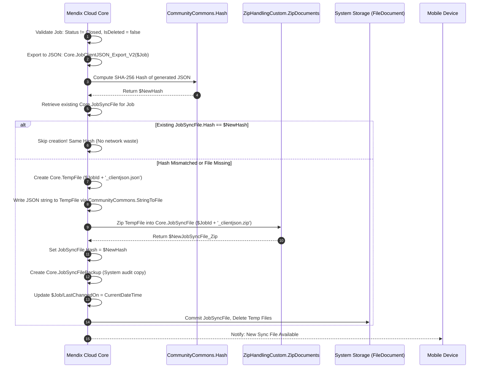
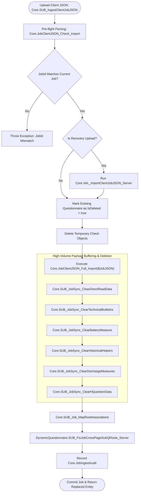
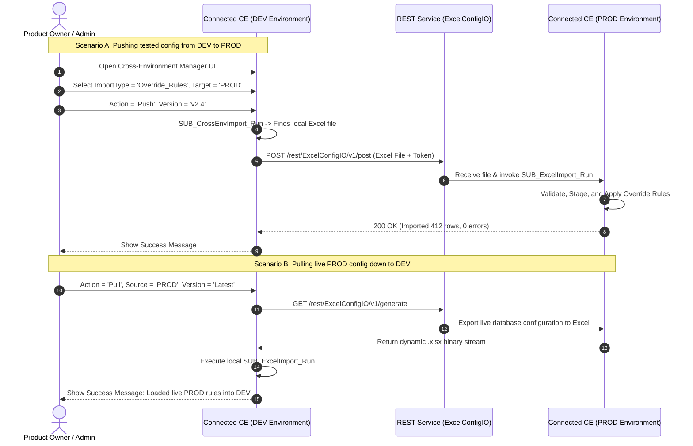
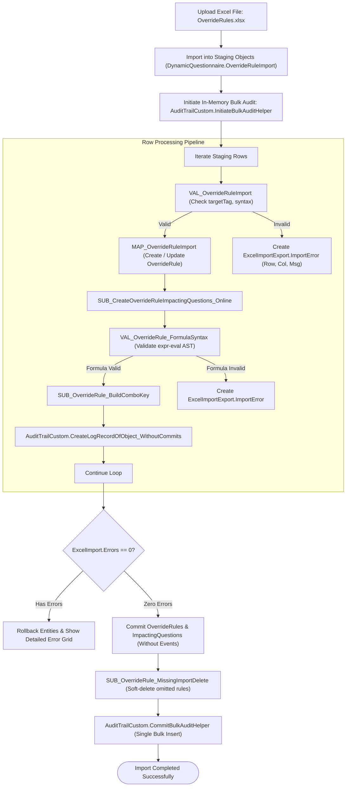
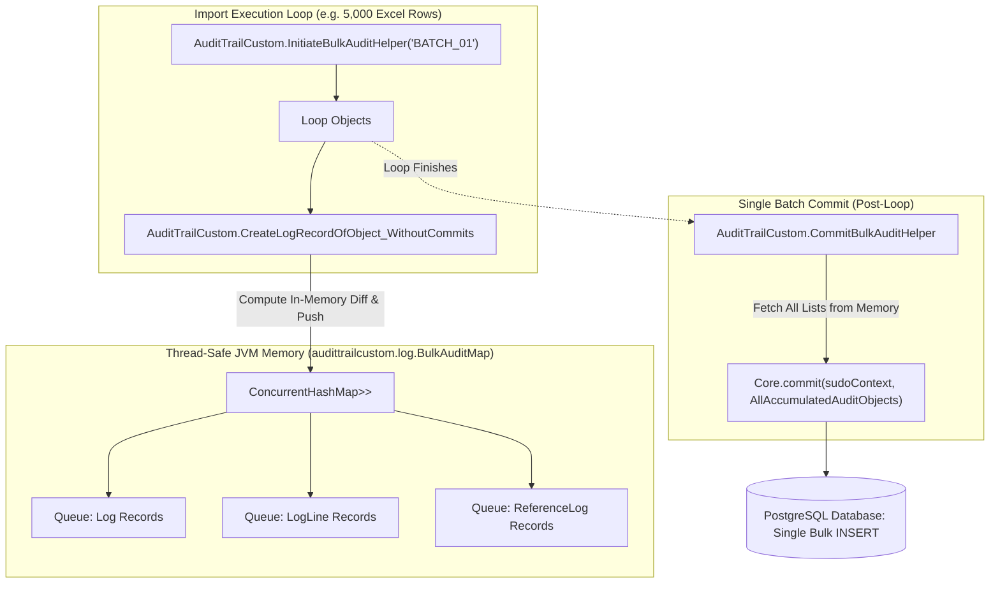
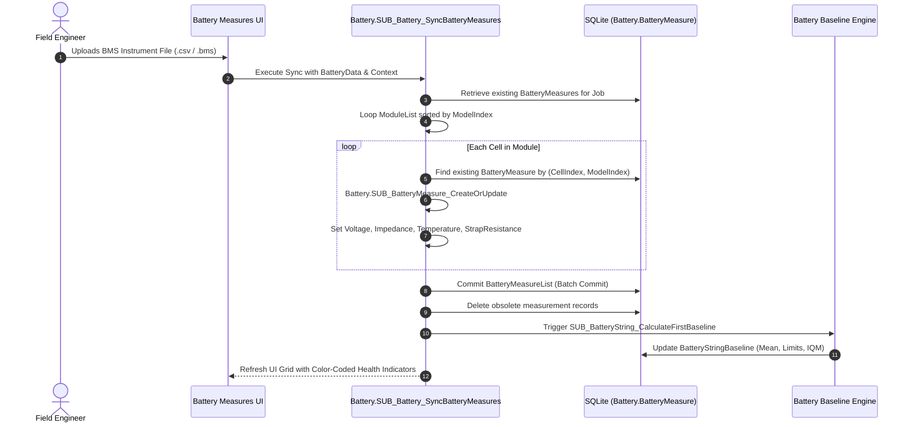
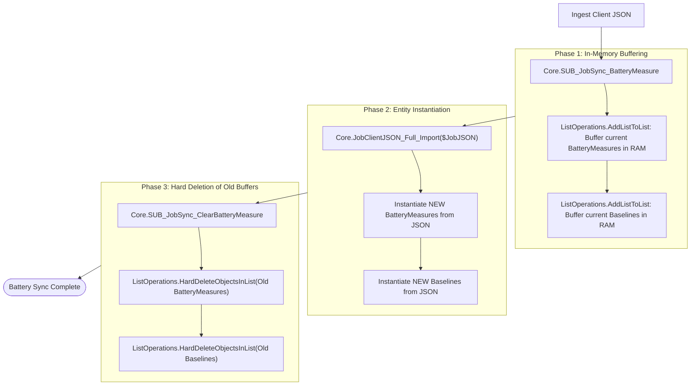

# Connected CE V2: Custom Sync, Cross-Environment Configuration & Data Pipeline Architecture Manual

> **Document Type:** Master Technical Reference & System Architecture Manual  
> **Target Audience:** Mendix Enterprise Architects, Mobile Engineers & Backend Developers  
> **Repository Root Reference:** [Connected CE V2.mpr](file:///Root/Connected%20CE%20V2.mpr)  
> **Key Modules Covered:** `Core`, `ClientImportExportMapping`, `ExcelImportExport`, `AuditTrailCustom`, `Battery`, `DynamicQuestionnaire`  

---

# Table of Contents
1. [Executive Summary & Core Architectural Principles](#executive-summary--core-architectural-principles)
2. [PART I: The Job Custom Sync Architecture](#part-i-the-job-custom-sync-architecture)
   - [1.1 Why Standard Mendix Offline Sync Was Abandoned for Jobs](#11-why-standard-mendix-offline-sync-was-abandoned-for-jobs)
   - [1.2 The Document Database Paradigm on SQLite](#12-the-document-database-paradigm-on-sqlite)
   - [1.3 Server-to-Client Pipeline: Job Packaging & Hashing](#13-server-to-client-pipeline-job-packaging--hashing)
   - [1.4 Client-Side Extraction & Native SQLite Ingestion](#14-client-side-extraction--native-sqlite-ingestion)
   - [1.5 Client-to-Server Pipeline: Native JSON Serialization Engine](#15-client-to-server-pipeline-native-json-serialization-engine)
   - [1.6 Server-Side Ingestion, Integrity Checking & Replacement Cascade](#16-server-side-ingestion-integrity-checking--replacement-cascade)
   - [1.7 Sync File Backups, Audit Logging & Recovery Mechanism](#17-sync-file-backups-audit-logging--recovery-mechanism)
3. [PART II: Cross-Environment Configuration & Excel Engine](#part-ii-cross-environment-configuration--excel-engine)
   - [2.1 The Business Dilemma: Configuration As Data](#21-the-business-dilemma-configuration-as-data)
   - [2.2 Cross-Environment Push/Pull Architecture (DEV → QA → PROD)](#22-cross-environment-pushpull-architecture-dev--qa--prod)
   - [2.3 REST Integration Layer: `REST_ExcelConfigIO_*`](#23-rest-integration-layer-rest_excelconfigio_)
   - [2.4 Complete Catalog of 34+ Supported Configuration Types](#24-complete-catalog-of-34-supported-configuration-types)
   - [2.5 Deep Walkthrough: Concrete Entity Example (`OverrideRule`)](#25-deep-walkthrough-concrete-entity-example-overriderule)
   - [2.6 Staging, Two-Phase Validation & Granular Error Badging](#26-staging-two-phase-validation--granular-error-badging)
4. [PART III: High-Performance Audit Trail Customization](#part-iii-high-performance-audit-trail-customization)
   - [3.1 Limitations of the Standard Marketplace Audit Trail](#31-limitations-of-the-standard-marketplace-audit-trail)
   - [3.2 The In-Memory Bulk Staging Engine (`BulkAuditHelper` & `BulkAuditMap`)](#32-the-in-memory-bulk-staging-engine-bulkaudithelper--bulkauditmap)
   - [3.3 The `VertivKey` Innovation (Cross-Environment Business Identity)](#33-the-vertivkey-innovation-cross-environment-business-identity)
   - [3.4 Character-Level Diffing via Google's `diff_match_patch`](#34-character-level-diffing-via-googles-diff_match_patch)
   - [3.5 Complete Java Action & Microflow Call Flow](#35-complete-java-action--microflow-call-flow)
5. [PART IV: Battery Measures Synchronization (The High-Volume Exception)](#part-iv-battery-measures-synchronization-the-high-volume-exception)
   - [4.1 Why Battery Data Breaks Standard Form Architectures](#41-why-battery-data-breaks-standard-form-architectures)
   - [4.2 Physical Reality: Jars, Blocks, Cells, Impedance & Thermal Drift](#42-physical-reality-jars-blocks-cells-impedance--thermal-drift)
   - [4.3 Device-Side Acquisition & BMS Parsing Engine](#43-device-side-acquisition--bms-parsing-engine)
   - [4.4 Statistical Baseline Calculation & IQM Health Indices](#44-statistical-baseline-calculation--iqm-health-indices)
   - [4.5 Dedicated Serialization Tree in Client Export Mapping](#45-dedicated-serialization-tree-in-client-export-mapping)
   - [4.6 Server-Side Ingestion: The Buffered Replacement Pattern](#46-server-side-ingestion-the-buffered-replacement-pattern)
6. [PART V: Complete Technical Reference & Data Schemas](#part-v-complete-technical-reference--data-schemas)
   - [5.1 Client Export Mapping Specification (JSON Schema)](#51-client-export-mapping-specification-json-schema)
   - [5.2 Job Sync File Data Structure](#52-job-sync-file-data-structure)
   - [5.3 Diagnostic & Chrome DevTools Debugging Playbook](#53-diagnostic--chrome-devtools-debugging-playbook)
   - [5.4 Developer Extension Recipes](#54-developer-extension-recipes)

---

# Executive Summary & Core Architectural Principles

In enterprise field service automation, modern equipment maintenance involves extreme environmental constraints, multi-tier data graphs, and dynamic configurations. 

While **Mendix** provides out-of-the-box offline synchronization and marketplace components, real-world field operations for **Connected CE V2** revealed critical architectural bottlenecks when operating at scale:
1. **Relational Delta Synchronization vs. Atomic Document Integrity:** Standard offline synchronization tracks record-level row deltas. In a complex inspection tree spanning hundreds of questions, signatures, attachments, and sub-forms, network drops during delta sync cause split-brain states and orphaned foreign keys.
2. **Metadata Velocity vs. Release Lifecycles:** Inspection logic changes weekly, while enterprise mobile binaries are deployed quarterly. The system treats questionnaire structure, conditional visibility, mathematical calculations, and equipment baselines strictly as **Data**, transported across environments via an automated Excel engine.
3. **Database Write amplification during Auditing:** High-frequency data imports (e.g. 10,000 rules) cause severe database locking under standard synchronous audit logging.
4. **High-Density Telemetry:** High-volume readings (such as battery cell impedance and discharge telemetry) cannot be normalized as individual questionnaire inputs without causing UI and SQLite latency.

This manual provides an in-depth technical analysis of the custom engineering subsystems built to overcome these limitations.

---

# PART I: The Job Custom Sync Architecture

## 1.1 Why Standard Mendix Offline Sync Was Abandoned for Jobs

Standard Mendix Native Mobile offline architecture relies on declarative entity synchronization:
- The modeler marks entities as *Synchronizable*.
- The Mendix client runtime introspects local SQLite tables and compares local commit flags with server timestamps.
- During a synchronization event (`mendix.lib.Sync`), the client packages changes and the server merges rows across tables using individual `INSERT` and `UPDATE` SQL statements.

```
┌────────────────────────────────────────────────────────────────────────┐
│             Why Standard Mendix Sync Fails for Enterprise Jobs         │
├───────────────────────────────────┬────────────────────────────────────┤
│ Problem in Field Reality          │ Result with Standard Mendix Sync   │
├───────────────────────────────────┼────────────────────────────────────┤
│ 1. Deep Entity Hierarchy          │ A single Job graph contains 15+    │
│    (Job -> Questionnaire -> Page  │ entity levels. Partial network     │
│    -> Question -> Option, etc.)   │ failures leave child rows orphaned.│
├───────────────────────────────────┼────────────────────────────────────┤
│ 2. Concurrent Field Operations    │ When 500 technicians sync at 8 AM, │
│    (High Cloud Server Contention) │ computing relational diffs across  │
│                                   │ normalized tables exhausts pools.  │
├───────────────────────────────────┼────────────────────────────────────┤
│ 3. Selective Job Portability      │ Field engineers must download or   │
│    (Targeted File Transfer)       │ export single jobs on demand       │
│                                   │ without syncing all other records. │
├───────────────────────────────────┼────────────────────────────────────┤
│ 4. Deterministic Backups          │ A single JSON file is trivial to   │
│    (Zero-Loss Disaster Recovery)  │ backup, email, inspect, or replay  │
│                                   │ if a physical tablet is damaged.   │
└───────────────────────────────────┴────────────────────────────────────┘
```

Because of these constraints, the engineering team designed an **Independent Document-Oriented Custom Synchronization Engine**.

---

## 1.2 The Document Database Paradigm on SQLite

Instead of synchronizing relational database tables row by row, the application treats an entire service visit as an **Atomic Document Package**:

```mermaid
flowchart LR
    subgraph Server_Cloud ["Mendix Cloud Runtime (PostgreSQL / SQL Server)"]
        RelJob[(Relational Job Tree)]
        ExportMap["Export Mapping: Core.JobClientJSON_Export_V2"]
        ZipEngine["Zip Document Engine (ZipHandlingCustom)"]
        SyncFileEntity["Core.JobSyncFile (Compressed Document)"]
    end

    subgraph Mobile_Device ["Offline Mobile Client (SQLite Store)"]
        UnzipEngine["JS Zip Extractor"]
        ClientImport["ClientImportExportMapping.ImportWithMapping"]
        LocalSQLite[(Local SQLite Tables)]
        ClientExport["ClientImportExportMapping.ExportWithMapping"]
    end

    RelJob -->|Compiled into JSON| ExportMap
    ExportMap -->|SHA-256 Hashed & Zipped| ZipEngine
    ZipEngine -->|Stored as FileDocument| SyncFileEntity
    SyncFileEntity -.->|HTTP File Download (Binary Stream)| UnzipEngine
    UnzipEngine -->|Parsed JSON Tree| ClientImport
    ClientImport -->|Instantiated Locally| LocalSQLite

    LocalSQLite -->|Serialized to JSON| ClientExport
    ClientExport -.->|Direct Document Upload| Server_Cloud
```

### The Three Invariants of the Document Sync Engine:
1. **Single Unit of Transfer:** A Job is packaged as a single, self-contained JSON file inside a compressed `.zip` container.
2. **Deterministic Hashing:** Before generating or downloading a package, the system computes a SHA-256 hash. If the payload hash matches the current state, data transfer is skipped entirely.
3. **Atomic Replacement on Ingest:** When the server receives an updated Job from a device, it does not execute messy field-by-field delta merges. It runs a validated replacement cascade, archiving the previous version and instantiating the new tree cleanly.

---

## 1.3 Server-to-Client Pipeline: Job Packaging & Hashing

The server generation pipeline is implemented in microflow [Core.SUB_JobSyncFile_Create](file:///Root/Connected%20CE%20V2.mpr).



### Key Server Microflows:
- **`Core.SUB_JobSyncFile_Create`**: The master compilation microflow.
  - Takes `$Job` (`Core.Job`).
  - Calls `Core.DS_Job_GetRootHQuestionnaire_Server` and `Core.DS_Job_GetQuestionnaire_Server`.
  - Executes export mapping `Core.JobClientJSON_Export_V2($Job)`.
  - Computes `CommunityCommons.Hash(value = $NewJSON)`.
  - Compares with `$JobSyncFile_Current/Hash`. If matching, exits cleanly.
  - Compresses JSON into `$Job/JobId + '_clientjson.zip'` via `ZipHandlingCustom.ZipDocuments`.
  - Calls `Core.SUB_JobSyncFileBackup_Create` to maintain historical recovery snapshots.
- **`Core.SUB_Job_CheckNewSyncFileRequired`**:
  - Compares timestamps between `Job/changedDate`, child questionnaire changes, and the existing `JobSyncFile/createdDate`.

---

## 1.4 Client-Side Extraction & Native SQLite Ingestion

When the mobile technician taps to synchronize or download an assigned job:

1. **Download Trigger:**  
   Nanoflow [Core.ACT_Job_DownloadLatestSyncFile](file:///Root/Connected%20CE%20V2.mpr) queries the server for the latest `Core.JobSyncFile` associated with the technician's `JobId`.
2. **File Extraction:**  
   Nanoflow [Core.SUB_JobSyncFile_TryExtract](file:///Root/Connected%20CE%20V2.mpr) invokes [Core.SUB_JobSyncFile_PerformExtraction](file:///Root/Connected%20CE%20V2.mpr):
   - Reads the `.zip` archive on the local mobile filesystem.
   - Unzips the inner payload file: `$JobId + '_clientjson.json'`.
3. **In-Memory Deserialization & Object Mapping:**  
   Nanoflow calls JavaScript Action [ClientImportExportMapping.ImportWithMapping_returnObject](file:///Root/javascriptsource/clientimportexportmapping/actions/ImportWithMapping_returnObject.js):
   - Passes the JSON text and the client import mapping descriptor [Core.SUB_Job_GetClientJSONMapping_Import](file:///Root/Connected%20CE%20V2.mpr).
   - The engine (implemented in [ImportJsonHelper.js](file:///Root/javascriptsource/clientimportexportmapping/implementation/ImportJsonHelper.js)) traverses the JSON tree and instantiates Mendix offline entities directly into the local SQLite store.
4. **Deferred File Writing:**  
   Any base64-encoded images, attachments, or signature canvases are extracted and scheduled via `pendingFiles`, ensuring files are saved to the device disk only *after* the parent database records are safely committed.

---

## 1.5 Client-to-Server Pipeline: Native JSON Serialization Engine

When the field engineer completes work or updates an inspection offline, the mobile client must serialize the active database state back into a JSON document.

### The Problem with Client-Side Nanoflows:
Mendix Nanoflows cannot run standard Mendix XML/JSON export mappings because Mendix export mapping documents are server-side Java constructs.

### The Solution: `ClientImportExportMapping.ExportWithMapping`
The project features a native JavaScript serialization engine:
- **Location:** [ExportWithMapping.js](file:///Root/javascriptsource/clientimportexportmapping/actions/ExportWithMapping.js)
- **Mapping Provider:** [Core.SUB_Job_GetClientJSONMapping_Export](file:///Root/Connected%20CE%20V2.mpr)

#### How `ExportWithMapping.js` Traverses the Entity Tree:

```javascript
// Excerpt from Root/javascriptsource/clientimportexportmapping/actions/ExportWithMapping.js
async function serializeMxObject(mxObject, eMap) {
    if (!mxObject) return null;
    
    // Sort attributes and associations alphabetically to ensure deterministic hashing
    const attributes = mxObject.getPrimitives().sort();
    const associations = eMap.Associations.sort((a, b) => a.JsonName.localeCompare(b.JsonName));
    let res = {};

    // 1. Serialize all primitive attributes (filtering by Include / Exclude rules)
    for (let i = 0; i < attributes.length; i++) {
        await serializeMxAttribute(mxObject, res, attributes[i], eMap);
    }

    // 2. Recursively traverse all configured associations
    for (let i = 0; i < associations.length; i++) {
        const assoc = associations[i];
        await serializeMxAssociation(mxObject, res, assoc);
    }
    return res;
}
```

#### Association Retrieval Modes (`FindType`):
- **`Path` (Default):** Uses `mx.data.get({ xpath: ... })` or object reference traversal (`retrieveByPath.js`) to follow Mendix associations in local SQLite memory.
- **`Database`:** Uses `retrieveByKey.js` to execute foreign key lookups against local SQLite indices.

#### Automatic File & Image Encoding:
If an entity inherits from `System.FileDocument` or `System.Image`, `ExportWithMapping.js` reads the file binary stream from mobile flash storage, encodes it into a standard **base64 string**, and embeds it under the `"Contents"` JSON property.

---

## 1.6 Server-Side Ingestion, Integrity Checking & Replacement Cascade

When the JSON document is uploaded to the cloud server, it is processed by [Core.SUB_IngestClientJobJSON](file:///Root/Connected%20CE%20V2.mpr).



### Detailed Server Ingest Steps:
1. **Pre-flight Validation:**  
   The microflow first imports the JSON into temporary staging entities using `Core.JobClientJSON_Check_Import`. It asserts that `ImportedJob.JobId == CurrentJob.JobId`. If mismatched, execution halts with a security exception.
2. **Old Questionnaire Soft-Deletion:**  
   To prevent unique constraint collisions and preserve historical audit links, existing child questionnaires linked to the job are retrieved and flagged with `IsDeleted = true`.
3. **Full Relational Instantiation:**  
   The server runs `Core.JobClientJSON_Full_Import($JobJSON)`, instantiating the new tree of `Questionnaire`, `Page`, `Question`, and `Option` records.
4. **Buffered Payload Replacement:**  
   Special high-density payloads (Direct Read, Technical Bulletins, Battery Measures) are cleaned up using specialized sub-microflows.
5. **Root Association Mapping:**  
   Calls `Core.SUB_Job_MapRootAssociations` and `DynamicQuestionnaire.SUB_FixJobCrossPageSubQRoots_Server` to re-bind root foreign keys across pages and repeatable sub-questionnaires.

---

## 1.7 Sync File Backups, Audit Logging & Recovery Mechanism

Field operations cannot afford data loss due to unexpected server crashes or network timeouts.

### The Triad of Disaster Recovery:
1. **`Core.JobSyncFileBackup`:**  
   Every generated or ingested JSON is archived in `Core.JobSyncFileBackup` with its origin (`Server` vs `Device`), creation timestamp, and SHA-256 hash.
2. **`Core.JobIngestAudit`:**  
   Maintains a 40-attribute audit log recording:
   - Client App Version, Device OS, Battery Level during upload.
   - Count of Questions answered, Count of Photos captured.
   - Processing duration in milliseconds across every ingest phase.
3. **Recovery Import Portal:**  
   If a mobile device is damaged or dropped in water, but the engineer managed to export the local JSON file to an SD card or email, an administrator can open the web portal, navigate to `Core.JobManagement`, and invoke `Core.ACT_ImportClientJobJSON_UploadFile`. The server runs the recovery pipeline (`fromRecovery = true`), executing strict schema validations before adopting the imported data.

---

# PART II: Cross-Environment Configuration & Excel Engine

## 2.1 The Business Dilemma: Configuration As Data

In large field service systems, the application code (Mendix MPR) represents the **Form Player**, while the actual business forms (HVAC Inspection Checklists, Safety Regulations, Calculation Formulas, Validation Thresholds) represent the **Sheet Music**.

```
┌────────────────────────────────────────────────────────────────────────┐
│                        Why Code Deployments Fail                       │
├────────────────────────────────────────────────────────────────────────┤
│ • Deploying an MPR requires IT change management, downtime, and        │
│   extensive regression testing.                                        │
│ • Business analysts and safety officers author form rules in Excel.    │
│ • Rules must be promoted seamlessly from DEV → TEST → STAGING → PROD.  │
│ • Rolling back a broken inspection rule must take 30 seconds, not      │
│   a 4-hour emergency hotfix release.                                   │
└────────────────────────────────────────────────────────────────────────┘
```

The `ExcelImportExport` module acts as a **Zero-Code Configuration Migration Engine**.

---

## 2.2 Cross-Environment Push/Pull Architecture (DEV → QA → PROD)

Instead of using database migration scripts, administrators use the **Cross-Environment Manager UI** ([ExcelImportExport.EnvConfigManager](file:///Root/Connected%20CE%20V2.mpr)).



---

## 2.3 REST Integration Layer: `REST_ExcelConfigIO_*`

The module exposes and consumes three high-speed REST operations:
- **`REST_ExcelConfigIO_Post`**: Pushes a local `ExcelImport` file document across network boundaries to a remote Mendix node.
- **`REST_ExcelConfigIO_Generate`**: Instructs the target environment to query its local database, compile an Excel spreadsheet containing the latest live configuration, and stream it back.
- **`REST_ExcelConfigIO_Version`**: Pulls an immutable, historically versioned Excel snapshot from the target repository.

Security is governed by token authentication and role checking: both ends require the calling user to hold the `Core.FormDeveloper` or `Core.ITAdmin` user roles.

---

## 2.4 Complete Catalog of 34+ Supported Configuration Types

Dispatched by [ExcelImportExport.SUB_ExcelImport_Run](file:///Root/Connected%20CE%20V2.mpr), the engine supports 34 distinct business domains:

| # | Import Type Enumeration Key | Target Microflow | Business Domain & Data Managed |
| :--- | :--- | :--- | :--- |
| 1 | `Structural_QConfig` | `DynamicQuestionnaire.ACT_ImportStructuralQConfig` | Complete Questionnaire, Page, and Question hierarchy. |
| 2 | `Override_Rules` | `DynamicQuestionnaire.ACT_ImportOverrideRules` | Dynamic visibility formulas (`{tagId} == 'val'`). |
| 3 | `Calculate_Rules` | `DynamicQuestionnaire.ACT_ImportCalculateRules` | Mathematical calculations and formula engines. |
| 4 | `Validation_Rules` | `DynamicQuestionnaire.ACT_ImportValidationRules` | Custom field constraints and error messages. |
| 5 | `All_Base_Rules` | `DynamicQuestionnaire.ACT_ImportAllBaseRules_byStaging` | Consolidated Region, Model, VisitType, and TechFamily rules. |
| 6 | `Battery_Dataset` | `MasterData.ACT_ImportBatteryDataSet` | Manufacturer battery specifications and baseline tables. |
| 7 | `Model_Base_Rules` | `Models.ACT_ImportModelBaseRule` | Equipment model code compatibility mappings. |
| 8 | `Region_Rules` | `DynamicQuestionnaire.ACT_ImportRegionRules` | Geographic operating unit filtering. |
| 9 | `Visit_Type_Rules` | `DynamicQuestionnaire.ACT_ImportVisitTypeRules` | PM, Emergency, Commissioning filter rules. |
| 10 | `Tech_Family_Rules` | `DynamicQuestionnaire.ACT_ImportTechFamilyRules` | Electrical, HVAC, Mechanical skill restrictions. |
| 11 | `Sync_Config` | `RelayConnector.ACT_ImportSyncConfig` | External ERP/EBS integration sync settings. |
| 12 | `Parameter_Table` | `Models.ACT_ImportParameterTable` | Equipment operating parameter boundaries. |
| 13 | `Translations` | `Translations.ACT_ImportTranslations` | Multi-language question labels and UI captions. |
| 14 | `PDF_Template` | `PDFs.ACT_ImportPdfTemplates` | Inspection report layout templates. |
| 15 | `Documentation_Links` | `Core.ACT_ImportDocumentationLinks` | Links to external SOPs and equipment manuals. |
| 16 | `Companies` | `Company.ACT_ImportCompanies` | Service partner and subcontractor directories. |
| 17 | `Visit_Types` | `MasterData.ACT_ImportVisitTypes` | Master list of service visit classifications. |
| 18 | `Model_Rules` | `Models.ACT_ImportModelRules` | Model group definitions and hierarchy. |
| 19 | `LifecycleData` | `MasterData.ACT_ImportLifecycle` | Equipment lifecycle milestones and obsolescence. |
| 20 | `Local_Data` | `MasterData.ACT_ImportLocalData` | Localized client lookup tables. |
| 21 | `States_and_Countries`| `MasterData.ACT_ImportStatesAndCountries` | Global geographic address references. |
| 22 | `Power_Supplies` | `MasterData.ACT_ImportPowerSupplies` | Electrical grid power supply specifications. |
| 23 | `Pivot_Import_Configs`| `PivotDataImporter.ACT_ImportPivotImportConfig` | Config for multi-dimensional data importers. |
| 24 | `Selectable_Rated_Voltage`| `MasterData.ACT_ImportSelectableRatedVoltage`| Master nominal voltage rating options. |
| 25 | `Customers` | `Customer.ACT_ImportCustomers` | Commercial account master records. |
| 26 | `Quality_Feedback` | `MasterData.ACT_ImportQualityFeedback` | Field quality issue classification codes. |
| 27 | `Email_Templates` | `Email_Connector.ACT_ImportEmailTemplates` | Automated customer sign-off email notifications. |
| 28 | `NextPredict_Items` | `MasterData.ACT_ImportNextPredictItems` | AI/ML predictive maintenance component catalog. |
| 29 | `PartDemandConfig` | `MasterData.ACT_ImportPartDemandConfig` | Spare parts demand forecasting configuration. |
| 30 | `NextPredict_Validations`| `MasterData.ACT_ImportNextPredictValidation` | Validation rules for predictive telemetry. |
| 31 | `Voice_to_Answer_Configs`| `LocalVoiceToAnswer.ACT_ImportVoiceToAnswerConfig`| Voice dictation NLP token mapping rules. |
| 32 | `Page_AI_Details` | `DynamicQuestionnaire.ACT_ImportPageAIDetails` | AI copilot contextual page guidance prompts. |
| 33 | `Tag_AI_Details` | `DynamicQuestionnaire.ACT_ImportTagAIDetails` | AI copilot question-specific diagnostic guidance. |
| 34 | `Root_Cause` | `MasterData.ACT_ImportRootCause` | Root cause failure analysis hierarchy. |

---

## 2.5 Deep Walkthrough: Concrete Entity Example (`OverrideRule`)

To understand the internal mechanics, let’s dissect the complete lifecycle of importing **`OverrideRule`** records via microflow [DynamicQuestionnaire.ACT_ImportOverrideRules](file:///Root/Connected%20CE%20V2.mpr).



### Step 1: Staging Import
The microflow uses Mendix Import Mapping `DynamicQuestionnaire.OverrideRuleImportMapping` to read sheet rows into non-persistent staging entities (`DynamicQuestionnaire.OverrideRuleImport`). This isolates raw spreadsheet values from production database entities.

### Step 2: Row Validation (`VAL_OverrideRuleImport`)
Each staging row is checked:
- Does the `TargetTagId` exist in `QuestionConfig`?
- Is the `ResultVisibility` a valid enumeration (`M`, `O`, `S`, `NA`, `I`)?
- Is the row number tracked (`RowNumber = $currentIndex + 3`)?

### Step 3: Entity Mapping (`MAP_OverrideRuleImport`)
The engine matches an existing `DynamicQuestionnaire.OverrideRule` by unique identifier or instantiates a new record. Attributes are updated:
- `Formula` $\leftarrow$ `OverrideRuleImport/Formula`
- `IsDeleted` $\leftarrow$ `false`
- `LastImportedOn` $\leftarrow$ `[%CurrentDateTime%]`

### Step 4: Inverted Dependency Indexing
Calls `DynamicQuestionnaire.SUB_CreateOverrideRuleImpactingQuestions_Online`:
- Regex extracts every tag inside braces `{...}` in the formula.
- Creates `OverrideRuleImpactingQuestion` child records, ensuring instant lookups on mobile SQLite.

### Step 5: Formula Abstract Syntax Tree (AST) Check
Calls `DynamicQuestionnaire.VAL_OverrideRule_FormulaSyntax`:
- Parses the formula using the JavaScript `expr-eval` parser.
- Asserts that all referenced variables are valid, avoiding runtime crashes on devices.

### Step 6: In-Memory Audit Staging
- Builds a business key via `DynamicQuestionnaire.SUB_OverrideRule_BuildComboKey`.
- Calls Java Action `AuditTrailCustom.CreateLogRecordOfObject_WithoutCommits`, staging audit lines in RAM without database commits.

### Step 7: Atomic Two-Phase Commit
If any row fails validation:
- All changes are rolled back.
- Detailed `ExcelImportExport.ImportError` records are presented in the admin UI.
If all rows pass:
- Entities are committed in bulk without events (`commit ... without events refresh`).
- Omitted rules are soft-deleted via `DynamicQuestionnaire.SUB_OverrideRule_MissingImportDelete`.
- The entire batch of audit logs is committed via `AuditTrailCustom.CommitBulkAuditHelper`.

---

## 2.6 Staging, Two-Phase Validation & Granular Error Badging

When a non-technical user imports an Excel file with 2,000 rows, a generic *"Import failed"* error message is useless.

The `ExcelImportExport` engine provides **Cell-Level Error Reporting**:
- Entity `ExcelImportExport.ImportError`:
  - `Row` (Integer): Exact Excel spreadsheet row number (e.g. `Row 42`).
  - `Column` (String): Header column name (e.g. `'Formula'`).
  - `Message` (String): Specific failure reason (e.g. *"Tag {Q_TEMP_OUT} referenced in formula does not exist in QuestionConfig"*).
- The admin page displays an interactive Data Grid highlighting exact cells requiring correction, preventing broken configurations from entering the system.

---

# PART III: High-Performance Audit Trail Customization

## 3.1 Limitations of the Standard Marketplace Audit Trail

The standard Mendix Marketplace `AuditTrail` module logs changes by subscribing to entity `beforeCommit` events or calling `CreateLogRecordOfObject`.

### Why Standard Audit Trail Causes Performance Bottlenecks:
1. **Synchronous Commit Overhead:** For every changed attribute on an entity, standard AuditTrail executes individual database `INSERT` statements for `Log` and `LogLine`. When importing 5,000 rules, this results in over 30,000 database round-trips within a single transaction, frequently causing database connection timeouts.
2. **Auto-Increment ID Fragility:** Standard AuditTrail identifies objects by their internal Mendix auto-increment ID (`123456789`). When data is migrated across environments (DEV $\rightarrow$ TEST $\rightarrow$ PROD), internal database IDs change, breaking audit trail history across environments.

---

## 3.2 The In-Memory Bulk Staging Engine (`BulkAuditHelper` & `BulkAuditMap`)

To solve this, the engineering team developed **`AuditTrailCustom`**.



### Key Java Architecture Components:
- **[BulkAuditMap.java](file:///Root/javasource/audittrailcustom/log/BulkAuditMap.java):**  
  Maintains thread-safe in-memory collections of pending audit records keyed by `MemoryListName`:
  ```java
  public static ConcurrentHashMap<String, Map<AuditListTypes, List<IMendixObject>>> bulkAuditMap;
  ```
- **[CreateLogRecordOfObject_WithoutCommits.java](file:///Root/javasource/audittrailcustom/actions/CreateLogRecordOfObject_WithoutCommits.java):**  
  Uses Mendix Core Java API reflection (`IMendixObject.getMembers()`) to compare current values against original database values. It constructs `Log` and `LogLine` objects in memory and buffers them in `BulkAuditMap` without invoking database commits.
- **[CommitBulkAuditHelper.java](file:///Root/javasource/audittrailcustom/actions/CommitBulkAuditHelper.java):**  
  Executes after the business loop completes. It pulls all accumulated `Log`, `LogLine`, and `ReferenceLog` instances and commits them to the database in a single batch, reducing audit write overhead by over 95%.

---

## 3.3 The `VertivKey` Innovation (Cross-Environment Business Identity)

To maintain consistent audit traceability across different environments, `AuditTrailCustom` introduces the **`VertivKey`**:
- In [CreateLogObject.java](file:///Root/javasource/audittrailcustom/log/CreateLogObject.java):
  ```java
  logObject.setValue(sudoContext, Log.MemberNames.VertivKey.toString(), vertivKey);
  ```
- **What is `VertivKey`?**  
  It is an immutable composite business key representing the object across environments (for example: `OverrideRule_Q_CHILLER_PRESS_HIGH` or `QuestionConfig_TAG_OIL_TEMP`).
- Even when an entity has ID `1001` in DEV, ID `4502` in TEST, and ID `98231` in PROD, audit queries filtering by `VertivKey` return the complete modification history of that configuration across its entire enterprise lifecycle.

---

## 3.4 Character-Level Diffing via Google's `diff_match_patch`

For long text fields, mathematical expressions, and formula configurations, standard before-and-after logging is insufficient for debugging subtle syntax changes.

The module embeds Google's **`diff_match_patch`** algorithm:
- **Source:** [diff_match_patch.java](file:///Root/javasource/audittrailcustom/log/diff_match_patch.java)
- Computes character-level insertion and deletion diffs (e.g. detecting that a formula changed from `{TEMP} > 100` to `{TEMP} >= 100`).
- Stores human-readable visual diffs inside `LogLine.DiffText`, allowing administrators to see exact character modifications in the audit viewer.

---

## 3.5 Complete Java Action & Microflow Call Flow

```
1. Initiate:
   $NewBulkAuditHelper = AuditTrailCustom.InitiateBulkAuditHelper(MemoryListName)

2. Loop Iteration:
   $ComboKey = DynamicQuestionnaire.SUB_OverrideRule_BuildComboKey($OverrideRule)
   $NewLog = AuditTrailCustom.CreateLogRecordOfObject_WithoutCommits(
                 AuditableObject = $OverrideRule,
                 VertivKey = $ComboKey,
                 BulkAuditHelper = $NewBulkAuditHelper
             )

3. Finalize:
   AuditTrailCustom.CommitBulkAuditHelper($NewBulkAuditHelper)
```

---

# PART IV: Battery Measures Synchronization (The High-Volume Exception)

## 4.1 Why Battery Data Breaks Standard Form Architectures

During preventive maintenance of Uninterruptible Power Supply (UPS) systems and data center power rooms, technicians inspect massive battery banks.

```
┌────────────────────────────────────────────────────────────────────────┐
│                      The Scale of Battery Testing                      │
├────────────────────────────────────────────────────────────────────────┤
│ • 1 to 4 Parallel Battery Strings per UPS system                       │
│ • 30 to 60 Battery Jars/Blocks per String                              │
│ • 1 to 6 Internal Cells per Jar                                        │
│ • Measurements: Float Voltage, Internal Resistance (mΩ),               │
│   Inter-tier Connection Resistance (µΩ), Temperature (°C)             │
│ • Discharge Tests: Voltage time-series sampled every 30 seconds        │
│ ────────────────────────────────────────────────────────────────────── │
│ Total data points per inspection: 800 to 2,500 numeric values          │
└────────────────────────────────────────────────────────────────────────┘
```

If these 2,000 data points were modeled as standard questions in `DynamicQuestionnaire.Question`:
1. The question tree would balloon to 2,500 entities per job.
2. The UI renderer would choke iterating thousands of snippet widgets.
3. The reactive on-change engine would lag evaluating cross-question dependencies.

To keep the application responsive, battery data is decoupled into a dedicated high-performance module: **`Battery`**.

---

## 4.2 Physical Reality: Jars, Blocks, Cells, Impedance & Thermal Drift

```
┌────────────────────────────────────────────────────────────────────────┐
│                        Battery Physical Topology                       │
└────────────────────────────────────────────────────────────────────────┘
  [ Battery String 1 (e.g., 480V DC Bus) ]
    ├── Jar 1 (Block 1) ──> [ Cell 1: 2.25V, 1.2mΩ ] [ Cell 2: 2.24V, 1.2mΩ ]
    ├── Jar 2 (Block 2) ──> [ Cell 1: 2.26V, 1.3mΩ ] [ Cell 2: 2.25V, 1.2mΩ ]
    │   ...
    └── Jar 40 (Block 40) ─> [ Cell 1: 2.21V, 1.8mΩ (ALERT: High Impedance!) ]
```

Field technicians use handheld electronic battery analyzers (Fluke 500 Series, Megger BITE, Hioki, Alber Cellcorder). These instruments export structured data files via Bluetooth, USB, or CSV/BMS exports.

---

## 4.3 Device-Side Acquisition & BMS Parsing Engine

Rather than typing 2,000 numbers manually into text boxes:
1. The technician uploads a BMS instrument data file or Excel report on their mobile tablet.
2. Nanoflow `Battery.SUB_Battery_ParseAndValidateBMS` parses the file into transient memory entities (`Battery.BatteryData`, `Battery.Module`, `Battery.CellInfo`).
3. Nanoflow [Battery.SUB_Battery_SyncBatteryMeasures](file:///Root/Connected%20CE%20V2.mpr) maps and synchronizes this telemetry into persistent mobile records:



---

## 4.4 Statistical Baseline Calculation & IQM Health Indices

Immediately upon synchronization, the device computes mathematical baselines via [Battery.SUB_BatteryString_CalculateFirstBaseline](file:///Root/Connected%20CE%20V2.mpr):
- **Mean String Voltage:**

  $$\mu_V = \frac{1}{N} \sum_{i=1}^{N} V_i$$

- **Mean Internal Resistance:**

  $$\mu_R = \frac{1}{N} \sum_{i=1}^{N} R_i$$

- **Impedance Variance Thresholds:**
  - Warning Threshold: $\mu_R \times 1.10$ (+10% deviation)
  - Critical Replacement Threshold: $\mu_R \times 1.20$ (+20% deviation)
- **IQM Index:**  
  Calculates the Interquartile Mean to eliminate measurement outliers (e.g. bad probe contact) and stores the resulting baselines in entity `Battery.BatteryStringBaseline`.

---

## 4.5 Dedicated Serialization Tree in Client Export Mapping

Because battery telemetry is decoupled from `DynamicQuestionnaire.Question`, how does it travel to the server during custom sync?

In [Core.SUB_Job_GetClientJSONMapping_Export](file:///Root/Connected%20CE%20V2.mpr), the JSON export descriptor defines dedicated branches:

```json
{
    "AssociationName": "Battery.BatteryMeasure_Job",
    "AssociationCardinality": "many",
    "JsonName": "BatteryMeasures",
    "EntityName": "Battery.BatteryMeasure",
    "Attributes": [
        "val_bat_measure_point_no_data_table",
        "val_bat_block_data_table",
        "val_bat_voltage",
        "val_bat_resistance",
        "val_bat_strap_resistance",
        "val_bat_temperature",
        "val_bat_is_valid",
        "val_bat_iqm_status"
    ]
},
{
    "AssociationName": "Battery.DischargeMeasures_Job",
    "AssociationCardinality": "many",
    "JsonName": "DischargeMeasures",
    "EntityName": "Battery.DischargeMeasures",
    "Associations": [
        {
            "AssociationName": "Battery.DischargeMeasures_VoltagePerTimestamp_DischargeMeasures",
            "AssociationCardinality": "many",
            "JsonName": "VoltagePerTimestamps",
            "EntityName": "Battery.DischargeMeasures_VoltagePerTimestamp"
        }
    ]
},
{
    "AssociationName": "Battery.BatteryStringBaseline_Job",
    "AssociationCardinality": "many",
    "JsonName": "BatteryStringBaseline",
    "EntityName": "Battery.BatteryStringBaseline"
}
```

This guarantees that thousands of battery readings travel inside the same atomic job JSON package without touching the questionnaire question tables.

---

## 4.6 Server-Side Ingestion: The Buffered Replacement Pattern

On the cloud server, processing 2,000 updated battery readings requires special care to avoid foreign key deadlocks and unique constraint violations.

In [Core.SUB_IngestClientJobJSON](file:///Root/Connected%20CE%20V2.mpr), the server executes a **Buffered Replacement Pattern**:



### Why This Pattern is Critical:
1. If the server deleted old battery measures *before* running the import, any network or mapping failure during import would leave the job with zero battery data.
2. If the server attempted to *update* existing records in place, matching 2,000 incoming records against 2,000 database rows would require expensive nested loops or multiple queries.
3. By pre-buffering old records in memory, importing the new batch directly, and hard-deleting the buffered list via `ListOperations.HardDeleteObjectsInList`, the operation executes in milliseconds with minimal database transaction log overhead.

---

# PART V: Complete Technical Reference & Data Schemas

## 5.1 Client Export Mapping Specification (JSON Schema)

The client export engine is driven by a JSON structure passed to `ClientImportExportMapping.ExportWithMapping`:

```json
{
  "$schema": "http://json-schema.org/draft-07/schema#",
  "title": "ClientExportMappingDescriptor",
  "type": "object",
  "properties": {
    "EntityName": { "type": "string", "example": "Core.Job" },
    "AttributeType": { "type": "string", "enum": ["Include", "Exclude"] },
    "Attributes": { 
      "type": "array", 
      "items": { "type": "string" } 
    },
    "Associations": {
      "type": "array",
      "items": {
        "type": "object",
        "properties": {
          "AssociationName": { "type": "string" },
          "AssociationCardinality": { "type": "string", "enum": ["one", "many"] },
          "FindType": { "type": "string", "enum": ["Path", "Database"] },
          "ForeignKey": { "type": "string" },
          "JsonName": { "type": "string" },
          "EntityName": { "type": "string" },
          "AttributeType": { "type": "string", "enum": ["Include", "Exclude"] },
          "Attributes": { "type": "array", "items": { "type": "string" } },
          "Associations": { "type": "array" }
        },
        "required": ["AssociationName", "AssociationCardinality", "JsonName", "EntityName"]
      }
    }
  },
  "required": ["EntityName", "Associations"]
}
```

---

## 5.2 Job Sync File Data Structure

Inside `$JobId + '_clientjson.zip'`, the decompressed file `$JobId + '_clientjson.json'` follows this structure:

```json
{
  "JobId": "JOB-2026-9821",
  "Job_Number": "JN-9821",
  "Status": "Assigned",
  "organization_region": "UK",
  "EquipmentModel": "CHILLER-MOD-X",
  "LastChangedOn": "2026-10-13T06:55:00.000Z",
  "Questionnaires": [
    {
      "QuestionnaireId": "Q-UUID-9821-001",
      "Description": "Commercial Chiller Annual Maintenance",
      "Pages": [
        {
          "PageId": "P-01",
          "Title": "Safety and PPE",
          "SortOrder": 1,
          "Questions": [
            {
              "tagId": "Q_PPE_VERIFIED",
              "QuestionType": "Radio",
              "ResultVisibility": "M",
              "AnswerValueString": "Pass",
              "SelectedOption": { "Key": "PASS" }
            },
            {
              "tagId": "Q_OIL_LEAK_FOUND",
              "QuestionType": "Radio",
              "ResultVisibility": "M",
              "AnswerValueString": "Yes",
              "SelectedOption": { "Key": "YES" }
            }
          ]
        }
      ]
    }
  ],
  "BatteryMeasures": [
    {
      "val_bat_measure_point_no_data_table": 1,
      "val_bat_block_data_table": 1,
      "val_bat_voltage": 2.25,
      "val_bat_resistance": 1.20,
      "val_bat_strap_resistance": 15.2,
      "val_bat_temperature": 23.5,
      "val_bat_is_valid": true
    }
  ],
  "BatteryStringBaseline": [
    {
      "val_bat_string_no": 1,
      "val_bat_string_voltage_baseline": 480.2,
      "val_bat_string_resistance_baseline": 1.21,
      "val_bat_string_resistance_threshold_warning": 1.33,
      "val_bat_string_resistance_threshold_critical": 1.45
    }
  ]
}
```

---

## 5.3 Diagnostic & Chrome DevTools Debugging Playbook

### 1. Enabling Client-Side Debugging:
Open the browser developer console on your device or via `chrome://inspect` and set the debug cookie:
```javascript
// Triggers an immediate JavaScript breakpoint inside ExportWithMapping.js
document.cookie = "debugJsonExport=true; path=/";
```

### 2. Inspecting Local SQLite Entities:
Query any object graph directly in device memory:
```javascript
// Verify that BatteryMeasures are populated locally
mx.data.get({
    xpath: "//Battery.BatteryMeasure[val_bat_block_data_table=1]",
    callback: function(measures) {
        console.table(measures.map(m => ({
            Cell: m.get("val_bat_measure_point_no_data_table"),
            Voltage: m.get("val_bat_voltage"),
            Impedance: m.get("val_bat_resistance")
        })));
    }
});
```

### 3. Server-Side Log Nodes to Monitor:
- **`Core.CONST_CustomSync_LogNode`**: Tracks sync file packaging, hashing, and JSON ingest operations.
- **`ExcelImportExport.CONST_LogNode`**: Tracks Excel parsing, staging, and cross-environment push/pull operations.
- **`AuditTrailCustom.CONST_LogNode`**: Tracks in-memory bulk audit creation and batch commit timings.

---

## 5.4 Developer Extension Recipes

### Recipe A: Adding a New Synced Child Entity to Job
1. **Update Domain Model:** Add the association (e.g. `Core.Job_NewChildEntity`).
2. **Update Export Mapping Descriptor:** Open [Core.SUB_Job_GetClientJSONMapping_Export](file:///Root/Connected%20CE%20V2.mpr), append the association descriptor block into the JSON mapping string under `Associations`.
3. **Update Server Export Mapping:** Open [Core.JobClientJSON_Export_V2](file:///Root/Connected%20CE%20V2.mpr), add the new child entity and attribute mappings.
4. **Update Server Import Mapping:** Open [Core.JobClientJSON_Full_Import](file:///Root/Connected%20CE%20V2.mpr), map the new JSON node to the target entity.
5. **Update Cleanup Microflow:** If the entity requires replacement buffering, add a cleanup call in `Core.SUB_IngestClientJobJSON`.

### Recipe B: Adding a New Configuration Type to the Excel Engine
1. **Update Enumeration:** Add a new key to `ExcelImportExport.ENUM_ImportType`.
2. **Create Staging Entity:** Create `MyConfigImport` in your module.
3. **Create Excel Import Mapping:** Build an import mapping from Excel sheet columns to `MyConfigImport`.
4. **Implement Import Action:** Build `ACT_ImportMyConfig(ExcelImport)` following the 7-step pattern demonstrated in `DynamicQuestionnaire.ACT_ImportOverrideRules`.
5. **Register in Dispatcher:** Open [ExcelImportExport.SUB_ExcelImport_Run](file:///Root/Connected%20CE%20V2.mpr) and add a branch for the new enumeration value.

---

*This document is maintained as the authoritative system integration specification for Connected CE V2.*
