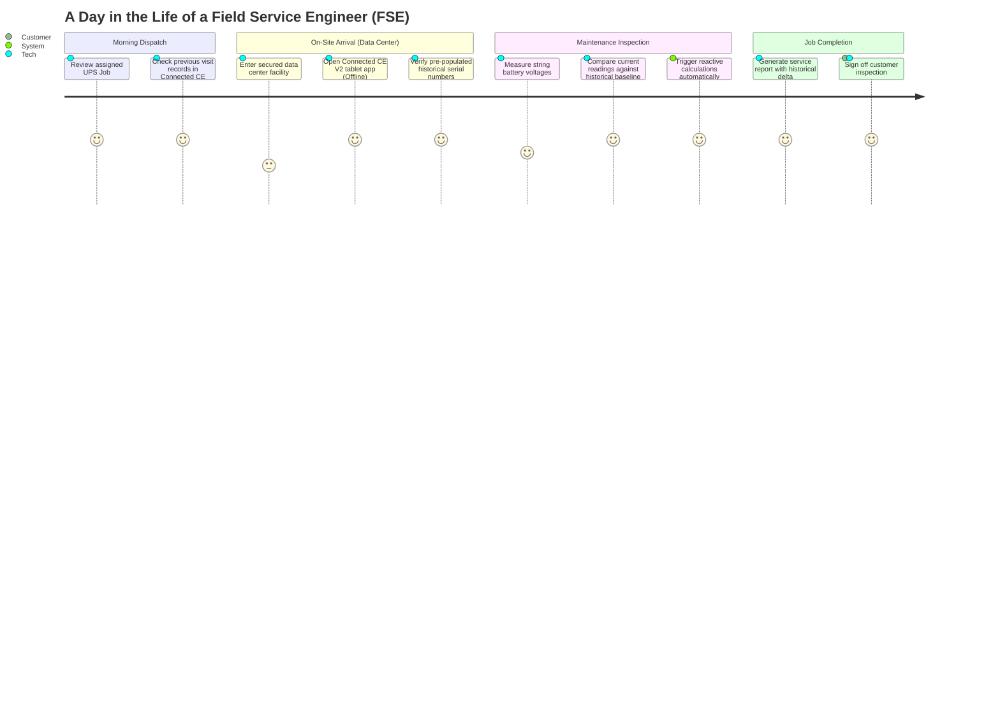
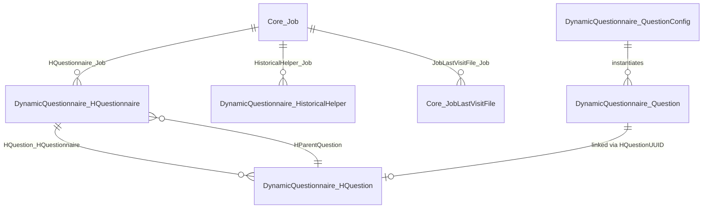
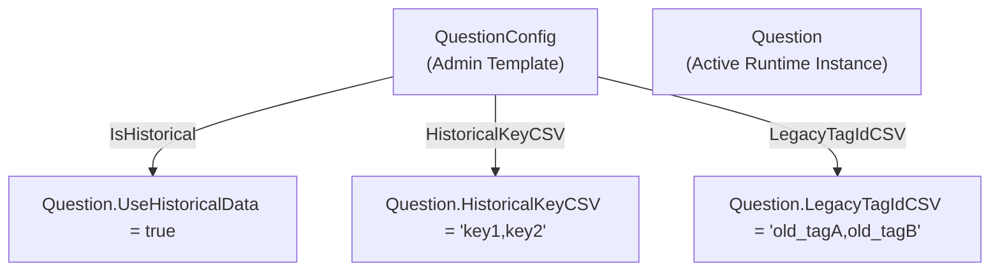
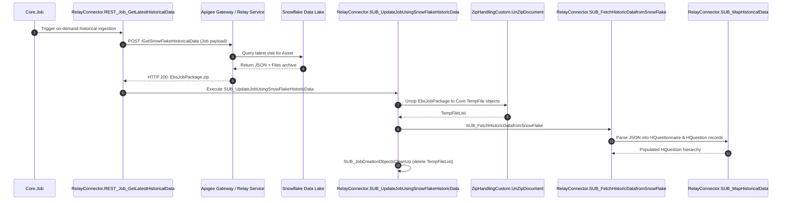
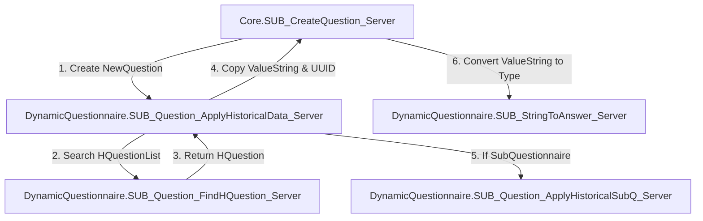
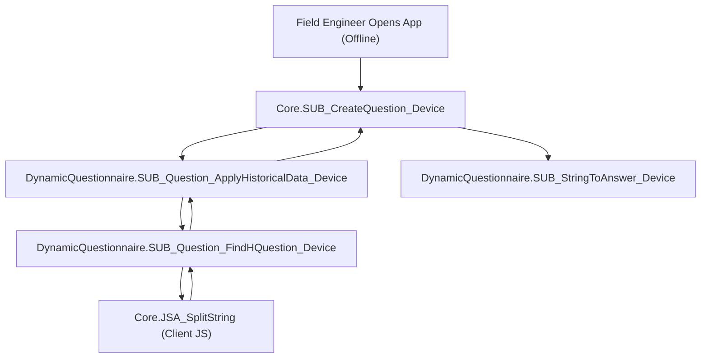
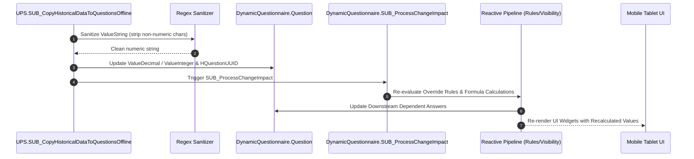
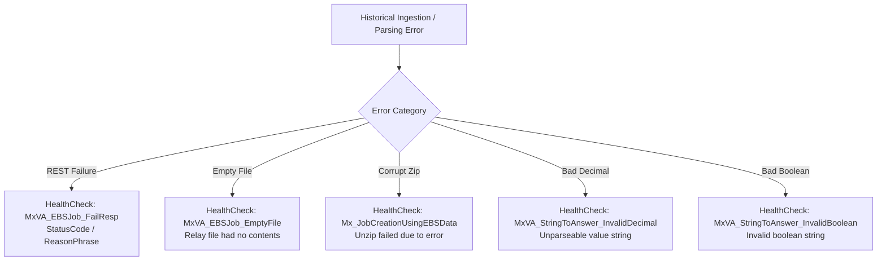
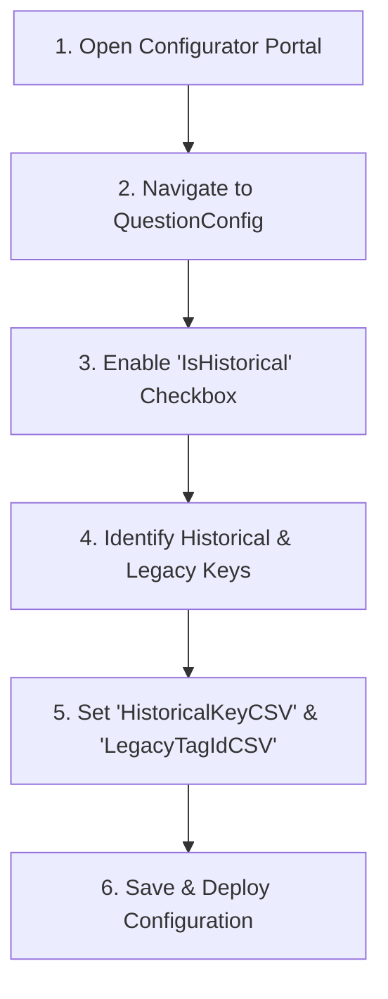

# HISTORICAL DATA ARCHITECTURE & RUNTIME INGESTION MANUAL
## Connected CE V2: Engineering Reference & Storytelling Guide for Mendix Developers

---

> [!NOTE]
> **Document Context & Audience**
> - **Project**: Connected CE V2 ([Connected CE V2.mpr](file:///Root/Connected%20CE%20V2.mpr))
> - **Modules Covered**: `DynamicQuestionnaire`, `Core`, `RelayConnector`, `UPS`
> - **Companion Documents**:
>   - Master Architecture Encyclopedia: [README.md](file:///Root/README.md)
>   - Custom Sync & Offline Integration Manual: [CUSTOM_SYNC_AND_INTEGRATION_MANUAL.md](file:///Root/CUSTOM_SYNC_AND_INTEGRATION_MANUAL.md)
> - **Audience**: Junior and Intermediate Mendix Developers, Solutions Architects, and Quality Engineers.
> - **Design Philosophy**: A dual-purpose guide combining real-world field engineering storytelling with exhaustive technical reference documentation.

---

# TABLE OF CONTENTS

- [VOLUME I: THE REQUIREMENT STORY & OPERATIONAL CONTEXT](#volume-i-the-requirement-story--operational-context)
  - [Chapter 1: The Day in the Life of a Field Service Engineer (FSE)](#chapter-1-the-day-in-the-life-of-a-field-service-engineer-fse)
  - [Chapter 2: The Core Business Problem: Redundant Inspections & Human Error](#chapter-2-the-core-business-problem-redundant-inspections--human-error)
  - [Chapter 3: The Legacy Migration Dilemma: Bridging EBS & Modern Questionnaires](#chapter-3-the-legacy-migration-dilemma-bridging-ebs--modern-questionnaires)
  - [Chapter 4: The Architectural Solution: Automated Historical Data Flow](#chapter-4-the-architectural-solution-automated-historical-data-flow)

- [VOLUME II: THE METAMODEL & CONFIGURATION ARCHITECTURE](#volume-ii-the-metamodel--configuration-architecture)
  - [Chapter 5: The Historical Metamodel Entities (`HQuestionnaire`, `HQuestion`, `HistoricalHelper`)](#chapter-5-the-historical-metamodel-entities-hquestionnaire-hquestion-historicalhelper)
  - [Chapter 6: Configuration Layer: `QuestionConfig` & `PageConfig` Flags](#chapter-6-configuration-layer-questionconfig--pageconfig-flags)
  - [Chapter 7: Tag Mapping Strategies: `tagId`, `HistoricalKeyCSV`, and `LegacyTagIdCSV`](#chapter-7-tag-mapping-strategies-tagid-historicalkeycsv-and-legacytagidcsv)
  - [Chapter 8: The UUID Chaining Engine (`HQuestionUUID` & `ACr_HQuestion`)](#chapter-8-the-uuid-chaining-engine-hquestionuuid--acr_hquestion)

- [VOLUME III: SERVER-SIDE INGESTION & PARSING PIPELINE](#volume-iii-server-side-ingestion--parsing-pipeline)
  - [Chapter 9: The On-Demand REST Retrieval (`RelayConnector.REST_Job_GetLatestHistoricalData`)](#chapter-9-the-on-demand-rest-retrieval-relayconnectorrest_job_getlatesthistoricaldata)
  - [Chapter 10: Unzipping the EBS Job Package (`ZipHandlingCustom.UnZipDocument`)](#chapter-10-unzipping-the-ebs-job-package-ziphandlingcustomunzipdocument)
  - [Chapter 11: Multi-Tier Hierarchy Extraction (`SUB_FetchHistoricDatafromSnowFlake` & `SUB_MapHistoricalData`)](#chapter-11-multi-tier-hierarchy-extraction-sub_fetchhistoricdatafromsnowflake--sub_maphistoricaldata)
  - [Chapter 12: Legacy Inspection Files & Sales Opportunities Ingestion](#chapter-12-legacy-inspection-files--sales-opportunities-ingestion)
  - [Chapter 13: Temporary Storage Lifecycle & Safe Memory Cleanup](#chapter-13-temporary-storage-lifecycle--safe-memory-cleanup)

- [VOLUME IV: SERVER-SIDE QUESTION COMPILATION & APPLICATION](#volume-iv-server-side-question-compilation--application)
  - [Chapter 14: Job Creation Orchestration (`Core.SUB_CreateQuestion_Server`)](#chapter-14-job-creation-orchestration-coresub_createquestion_server)
  - [Chapter 15: The Server Application Microflow (`DynamicQuestionnaire.SUB_Question_ApplyHistoricalData_Server`)](#chapter-15-the-server-application-microflow-dynamicquestionnairesub_question_applyhistoricaldata_server)
  - [Chapter 16: The Priority-Order Matching Algorithm (`DynamicQuestionnaire.SUB_Question_FindHQuestion_Server`)](#chapter-16-the-priority-order-matching-algorithm-dynamicquestionnairesub_question_findhquestion_server)
  - [Chapter 17: Recursive Sub-Questionnaire Instantiation (`SUB_Question_ApplyHistoricalSubQ_Server`)](#chapter-17-recursive-sub-questionnaire-instantiation-sub_question_applyhistoricalsubq_server)
  - [Chapter 18: Parsing Server String Answers (`DynamicQuestionnaire.SUB_StringToAnswer_Server`)](#chapter-18-parsing-server-string-answers-dynamicquestionnairesub_stringtoanswer_server)

- [VOLUME V: CLIENT-SIDE OFFLINE RUNTIME PIPELINE](#volume-v-client-side-offline-runtime-pipeline)
  - [Chapter 19: Offline SQLite Architecture & Mobile Constraints](#chapter-19-offline-sqlite-architecture--mobile-constraints)
  - [Chapter 20: The Device Application Nanoflow (`DynamicQuestionnaire.SUB_Question_ApplyHistoricalData_Device`)](#chapter-20-the-device-application-nanoflow-dynamicquestionnairesub_question_applyhistoricaldata_device)
  - [Chapter 21: Client String Parsing via JavaScript Action (`Core.JSA_SplitString`)](#chapter-21-client-string-parsing-via-javascript-action-corejsa_splitstring)
  - [Chapter 22: Offline Sub-Questionnaire Compilation & Rule Map Lifecycle](#chapter-22-offline-sub-questionnaire-compilation--rule-map-lifecycle)
  - [Chapter 23: Offline Type Hydration (`DynamicQuestionnaire.SUB_StringToAnswer_Device`)](#chapter-23-offline-type-hydration-dynamicquestionnairesub_stringtoanswer_device)

- [VOLUME VI: SPECIALIZED BATTERY TELEMETRY & REACTIVE ENGINE CASCADE](#volume-vi-specialized-battery-telemetry--reactive-engine-cascade)
  - [Chapter 24: Why Battery Telemetry Requires Custom Handling](#chapter-24-why-battery-telemetry-requires-custom-handling)
  - [Chapter 25: The Offline Battery Copier (`UPS.SUB_CopyHistoricalDataToQuestionsOffline`)](#chapter-25-the-offline-battery-copier-upssub_copyhistoricaldatatoquestionsoffline)
  - [Chapter 26: Robust Data Sanitization: Regex Cleaning of Numeric Values](#chapter-26-robust-data-sanitization-regex-cleaning-of-numeric-values)
  - [Chapter 27: Boolean Fuzzy Matching & Type Casting](#chapter-27-boolean-fuzzy-matching--type-casting)
  - [Chapter 28: Triggering the Reactive Pipeline (`SUB_ProcessChangeImpact`)](#chapter-28-triggering-the-reactive-pipeline-sub_processchangeimpact)

- [VOLUME VII: ERROR HANDLING, HEALTH CHECKS & DIAGNOSTICS](#volume-vii-error-handling-health-checks--diagnostics)
  - [Chapter 29: The Health Check Architecture for Historical Failures](#chapter-29-the-health-check-architecture-for-historical-failures)
  - [Chapter 30: Common Production Edge Cases & Mitigation Strategies](#chapter-30-common-production-edge-cases--mitigation-strategies)
  - [Chapter 31: Logging Codes & Troubleshooting Index](#chapter-31-logging-codes--troubleshooting-index)

- [VOLUME VIII: JUNIOR DEVELOPER IMPLEMENTATION PLAYBOOK](#volume-viii-junior-developer-implementation-playbook)
  - [Chapter 32: Step-by-Step: Enabling Historical Lookup on a New Question](#chapter-32-step-by-step-enabling-historical-lookup-on-a-new-question)
  - [Chapter 33: How to Test Historical Ingestion Locally & Offline](#chapter-33-how-to-test-historical-ingestion-locally--offline)
  - [Chapter 34: Verification Checklist & Best Practices](#chapter-34-verification-checklist--best-practices)

---

# VOLUME I: THE REQUIREMENT STORY & OPERATIONAL CONTEXT



## Chapter 1: The Day in the Life of a Field Service Engineer (FSE)

Picture this scenario: It is 7:00 AM on a freezing Tuesday morning in Frankfurt. Marcus, a senior Vertiv Field Service Engineer (FSE), arrives at a tier-4 hyper-scale data center. His assignment for the day is critical: perform a comprehensive annual preventive maintenance inspection on a 500 kVA Vertiv Liebert Uninterruptible Power Supply (UPS) system that powers the banking transactions for millions of European citizens.

Marcus enters the high-security bunker. The ambient room is deafening with the roar of forced-air cooling blowers. Most crucially, **there is zero cellular reception and zero Wi-Fi connectivity**. Steel-reinforced concrete walls and electromagnetic shielding block all wireless signals. Marcus’s only tool is an industrial ruggedized tablet running the **Connected CE V2 Mendix Mobile Application**.

Before he unscrews a single bolt or connects a single multi-meter probe, Marcus opens the job on his tablet. The UPS unit he is inspecting contains:
- 40 battery jars per string across 4 parallel battery strings (160 battery jars in total).
- Over 60 internal telemetry sensors (ambient temperature, DC bus voltage, inverter phase angles, bypass static switch temperatures, and run hours).
- Dozens of manufacturer configuration flags (battery installation date, jar model, torque specifications, warranty codes).

If Marcus had to manually type all 160 battery jar serial numbers, baseline internal resistance values, and previous visit run hours from scratch, he would spend three hours typing before even beginning his physical safety checks.

## Chapter 2: The Core Business Problem: Redundant Inspections & Human Error

Before the implementation of the **Historical Data Architecture** in Connected CE V2, field operations suffered from severe bottlenecks:

1. **Redundant Data Entry Overhead**: Engineers spent up to 40% of their on-site time re-entering static or semi-static data that had already been recorded during prior maintenance visits (such as battery model numbers, breaker ratings, baseline cell impedances, and site environmental limits).
2. **High Typo and Variance Rates**: When engineers manually transcribed historical numbers, slight variations in entry (e.g. `"12.4 V"` vs `"12.40"` vs `"12,4"`) prevented analytical comparison tools from graphing performance degradation over time.
3. **Loss of Baseline Context**: In power infrastructure, knowing a battery cell currently measures `13.2V` is meaningless without knowing whether it was `13.5V` twelve months ago or `12.8V`. Degradation delta is what saves data centers from catastrophic outages.
4. **Frustration in the Field**: Engineers felt the mobile application treated every visit like the system had amnesia, asking questions whose answers had remained unchanged for five years.

## Chapter 3: The Legacy Migration Dilemma: Bridging EBS & Modern Questionnaires

Vertiv’s operational ecosystem has evolved over decades. Historically, customer service records, asset inventories, and inspection logs were stored in enterprise legacy systems, notably **Oracle E-Business Suite (EBS)** and early custom inspection databases.

When Vertiv transitioned to the modern **DynamicQuestionnaire** engine in Connected CE V2, an architectural challenge arose:

> **The Legacy Tag Incompatibility Challenge**:
> In legacy EBS inspection forms, the question asking for "Battery String 1 Ambient Temperature" was tracked under key `temp_str1_amb` or `val_egg`. In the modern Dynamic Questionnaire metadata model, that same question is standardized as `BAT_STR1_TEMP_AMB`.
> If the new system only looked for its modern `tagId`, it would fail to find historical answers from legacy visits.

Furthermore, jobs migrated directly from EBS were flagged in the database with `Job.isLegacyJob = true`. The solution had to seamlessly reconcile modern questionnaire structures with legacy tag naming conventions, without requiring millions of historical records in the Snowflake enterprise data lake to be destructively transformed.

## Chapter 4: The Architectural Solution: Automated Historical Data Flow

The engineering team designed a comprehensive end-to-end historical data lifecycle spanning three physical tiers:
1. **The Data Lake & Integration Tier (Snowflake & Relay Connector)**: Ingests on-demand historical zip archives containing JSON inspection payloads and legacy PDF/settings files from Snowflake via Apigee-secured REST endpoints.
2. **The Server-Side Compilation Tier (Mendix Core & DynamicQuestionnaire)**: Unzips packages, instantiates normalized `HQuestionnaire` and `HQuestion` records, resolves priority tag aliases (`HistoricalKeyCSV` and `LegacyTagIdCSV`), and pre-populates questionnaire instances during server-side job provisioning.
3. **The Mobile Client Offline Tier (Offline SQLite & Reactive Nanoflows)**: Synchronizes historical records to the mobile SQLite database, applies historical values offline, performs robust numeric regex sanitation, and immediately fires the reactive change engine (`SUB_ProcessChangeImpact`) so dependent calculations and override visibility rules evaluate instantaneously.

---

# VOLUME II: THE METAMODEL & CONFIGURATION ARCHITECTURE



## Chapter 5: The Historical Metamodel Entities (`HQuestionnaire`, `HQuestion`, `HistoricalHelper`)

Historical data in Connected CE V2 is modeled with a clean separation between **template configuration**, **historical records**, and **runtime active questions**.

### 1. `DynamicQuestionnaire.HQuestionnaire`
Represents an instance of a historical questionnaire or sub-questionnaire.
- **Location**: [Connected CE V2.mpr](file:///Root/Connected%20CE%20V2.mpr) $\rightarrow$ `DynamicQuestionnaire` module.
- **Attributes**:
  - `HQuestionnaireUUID` (`String(36)`): Globally unique identifier generated on creation.
  - `Name` (`String(unlimited)`): Form name or identifier (e.g. `"root"`, `"BATTERY_SUBQ"`).
  - `Index` (`String(unlimited)`): Zero-based or ordinal index of this questionnaire in its collection.
  - `IsRoot` (`Boolean`): Set to `true` if this represents the top-level questionnaire for the job; `false` if it is a child sub-questionnaire.
  - `ChangedDate` (`AutoChangedDate`): System audit timestamp.
- **Associations**:
  - `DynamicQuestionnaire.HQuestionnaire_Job` $\rightarrow$ `Core.Job` (1 to many): Links the historical questionnaire directly to the active service job.
  - `DynamicQuestionnaire.HParentQuestion` $\rightarrow$ `DynamicQuestionnaire.HQuestion` (many to 1): Used when this `HQuestionnaire` is a sub-questionnaire belonging to an upstream parent question.

### 2. `DynamicQuestionnaire.HQuestion`
Represents a specific historical question-and-answer pair.
- **Attributes**:
  - `HQuestionUUID` (`String(36)`): Unique identifier generated by `ACr_HQuestion`.
  - `Key` (`String(unlimited)`): The historical question identifier or legacy tag ID (e.g. `"BAT_STR1_TEMP"`, `"val_egg"`).
  - `Value` (`String(unlimited)`): The raw string value recorded during the prior inspection.
  - `ChangedDate` (`AutoChangedDate`): System audit timestamp.
- **Associations**:
  - `DynamicQuestionnaire.HQuestion_HQuestionnaire` $\rightarrow$ `DynamicQuestionnaire.HQuestionnaire` (many to 1): Associates the question to its parent historical questionnaire.

### 3. `DynamicQuestionnaire.HistoricalHelper`
A lightweight persistence entity designed for fast lookups and staging.
- **Attributes**:
  - `HQuestionUUID` (`String(40)`): Foreign key linking to `HQuestion.HQuestionUUID`.
  - `StringValue` (`String(unlimited)`): Flattened answer payload.
  - `ChangedDate` (`AutoChangedDate`): Timestamp.
- **Associations**:
  - `DynamicQuestionnaire.HistoricalHelper_Job` $\rightarrow$ `Core.Job` (many to 1).

### 4. `Core.JobLastVisitFile`
Stores binary artifacts retrieved from the previous visit.
- **Attributes**:
  - `FileTagName` (`Enum: Core.ENUM_LastVisitFileType`):
    - `LastVisitReportPDF`: Final signed inspection report generated during the previous visit.
    - `LastVisitSettingsFile`: Raw calibration or parameter export file from the equipment controller.
- **Associations**:
  - `Core.JobLastVisitFile_Job` $\rightarrow$ `Core.Job`.

---

## Chapter 6: Configuration Layer: `QuestionConfig` & `PageConfig` Flags

Administrators configure how questions interact with historical data inside the **Configurator Portal** via `DynamicQuestionnaire.QuestionConfig` and `DynamicQuestionnaire.PageConfig`.



### Attributes on `DynamicQuestionnaire.QuestionConfig`:
1. `IsHistorical` (`Boolean`):
   - When checked, indicates that questions compiled from this config should attempt to find and copy their value from previous visit historical records.
   - Compiles to `Question.UseHistoricalData`.
2. `HistoricalKeyCSV` (`String(unlimited)`):
   - A comma-separated list of historical keys to search in order of precedence.
   - Example: `"ups_temp_sensor_1,ambient_temp_prev,raw_celsius"`.
   - Compiles to `Question.HistoricalKeyCSV`.
3. `LegacyTagIdCSV` (`String(unlimited)`):
   - Specific comma-separated aliases used when `Job.isLegacyJob = true`.
   - Accommodates legacy Oracle EBS field codes.
   - Compiles to `Question.LegacyTagIdCSV`.

### Attributes on `DynamicQuestionnaire.PageConfig`:
- `UseHistoricalData` (`Boolean`): Controls whether questions across the entire page participate in bulk historical hydration.
- `HistoricalKeyCSV` (`String(unlimited)`): Page-level fallback key mappings.

---

## Chapter 7: Tag Mapping Strategies: `tagId`, `HistoricalKeyCSV`, and `LegacyTagIdCSV`

The matching engine resolves historical answers using a strict **fallback priority cascade**:

```mermaid
flowchart TD
    Start([Evaluate Question]) --> CheckLegacy{Is Job Legacy?\n(Job.isLegacyJob == true)}
    
    CheckLegacy -- Yes --> CheckLegacyCSV{LegacyTagIdCSV\nis not empty?}
    CheckLegacyCSV -- Yes --> SplitLegacy[Split LegacyTagIdCSV by comma]
    CheckLegacyCSV -- No --> MatchTagId[Match HQuestion.Key == Question.tagId]
    
    CheckLegacy -- No --> CheckHistCSV{HistoricalKeyCSV\nis not empty?}
    CheckHistCSV -- Yes --> SplitHist[Split HistoricalKeyCSV by comma]
    CheckHistCSV -- No --> MatchTagId
    
    SplitLegacy --> LoopLegacy[Loop CSV Keys in Order\nFind first matching HQuestion]
    SplitHist --> LoopHist[Loop CSV Keys in Order\nFind first matching HQuestion]
    
    LoopLegacy --> Found{Match Found?}
    LoopHist --> Found
    MatchTagId --> Found
    
    Found -- Yes --> Apply[Apply HQuestion.Value\nStore HQuestionUUID\nBREAK Loop]
    Found -- No --> Clear[HQuestionUUID = empty\nLeave Answer Blank]
```

### The Priority Rules:
1. **Rule 1 (Legacy Job with CSV)**: If `Job.isLegacyJob = true` and `LegacyTagIdCSV` is not empty, the system tokenizes `LegacyTagIdCSV` by comma. It searches `HQuestionList` for each token sequentially. **The first token that matches an `HQuestion.Key` (case-insensitive) wins immediately**, and the loop terminates.
2. **Rule 2 (Modern Job with CSV)**: If `Job.isLegacyJob = false` and `HistoricalKeyCSV` is not empty, the system tokenizes `HistoricalKeyCSV` by comma and searches `HQuestionList`. The first matching key wins.
3. **Rule 3 (Direct Tag ID Match)**: If no CSV string is defined, the system performs a direct lookup:
   $$\text{toLowerCase}(HQuestion.Key) == \text{toLowerCase}(Question.tagId)$$
4. **Rule 4 (No Match)**: If no matching `HQuestion` is found or if its value is empty/null, the question remains unpopulated, and `Question.HQuestionUUID` is cleared to `empty`.

---

## Chapter 8: The UUID Chaining Engine (`HQuestionUUID` & `ACr_HQuestion`)

A crucial architectural principle of Connected CE V2 is **traceability**. When an engineer views an answer on a tablet, the system must know whether that value was typed by Marcus today or carried over from a previous technician's visit.

### 1. The Generation Microflow: `DynamicQuestionnaire.ACr_HQuestion`
- **Trigger**: Executed `after create` on every `DynamicQuestionnaire.HQuestion` entity.
- **Implementation**:
  ```mendix
  // Calls Java Action DynamicQuestionnaire.CreateUUID
  $uuid = call java action DynamicQuestionnaire.CreateUUID();
  change $HQuestion (HQuestionUUID = $uuid);
  return true;
  ```
- **Rationale**: Assigning a persistent UUID guarantees that each historical record has an immutable key independent of database internal auto-increment IDs.

### 2. Chaining to Active Questions:
When `SUB_Question_ApplyHistoricalData_Server` or `SUB_Question_ApplyHistoricalData_Device` matches an answer, it updates:
```mendix
change $NewQuestion (
    ValueString = $HQuestion/Value,
    HQuestionUUID = $HQuestion/HQuestionUUID
);
```
- If the question becomes hidden later (due to visibility rules) and is re-shown, or if an audit log is written, the system reads `HQuestionUUID` to confirm the value came from historical visit data.

---

# VOLUME III: SERVER-SIDE INGESTION & PARSING PIPELINE



## Chapter 9: The On-Demand REST Retrieval (`RelayConnector.REST_Job_GetLatestHistoricalData`)

The entry point for acquiring historical data from the enterprise cloud is `RelayConnector.REST_Job_GetLatestHistoricalData`.

### Logic Breakdown:
1. **Pre-condition Validation**:
   - Ensures `$Job != empty`.
   - Bypasses test jobs and sub-questionnaires:
     ```mendix
     $Job/sr_unit_item_type != DynamicQuestionnaire.QuestionnaireForms.Testing
     and
     $Job/sr_unit_item_type != DynamicQuestionnaire.QuestionnaireForms.SubQuestionnaire
     ```
2. **Relay Configuration Check**:
   - Calls `RelayConnector.VAL_RelayConnectorConfig()`.
3. **REST POST Execution**:
   - **Target Endpoint**: `@RelayConnector.CONST_RelayConnector_BaseURL + @RelayConnector.CONST_RelayConnector_GetSnowFlakeHistoricalData`
   - **Headers**:
     - `'apikey'`: `@RelayConnector.CONST_RelayConnector_APIGEEToken`
     - `'content-type'`: `'application/json'`
     - `'accept'`: `'application/json'`
     - `'environment'`: `@RelayConnector.CONST_JobMetaData_EnvName`
   - **Body Export**: Mapped via export mapping `RelayConnector.Job_ReqHistorical_Export2` from `$Job`.
   - **Timeout**: 300 seconds.
4. **Response Handling**:
   - If HTTP 200 and `$NewEbsJobPackage/HasContents == true`:
     - Sets `$NewEbsJobPackage/Name = $Job/JobId + '.zip'`.
     - Commits `$NewEbsJobPackage`.
     - Calls `Core.DS_Job_GetJobMetaData_Server`.
     - Invokes `RelayConnector.SUB_UpdateJobUsingSnowFlakeHistoricData`.
   - If HTTP status $\neq 200$ or payload is empty:
     - Invokes `Core.SUB_HealthCheck_Create_Server` with code `'MxVA_EBSJob_FailResp'` or `'MxVA_EBSJob_EmptyFile'`.

---

## Chapter 10: Unzipping the EBS Job Package (`ZipHandlingCustom.UnZipDocument`)

The incoming zip file from Relay is unpacked in memory and staging disk by `RelayConnector.SUB_UpdateJobUsingSnowFlakeHistoricData`:

1. Creates `$NewJobPayload = create Core.JobPayload`.
2. Calls custom Java Action:
   ```mendix
   $TempFileList = call java action ZipHandlingCustom.UnZipDocument(
       ResultFileEntity = 'Core.TempFile',
       ZipFile = $EbsJobPackage
   );
   ```
3. Error Handler: Wrapped in an `on error without rollback` block that logs a Health Check record (`'Mx_JobCreationUsingEBSData'`) if the zip archive is corrupt or password-protected.

---

## Chapter 11: Multi-Tier Hierarchy Extraction (`SUB_FetchHistoricDatafromSnowFlake` & `SUB_MapHistoricalData`)

Once files are extracted, `RelayConnector.SUB_FetchHistoricDatafromSnowFlake` handles schema mapping.

### The 4-Tier Hierarchy Architecture:
Complex power systems require deep nesting. A UPS contains battery cabinets; each cabinet contains shelves; each shelf contains battery jars. To handle this without data truncation, the ingestion engine constructs up to **four tiers** of historical objects:

```mendix
$NewRootHQuestionnaire = create DynamicQuestionnaire.HQuestionnaire (
    IsRoot = true, 
    Name = 'root', 
    HQuestionnaire_Job = $Job, 
    Index = '0'
);

$HQuestionnaireList_Root       = create list of DynamicQuestionnaire.HQuestionnaire;
$HQuestionList_Root            = create list of DynamicQuestionnaire.HQuestion;
$HQuestionnaireList_Child      = create list of DynamicQuestionnaire.HQuestionnaire;
$HQuestionList_Child           = create list of DynamicQuestionnaire.HQuestion;
$HQuestionnaireList_GrandChild = create list of DynamicQuestionnaire.HQuestionnaire;
$HQuestionList_GrandChild      = create list of DynamicQuestionnaire.HQuestion;
$HQuestionnaireList_GreatGrand = create list of DynamicQuestionnaire.HQuestionnaire;
$HQuestionList_GreatGrand      = create list of DynamicQuestionnaire.HQuestion;
```

It invokes `RelayConnector.SUB_MapHistoricalData`, passing all eight list buffers. The JSON payload is traversed:
- **Tier 1 (Root)**: Top-level UPS parameters (model, serial number, kVA rating).
- **Tier 2 (Child)**: Sub-questionnaires (e.g. Battery Strings, Power Modules).
- **Tier 3 (GrandChild)**: Sub-sub-questionnaires (e.g. Individual Battery Jars, Fan Trays).
- **Tier 4 (GreatGrandChild)**: Specialized sub-components (e.g. Temperature Sensors, Fuse Assemblies).

Every question created is linked to its containing `HQuestionnaire` via `HQuestion_HQuestionnaire`.

---

## Chapter 12: Legacy Inspection Files & Sales Opportunities Ingestion

In addition to questionnaire answers, historical visits often contain previous engineer reports and customer equipment upgrade recommendations:

1. **Last Visit Sales Opportunities**:
   - Calls `RelayConnector.SUB_MapHistoricalLastVisitSalesData` using `$JobIngestPaylod/DatalakeLastVisitSalesPayload`.
   - Creates `Core.LastVisitSalesOpportunity` objects linked to `$Job`.
2. **Previous Inspection PDF & Settings Files**:
   - Calls `RelayConnector.SUB_MAP_Historical_Files`.
   - Instantiates `Core.JobLastVisitFile`:
     - `LastVisitReportPDF`: Stores the historical PDF for offline engineer viewing.
     - `LastVisitSettingsFile`: Stores device configuration files.
   - If empty, logs warning Health Check (`'PDF file has no contents'`) and deletes the empty object.

---

## Chapter 13: Temporary Storage Lifecycle & Safe Memory Cleanup

Processing hundreds of unzipped files can quickly saturate JVM memory and server disk space. 

At the conclusion of `RelayConnector.SUB_UpdateJobUsingSnowFlakeHistoricData`:
```mendix
call microflow RelayConnector.SUB_JobCreationObjectsCleanUp(
    FileDocumentList = $TempFileList
);
```
This iterates over every unzipped `Core.TempFile`, deletes it from the database and filestore, and reclaims disk space before committing the transaction.

---

# VOLUME IV: SERVER-SIDE QUESTION COMPILATION & APPLICATION



## Chapter 14: Job Creation Orchestration (`Core.SUB_CreateQuestion_Server`)

When a job is initialized online (for example, via web dispatch or automatic job scheduling), `Core.SUB_CreateQuestion_Server` generates the active questionnaire structure from `QuestionConfig`.

### Compilation Steps:
1. Instantiates `DynamicQuestionnaire.Question`:
   ```mendix
   tagId = $QuestionConfig/tagId,
   QuestionType = $QuestionConfig/QuestionType,
   UseHistoricalData = $QuestionConfig/UseHistoricalData,
   HistoricalKeyCSV = $QuestionConfig/HistoricalKeyCSV,
   LegacyTagIdCSV = $QuestionConfig/LegacyTagIdCSV
   ```
2. Copies initial values: `Core.SUB_Question_CopyOriginalValues_Server`.
3. Invokes historical application:
   ```mendix
   $HistoricalApplied = call microflow DynamicQuestionnaire.SUB_Question_ApplyHistoricalData_Server(
       HQuestionList = $HQuestionList,
       Job = $Job,
       AttemptHistorical = ($OriginalQuestionList = empty),
       NewQuestion = $NewQuestion,
       ModelRule = $ModelRule,
       Language = $Language,
       IsJobCreation = true,
       JobMetaData = $JobMetaData
   );
   ```
4. Parses string value into typed fields via `DynamicQuestionnaire.SUB_StringToAnswer_Server`.

---

## Chapter 15: The Server Application Microflow (`DynamicQuestionnaire.SUB_Question_ApplyHistoricalData_Server`)

This microflow controls whether a historical answer should be injected into a question.

### Detailed Execution Trace:
```mendix
// Parameter Check
if not($AttemptHistorical) then
    return false;
end if;

// Gatekeeper Condition:
// Only attempt if UseHistoricalData is enabled and current answer is blank.
// EXCEPTION: If Job.isLegacyJob is true, ALWAYS attempt!
if ($NewQuestion/UseHistoricalData and trim($NewQuestion/ValueString) = '')
   or ($Job/isLegacyJob) then
    // Proceed to search
else
    change $NewQuestion (HQuestionUUID = empty);
    return false;
end if;

// Call Search Microflow
$HQuestion = call microflow DynamicQuestionnaire.SUB_Question_FindHQuestion_Server(
    HQuestionList = $HQuestionList,
    Question = $NewQuestion,
    isLegacyJob = $Job/isLegacyJob
);

// Process Match
if $HQuestion != empty then
    if trim($HQuestion/Value) != '' then
        change $NewQuestion (
            ValueString = $HQuestion/Value,
            HQuestionUUID = $HQuestion/HQuestionUUID
        );
        log debug node @DynamicQuestionnaire.CONST_LogNode 
            'Found and attempting to map HQuestion data: UUID ' + $HQuestion/HQuestionUUID 
            + ', key ' + $HQuestion/Key + ', value ' + $HQuestion/Value;
        $HistoricalApplied = true;
    end if;
    
    // Check for Sub-Questionnaire
    if $NewQuestion/QuestionType = DynamicQuestionnaire.QuestionTypes.SubQuestionnaire then
        retrieve $SubHQuestionnaireList from $HQuestion/DynamicQuestionnaire.HParentQuestion;
        if $SubHQuestionnaireList != empty then
            call microflow DynamicQuestionnaire.SUB_Question_ApplyHistoricalSubQ_Server(
                ParentQuestion = $NewQuestion,
                Job = $Job,
                SubHQuestionnaireList = $SubHQuestionnaireList,
                IsJobCreation = $IsJobCreation,
                ModelRule = $ModelRule,
                Language = $Language,
                JobMetaData = $JobMetaData
            );
            change $NewQuestion (HQuestionUUID = $HQuestion/HQuestionUUID);
            return true;
        end if;
    end if;
    return $HistoricalApplied;
else
    change $NewQuestion (HQuestionUUID = empty);
    return false;
end if;
```

---

## Chapter 16: The Priority-Order Matching Algorithm (`DynamicQuestionnaire.SUB_Question_FindHQuestion_Server`)

The resolution logic in `DynamicQuestionnaire.SUB_Question_FindHQuestion_Server` implements the CSV token priority engine:

```mendix
$HQuestionList_Found = create list of DynamicQuestionnaire.HQuestion;

// Evaluate whether a custom CSV exists
$hasCSV = if $isLegacyJob 
          then trim($Question/LegacyTagIdCSV) != ''
          else trim($Question/HistoricalKeyCSV) != '';

if $hasCSV then
    // Split CSV using CommunityCommons Java Action
    $csvString = if $isLegacyJob 
                 then $Question/LegacyTagIdCSV 
                 else $Question/HistoricalKeyCSV;
                 
    $SplitItemList = call java action CommunityCommons.StringSplit(
        inputString = $csvString, 
        splitParameter = ','
    );
    
    // Loop tokens in exact declared order
    loop $IteratorSplitItem in $SplitItemList
    begin
        $HQuestion_byCSV = find $HQuestionList 
                           where toLowerCase($currentObject/Key) = toLowerCase($IteratorSplitItem/Value);
        if $HQuestion_byCSV != empty then
            add $HQuestion_byCSV to $HQuestionList_Found;
            break; // First match wins!
        end if;
    end loop;
else
    // Direct match against tagId
    $HQuestion_byTagId = find $HQuestionList 
                         where toLowerCase($currentObject/Key) = toLowerCase($Question/tagId);
    if $HQuestion_byTagId != empty then
        add $HQuestion_byTagId to $HQuestionList_Found;
    end if;
end if;

return head($HQuestionList_Found);
```

---

## Chapter 17: Recursive Sub-Questionnaire Instantiation (`SUB_Question_ApplyHistoricalSubQ_Server`)

When an `HQuestion` corresponds to a sub-questionnaire (e.g. an entire Battery String), the parent question must not merely hold a string; it must spawn child questionnaires.

1. Retrieves `$SubHQuestionnaireList` via `$HQuestion/DynamicQuestionnaire.HParentQuestion`.
2. Validates sub-questionnaire configuration:
   ```mendix
   $SubQuestionnaireConfig = call microflow DynamicQuestionnaire.VAL_AddSubQuestionnaire_Server(
       ParentQuestion = $ParentQuestion,
       Job = $Job,
       ModelRule = $ModelRule
   );
   ```
3. Loops over each `$IteratorSubHQuestionnaire`:
   ```mendix
   $NewSubQuestionnaire = call microflow DynamicQuestionnaire.SUB_AddSubQuestionnaire_inLoop_Server(
       ParentQuestion = $ParentQuestion,
       Job = $Job,
       HQuestionnaire = $IteratorSubHQuestionnaire,
       SubQuestionnaireConfig = $SubQuestionnaireConfig,
       ModelRule = $ModelRule,
       IsJobCreation = $IsJobCreation,
       Language = $Language,
       OriginalQuestionnaire = empty,
       JobMetaData = $JobMetaData
   );
   ```
4. This recursively invokes `SUB_CreateQuestion_Server` for all child questions inside that sub-questionnaire, binding child `HQuestion` records down the tree.

---

## Chapter 18: Parsing Server String Answers (`DynamicQuestionnaire.SUB_StringToAnswer_Server`)

Historical answers are received as raw strings (`ValueString`). To make them operable by Mendix expressions and forms, `SUB_StringToAnswer_Server` parses them into typed attributes:
- **`Single_Select_Option`**: Loops options under the question; sets `Option.IsSelected = true` where `toLowerCase(Key) == toLowerCase(ValueString)` or `toLowerCase(Caption) == toLowerCase(ValueString)`.
- **`Multi_Select_Options`**: Splits comma-separated values and sets `IsSelected = true` for each matching option.
- **`DateTime`**: Parses date strings into `Question.ValueDate`.
- **`Decimal`**: Parses decimal string into `Question.ValueDecimal`.
- **`Integer`**: Parses integer string into `Question.ValueInteger`.
- **`Boolean`**: Parses `'true'`, `'1'`, `'y'`, `'yes'` into `Question.ValueBoolean`.

---

# VOLUME V: CLIENT-SIDE OFFLINE RUNTIME PIPELINE



## Chapter 19: Offline SQLite Architecture & Mobile Constraints

On the mobile client, Mendix executes inside a hybrid mobile container (React Native / Cordova) backed by an **offline SQLite database**.

### Mobile Architectural Differences:
1. **No Java Actions**: Java code (`CommunityCommons.StringSplit`) cannot execute on mobile devices. All string manipulation must use **JavaScript Actions (JSAs)** or native Nanoflow expressions.
2. **Nanoflow Execution Speed**: Nanoflows run in the client JavaScript thread. Heavy iterative loops must be optimized to prevent UI freezing.
3. **Explicit Refresh Flags**: Changes to entities on the client require explicit `refresh in client` directives so mobile widgets redraw immediately.

---

## Chapter 20: The Device Application Nanoflow (`DynamicQuestionnaire.SUB_Question_ApplyHistoricalData_Device`)

The offline equivalent of the server application flow is `DynamicQuestionnaire.SUB_Question_ApplyHistoricalData_Device`.

### Key Implementation Differences from Server:
- Executes as a **Nanoflow**.
- Updates `NewQuestion` with `refresh in client`:
  ```mendix
  change $NewQuestion (
      ValueString = $HQuestion/Value, 
      HQuestionUUID = $HQuestion/HQuestionUUID
  ) refresh;
  ```
- Sub-questionnaire handling invokes `DynamicQuestionnaire.SUB_Question_ApplyHistoricalSubQ_Device`.

---

## Chapter 21: Client String Parsing via JavaScript Action (`Core.JSA_SplitString`)

To tokenize `HistoricalKeyCSV` and `LegacyTagIdCSV` offline without Java dependencies, `DynamicQuestionnaire.SUB_Question_FindHQuestion_Device` calls `Core.JSA_SplitString`:

```javascript
// Core.JSA_SplitString
export async function JSA_SplitString(InputString, Separator) {
    if (!InputString) {
        return [];
    }
    const sep = Separator || ",";
    const parts = InputString.split(sep);
    return parts.map(item => ({
        Value: item.trim()
    }));
}
```

The returned list is iterated inside the nanoflow, performing case-insensitive matching against offline SQLite `HQuestion` records:
```mendix
$HQuestion_byCSV = find $HQuestionList 
    where toLowerCase(trim($currentObject/Key)) = toLowerCase(trim($IteratorSplitItem/Value));
```

---

## Chapter 22: Offline Sub-Questionnaire Compilation & Rule Map Lifecycle

When creating sub-questionnaires offline (`SUB_Question_ApplyHistoricalSubQ_Device`), memory management is vital:

1. **Map Creation**:
   ```mendix
   if $IsJobCreation = false then
       call nanoflow Core.SUB_BaseRuleMaps_Create(Job = $Job, ModelRule = $ModelRule);
   end if;
   ```
2. **Loop Iteration**:
   Calls `DynamicQuestionnaire.SUB_AddSubQuestionnaire_inLoop_Device` to build questionnaires and questions in offline SQLite.
3. **Map Cleanup & Completeness Validation**:
   ```mendix
   if $IsJobCreation = false then
       call nanoflow Core.SUB_BaseRuleMaps_Delete();
       loop $IteratorPage in $PageList_toCheckCompleteness
       begin
           call nanoflow DynamicQuestionnaire.CheckComplete_Page_Device(Page = $IteratorPage, Job = $Job);
       end loop;
   end if;
   ```
   This guarantees that memory-heavy rule maps are purged from mobile RAM and every new page calculates its completion indicator.

---

## Chapter 23: Offline Type Hydration (`DynamicQuestionnaire.SUB_StringToAnswer_Device`)

Once `ValueString` is set on the device, `DynamicQuestionnaire.SUB_StringToAnswer_Device` hydrates offline SQLite attributes:
- Options are retrieved via `$Question/DynamicQuestionnaire.Option_Question`.
- Matching options have `IsSelected` set to `true` with client refresh.
- Dates, decimals, and booleans are parsed locally.

---

# VOLUME VI: SPECIALIZED BATTERY TELEMETRY & REACTIVE ENGINE CASCADE



## Chapter 24: Why Battery Telemetry Requires Custom Handling

In data centers, battery health telemetry presents unique challenges:
1. **High Volume**: A single UPS installation can contain hundreds of battery jars across multiple battery strings.
2. **Extreme Sensitivity**: A difference of $0.05\text{ V}$ or $0.2\text{ m}\Omega$ (milliohms) across battery jars indicates imminent thermal runaway or cell failure.
3. **Formatting Pollution**: Upstream telemetry from battery diagnostic tools frequently embeds units, commas, or spaces (e.g. `"13.45 VDC"`, `" 12,80 "`, `"N/A"`).
4. **Instant Calculation Dependencies**: In Vertiv questionnaires, jar voltages feed into string averages, standard deviations, and battery health degradation formulas. Setting a historical answer **must trigger downstream calculation formulas immediately**.

---

## Chapter 25: The Offline Battery Copier (`UPS.SUB_CopyHistoricalDataToQuestionsOffline`)

To meet these requirements, the engineering team created `UPS.SUB_CopyHistoricalDataToQuestionsOffline`.

- **Module**: `UPS`
- **Folder**: `UnitConfig/Battery_SubQ`
- **Parameters**:
  - `$HQuestion_byTagId`: `DynamicQuestionnaire.HQuestion`
  - `$IteratorQuestion`: `DynamicQuestionnaire.Question`
  - `$Questionnaire`: `DynamicQuestionnaire.Questionnaire`
  - `$SubQPage`: `DynamicQuestionnaire.Page`
  - `$Job`: `Core.Job`
  - `$PageListName`: `String`

This nanoflow handles each question type with defensive parsing, logging, and **immediate reactive cascade**.

---

## Chapter 26: Robust Data Sanitization: Regex Cleaning of Numeric Values

If a historical record contains `" 13.45 VDC "`, a standard `parseDecimal()` will crash. `UPS.SUB_CopyHistoricalDataToQuestionsOffline` uses robust regular expression stripping:

### 1. Decimal Parsing Logic:
```mendix
declare $DecimalValue_1 Decimal = parseDecimal(
    replaceAll($HQuestion_byTagId/Value, '[^0-9.,]', '')
) on error without rollback begin
    call nanoflow Core.SUB_HealthCheck_Create_Device(
        Job = $Questionnaire/DynamicQuestionnaire.Questionnaire_RootJob/Core.Job,
        Asset = $NanoflowName,
        AssetDescription = $AssetDescription,
        LogLevel = CommunityCommons.LogLevel.Error,
        LogMessage = 'Failed to parse ValueString into ValueDecimal',
        LogDetails = 'The tag "' + $IteratorQuestion/tagId + '" had ValueString "' 
                     + $HQuestion_byTagId/Value + '" but this is not a valid decimal',
        LogCode = 'MxVA_StringToAnswer_InvalidDecimal',
        LogNode = @DynamicQuestionnaire.CONST_LogNode
    );
    return $historicalDataUsed;
end error;

change $IteratorQuestion (
    ValueDecimal = $DecimalValue_1, 
    HQuestionUUID = $HQuestion_byTagId/HQuestionUUID
) refresh;
```

### 2. Integer Parsing Logic:
```mendix
declare $IntegerValue_1 Integer = floor(parseDecimal(
    replaceAll($HQuestion_byTagId/Value, '[^0-9.,]', '')
)) on error without rollback begin
    call nanoflow Core.SUB_HealthCheck_Create_Device(
        LogMessage = 'Failed to parse ValueString into ValueInteger',
        LogCode = 'MxVA_StringToAnswer_InvalidInteger',
        ...
    );
    return $historicalDataUsed;
end error;

change $IteratorQuestion (
    ValueInteger = $IntegerValue_1, 
    HQuestionUUID = $HQuestion_byTagId/HQuestionUUID
) refresh;
```

---

## Chapter 27: Boolean Fuzzy Matching & Type Casting

Historical systems store booleans in multiple formats (`"true"`, `"1"`, `"yes"`, `"y"` vs `"false"`, `"0"`, `"no"`, `"n"`).

`UPS.SUB_CopyHistoricalDataToQuestionsOffline` normalizes these variations:
```mendix
if toLowerCase(trim($HQuestion_byTagId/Value)) = 'true'
   or trim($HQuestion_byTagId/Value) = '1'
   or toLowerCase(trim($HQuestion_byTagId/Value)) = 'y'
   or toLowerCase(trim($HQuestion_byTagId/Value)) = 'yes'
   or toLowerCase(trim($HQuestion_byTagId/Value)) = 'false'
   or trim($HQuestion_byTagId/Value) = '0'
   or toLowerCase(trim($HQuestion_byTagId/Value)) = 'n'
   or toLowerCase(trim($HQuestion_byTagId/Value)) = 'no' then

    change $IteratorQuestion (
        ValueBoolean = (
            toLowerCase(trim($HQuestion_byTagId/Value)) = 'true'
            or trim($HQuestion_byTagId/Value) = '1'
            or toLowerCase(trim($HQuestion_byTagId/Value)) = 'y'
            or toLowerCase(trim($HQuestion_byTagId/Value)) = 'yes'
        )
    ) refresh;
    set $historicalDataUsed = true;
else
    call nanoflow Core.SUB_HealthCheck_Create_Device(
        LogMessage = 'Failed to parse ValueString into ValueBoolean',
        LogCode = 'MxVA_StringToAnswer_InvalidBoolean',
        ...
    );
end if;
```

---

## Chapter 28: Triggering the Reactive Pipeline (`SUB_ProcessChangeImpact`)

The most critical instruction in `UPS.SUB_CopyHistoricalDataToQuestionsOffline` is the reactive cascade trigger.

Whenever any historical answer is successfully written:
```mendix
set $historicalDataUsed = true;

call nanoflow DynamicQuestionnaire.SUB_ProcessChangeImpact(
    ImpactingQuestion = $IteratorQuestion,
    Questionnaire = $Questionnaire,
    CurrentPage = $SubQPage,
    Job = $Job,
    SkipSubQ12Creation = nothing,
    PageListName = $PageListName
);
```

### Why this is essential:
In standard question creation, values are static. But when historical data is loaded offline into battery questions, dependent calculations (such as total string voltage $\sum V_i$, average cell impedance $\bar{Z}$, and variance thresholds) must recalculate immediately.

Calling `DynamicQuestionnaire.SUB_ProcessChangeImpact` guarantees:
1. **Override Rules Fire**: Any questions conditioned on battery values (e.g. "Warn: Cell 14 voltage exceeds tolerance") become visible immediately.
2. **Calculation Rules Fire**: Mathematical formulas recalculate based on the historical baseline.
3. **Page Status Updates**: Page completion indicators update to reflect the pre-populated answers.

---

# VOLUME VII: ERROR HANDLING, HEALTH CHECKS & DIAGNOSTICS



## Chapter 29: The Health Check Architecture for Historical Failures

Errors during historical processing never crash the technician’s mobile tablet or block the job workflow. Instead, Connected CE V2 uses the **HealthCheck Subsystem** (`Core.SUB_HealthCheck_Create_Server` and `Core.SUB_HealthCheck_Create_Device`) to capture diagnostics without rollbacks.

Each diagnostic record logs:
- **`Asset`**: The microflow or nanoflow where the failure occurred.
- **`LogCode`**: Standardized error signature.
- **`LogLevel`**: Info, Warning, or Error.
- **`LogDetails`**: Detailed string payload, tag ID, job ID, and error message.

---

## Chapter 30: Common Production Edge Cases & Mitigation Strategies

| Scenario / Edge Case | Root Cause | System Behavior & Mitigation |
| :--- | :--- | :--- |
| **No Historical Visit Exists** | Brand new UPS installation or first visit in Connected CE. | Relay returns empty JSON. System logs Info HealthCheck and leaves questions blank for manual entry. |
| **Legacy Tag Renamed** | Question tag in EBS was `val_bread`, but in modern config it is `BAT_BREAKER_AMP`. | Configure `QuestionConfig.LegacyTagIdCSV = 'val_bread'`. System resolves legacy alias automatically. |
| **Alphanumeric in Numeric Question** | Historical value recorded as `"12.4 VDC"` or `"> 50"`. | `replaceAll(..., '[^0-9.,]', '')` strips non-numeric characters. Parses `"12.4"`. If unparseable, logs `MxVA_StringToAnswer_InvalidDecimal`. |
| **Question Was Pre-Filled by Tech** | Technician already entered an answer before historical lookup ran. | Gated by `trim(ValueString) = ''`. Historical data will **not** overwrite an existing technician answer. |
| **Corrupt Zip Archive** | Network drop during Apigee REST download. | `ZipHandlingCustom.UnZipDocument` catches error in `on error without rollback`. Logs `Mx_JobCreationUsingEBSData`. Job proceeds without historical pre-fill. |

---

## Chapter 31: Logging Codes & Troubleshooting Index

- **`MxVA_EBSJob_FailResp`**: Relay REST service returned non-200 status code. Check Apigee token, network connectivity, or Snowflake query timeouts.
- **`MxVA_EBSJob_EmptyFile`**: Relay service reached, but returned file had zero bytes.
- **`Mx_JobCreationUsingEBSData`**: Failed to decompress the job zip archive.
- **`MxVA_StringToAnswer_InvalidDecimal`**: Historical value string could not be converted to a decimal after regex cleaning.
- **`MxVA_StringToAnswer_InvalidInteger`**: Historical value string could not be converted to an integer.
- **`MxVA_StringToAnswer_InvalidBoolean`**: Historical value string was not a recognizable boolean literal.

---

# VOLUME VIII: JUNIOR DEVELOPER IMPLEMENTATION PLAYBOOK

## Chapter 32: Step-by-Step: Enabling Historical Lookup on a New Question

Follow these steps to configure historical pre-population for a new question:



### Implementation Checklist:
1. **Open Configurator**: Access the Admin Configurator in your browser.
2. **Locate QuestionConfig**: Navigate to `DynamicQuestionnaire.QuestionConfig_NewEdit` for your target question.
3. **Check `IsHistorical`**: Ensure the `IsHistorical` checkbox is set to `true`.
4. **Identify Historical Keys**:
   - Query previous inspection records in Snowflake or sample EBS exports.
   - If previous visits used modern tag `UPS_INVERTER_FREQ`, but older visits used `inv_hz` or `freq_inv`, enter:
     ```text
     HistoricalKeyCSV: UPS_INVERTER_FREQ,inv_hz,freq_inv
     ```
   - If legacy EBS jobs used `LEGACY_FREQ_01`, enter:
     ```text
     LegacyTagIdCSV: LEGACY_FREQ_01
     ```
5. **Set Question Type**: Ensure the `QuestionType` matches the expected data (e.g. `Decimal`, `Text`, `Single_Select_Option`).
6. **Save**: Commit your configuration.

---

## Chapter 33: How to Test Historical Ingestion Locally & Offline

### Step 1: Online Server Test
1. In Studio Pro or local development, open [Connected CE V2.mpr](file:///Root/Connected%20CE%20V2.mpr).
2. Set a breakpoint at the start of `DynamicQuestionnaire.SUB_Question_ApplyHistoricalData_Server`.
3. Trigger job creation via `Core.SUB_CreateQuestion_Server`.
4. Inspect `$HQuestionList`: verify that historical questions from the test payload are present.
5. Step into `DynamicQuestionnaire.SUB_Question_FindHQuestion_Server`: verify that your CSV tokens are evaluated in the expected priority order.

### Step 2: Offline Mobile Device Test
1. Launch the mobile app in the web simulator or on a physical test tablet.
2. Synchronize your test job to the device.
3. Turn on Airplane Mode (disconnect all network interfaces).
4. Open the job questionnaire on the tablet.
5. Verify that:
   - Historical answers appear pre-populated in the input widgets.
   - For battery questions, `UPS.SUB_CopyHistoricalDataToQuestionsOffline` executed and downstream calculated fields show updated totals.
   - No error popups appear; check the local Health Check log for any parsing warnings.

---

## Chapter 34: Verification Checklist & Best Practices

- [ ] **Preserve Precedence**: Always place the most recent or preferred historical key first in `HistoricalKeyCSV`.
- [ ] **Case Insensitivity**: Never rely on exact casing. The engine uses `toLowerCase(trim(...))` for all key comparisons.
- [ ] **Do Not Overwrite**: Remember that `SUB_Question_ApplyHistoricalData` intentionally skips questions where `ValueString` is not blank (unless `Job.isLegacyJob` is true).
- [ ] **Clean Up Memory**: If you extend sub-questionnaire instantiation, always pair `Core.SUB_BaseRuleMaps_Create` with `Core.SUB_BaseRuleMaps_Delete` to protect mobile device memory.
- [ ] **Verify Reactive Impact**: When populating answers programmatically offline, always invoke `DynamicQuestionnaire.SUB_ProcessChangeImpact` so formulas and visibility rules re-evaluate.

---
*End of Historical Data Architecture & Runtime Ingestion Manual*
