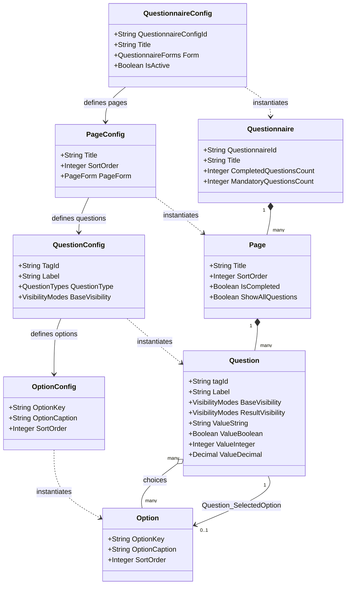
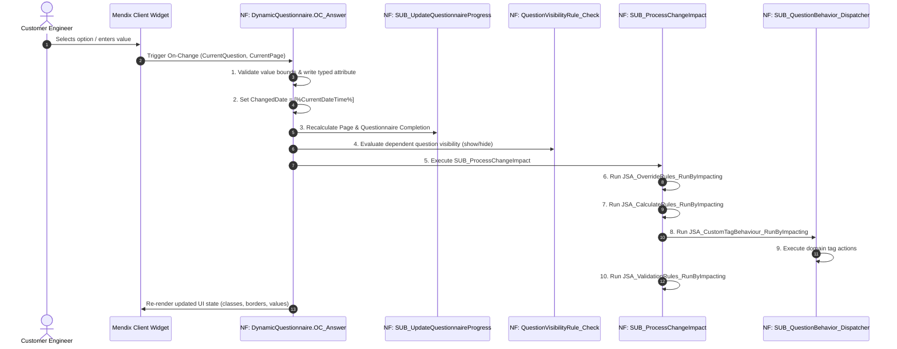

# Appendix 01: Dynamic Questionnaire Engine (DQE) Metamodel & Formula Engine

> [!NOTE]
> **Parent Document**: [Connected CE V2 — Comprehensive Mendix Developer Knowledge Transfer (KT) Guide](file:///C:/Users/chand/.gemini/antigravity-cli/brain/675d50f8-c688-4e59-bfba-d5550106bbba/Connected_CE_V2_Comprehensive_KT_Guide.md)
>
> This appendix delivers an exhaustive technical breakdown of the **Dynamic Questionnaire Engine (DQE)**, the client-side SQLite database architecture, polymorphic data storage, the Abstract Syntax Tree (AST) formula evaluator, and the reactive execution pipelines for all four rule frameworks.

---

## 1. DQE Metamodel Architecture

The Dynamic Questionnaire Engine decouples form structure and validation rules from the application binary. The schema is divided into **Design-time Configuration Entities** (pre-fixed `Config`) and **Runtime Execution Entities**.



### 1.1 Configuration vs. Runtime Metamodel
1. **Design-Time (Admin/Configurator)**:
   * [`DynamicQuestionnaire.QuestionnaireConfig`](file:///C:/Users/chand/Mendix/CEV2-Devs/javasource/dynamicquestionnaire/proxies/QuestionnaireConfig.java): Master template for an inspection type (e.g., `UPS_ANNUAL_PM_V4`).
   * [`DynamicQuestionnaire.PageConfig`](file:///C:/Users/chand/Mendix/CEV2-Devs/javasource/dynamicquestionnaire/proxies/PageConfig.java): Logical tab or wizard page.
   * [`DynamicQuestionnaire.QuestionConfig`](file:///C:/Users/chand/Mendix/CEV2-Devs/javasource/dynamicquestionnaire/proxies/QuestionConfig.java): Question definition containing the semantic `TagId`.
   * [`DynamicQuestionnaire.OptionConfig`](file:///C:/Users/chand/Mendix/CEV2-Devs/javasource/dynamicquestionnaire/proxies/OptionConfig.java): Selectable choice list.
2. **Runtime (Field Engineer Device)**:
   * When a Job is dispatched, microflow [`Core.SUB_CreateQuestionnaire_Server`](file:///C:/Users/chand/Mendix/CEV2-Devs/mprcontents/) clones active configurations into operational runtime entities: [`DynamicQuestionnaire.Questionnaire`](file:///C:/Users/chand/Mendix/CEV2-Devs/javasource/dynamicquestionnaire/proxies/Questionnaire.java), [`Page`](file:///C:/Users/chand/Mendix/CEV2-Devs/javasource/dynamicquestionnaire/proxies/Page.java), [`Question`](file:///C:/Users/chand/Mendix/CEV2-Devs/javasource/dynamicquestionnaire/proxies/Question.java), and [`Option`](file:///C:/Users/chand/Mendix/CEV2-Devs/javasource/dynamicquestionnaire/proxies/Option.java).
   * These runtime records are synchronized downstream to the mobile client's SQLite database.

---

## 2. Polymorphic Value Storage & Data Typing

Rather than storing all user entries as strings or creating separate entities per data type, `DynamicQuestionnaire.Question` implements a **polymorphic multi-attribute pattern**:

| Enumeration: `QuestionTypes` | Target Entity Attribute | UI Widget / Snippet | Behavior & Validation |
| :--- | :--- | :--- | :--- |
| `SingleSelect` | `Question_SelectedOption` (1-1 Assoc) | `SNIP_SingleOptionQuestion_Combobox` | Single choice dropdown or radio buttons. Value represented by linked `Option/OptionKey`. |
| `MultiSelect` | `Question_SelectedOptionList` (1-* Assoc) | `SNIP_MultiOptionQuestion_Segmented` | Checkbox group or segmented button bar. |
| `Text` | `ValueString` (String 2000 or Unlimited) | `SNIP_TextQuestion` | Freeform text, serial numbers, customer remarks. |
| `Integer` | `ValueInteger` (Integer) | `SNIP_IntegerQuestion` | Whole numbers: jar counts, string counts, calendar years. |
| `Decimal` | `ValueDecimal` (Decimal 28, 8) | `SNIP_DecimalQuestion` | High-precision measurements: cell voltages (e.g., `2.265`), resistance ($m\Omega$). |
| `Boolean` | `ValueBoolean` (Boolean) | `SNIP_BooleanQuestion` | Yes/No toggle switches, safety sign-offs. |
| `MonthYear` | `ValueString` (Formatted `MM/YYYY`) | `SNIP_MonthYearQuestion` | Battery installation dates, capacitor expiration dates. |
| `Media` / `Picture` | Associated `DynamicQuestionnaire.Picture` | `SNIP_PictureQuestion` | Attached thermal camera captures, equipment nameplate photos. |

### 2.1 Visibility States: `BaseVisibility` vs. `ResultVisibility`
Each Question manages two visibility enumerations typed by [`DynamicQuestionnaire.VisibilityModes`](file:///C:/Users/chand/Mendix/CEV2-Devs/javasource/dynamicquestionnaire/proxies/VisibilityModes.java):
* **`BaseVisibility`**: The static baseline configured by the template:
  * `M` (Mandatory): Required before a job can be marked Customer Ready.
  * `O` (Optional): Field engineer may fill or leave blank.
  * `S` (System): Read-only calculated output or hardware ingest target.
  * `H` (Hidden): Not shown unless triggered by a rule.
  * `NA` (Not Applicable): Inactive for this equipment variant.
* **`ResultVisibility`**: The active, dynamically computed visibility mode evaluated at runtime by `QuestionVisibilityRule`.
  * If a parent question (e.g., `has_corrosion`) is answered `false`, child questions (e.g., `corrosion_severity`) have `ResultVisibility` set to `H`.
  * Hidden questions are ignored by the mandatory completion counter.

---

## 3. The Answering Lifecycle: `DynamicQuestionnaire.OC_Answer`

Every user interaction with an input widget triggers the centralized nanoflow [`DynamicQuestionnaire.OC_Answer`](file:///C:/Users/chand/Mendix/CEV2-Devs/mprcontents/).



### 3.1 Progress Calculation Logic
Inside `SUB_UpdateQuestionnaireProgress`:
* Total mandatory count:
  $$\text{MandatoryTotal} = \sum \text{Questions where } (\text{ResultVisibility} = \text{'M'} \land \text{BaseVisibility} \ne \text{'NA'})$$
* Completed count:
  $$\text{CompletedCount} = \sum \text{Mandatory Questions with non-null, non-whitespace value}$$
* Page completion: `Page.IsCompleted = (PageCompletedMandatory == PageTotalMandatory)`.

---

## 4. In-Depth: The Four Rule Frameworks

Connected CE V2 relies on four independent rule engines executing directly against the local SQLite database via JavaScript actions.

---

### 4.1 Framework 1: Override Rules
**Entity**: [`DynamicQuestionnaire.OverrideRule`](file:///C:/Users/chand/Mendix/CEV2-Devs/javasource/dynamicquestionnaire/proxies/OverrideRule.java)  
**Impacting Mapping**: `DynamicQuestionnaire.OverrideRuleImpactingQuestion`  
**Execution Action**: [`DynamicQuestionnaire.JSA_OverrideRules_RunByImpacting`](file:///C:/Users/chand/Mendix/CEV2-Devs/javascriptsource/dynamicquestionnaire/actions/JSA_OverrideRules_RunByImpacting.js)  
**Implementation**: `javascriptsource/dynamicquestionnaire/implementation/executeOverrideRuleResult.js`

#### Purpose & Mechanics:
Override Rules force-set a target question's answer or visibility based on the state of impacting questions.
* **Example**: If `val_ups_operating_mode` is set to `'Bypass'`, automatically override `val_ups_inverter_status` to `'Off'` and lock the field.
* **Offline SQL Query** (executed by `offlineSQLEngine.js`):
  ```sql
  SELECT DISTINCT 
      OverRule.ImpactedTagId AS "ImpactedTagId", 
      QtoUpdate.guid AS "ImpactedTagGuid", 
      'OverrideRule' AS "RuleType", 
      OverRule.guid AS "RuleGuid"
  FROM mx${userGUID}$DynamicQuestionnaire$Question AS DynamicQuestionnaire$Question 
  INNER JOIN mx${userGUID}$DynamicQuestionnaire$OverrideRuleImpactingQuestion AS OverRuleIQ 
      ON OverRuleIQ.TagId = DynamicQuestionnaire$Question.tagId 
  INNER JOIN mx${userGUID}$DynamicQuestionnaire$OverrideRule AS OverRule 
      ON OverRule.guid = OverRuleIQ.DynamicQuestionnaire$OverrideRuleImpactingQuestion_OverrideRule 
      AND OverRule.IsDeleted = false 
      AND (OverRule.Technology = '${technology}' OR OverRule.Technology IS NULL OR OverRule.Technology = '')
  INNER JOIN mx${userGUID}$DynamicQuestionnaire$Question AS QtoUpdate 
      ON QtoUpdate.tagId = OverRule.ImpactedTagId 
      AND QtoUpdate.QuestionnaireId IN (${questionnaireIdCSV})
  INNER JOIN mx${userGUID}$DynamicQuestionnaire$Page AS Page 
      ON Page.guid = QtoUpdate.DynamicQuestionnaire$Question_RootPage
  WHERE DynamicQuestionnaire$Question.tagId = '${changedTagId}'
  ORDER BY Page.SortOrder ASC, QtoUpdate.SortOrder ASC, QtoUpdate.BlockTagId ASC, OverRule.Technology DESC;
  ```

---

### 4.2 Framework 2: Calculate Rules & Mathematical Formulas
**Entity**: [`DynamicQuestionnaire.CalculateRule`](file:///C:/Users/chand/Mendix/CEV2-Devs/javasource/dynamicquestionnaire/proxies/CalculateRule.java)  
**Execution Action**: [`DynamicQuestionnaire.JSA_CalculateRules_RunByImpacting`](file:///C:/Users/chand/Mendix/CEV2-Devs/javascriptsource/dynamicquestionnaire/actions/JSA_CalculateRules_RunByImpacting.js)  
**Implementation**: `javascriptsource/dynamicquestionnaire/implementation/executeCalculateRuleResult.js`  
**AST Evaluator**: `javascriptsource/dynamicquestionnaire/actions/CalculateFormula.js` and `EvaluateFormula.js`

#### Supported Formula Functions:
The formula engine supports rich mathematical and contextual operators:
* Arithmetic: `+`, `-`, `*`, `/`, `^`, `%`.
* Logical: `if(condition, trueResult, falseResult)`, `and`, `or`, `not`, `<`, `<=`, `>`, `>=`, `==`, `!=`.
* Math Functions: `round(val, decimals)`, `floor(val)`, `ceil(val)`, `abs(val)`, `min(a, b, ...)`, `max(a, b, ...)`, `avg(a, b, ...)`, `sqrt(val)`.
* DQE Context Functions:
  * `getTagValue('tagId')`: Retrieves active typed value for a tag.
  * `getSubQuestionnaireValue('tagId', 'instanceNo')`: Cross-subquestionnaire value lookup.
  * `dateDiff('unit', dateA, dateB)`: Date interval calculations.
  * `dateAdd('unit', count, dateA)`: Future expiration/replacement dates.

#### Cyclic Dependency Loop Prevention (`ListTracker`):
To prevent infinite recalculation loops (e.g. Celsius $\leftrightarrow$ Fahrenheit conversions or circular dependencies between tags), `executeCalculateRuleResult.js` maintains an in-memory execution trace:
```javascript
const pushCalcTagRunList = (ImpactedTagGuid, CalculateResultType) => {
    if (listTracker["CalcTagsRan"] === undefined) {
        listTracker["CalcTagsRan"] = [];
    }
    listTracker["CalcTagsRan"].push({
        ImpactedTagGuid,
        CalculateResultType,
    });
};
```
If a tag + calculation result type combination has already executed during the current change cycle, it is skipped. The tracking array is cleared at the end of the answering pipeline via `ListOperations.DeleteList` (`'CalcTagsRan'`).

---

### 4.3 Framework 3: Validation Rules (OnPage & Modal Popup)
**Entity**: [`DynamicQuestionnaire.ValidationRule`](file:///C:/Users/chand/Mendix/CEV2-Devs/javasource/dynamicquestionnaire/proxies/ValidationRule.java)  
**Execution Action**: [`DynamicQuestionnaire.JSA_ValidationRules_RunByImpacting`](file:///C:/Users/chand/Mendix/CEV2-Devs/javascriptsource/dynamicquestionnaire/actions/JSA_ValidationRules_RunByImpacting.js)  
**Evaluation Flow**: [`DynamicQuestionnaire.SUB_ValidationFormula_Evaluate`](file:///C:/Users/chand/Mendix/CEV2-Devs/mprcontents/)

#### Validation Modes:
1. **OnPage Validation**:
   * Evaluated continuously as the user types.
   * If `Formula` returns `false`, sets question visual status to `ValidationStatus.Invalid`.
   * The UI applies CSS dynamic class `q-has-error` and renders inline error text below the input field.
2. **Modal Popup Validation**:
   * Triggered when a value violates critical safety or engineering constraints (e.g. DC float voltage exceeds maximum tolerance).
   * Displays an interactive dialog requiring engineer acknowledgment or correction before continuing.
   * Can be auto-accepted in test environments using nanoflow `DynamicQuestionnaire.SET_AutoAcceptValidationPopups_byCookie`.

---

### 4.4 Framework 4: The Tag Action Framework
**Entity**: [`DynamicQuestionnaire.TagActionConfig`](file:///C:/Users/chand/Mendix/CEV2-Devs/javasource/dynamicquestionnaire/proxies/TagActionConfig.java)  
**Execution Action**: [`DynamicQuestionnaire.JSA_CustomTagBehaviour_RunByImpacting`](file:///C:/Users/chand/Mendix/CEV2-Devs/javascriptsource/dynamicquestionnaire/actions/JSA_CustomTagBehaviour_RunByImpacting.js)  
**Dispatcher Nanoflow**: [`DynamicQuestionnaire.SUB_QuestionBehavior_Dispatcher`](file:///C:/Users/chand/Mendix/CEV2-Devs/mprcontents/)

#### Schema & Attributes of `TagActionConfig`:
* **`ImpactingTagId`** (String 200): The semantic tag that triggers the event (e.g. `val_bat_upsBattStrings`, `st_bat_rack_no`).
* **`Technology`** (Enum `QuestionnaireForms`): Optional filter (`UPS`, `Battery`, `Thermal`). If left empty, evaluates across all technologies.
* **`ActionType`** (Enum `TagActionType`): The business action to invoke.
* **`ExecutionOrder`** (Integer): Sequence of execution when multiple actions bind to one tag.
* **`AdditionalParam`** (String 2000): Comma-separated target tags or parameters passed to the domain nanoflow.
* **`IsDeleted`** (Boolean): Soft deletion flag.

#### Dispatcher Loop & Execution Flow:
Inside `JSA_CustomTagBehaviour_RunByImpacting.js`:
```sql
SELECT DISTINCT 
    Q.guid AS "ImpactingQuestionGuid", 
    Q.tagId AS "TagId", 
    Page.guid AS "PageGuid", 
    Q.DynamicQuestionnaire$Question_Questionnaire AS "QuestionnaireGuid"
FROM mx${userGUID}$DynamicQuestionnaire$Question AS Q
INNER JOIN mx${userGUID}$DynamicQuestionnaire$TagActionConfig AS TagAction 
    ON TagAction.ImpactingTagId = Q.tagId 
    AND (TagAction.IsDeleted = 0 OR TagAction.IsDeleted = 'false' OR TagAction.IsDeleted IS NULL)
    AND (TagAction.Technology = '${technology}' OR TagAction.Technology IS NULL OR TagAction.Technology = '')
INNER JOIN mx${userGUID}$DynamicQuestionnaire$Page AS Page 
    ON Page.guid = Q.DynamicQuestionnaire$Question_RootPage
WHERE Q.QuestionnaireId IN (${questionnaireIdCSV})
ORDER BY Page.SortOrder ASC, Q.SortOrder ASC, Q.BlockTagId ASC;
```
For each distinct question found, the JavaScript action retrieves `ImpactingQuestion`, `Questionnaire`, `CurrentPage`, and invokes `checkQuestionNanoflow` (pointing to `DynamicQuestionnaire.SUB_QuestionBehavior_Dispatcher`):
```javascript
await checkQuestionNanoflow({
    ImpactingQuestion: impactingQuestion,
    Questionnaire: questionnaire,
    Job: job,
    CurrentPage: currentPage,
    PageListName: pageListName,
});
```

#### Supported `TagActionType` Enumeration Values:
* `GenerateBatteryMeasures`: Invokes [`Battery.SUBOCH_Battery_MeasuresData_Generate`](file:///C:/Users/chand/Mendix/CEV2-Devs/mprcontents/) to construct measurement rows.
* `SyncRackOptions`: Invokes [`Battery.ACT_SyncRackOptions`](file:///C:/Users/chand/Mendix/CEV2-Devs/mprcontents/) to refresh rack selection dropdowns.
* `CalculateBatteryType`: Invokes [`UPS.Sub_calculateBatteryType`](file:///C:/Users/chand/Mendix/CEV2-Devs/mprcontents/) to resolve battery chemistry and form factors.
* `GenerateOptionsFromInteger_Measures`: Dynamically seeds option sets from integer answers.
* `ResetStringBaseline`: Invokes [`Battery.ACT_ResetStringBaseline`](file:///C:/Users/chand/Mendix/CEV2-Devs/mprcontents/) when battery strings are replaced.

---

## 5. Direct Offline SQLite Execution Engine

To achieve desktop-class performance while processing thousands of questions and measurements on mobile devices, Connected CE V2 bypasses standard Mendix client retrieves in favor of raw indexed SQLite queries.

### 5.1 Architecture of `offlineSQLEngine.js`
The engine directly accesses Mendix's underlying SQLite database instance:
```javascript
export default async function offlineSQLEngine(sql) {
    if (mx.isOffline()) {
        const db = mx.data.offlineDataBackend._store._database.database;
        return await mx.data.offlineDataBackend._store._database.selectObjects(
            db,
            [sql, []]
        );
    } else {
        throw new Error("Offline SQL Engine cannot be used online");
    }
}
```

### 5.2 Multi-User Client Partitioning
In Mendix offline applications, local tables are dynamically prefixed with the active user GUID:
```
mx${userGUID}$DynamicQuestionnaire$Question
mx${userGUID}$DynamicQuestionnaire$CalculateRule
mx${userGUID}$DynamicQuestionnaire$TagActionConfig
```
This guarantees that if two different engineers log onto the same physical tablet, their local offline databases remain completely partitioned without data leakage.

---

## 6. Configuration Management: Excel Import & Export

DQE templates and rules are authored in Microsoft Excel and synchronized via the [`ExcelImportExport`](file:///C:/Users/chand/Mendix/CEV2-Devs/javasource/excelimportexport/) and `DataImporter` modules.

### 6.1 Key Import Microflows:
* **`DynamicQuestionnaire.ACT_ImportTagActionConfig`**: Imports `TagActionConfig` sheets, maps `ImpactingTagId`, `Technology`, `ActionType`, `ExecutionOrder`, and uses `DynamicQuestionnaire.JA_QuestionnaireFormStringToEnum` to convert technology strings safely to enum values.
* **`DynamicQuestionnaire.ACT_ImportCalculateRules`**: Ingests mathematical calculation rules and validates formula syntax.
* **`DynamicQuestionnaire.ACT_ImportOverrideRules`**: Ingests override rules with conditional logic.
* **`DynamicQuestionnaire.ACT_ImportValidationRules`**: Ingests OnPage and Popup validation constraints.
* **`DynamicQuestionnaire.ACT_ImportStructuralQConfig`**: Imports the physical hierarchy of Questionnaires, Pages, Questions, and Standard Option Sets.
