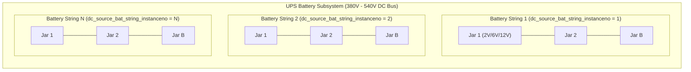
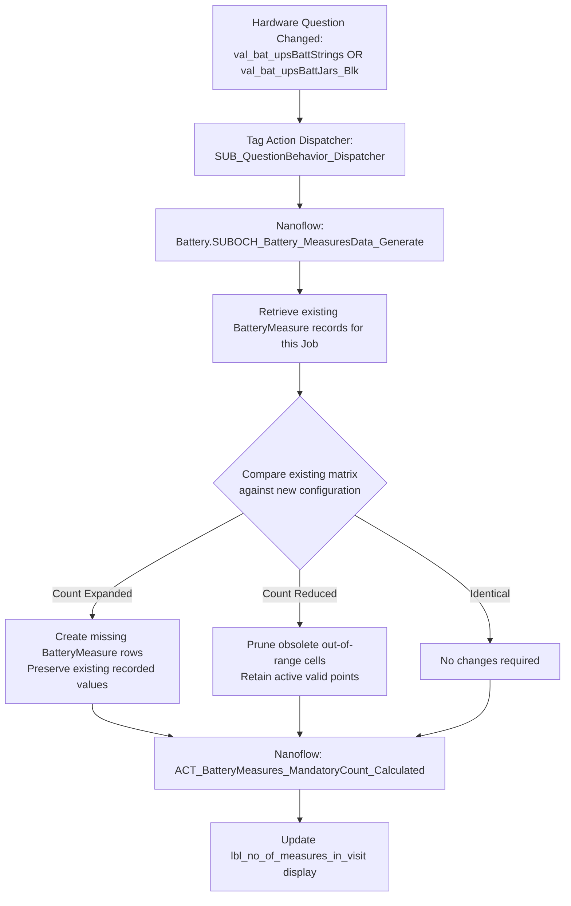
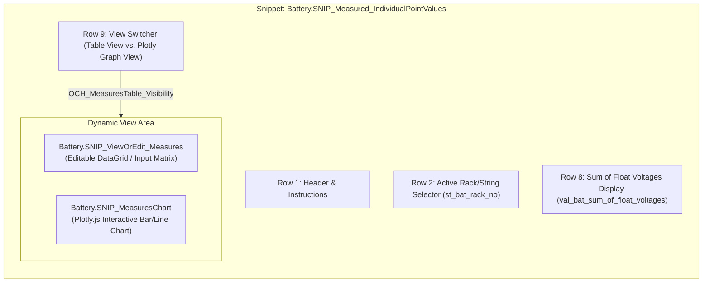

# Appendix 02: Battery Engineering & Hardware Ingestion

> [!NOTE]
> **Parent Document**: [Connected CE V2 — Comprehensive Mendix Developer Knowledge Transfer (KT) Guide](file:///C:/Users/chand/.gemini/antigravity-cli/brain/675d50f8-c688-4e59-bfba-d5550106bbba/Connected_CE_V2_Comprehensive_KT_Guide.md)
>
> This appendix details Vertiv's battery and DC power engineering domain, measurement point matrix calculations, hardware interfacing with test sets (Hioki 3554, Alber Cellcorder, NextPredict), baseline invalidation, historical trending, and discharge testing curves.

---

## 1. Vertiv Battery Engineering & Physics Primer

In a data center or critical facility, the battery subsystem is the ultimate line of defense against catastrophic power outages. While a Uninterruptible Power Supply (UPS) conditions incoming AC power, the battery bank provides the raw Direct Current (DC) energy required to sustain server operations until emergency diesel generators synchronize and take over.

### 1.1 Electrical Hierarchy

* **Strings in Parallel**: Multiple strings are connected in parallel to increase battery autonomy runtime (e.g. 15 minutes to 4 hours) and provide $N+1$ redundancy.
* **Jars in Series**: Inside each string, individual battery jars are wired in series. The sum of jar voltages must equal the total DC bus float voltage (typically 400V to 540V DC).
* **Failure Modes**: If a single jar opens or experiences excessive internal resistance, the **entire string fails**, reducing backup capacity or causing the UPS to drop the load during a power cut.

### 1.2 Core Physical Measurements
During a Preventive Maintenance (PM) inspection, Customer Engineers measure three parameters per cell or jar:
1. **Float Voltage ($V_{\text{float}}$)**: Terminal voltage while connected to the active UPS charger. Identifies under-charging (leading to sulfation) or over-charging (leading to dry-out and thermal runaway).
2. **Internal Resistance ($R_{\text{int}}$ in $m\Omega$ or $\mu\Omega$)**: The primary indicator of battery electrochemical health. As lead plates corrode, electrolyte depletes, or grid growth occurs, internal resistance rises steadily.
3. **Inter-tier / Strap Resistance**: Resistance across physical copper or lead straps connecting adjacent jars. High resistance indicates loose torqued bolts or terminal post corrosion.
4. **Temperature ($T$)**: Jar surface temperature. Elevated temperature accelerates aging (battery life halves for every $10^\circ\text{C}$ rise above $25^\circ\text{C}$).

---

## 2. The Battery Measurement Matrix Generator

Because each customer site has a unique hardware configuration (e.g. 4 strings of 40 jars of 12V batteries, or 2 strings of 240 cells of 2V batteries), the application cannot use fixed data entry tables. It dynamically generates a point matrix.

### 2.1 The Matrix Math Formula
$$\text{Total Points} = \text{Strings} \times \text{BlocsPerString} \times \text{PointsPerBloc}$$
* Typical enterprise configuration: 4 strings $\times$ 40 blocs $\times$ 1 point/bloc = **160 measurement points**.
* Large telecommunications/colocation facility: 6 strings $\times$ 240 cells = **1,440 individual measurements**.

### 2.2 Entity: `Battery.BatteryMeasure`
Every measurement point is an instance of [`Battery.BatteryMeasure`](file:///C:/Users/chand/Mendix/CEV2-Devs/javasource/battery/proxies/BatteryMeasure.java):

| Attribute | Data Type | Engineering Purpose |
| :--- | :--- | :--- |
| `StringNumber` | Integer | Physical string identifier ($1 \dots N$). |
| `JarNumber` | Integer | Physical jar/bloc index ($1 \dots B$). |
| `CellNumber` | Integer | Internal cell index within the bloc ($1 \dots C$). |
| `FloatVoltage` | Decimal (28, 8) | Measured float voltage (VDC). |
| `Resistance` | Decimal (28, 8) | Measured internal resistance ($m\Omega$ or $\mu\Omega$). |
| `StrapResistance` | Decimal (28, 8) | Inter-tier connection strap resistance. |
| `Temperature` | Decimal (28, 8) | Surface temperature ($^\circ\text{C}$ or $^\circ\text{F}$). |
| `IsBaseline` | Boolean | Flags whether this record represents an initial commissioning benchmark. |
| `IsCalculated` | Boolean | True if populated via formula engine or averaging script. |
| `JobNo` | String | Foreign key back to `Core.Job`. |

### 2.3 Execution Flow: `Battery.SUBOCH_Battery_MeasuresData_Generate`
When an engineer alters hardware parameters (e.g., updates `val_bat_upsBattStrings` or `val_bat_upsBattJars_Blk`), the Tag Action Framework invokes [`Battery.SUBOCH_Battery_MeasuresData_Generate`](file:///C:/Users/chand/Mendix/CEV2-Devs/mprcontents/):

---

## 3. Interactive Measures UI & Workspace

The technician's primary data entry workspace is encapsulated in snippet [`Battery.SNIP_Measured_IndividualPointValues`](file:///C:/Users/chand/Mendix/CEV2-Devs/mprcontents/).

### 3.1 Voltage Summation Cross-Check
Row 8 displays `val_bat_sum_of_float_voltages`.
* The formula engine computes:
  $$V_{\text{sum}} = \sum_{j=1}^{B} V_{\text{float}}(j)$$
* If $V_{\text{sum}}$ deviates by more than $\pm 2\%$ from the overall UPS DC bus voltage (`val_ups_dc_bus_voltage`), validation rule `VAL_bat_sum_of_float_voltages` highlights the field in amber, signaling that one or more jar measurements were entered incorrectly or reversed.

---

## 4. Hardware Ingestion Pipelines

To avoid entering hundreds of values manually on a tablet keyboard, technicians use three automated ingestion channels:

### 4.1 Channel 1: Hioki 3554 Optical/Bluetooth Probe
The **Hioki 3554** handheld battery tester is the industry-standard instrument used by Vertiv field engineers.
* **Hardware Connection**: The instrument communicates with the mobile device via an optical USB probe or Bluetooth Low Energy (BLE).
* **Snippet**: `Battery.SNIP_Read_Hioki_Cellcorder`.
* **Execution Flow**:
  1. Engineer selects the active string in `st_bat_rack_no`.
  2. Engineer taps **Start Direct Read** (`Battery.SNIP_Read_Hioki_StartDirectRead`).
  3. Nanoflow [`Battery.ACT_Read_Hioki`](file:///C:/Users/chand/Mendix/CEV2-Devs/mprcontents/) opens the device communication port.
  4. As the technician touches the dual-pin probe to each jar's terminal posts, the Hioki tester automatically records voltage and resistance, beeps, and streams the measurement pair.
  5. The nanoflow matches the incoming stream to `JarNumber` sequentially ($1, 2, 3 \dots B$) and writes `FloatVoltage` and `Resistance` into the corresponding `BatteryMeasure` rows in offline SQLite.

### 4.2 Channel 2: Alber Cellcorder Ingestion
For sites equipped with Alber Cellcorder test carts:
* The technician exports test data onto a USB drive as ASCII/CSV logs.
* Snippet `Battery.SNIP_Read_Hioki_Cellcorder` provides a file drop target.
* Java Action `JA_ParseCellcorderFile` parses the header blocks, identifies string numbers, and extracts jar float voltages and strap resistances.

### 4.3 Channel 3: NextPredict Batch File Upload
Vertiv's predictive maintenance analytics platform, **NextPredict**, generates batch spreadsheets containing historical and current readings.
* **Snippet**: [`Battery.SNIP_UploadBatteryMeasures`](file:///C:/Users/chand/Mendix/CEV2-Devs/mprcontents/).
* **File Type Selector**: `Battery.SNIP_SingleOptionQuestion_Combobox_FileType` backed by option datasource [`Battery.DS_GetOptionValues_FileType`](file:///C:/Users/chand/Mendix/CEV2-Devs/mprcontents/) supporting:
  * `Hioki CSV Format (*.csv)`
  * `Alber Cellcorder Text (*.txt)`
  * `NextPredict Standard Excel (*.xlsx)`
* **Processing Flow**:
  1. The file is uploaded via [`Battery.ACT_Upload_BatteryMeasures`](file:///C:/Users/chand/Mendix/CEV2-Devs/mprcontents/).
  2. Microflow `Battery.SUB_ProcessUploadedBatteryMeasures` parses spreadsheet columns using `ExcelImportExport.ACT_ExcelImport_Execute`.
  3. Readings are validated against physical tolerance envelopes (e.g. voltage between $0.5\text{V}$ and $16.0\text{V}$, resistance between $0.01\text{m}\Omega$ and $100.0\text{m}\Omega$).
  4. Rows passing validation update `BatteryMeasure` entities in SQLite. Erroneous rows are written to `Core.ErrorCollection` with exact cell coordinates.

---

## 5. Reactive Pipelines: Rack Sync & Baseline Invalidation

### 5.1 Universal Rack Synchronization (`ACT_SyncRackOptions`)
When a UPS configuration changes its string count (e.g. from 2 strings to 4 strings):
* All pages containing the rack selector `st_bat_rack_no` must immediately update their dropdown choices to include `RACK 1`, `RACK 2`, `RACK 3`, and `RACK 4`.
* **Flow**:
  1. Dispatcher calls [`Battery.ACT_SyncRackOptions`](file:///C:/Users/chand/Mendix/CEV2-Devs/mprcontents/).
  2. Sub-flow [`Battery.SUB_SyncRackOptionsForQuestion`](file:///C:/Users/chand/Mendix/CEV2-Devs/mprcontents/) queries the total active SubQuestionnaires under the Job.
  3. It constructs missing `Option` objects (`RACK_1`..`RACK_N`).
  4. It prunes obsolete options if string count decreased.
  5. **Selection Preservation**: If the engineer already had `RACK 2` selected, the algorithm verifies that `RACK 2` is still valid and **does not clear the user selection**.

### 5.2 Baseline Invalidation & Reset (`ACT_ResetStringBaseline`)
Battery degradation tracking depends on having an accurate baseline:
$$\Delta R = \frac{R_{\text{current}} - R_{\text{baseline}}}{R_{\text{baseline}}} \times 100\%$$
* If an engineer replaces a physical battery string during a service visit, checking question `st_bat_replace_string`:
* **The old baseline is no longer valid**. Comparing a brand-new battery against a 5-year-old baseline would produce invalid health scores.
* **Flow**:
  1. Triggered via Tag Action `ResetStringBaseline`.
  2. Nanoflow [`Battery.ACT_ResetStringBaseline`](file:///C:/Users/chand/Mendix/CEV2-Devs/mprcontents/) calls [`Battery.SUB_BatteryMeasure_CleanupBaseline`](file:///C:/Users/chand/Mendix/CEV2-Devs/mprcontents/).
  3. Prior baseline associations for that string are deleted.
  4. Current visit measurements are flagged as the **new initial baseline** (`IsBaseline = true`), establishing a new degradation curve for the replacement hardware.

---

## 6. Historical Trending & Critical Alarms

### 6.1 Critical Alarm Thresholds
Entity [`Battery.BatteryMeasures_MonitorCrtical`](file:///C:/Users/chand/Mendix/CEV2-Devs/javasource/battery/proxies/BatteryMeasures_MonitorCrtical.java) continuously monitors resistance deltas:

| Delta Resistance ($\Delta R$) | Health Status | UI Display | Engineering Action Required |
| :--- | :--- | :--- | :--- |
| $\Delta R < +20\%$ | **Normal / Pass** | Green Bar | Battery operating within normal electrochemical parameters. |
| $+20\% \le \Delta R < +30\%$ | **Notice** | Yellow Bar | Minor aging or sulfation detected; re-check on next quarterly visit. |
| $+30\% \le \Delta R < +50\%$ | **Warning** | Orange Bar | Significant degradation; schedule jar replacement. |
| $\Delta R \ge +50\%$ | **Critical Alarm** | Red Blinking Bar | High risk of thermal runaway or open circuit; immediate replacement mandatory. |

### 6.2 Plotly.js Chart Visualizations
On-screen interactive charts and PDF report charts are rendered using **Plotly.js**:
* **Client Action**: [`Battery.getMeasuresChartJSON.js`](file:///C:/Users/chand/Mendix/CEV2-Devs/javascriptsource/battery/actions/getMeasuresChartJSON.js) builds the JSON configuration payload (traces, layout, threshold reference lines, responsive margins).
* **Trending Action**: [`Battery.JSA_GetBatteryTrendingChartData.js`](file:///C:/Users/chand/Mendix/CEV2-Devs/javascriptsource/battery/actions/JSA_GetBatteryTrendingChartData.js) overlays current readings against multi-year historical visit baselines.
* **PDF Action**: `Battery.getMeasuresChartJSON_PDF.js` renders vector-optimized static chart images embedded in the final customer engineering report.

---

## 7. Battery Discharge & Capacity Testing

For sites requiring formal autonomy verification, engineers conduct battery discharge tests:
* **Snippet**: [`Battery.SNIP_BatteryDischarge`](file:///C:/Users/chand/Mendix/CEV2-Devs/mprcontents/).
* **Entity**: [`Battery.DischargeMeasures_VoltagePerTimestamp`](file:///C:/Users/chand/Mendix/CEV2-Devs/javasource/battery/proxies/DischargeMeasures_VoltagePerTimestamp.java).
* **Operation**:
  1. The UPS is disconnected from utility AC power, forcing the critical load onto the battery bank.
  2. Every minute (or at configured time intervals), the technician records DC bus voltage and discharge current.
  3. Action [`Battery.ACT_Upload_BatteryDischarge`](file:///C:/Users/chand/Mendix/CEV2-Devs/mprcontents/) imports time-series load data.
  4. Action `Battery.getDischargeChartJSON.js` renders the discharge curve, comparing actual voltage drop against the manufacturer's expected discharge profile to compute **Battery Health Percentage (%)**.
