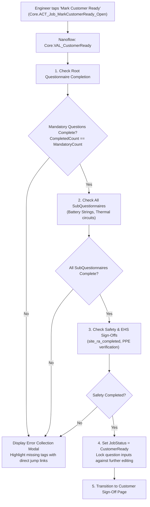
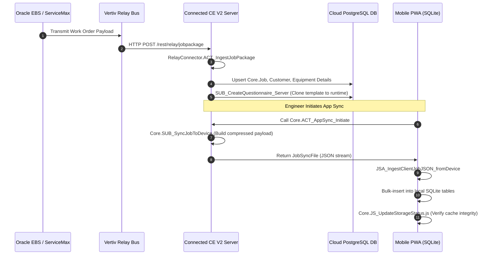
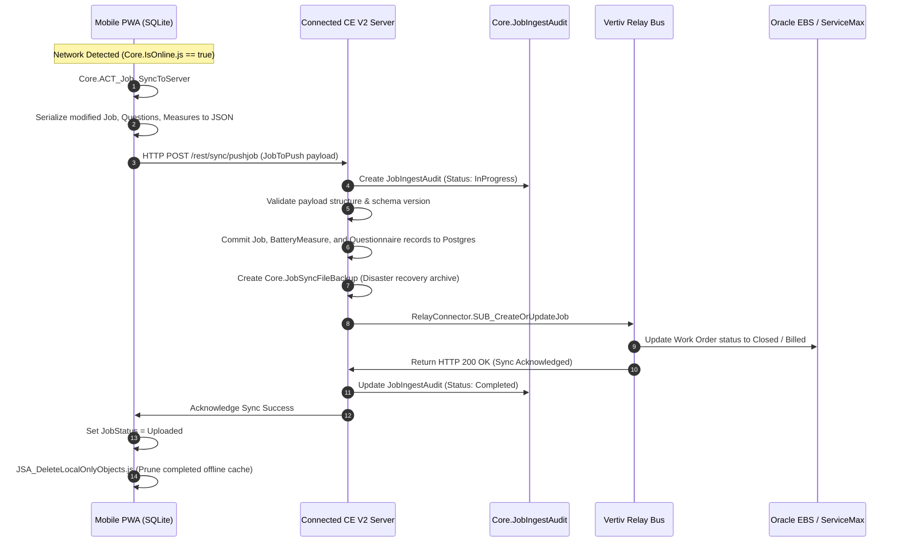

# Appendix 03: Job Lifecycle & Offline Sync Pipeline

> [!NOTE]
> **Parent Document**: [Connected CE V2 — Comprehensive Mendix Developer Knowledge Transfer (KT) Guide](file:///C:/Users/chand/.gemini/antigravity-cli/brain/675d50f8-c688-4e59-bfba-d5550106bbba/Connected_CE_V2_Comprehensive_KT_Guide.md)
>
> This appendix details the end-to-end lifecycle of a work order ([`Core.Job`](file:///C:/Users/chand/Mendix/CEV2-Devs/javasource/core/proxies/Job.java)), state machine transition guards, the "Customer Ready" validation checkpoint, the [`RelayConnector`](file:///C:/Users/chand/Mendix/CEV2-Devs/javasource/relayconnector/) enterprise integration, payload schemas, and offline-to-online bi-directional synchronization.

---

## 1. The Job State Machine & Lifecycle

The work order entity [`Core.Job`](file:///C:/Users/chand/Mendix/CEV2-Devs/javasource/core/proxies/Job.java) governs the physical workflow of a Customer Engineer on site.

### 1.1 Complete State Machine Diagram

```mermaid
stateDiagram-v2
    [*] --> Assigned: Ingested from Oracle EBS / Salesforce via Relay
    Assigned --> Downloaded: CE performs "App Sync"; Job cached to device SQLite
    Downloaded --> Open: CE arrives on customer site & opens Job
    Open --> CustomerReady: All mandatory safety & equipment questions answered
    CustomerReady --> Open: CE needs to amend or add additional findings
    CustomerReady --> Completed: Customer signs on tablet glass; Final PDF generated
    Completed --> Uploaded: Device reconnects to network; Sync pushes Job to Relay
    Uploaded --> [*]: Work order closed in Oracle EBS / ServiceMax

    Assigned --> Cancelled: Cancelled by Dispatcher / Coordinator
    Downloaded --> Cancelled: Cancelled by Coordinator
    Open --> Cancelled: Site aborted / Access denied
```

### 1.2 State Transition Guards & Security Rules

| State (`Core.ENUM_JobStatus`) | Permitted User Actions | Data Mutation Allowed? | Transition Guard / Validation |
| :--- | :--- | :---: | :--- |
| **`Assigned`** | View job card on server dashboard; assign engineer. | Yes (Server) | Work order exists in Oracle EBS with a scheduled visit date. |
| **`Downloaded`** | Stored locally in mobile client SQLite database. | No | Successfully transferred via `Core.SUB_SyncJobToDevice`. |
| **`Open`** | Answer questions, scan Hioki battery tester, upload files. | **Yes (Full Edit)** | Engineer taps **Open Job** (`Core.ACT_Job_Open`). |
| **`CustomerReady`** | View completed summary, generate draft report preview. | **Read-Only** | [`Core.VAL_CustomerReady`](file:///C:/Users/chand/Mendix/CEV2-Devs/mprcontents/) must confirm 100% of mandatory tags answered. |
| **`Completed`** | Capture customer signature, view final signed PDF. | **Locked** | Signature captured; final PDF rendered and enqueued. |
| **`Uploaded`** | Archived; historical read-only reference. | **Immutable** | Server confirms receipt of `JobPayload` and pushes to Relay. |

---

## 2. The "Customer Ready" Validation Checkpoint

A critical business requirement for Vertiv is ensuring that **no incomplete or unvalidated report is ever presented to a customer**.

### 2.1 The Customer Sign-Off Flow
Once a Job enters `CustomerReady`:
1. The app displays the customer summary dashboard (`Core.SNIP_CustomerSummary`).
2. The customer reviews equipment status, critical battery alarms, and technician recommendations.
3. The customer signs directly on the touch screen (captured via custom canvas widget into an image attribute).
4. Nanoflow [`Core.Act_EnQueForPrintAndCloseJob`](file:///C:/Users/chand/Mendix/CEV2-Devs/mprcontents/) is invoked:
   * Sets `JobStatus = Completed`.
   * Triggers the PDF generation pipeline (`PDFs.SUB_GenerateJobReport_Server`).
   * Enqueues the completed work order into the upload sync queue.

---

## 3. Downstream Synchronization: Enterprise to Mobile

Downstream sync transfers scheduled work orders from Vertiv's cloud to the technician's mobile device.

### 3.1 The `EbsJobPackage` JSON Payload Structure
Ingested via [`RelayConnector.ACT_IngestJobPackage`](file:///C:/Users/chand/Mendix/CEV2-Devs/mprcontents/):
* **`SR_INFO_DETAIL_ITEM`**: Service Request number, customer name, site physical address, dispatch notes.
* **`UNIT_DETAILS_ITEM`**: Physical asset serial number, model name, technology type (`UPS`, `Battery`, `Thermal`), commissioning date.
* **`TASK_DETAILS_ITEM`**: Specific PM tasks required by the customer's service contract.
* **`CONTRACT_DETAILS_ITEM`**: SLA response times, contracted labor hours, coverage entitlements.
* **`CUSTOMER_DETAILS_ITEM`**: Site contact name, email address, phone number, security clearance requirements.

### 3.2 Seeding the Mobile SQLite Database
Inside `Core.SUB_SyncJobToDevice`:
* The server serializes not just the `Core.Job`, but the entire tree:
  $$\text{Job} \longrightarrow \text{Questionnaire} \longrightarrow \text{Pages} \longrightarrow \text{Questions} \longrightarrow \text{Options} \longrightarrow \text{Rules}$$
* In addition, it packs **historical baseline records** (`Battery.BatteryStringBaseline`) from previous service visits so the engineer can compare degradation curves offline.

---

## 4. Upstream Synchronization: Mobile to Enterprise

When the engineer finishes work on site and re-establishes internet connectivity, the upstream synchronization pipeline pushes the completed inspection back to Vertiv enterprise systems.

### 4.1 Upstream Entities:
* **[`Core.JobToPush`](file:///C:/Users/chand/Mendix/CEV2-Devs/javasource/core/proxies/JobToPush.java)**: Ephemeral synchronization envelope holding the serialized JSON payload.
* **[`Core.JobPayload`](file:///C:/Users/chand/Mendix/CEV2-Devs/javasource/core/proxies/JobPayload.java)**: File document containing the raw JSON upload stream.
* **[`Core.JobSyncFileBackup`](file:///C:/Users/chand/Mendix/CEV2-Devs/javasource/core/proxies/JobSyncFileBackup.java)**: Permanent audit archive preserved in file storage to guarantee zero data loss if an ERP endpoint is temporarily down.
* **[`Core.JobIngestAudit`](file:///C:/Users/chand/Mendix/CEV2-Devs/javasource/core/proxies/JobIngestAudit.java)**: System log tracking timestamp, engineer GUID, payload size (KB), duration (ms), and error messages.

---

## 5. Conflict Resolution & Offline Edge Cases

### 5.1 Scenario 1: Reassigned Job Detection
* **Problem**: While a technician is offline in a data center for two days, the central dispatch coordinator reassigns the work order to a different engineer in Oracle EBS.
* **Resolution**: When the offline technician reconnects and initiates sync, JavaScript Action [`Core.JSA_CheckIfJobReassigned.js`](file:///C:/Users/chand/Mendix/CEV2-Devs/javascriptsource/core/actions/JSA_CheckIfJobReassigned.js) queries the server.
  * If the job was reassigned, the server does not overwrite the reassignment blindly.
  * It presents a split dialog (`Core.ACT_Job_ReassignOffline_Submit`) allowing the coordinator to merge field findings into an audit revision.

### 5.2 Scenario 2: Emergency Manual Recovery
If a mobile device's local database encounters a fatal corruption or network timeout:
1. **Manual Client JSON Export**: Nanoflow [`Core.ACT_Job_ExportClientJSON_Offline`](file:///C:/Users/chand/Mendix/CEV2-Devs/mprcontents/) exports the entire raw in-browser SQLite database as a downloadable JSON file.
2. **Server Manual Ingestion**: An IT Administrator opens [`Core.ACT_ImportClientJobJSON_Server_Submit`](file:///C:/Users/chand/Mendix/CEV2-Devs/mprcontents/) in the Admin Console, uploads the JSON file, and forces synchronization directly into the server database.
3. **Local Cache Purge**: If an engineer needs to clear stale local storage, [`Core.ACT_Job_PurgeManually`](file:///C:/Users/chand/Mendix/CEV2-Devs/mprcontents/) and `Core.JSA_WipeProfile.js` safely reset the in-browser database without affecting server records.
