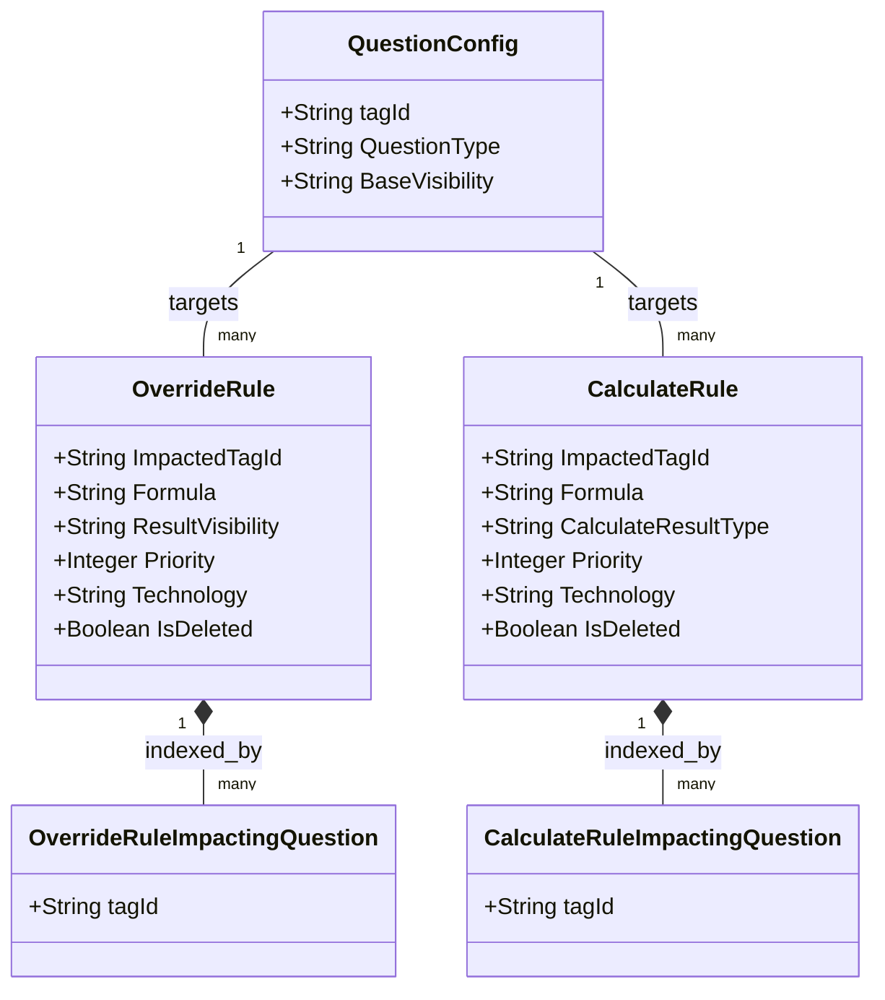
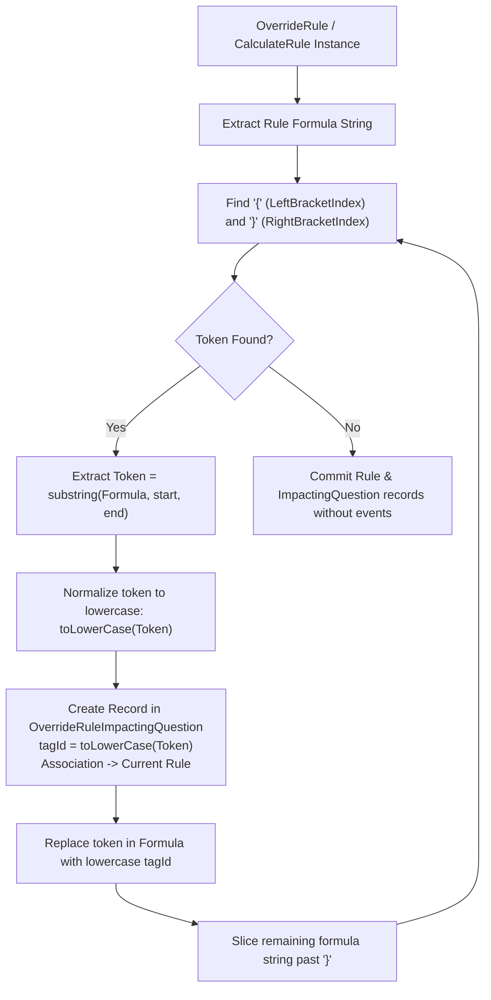
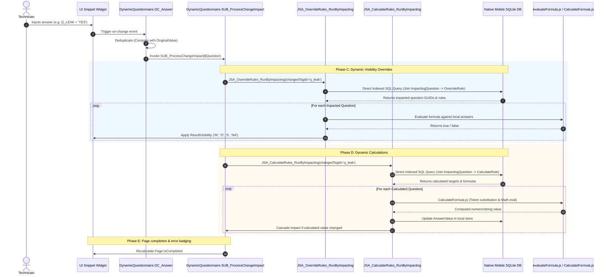

# Dynamic Override & Calculate Rules Architecture
## Impacted & Impacting Tags Computation and Offline Runtime Execution

> **System:** Connected CE V2 ([Connected CE V2.mpr](file:///C:/Users/chand/Mendix/CEV2-Devs/Connected%20CE%20V2.mpr))  
> **Key Modules:** `DynamicQuestionnaire`, `Core`, `MasterData`  
> **Target Profiles:** Native Mobile (Offline SQLite Profile) & Web Administration (Online PostgreSQL Profile)  

---

## 1. Architectural Overview & Problem Context

In large-scale industrial equipment inspections (such as Vertiv Liebert UPS, thermal chillers, and power distribution units), field questionnaires cannot remain static. An inspection form must adapt dynamically based on real-time field observations and physical sensor readings:
1. **Dynamic Visibility & Requirement Overrides:** Answering `"YES"` to `"Oil leak observed?"` must dynamically force follow-up questions (e.g. `"Leak location"`, `"Severity"`, `"Remedial action taken"`) to change from Hidden/Not Applicable (`'NA'`) to Mandatory (`'M'`).
2. **Dynamic Mathematical Derivations:** Entering physical measurements such as Suction Pressure (`{Q_SUCTION_PRESS}`) and Discharge Pressure (`{Q_DISCHARGE_PRESS}`) must instantly compute derived engineering telemetry such as **Compression Ratio** or **Superheat Temperature**.

To execute this on ruggedized mobile tablets operating in **offline, zero-connectivity data center bunkers**, the architecture avoids full-form re-evaluations. Instead, it utilizes an **Inverted Dependency Index** and **Direct Indexed SQLite Queries** to achieve sub-10ms reactive evaluation.

---

## 2. Metamodel & Formula Specification

### 2.1 Core Entities



### 2.2 Formula Syntax & Lexical Rules

Formulas are parsed by an embedded mathematical evaluator based on `expr-eval`:
- **Variable Tokens:** Enclosed in curly braces: `{TAG_NAME}` (e.g., `{Q_OIL_LEAK}`, `{VOLTS_L1}`).
- **Comparison Operators:** `==` (equal), `!=` (not equal), `<`, `>`, `<=`, `>=`.
- **Logical Connectors:** `and`, `or`, `not`.
- **String Literals:** Enclosed in single quotes: `'YES'`, `'CRITICAL'`, `'FAIL'`.
- **Arithmetic & Scientific Functions:** `+`, `-`, `*`, `/`, `^`, `%`, `round(val, decimals)`, `floor(val)`, `ceil(val)`, `abs(val)`, `min(a, b)`, `max(a, b)`, `if(cond, thenVal, elseVal)`.

#### Concrete Examples:
```text
// Override Rule Formula (Returns Boolean):
({Q_LEAK_OBSERVED} == 'YES' or {Q_PRESSURE_DIFF} > 15.5) and {Q_SYSTEM_STATUS} != 'NORMAL'

// Calculate Rule Formula (Returns Decimal / String):
if({Q_PRESS_RATIO} > 4.5, round({Q_FLOW_RATE} * 1.15, 2), round({Q_FLOW_RATE} * 1.05, 2))
```

---

## 3. Impacted vs. Impacting Tags Computation

### 3.1 Conceptual Distinction

| Concept | Attribute in Model | Definition | Example |
| :--- | :--- | :--- | :--- |
| **Impacted Tag** | `TargetTagId` / `ImpactedTagId` | The question whose **visibility or value is altered** by the rule. | `Q_ACTION_TAKEN` (becomes mandatory), `Q_COMPRESSION_RATIO` (receives calculated value). |
| **Impacting Tag** | `ImpactingTagId` / `tagId` | The question referenced inside the formula whose **answer change triggers** the rule. | `{Q_LEAK_OBSERVED}`, `{Q_SUCTION_PRESS}`. |

### 3.2 Server-Side Inverted Indexing (`SUB_CreateOverrideRuleImpactingQuestions_Online`)

When an administrator saves an `OverrideRule` or imports it via Excel, Mendix compiles the inverted dependency index:



#### Exact Microflow Implementation Logic:
1. Loops through `$IteratorFormula` using `find($IteratorFormula, '{')` and `find($IteratorFormula, '}')`.
2. Extracts `$NextToken = substring(...)`.
3. Normalizes tag: `toLowerCase($NextToken)` to ensure case-insensitive matching across mobile SQLite and backend databases.
4. Creates a child entity [`DynamicQuestionnaire.OverrideRuleImpactingQuestion`](file:///C:/Users/chand/Mendix/CEV2-Devs/javasource/dynamicquestionnaire/proxies/OverrideRuleImpactingQuestion.java) setting:
   - `tagId = toLowerCase($NextToken)`
   - `OverrideRuleImpactingQuestion_OverrideRule = $OverrideRule`
5. Updates the formula in place: `replaceAll($OverrideRule/Formula, $NextToken, toLowerCase($NextToken))`.
6. Repeats identically for `CalculateRule` $\rightarrow$ [`CalculateRuleImpactingQuestion`](file:///C:/Users/chand/Mendix/CEV2-Devs/javasource/dynamicquestionnaire/proxies/CalculateRuleImpactingQuestion.java).

---

## 4. Runtime Execution in the Mobile Offline Profile

When the technician works offline, all data resides in the local **mobile SQLite database**. The application never executes full-tree scans. Instead, an event-driven, five-phase reactive engine processes changes in milliseconds.



### 4.1 Step-by-Step Offline Lifecycle

#### Step 1: Deduplication Guard (`OC_Answer`)
When a user blurs or edits an input field:
- Compares `$Question/AnswerValueString` or `AnswerValueDecimal` against `QuestionGetOriginalValueString` or `QuestionGetOriginalValueDecimal`.
- If unchanged, execution stops immediately, preventing spurious CPU cycles.

#### Step 2: Direct SQLite Index Query
[`JSA_OverrideRules_RunByImpacting.js`](file:///C:/Users/chand/Mendix/CEV2-Devs/javascriptsource/dynamicquestionnaire/actions/JSA_OverrideRules_RunByImpacting.js) issues raw indexed SQL to the mobile SQLite database:

```sql
SELECT DISTINCT 
    OverRule.ImpactedTagId AS "ImpactedTagId", 
    QtoUpdate.guid AS "ImpactedTagGuid", 
    'OverrideRule' AS "RuleType", 
    OverRule.guid AS "RuleGuid"
FROM mx${userGUID}$DynamicQuestionnaire$Question AS Question
INNER JOIN mx${userGUID}$DynamicQuestionnaire$OverrideRuleImpactingQuestion AS OverRuleIQ 
    ON OverRuleIQ.TagId = Question.tagId 
INNER JOIN mx${userGUID}$DynamicQuestionnaire$OverrideRule AS OverRule 
    ON OverRule.guid = OverRuleIQ.DynamicQuestionnaire$OverrideRuleImpactingQuestion_OverrideRule 
    AND OverRule.IsDeleted = false 
    AND (OverRule.Technology = '${job.get("sr_unit_item_type")}' OR OverRule.Technology IS NULL OR OverRule.Technology = '')
INNER JOIN mx${userGUID}$DynamicQuestionnaire$Question AS QtoUpdate 
    ON QtoUpdate.tagId = OverRule.ImpactedTagId
    AND QtoUpdate.QuestionnaireId IN (${questionnaireIdCSV})
INNER JOIN mx${userGUID}$DynamicQuestionnaire$Page AS Page 
    ON Page.guid = QtoUpdate.DynamicQuestionnaire$Question_RootPage
WHERE Question.tagId = '${changedTagId}' 
  AND Question.QuestionnaireId IN (${questionnaireIdCSV})
ORDER BY Page.SortOrder ASC, QtoUpdate.SortOrder ASC, QtoUpdate.BlockTagId ASC, OverRule.Technology DESC;
```

#### Step 3: Priority Resolution & Visibility Application
- A single question can be targeted by multiple override rules.
- Rules are sorted by **`Priority ASC`** (lowest number = highest precedence).
- The engine iterates through the active rules:
  1. Replaces all `{tagId}` tokens in `Formula` with their actual values from the local SQLite answer table.
  2. Evaluates the expression in JavaScript via `evaluateFormula.js`.
  3. **First Match Wins:** The first rule whose formula evaluates to `true` sets `$Question/ResultVisibility` to the rule's `ResultVisibility` (`'M'`, `'O'`, `'S'`, `'NA'`, `'I'`).
  4. **Fallback:** If no override rule evaluates to `true`, the question's `ResultVisibility` is restored to its static baseline: `$Question/ResultVisibility = $Question/BaseVisibility`.

#### Step 4: Calculate Rules Execution & Recursion Protection
[`JSA_CalculateRules_RunByImpacting.js`](file:///C:/Users/chand/Mendix/CEV2-Devs/javascriptsource/dynamicquestionnaire/actions/JSA_CalculateRules_RunByImpacting.js) executes in Phase D:
1. Finds all calculate rules whose `CalculateRuleImpactingQuestion` references the modified tag.
2. In `CalculateFormula.js`, tokens are hydrated from the SQLite database:
   - Numbers: unquoted decimals/integers.
   - Text: escaped single-quoted strings.
   - Nulls: literal `null`.
3. **The Recursion Guard (`CalcTagsRan`):** If formula `{A}` derives `{B}`, and `{B}` derives `{A}`, a naive reactive engine would lock the device in an infinite loop. The engine maintains a runtime set `CalcTagsRan`. If a question tag is encountered more than once within a single reactive cascade, calculation halts and an alert is logged.
4. **Downstream Cascade:** If the calculated result changes the stored answer of `{B}`, `SUB_ProcessChangeImpact` is dispatched for `{B}`, propagating downstream derivations to all dependent questions.

#### Step 5: Downstream Page Completion Auditing
In Phase E, `DynamicQuestionnaire.CheckComplete_ImpactedPages` verifies:
- All questions on the current and impacted pages with `ResultVisibility = 'M'` have non-null, valid answers.
- All validation constraints pass (`HasError = false`).
- Updates `Page.IsCompleted = true/false`, dynamically enabling or disabling the mobile navigation buttons.

---

## 5. Summary Matrix: Online vs. Offline Operation

| Execution Phase | Online Web Profile | Mobile Offline Profile |
| :--- | :--- | :--- |
| **Rule Storage** | PostgreSQL / SQL Server | Local SQLite Database (`mx${userGUID}$...`) |
| **Impacting Tag Indexing** | Compiled in microflow on Save/Import via `SUB_CreateOverrideRuleImpactingQuestions_Online` | Pre-indexed in SQLite during metadata synchronization |
| **Query Engine** | Standard Mendix XPath / OQL | Direct native SQLite queries in JavaScript actions |
| **Formula Evaluator** | Server-side JavaScript / Java engine | Client-side `expr-eval` in `evaluateFormula.js` |
| **Cascade Speed** | ~100–300 ms (network/DB round-trips) | < 15 ms (local RAM and indexed SQLite) |
