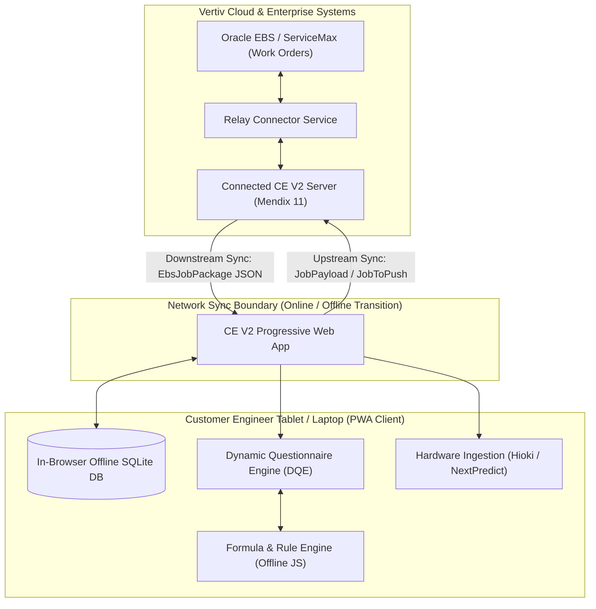
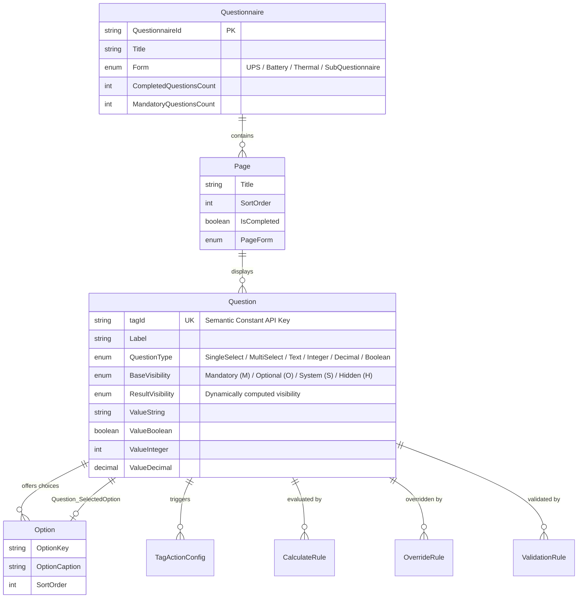
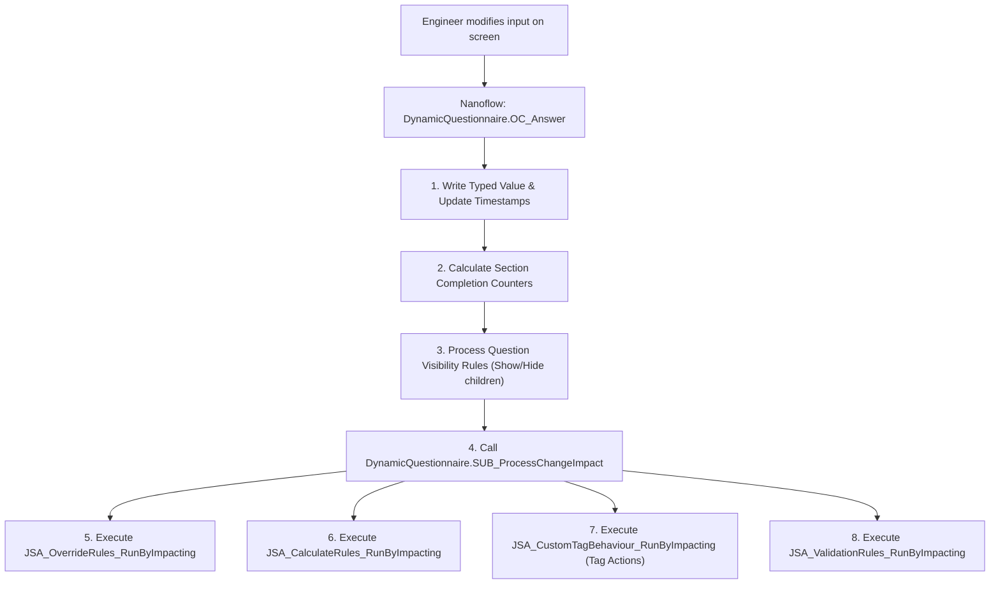
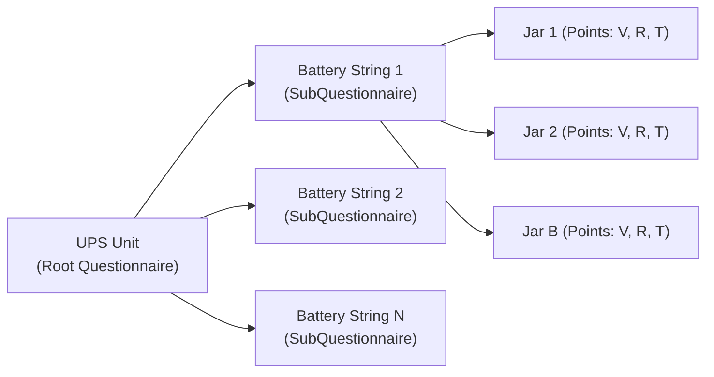
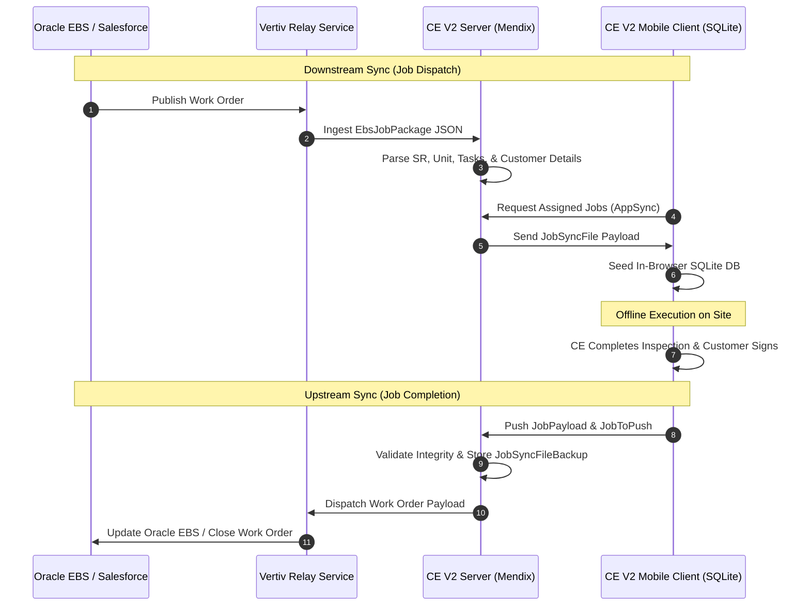

# Connected CE V2 — Comprehensive Mendix Developer Knowledge Transfer (KT) Guide

> [!IMPORTANT]
> **Document Purpose**: This guide is written for a Mendix developer who is newly joining the **Connected CE V2** ("CE V2") project. It bridges the gap between Vertiv's physical field engineering business domain and the technical implementation inside the Mendix application model.
>
> This main guide provides the architectural blueprint, domain models, execution flows, and key system concepts. Detailed deep dives for specific subsystems are provided in the companion **Appendix Documents (01 through 04)** linked throughout this text.

---

## 1. Executive Summary & Vertiv Domain Overview

### 1.1 What is Vertiv?
**Vertiv** is a global leader in designing, manufacturing, and servicing critical digital infrastructure. This encompasses:
* **Uninterruptible Power Supply (UPS) Systems**: Massive battery-backed power conditioning and backup units (e.g. Liebert EXM, Trinergy, APM, eXL) that ensure zero milliseconds of downtime for enterprise data centers, hospitals, financial trading platforms, and telecommunications sites.
* **DC Power & Battery Strings**: Banks of Valve-Regulated Lead-Acid (VRLA), Lithium-Ion, or Wet-cell batteries connected in series/parallel strings to deliver hundreds of volts of DC reserve power when grid power fails.
* **Thermal Management Systems**: Precision cooling, chilled water systems, heat rejection, and economizers maintaining exact temperature and humidity envelopes in server halls.

### 1.2 What is Connected CE V2?
**Connected CE V2** (Customer Engineer Version 2) is Vertiv's flagship field service web/mobile application. It is used on customer sites by **Customer Engineers (CEs)**—highly trained field technicians who perform:
1. **Preventive Maintenance (PM) Visits**: Scheduled rigorous multi-point visual, electrical, mechanical, and safety inspections of critical equipment.
2. **Corrective Maintenance & Repair**: Diagnosing component failures, replacing capacitors, fans, power modules, or battery jars.
3. **Commissioning & Startup**: Energizing newly installed infrastructure, setting baseline internal resistance values, and verifying installation compliance.
4. **Capacity & Discharge Testing**: Load-testing battery banks under real-world load to verify runtime autonomy.

### 1.3 The Core Operational Challenge: 100% Offline Capability
Vertiv Customer Engineers regularly operate in **high-security underground data centers, Faraday cages, offshore facilities, and remote substations** where cellular signals and Wi-Fi are strictly prohibited or non-existent.
* The application must operate **fully offline** for hours or days at a time.
* All data entry, dynamic validations, mathematical formula calculations, battery health evaluations, and PDF report previews must occur directly on the engineer's device without a single HTTP request to a server.
* When connectivity is re-established, the app must reliably synchronize complex hierarchical inspection results back to Vertiv's enterprise backend systems (**Oracle EBS**, **Salesforce/ServiceMax**, and the **Vertiv Relay** integration bus).



---

## 2. High-Level Technical Architecture

Connected CE V2 is built on **Mendix 11** configured as an **Offline-First Progressive Web Application (PWA)**.

### 2.1 Technical Stack & Key Technologies
* **Platform**: Mendix Studio Pro 11.15.0.
* **Client Runtime**: Progressive Web App (PWA) with Service Worker caching for static assets.
* **Local Data Store**: In-browser Web SQL / SQLite managed by Mendix Client SDK (`mx.data.offlineDataBackend`).
* **Direct SQL Acceleration**: `javascriptsource/core/helpers/offlineSQLEngine.js` executes raw SQLite queries directly on the local client database for instantaneous retrieval of large datasets (thousands of questions and measurement points).
* **State Management**: `ListOperations.ListTracker` maintaining in-memory tracking arrays (e.g. `CalcTagsRan`) to break cyclic dependency loops in rule evaluations.
* **Hardware Interfacing**: Optical probe and Bluetooth scanner integration for **Hioki 3554** battery testers, file parsers for **Alber Cellcorder**, and Excel/CSV ingestion for **NextPredict** predictive analytics.

### 2.2 Module Organization & Architectural Layering

| Architectural Layer | Modules | Core Responsibility |
| :--- | :--- | :--- |
| **Presentation & UI Shell** | `Custom_ThemeStarter`, `Atlas_Core`, `Custom_DesignSystem` | Master layouts, responsive design tokens, SVG icons, and common styling. |
| **Identity & Access** | `Login`, `OIDC`, `Administration`, `MicrosoftGraph` | Azure Active Directory authentication, Single Sign-On (SSO), and role-based access. |
| **Job Management & State** | `Core`, `Customer`, `MasterData` | Work order entity (`Core.Job`), state transitions, assignees, engineer profiles, and equipment catalog. |
| **Dynamic Form Engine** | `DynamicQuestionnaire`, `LocalDatabaseOperations`, `ListOperations` | Metamodel for dynamic questionnaires, polymorphic question storage, formula evaluation, and tag actions. |
| **Asset Domain Modules** | `Battery`, `UPS`, `Thermal` | Equipment-specific inspection workflows, battery measurement matrices, string configurations, and trending curves. |
| **Integration & Exchange** | `RelayConnector`, `ExcelImportExport`, `DataImporter`, `PDFs` | Bi-directional synchronization with Oracle EBS/Salesforce, Excel configuration upload/download, and customer PDF generation. |

---

## 3. The Core Job Lifecycle

The central entity driving all engineer activity is [`Core.Job`](file:///C:/Users/chand/Mendix/CEV2-Devs/javasource/core/proxies/Job.java). A Job represents a discrete customer work order or service visit.

### 3.1 Job State Machine
A Job advances through clear states tracked by enumeration [`Core.ENUM_JobStatus`](file:///C:/Users/chand/Mendix/CEV2-Devs/javasource/core/proxies/ENUM_JobStatus.java):

```mermaid
stateDiagram-v2
    [*] --> Assigned: Ingested from Oracle EBS via Relay
    Assigned --> Downloaded: CE syncs device; Job cached to SQLite
    Downloaded --> Open: CE opens Job on site & begins inspection
    Open --> CustomerReady: All mandatory tags answered & validated
    CustomerReady --> Completed: Customer signs on glass; PDF generated
    Completed --> Uploaded: Synchronized back to Oracle EBS & Salesforce
    Uploaded --> [*]
```



### 3.2 Key Job Attributes & Associations
* **Identification**: `JobNo` (e.g. `SR-1234567-1`), `CustomerName`, `SiteName`, `VisitDate`.
* **Technology & Form**: `sr_unit_item_type` (String Enum matching `QuestionnaireForms`: `UPS`, `Battery`, `Thermal`, etc.), `ModelType`, `TechFamily`.
* **Engineers**: `DynamicQuestionnaire.Questionnaire_RootJob` links the Job to its top-level root questionnaire.
* **Process Tracking**: [`Core.CustomerReadyHelper`](file:///C:/Users/chand/Mendix/CEV2-Devs/javasource/core/proxies/CustomerReadyHelper.java) verifies whether all required safety and equipment questions are completed before the engineer is permitted to present the tablet for customer sign-off.

### 3.3 Key Microflows & Nanoflows for Job Management
* **`Core.ACT_CreateJob_Open_Device`** (NF): Opens the offline job creation or selection interface on the mobile device.
* **`Core.ACT_Job_Open`** (NF): Primary entry point when a technician taps a Job card. Validates local SQLite cache, seeds current user permissions, and routes to the appropriate questionnaire view.
* **`Core.ACT_Job_EditStatus_toCustomerReady`** (NF): Validates completion criteria via `Core.VAL_CustomerReady` and transitions the job to `CustomerReady`.
* **`Core.SUB_SyncJobToDevice`** (MF): Server-side microflow that packages job data, historical baselines, and questionnaire configurations into an optimized payload for the mobile device.

---

## 4. The Dynamic Questionnaire Engine (DQE)

The single most critical subsystem in Connected CE V2 is the **Dynamic Questionnaire Engine (DQE)** housed in the [`DynamicQuestionnaire`](file:///C:/Users/chand/Mendix/CEV2-Devs/javasource/dynamicquestionnaire/) module.

### 4.1 Why Dynamic Questionnaires?
In standard Mendix applications, forms are created with fixed entity attributes and hardcoded page inputs. In Vertiv's business, this approach fails because:
1. Vertiv maintains **thousands of equipment models** across UPS, Battery, and Thermal product lines.
2. Service contract requirements differ by region (North America, EMEA, APAC) and visit type (Annual PM, Quarterly PM, Emergency Callout).
3. Hardcoding every question would require hundreds of static pages and continuous app deployments.

DQE solves this by introducing a **metadata-driven metamodel** where questionnaires, pages, questions, options, and rules are defined as data.

### 4.2 The DQE Metamodel



### 4.3 The Semantic `tagId` Contract
Every question in the system has a unique, immutable string identifier called **`tagId`** (e.g. `val_bat_upsBattStrings`, `st_bat_rack_no`, `lbl_bat_measured_individual_point_values`).
* **`tagId` is never localized and never displayed to the user**. It serves as an internal API contract across SQL queries, JavaScript actions, formulas, hardware parsers, and external integrations.
* **Rule**: Never change an existing `tagId` without understanding downstream impacts on formulas and SQLite indexes.

### 4.4 Polymorphic Value Storage
Instead of creating dozens of subclassed entities, [`DynamicQuestionnaire.Question`](file:///C:/Users/chand/Mendix/CEV2-Devs/javasource/dynamicquestionnaire/proxies/Question.java) uses polymorphic value columns:
* **`ValueString`**: Free text, serial numbers, notes, and raw string values.
* **`ValueBoolean`**: Checkboxes, Yes/No toggles.
* **`ValueInteger`**: Counts (e.g. number of battery strings, jar count).
* **`ValueDecimal`**: Measurements (e.g. DC bus voltage, temperature).
* **`Question_SelectedOption`**: Association pointing to the chosen [`DynamicQuestionnaire.Option`](file:///C:/Users/chand/Mendix/CEV2-Devs/javasource/dynamicquestionnaire/proxies/Option.java) for single-choice dropdowns/radio buttons.
* **`Question_SelectedOptionList`**: Association pointing to multiple chosen options for multi-select checklists.

### 4.5 The Answering Pipeline (`DynamicQuestionnaire.OC_Answer`)
When an engineer answers a question on screen, the event is processed by nanoflow [`DynamicQuestionnaire.OC_Answer`](file:///C:/Users/chand/Mendix/CEV2-Devs/mprcontents/):



> [!NOTE]
> For an exhaustive exploration of AST formula evaluation, SQLite queries, and user GUID session partitioning in DQE, refer to [Appendix 01: DQE Metamodel & Formula Engine](file:///C:/Users/chand/.gemini/antigravity-cli/brain/675d50f8-c688-4e59-bfba-d5550106bbba/Appendix_01_DQE_Metamodel_and_Formula_Engine.md).

---

## 5. The Four Rule Engines

Connected CE V2 incorporates four distinct rule systems that execute reactively inside the client SQLite database:

| Rule Type | Entity | Offline JavaScript Action | Purpose |
| :--- | :--- | :--- | :--- |
| **Override Rules** | `OverrideRule` | [`JSA_OverrideRules_RunByImpacting`](file:///C:/Users/chand/Mendix/CEV2-Devs/javascriptsource/dynamicquestionnaire/actions/JSA_OverrideRules_RunByImpacting.js) | Overwrites question answers or options based on conditional expressions (e.g. if `is_emergency = true`, set `priority = high`). |
| **Calculate Rules** | `CalculateRule` | [`JSA_CalculateRules_RunByImpacting`](file:///C:/Users/chand/Mendix/CEV2-Devs/javascriptsource/dynamicquestionnaire/actions/JSA_CalculateRules_RunByImpacting.js) | Evaluates mathematical formulas (averages, sums, standard deviations, date additions). |
| **Validation Rules** | `ValidationRule` | [`JSA_ValidationRules_RunByImpacting`](file:///C:/Users/chand/Mendix/CEV2-Devs/javascriptsource/dynamicquestionnaire/actions/JSA_ValidationRules_RunByImpacting.js) | Evaluates OnPage constraints (red warning borders) and modal Popups blocking invalid inputs. |
| **Tag Action Rules** | `TagActionConfig` | [`JSA_CustomTagBehaviour_RunByImpacting`](file:///C:/Users/chand/Mendix/CEV2-Devs/javascriptsource/dynamicquestionnaire/actions/JSA_CustomTagBehaviour_RunByImpacting.js) | Decoupled event bus executing domain logic when designated tags change (e.g. generating battery matrices, syncing rack choices). |

### 5.1 The Tag Action Architecture
To prevent spaghetti code inside `OC_Answer`, Vertiv introduced the **Tag Action Framework**:
1. Entity [`DynamicQuestionnaire.TagActionConfig`](file:///C:/Users/chand/Mendix/CEV2-Devs/javasource/dynamicquestionnaire/proxies/TagActionConfig.java) defines:
   * `ImpactingTagId`: The trigger question.
   * `Technology`: Optional filter (`UPS`, `Battery`, `Thermal`, or empty for universal).
   * `ActionType`: Enumeration value (e.g. `GenerateBatteryMeasures`, `SyncRackOptions`, `CalculateBatteryType`).
   * `ExecutionOrder`: Integer sequence.
   * `AdditionalParam`: Comma-separated or serialized parameters.
2. Dispatcher nanoflow [`DynamicQuestionnaire.SUB_QuestionBehavior_Dispatcher`](file:///C:/Users/chand/Mendix/CEV2-Devs/mprcontents/) is invoked whenever an impacting tag changes. It retrieves matching `TagActionConfig` rows and executes the corresponding domain action.

---

## 6. Battery & Power Subsystem

The [`Battery`](file:///C:/Users/chand/Mendix/CEV2-Devs/javasource/battery/) module represents the most complex mathematical and UI domain in Connected CE V2.

### 6.1 Hardware Hierarchy: Strings, Jars, and Cells
A UPS battery system is physically configured in a strict hierarchy:
$$\text{UPS Unit} \longrightarrow \text{Battery Strings } (1 \dots N) \longrightarrow \text{Jars / Blocs } (1 \dots B) \longrightarrow \text{Cells } (1 \dots C)$$

* **Battery String**: A series connection of battery jars providing DC bus voltage. Each physical string is modeled in CE V2 as an isolated **SubQuestionnaire** (`UPS.SNIP_SubQuestionnaire_Battery_New`) with an instance number (`dc_source_bat_string_instanceno`).
* **Jar / Bloc**: A physical battery container (typically 2V, 6V, or 12V nominal).
* **Cell**: The individual electrochemical unit inside the jar.



### 6.2 Measurement Points & The Matrix Generator
During a PM visit, CEs measure three critical parameters for every jar or cell:
1. **Float Voltage ($V_{\text{float}}$)**: Direct current voltage across terminals while under continuous float charge.
2. **Internal Resistance ($R_{\text{int}}$ in $m\Omega$ or $\mu\Omega$)**: Indicates internal plate degradation and sulfation.
3. **Inter-tier / Strap Resistance**: Resistance across physical copper busbars connecting jars.

Total measurements can range from **120 to over 1,500 points per visit**.
* The measurement matrix is dynamically generated by nanoflow [`Battery.SUBOCH_Battery_MeasuresData_Generate`](file:///C:/Users/chand/Mendix/CEV2-Devs/mprcontents/), creating or updating instances of entity [`Battery.BatteryMeasure`](file:///C:/Users/chand/Mendix/CEV2-Devs/javasource/battery/proxies/BatteryMeasure.java).
* If an engineer changes string or jar counts in the configuration, existing recorded measurements are preserved while missing points are generated or obsolete points are pruned.

### 6.3 Hardware Ingestion: Hioki 3554, Cellcorder, and NextPredict
Engineers rarely type hundreds of resistance numbers by hand. Connected CE V2 provides three hardware ingestion pipelines:
1. **Hioki 3554 Scanner**: Technicians use a handheld Hioki battery tester with an optical Bluetooth probe. Nanoflow [`Battery.ACT_Read_Hioki`](file:///C:/Users/chand/Mendix/CEV2-Devs/mprcontents/) and snippet `Battery.SNIP_Read_Hioki_Cellcorder` capture the stream directly into the active string's `BatteryMeasure` rows.
2. **Alber Cellcorder**: Legacy test sets upload structured CSV/ASCII logs.
3. **NextPredict Batch File Upload**: Technicians upload vendor spreadsheets via snippet [`Battery.SNIP_UploadBatteryMeasures`](file:///C:/Users/chand/Mendix/CEV2-Devs/mprcontents/). The system dynamically maps Excel columns to string, jar, voltage, and resistance values.

### 6.4 Historical Trending & Critical Alarms
Battery health is evaluated by comparing current resistance values against historical installation baselines:
$$\Delta R = \frac{R_{\text{current}} - R_{\text{baseline}}}{R_{\text{baseline}}} \times 100\%$$
* If $\Delta R \ge +30\%$: Marked as an engineering warning.
* If $\Delta R \ge +50\%$: Marked as a **Critical Alarm** by entity [`Battery.BatteryMeasures_MonitorCrtical`](file:///C:/Users/chand/Mendix/CEV2-Devs/javasource/battery/proxies/BatteryMeasures_MonitorCrtical.java). This triggers mandatory replacement recommendations in the customer report.
* If a technician replaces a string on site (`st_bat_replace_string`), nanoflow [`Battery.ACT_ResetStringBaseline`](file:///C:/Users/chand/Mendix/CEV2-Devs/mprcontents/) invalidates and purges the old baseline to ensure the new battery is benchmarked accurately.

> [!NOTE]
> For detailed calculations, Plotly.js chart configurations, and baseline carry-forward algorithms, see [Appendix 02: Battery Engineering & Hardware Ingestion](file:///C:/Users/chand/.gemini/antigravity-cli/brain/675d50f8-c688-4e59-bfba-d5550106bbba/Appendix_02_Battery_Engineering_and_Hardware_Ingestion.md).

---

## 7. Integration & Synchronization Architecture (`RelayConnector`)

The [`RelayConnector`](file:///C:/Users/chand/Mendix/CEV2-Devs/javasource/relayconnector/) module handles communication between the Mendix application and Vertiv's cloud infrastructure.



### 7.1 Key Ingestion & Serialization Artifacts
* **`RelayConnector.EbsJobPackage`**: Main JSON container received from the enterprise bus containing work orders, historical visits, and customer data.
* **`Core.SUB_SyncJobToDevice`** (MF): Packages questions, options, rules, and existing historical measurements into compressed JSON payloads.
* **`Core.ACT_Job_SyncToServer`** (NF/MF): Orchestrates the upstream sync pipeline, checking network availability via `Core.IsOnline.js` before serializing modified objects.
* **`Core.JobIngestAudit`**: Audit table logging every inbound and outbound synchronization event with timestamp, byte size, and error stack traces.

> [!NOTE]
> For payload JSON schemas, conflict resolution policies, and manual sync recovery procedures, refer to [Appendix 03: Job Lifecycle & Offline Sync Pipeline](file:///C:/Users/chand/.gemini/antigravity-cli/brain/675d50f8-c688-4e59-bfba-d5550106bbba/Appendix_03_Job_Lifecycle_and_Offline_Sync_Pipeline.md).

---

## 8. Developer Setup, Workflows, & Best Practices

### 8.1 Local Environment Setup
1. **Mendix Studio Pro Version**: `11.15.0`.
2. **MPR Structure**: The project uses modern directory storage (`mprcontents/` with `.mxunit` files) alongside the master `Connected CE V2.mpr` file.
3. **Database**: PostgreSQL for local server development; SQLite for in-browser offline mobile execution.
4. **Linting & Validation**: Use `mxcli` to inspect and lint the project model:
   ```powershell
   mxcli lint -p "Connected CE V2.mpr"
   ```

### 8.2 The "Do's and Don'ts" for CE V2 Developers

> [!CAUTION]
> #### 1. Tag ID Immutability
> Never rename, alter, or delete existing `tagId` strings in question configurations. Hundreds of SQL queries, formula rules, and hardware parsers rely on exact string matches.
>
> #### 2. Studio Pro Active File Etiquette
> When Mendix Studio Pro is running, never manually edit `.mxunit` files or `.mpr` on disk. Studio Pro maintains an in-memory lock and will overwrite disk changes on save. Always edit `.js` files in `javascriptsource/` directly, and make model changes through the Studio Pro UI.
>
> #### 3. Nanoflow vs. Microflow Boundary
> All user-interactive calculations, option filtering, and validations on mobile devices **must execute in Nanoflows**. Microflows cannot run offline on the device without an active server connection.
>
> #### 4. Avoid Hardcoding in `OC_Answer`
> Never add equipment-specific `if/else` checks into `DynamicQuestionnaire.OC_Answer`. Always register new behavior through `TagActionConfig` and the `SUB_QuestionBehavior_Dispatcher` event bus.
>
> #### 5. In-Memory Loop Prevention
> When creating new calculation or override rules that trigger dependent questions, register the executed GUID in `ListOperations.ListTracker` to prevent infinite recalculation loops.

---

## 9. Companion Appendix Roadmap

To continue your deep dive into specific subsystems of Connected CE V2, consult the detailed companion appendix documents:

* **[Appendix 01: DQE Metamodel & Formula Engine](file:///C:/Users/chand/.gemini/antigravity-cli/brain/675d50f8-c688-4e59-bfba-d5550106bbba/Appendix_01_DQE_Metamodel_and_Formula_Engine.md)**
  * Full metamodel entity dictionary, polymorphic value mapping, AST formula parsing, offline SQLite query architecture, and rule execution pipelines.
* **[Appendix 02: Battery Engineering & Hardware Ingestion](file:///C:/Users/chand/.gemini/antigravity-cli/brain/675d50f8-c688-4e59-bfba-d5550106bbba/Appendix_02_Battery_Engineering_and_Hardware_Ingestion.md)**
  * Physical battery topology, measurement point calculation math, Hioki 3554 optical probe workflows, NextPredict Excel ingestion, baseline trending, and critical alarm thresholds.
* **[Appendix 03: Job Lifecycle & Offline Sync Pipeline](file:///C:/Users/chand/.gemini/antigravity-cli/brain/675d50f8-c688-4e59-bfba-d5550106bbba/Appendix_03_Job_Lifecycle_and_Offline_Sync_Pipeline.md)**
  * Complete Job state machine, Customer Ready validation logic, RelayConnector architecture, payload schemas, and offline conflict handling.
* **[Appendix 04: Developer Reference & Code Atlas](file:///C:/Users/chand/.gemini/antigravity-cli/brain/675d50f8-c688-4e59-bfba-d5550106bbba/Appendix_04_Developer_Reference_and_Code_Atlas.md)**
  * Master index of all critical Microflows (MF), Nanoflows (NF), JavaScript Actions (JSA), Java Actions (JA), Pages, and Snippets, complete with invocation contexts and troubleshooting playbooks.
