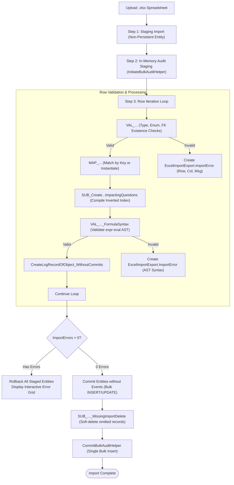
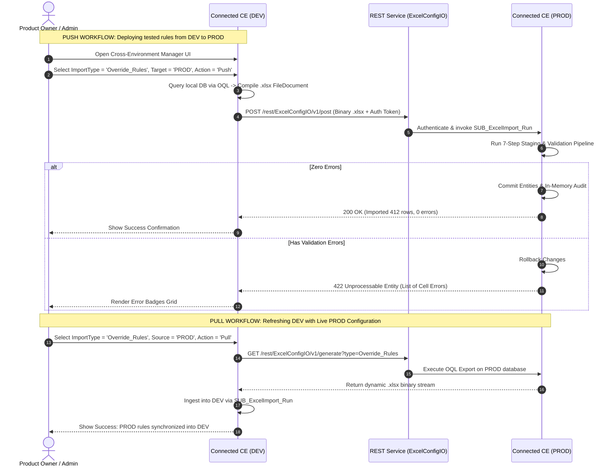

# Excel Imports, OQL Exports & Cross-Environment Configuration Architecture
## Enterprise Zero-Code Configuration Migration & Data Pipeline

> **System:** Connected CE V2 ([Connected CE V2.mpr](file:///C:/Users/chand/Mendix/CEV2-Devs/Connected%20CE%20V2.mpr))  
> **Key Modules:** `ExcelImportExport`, `OQLToExcel`, `DynamicQuestionnaire`, `Core`, `MasterData`  
> **Environments:** DEV $\rightarrow$ TEST / QA $\rightarrow$ STAGING $\rightarrow$ PROD  

---

## 1. Executive Summary & The "Configuration as Data" Paradigm

In enterprise field service automation, modern equipment inspection checklists, safety standards, calculation formulas, and validation bounds change rapidly. 
- Deploying a new Mendix deployment package (`.mda` / `.mpr`) requires formal IT change tickets, regression cycles, and system downtime.
- In **Connected CE V2**, the Mendix application model represents the **Form Player**, while questionnaires, calculation formulas, visibility overrides, and equipment specifications represent the **Sheet Music**.
- To empower business analysts, safety officers, and technical leads to modify inspection logic without code deployments, all questionnaire metadata is treated as **Data** transported via an automated **Excel & OQL Transfer Engine**.

```
┌────────────────────────────────────────────────────────────────────────┐
│                        Why Code Deployments Fail                       │
├────────────────────────────────────────────────────────────────────────┤
│ • Code deployment requires IT change windows, downtime, and regression.│
│ • Business analysts author complex rules and checklists in Excel.      │
│ • Rules must be promoted seamlessly from DEV → TEST → PROD.            │
│ • Rolling back a broken inspection rule must take 30 seconds, not      │
│   a 4-hour emergency hotfix release.                                   │
└────────────────────────────────────────────────────────────────────────┘
```

---

## 2. Catalog of 34+ Supported Configuration Domains

All imports and exports are centrally orchestrated by [`ExcelImportExport.SUB_ExcelImport_Run`](file:///C:/Users/chand/Mendix/CEV2-Devs/Connected%20CE%20V2.mpr), which dispatches incoming spreadsheets to domain-specific handlers:

| # | Import Type Enumeration Key | Target Microflow | Business Domain Managed |
| :--- | :--- | :--- | :--- |
| 1 | `Structural_QConfig` | `DynamicQuestionnaire.ACT_ImportStructuralQConfig` | Questionnaires, Pages, and Question hierarchy. |
| 2 | `Override_Rules` | `DynamicQuestionnaire.ACT_ImportOverrideRules` | Conditional visibility formulas (`{tagId} == 'val'`). |
| 3 | `Calculate_Rules` | `DynamicQuestionnaire.ACT_ImportCalculateRules` | Real-time mathematical derivations and formulas. |
| 4 | `Validation_Rules` | `DynamicQuestionnaire.ACT_ImportValidationRules` | Custom field bounds and error messages. |
| 5 | `All_Base_Rules` | `DynamicQuestionnaire.ACT_ImportAllBaseRules_byStaging` | Consolidated Region, Model, VisitType, and TechFamily rules. |
| 6 | `Battery_Dataset` | `MasterData.ACT_ImportBatteryDataSet` | Manufacturer battery specifications and baseline tables. |
| 7 | `Model_Base_Rules` | `Models.ACT_ImportModelBaseRule` | Equipment model code compatibility mappings. |
| 8 | `Region_Rules` | `DynamicQuestionnaire.ACT_ImportRegionRules` | Geographic operating unit filtering. |
| 9 | `Visit_Type_Rules` | `DynamicQuestionnaire.ACT_ImportVisitTypeRules` | PM, Emergency, Commissioning filter rules. |
| 10 | `Tech_Family_Rules` | `DynamicQuestionnaire.ACT_ImportTechFamilyRules` | Electrical, HVAC, Mechanical skill restrictions. |
| 11 | `Sync_Config` | `RelayConnector.ACT_ImportSyncConfig` | External ERP/EBS integration sync settings. |
| 12 | `Parameter_Table` | `Models.ACT_ImportParameterTable` | Equipment operating parameter boundaries. |
| 13 | `Translations` | `Translations.ACT_ImportTranslations` | Multi-language question labels and UI captions. |
| 14 | `PDF_Template` | `PDFs.ACT_ImportPdfTemplates` | Inspection report layout templates. |
| 15 | `Documentation_Links` | `Core.ACT_ImportDocumentationLinks` | Links to external SOPs and equipment manuals. |
| 16 | `Companies` | `Company.ACT_ImportCompanies` | Service partner and subcontractor directories. |
| 17 | `Visit_Types` | `MasterData.ACT_ImportVisitTypes` | Master list of service visit classifications. |
| 18 | `Model_Rules` | `Models.ACT_ImportModelRules` | Model group definitions and hierarchy. |
| 19 | `LifecycleData` | `MasterData.ACT_ImportLifecycle` | Equipment lifecycle milestones and obsolescence. |
| 20 | `Local_Data` | `MasterData.ACT_ImportLocalData` | Localized client lookup tables. |
| 21 | `States_and_Countries`| `MasterData.ACT_ImportStatesAndCountries` | Global geographic address references. |
| 22 | `Power_Supplies` | `MasterData.ACT_ImportPowerSupplies` | Electrical grid power supply specifications. |
| 23 | `Pivot_Import_Configs`| `PivotDataImporter.ACT_ImportPivotImportConfig` | Config for multi-dimensional data importers. |
| 24 | `Selectable_Rated_Voltage`| `MasterData.ACT_ImportSelectableRatedVoltage`| Master nominal voltage rating options. |
| 25 | `Customers` | `Customer.ACT_ImportCustomers` | Commercial account master records. |
| 26 | `Quality_Feedback` | `MasterData.ACT_ImportQualityFeedback` | Field quality issue classification codes. |
| 27 | `Email_Templates` | `Email_Connector.ACT_ImportEmailTemplates` | Automated customer sign-off email notifications. |
| 28 | `NextPredict_Items` | `MasterData.ACT_ImportNextPredictItems` | AI/ML predictive maintenance component catalog. |
| 29 | `PartDemandConfig` | `MasterData.ACT_ImportPartDemandConfig` | Spare parts demand forecasting configuration. |
| 30 | `NextPredict_Validations`| `MasterData.ACT_ImportNextPredictValidation` | Validation rules for predictive telemetry. |
| 31 | `Voice_to_Answer_Configs`| `LocalVoiceToAnswer.ACT_ImportVoiceToAnswerConfig`| Voice dictation NLP token mapping rules. |
| 32 | `Page_AI_Details` | `DynamicQuestionnaire.ACT_ImportPageAIDetails` | AI copilot contextual page guidance prompts. |
| 33 | `Tag_AI_Details` | `DynamicQuestionnaire.ACT_ImportTagAIDetails` | AI copilot question-specific diagnostic guidance. |
| 34 | `Root_Cause` | `MasterData.ACT_ImportRootCause` | Root cause failure analysis hierarchy. |

---

## 3. The Multi-Phase Excel Import Pipeline

To safeguard production integrity, spreadsheets are never parsed directly into operational database entities. The engine implements a rigorous **7-Step Staging & Validation Protocol**:



### Detailed Pipeline Phases:

1. **Staging Isolation:** Mendix Import Mapping reads raw spreadsheet cells into non-persistent staging entities (e.g. `DynamicQuestionnaire.OverrideRuleImport`). Malformed dates or corrupted strings cannot pollute production tables.
2. **Granular Cell-Level Error Badging:** When validation fails, generic error alerts are rejected. The engine instantiates an `ExcelImportExport.ImportError` recording:
   - `Row` (Integer): Exact Excel spreadsheet row number (e.g., `Row 42`).
   - `Column` (String): Header column name (e.g., `'Formula'`).
   - `Message` (String): Diagnostic explanation (e.g., *"Tag {Q_TEMP_OUT} referenced in formula does not exist in QuestionConfig"*).
   The user interface displays an interactive Data Grid highlighting the exact cells that need correction.
3. **Atomic Two-Phase Commit:** If even one error exists in a 5,000-row file, the entire batch is rolled back. If zero errors exist, entities are committed in bulk without events (`Core.commitWithoutEvents`).
4. **Soft-Delete Invariant (`SUB_..._MissingImportDelete`):** Any existing database rule omitted from the uploaded spreadsheet is marked `IsDeleted = true`. The engine never executes hard SQL `DELETE` commands, protecting compliance reporting and historical visit records.

---

## 4. OQL Exports to Excel (`oqltoexcel`)

To extract live configurations from the database back into Excel format, the application uses the high-performance [`oqltoexcel`](file:///C:/Users/chand/Mendix/CEV2-Devs/javasource/oqltoexcel/actions) engine.

### 4.1 Core Java Actions
- **[`OQLToExcel.java`](file:///C:/Users/chand/Mendix/CEV2-Devs/javasource/oqltoexcel/actions/OQLToExcel.java):**  
  Executes an Object Query Language (OQL) query and translates the result set into an Excel binary workbook with default typed styling (dates, numbers, strings).
- **[`AdvancedOQLToExcel.java`](file:///C:/Users/chand/Mendix/CEV2-Devs/javasource/oqltoexcel/actions/AdvancedOQLToExcel.java):**  
  Provides fine-grained control over column widths, cell backgrounds, borders, font weights, and header freeze panes.

### 4.2 How Live Configuration Export Works
When an export is triggered (e.g. via UI or REST API):
1. The microflow dynamically constructs an OQL statement retrieving active configuration records:
   ```sql
   SELECT 
       r/ImpactedTagId AS ImpactedTagId,
       r/Formula AS Formula,
       r/ResultVisibility AS ResultVisibility,
       r/Priority AS Priority,
       r/Technology AS Technology
   FROM DynamicQuestionnaire.OverrideRule AS r
   WHERE r/IsDeleted = false
   ORDER BY r/ImpactedTagId ASC, r/Priority ASC
   ```
2. Passes the query to `OQLToExcel`.
3. Java instantiates Apache POI workbook components (`ExWorkSheet`, `ExSheet`, `ExCell`), streams the binary data, and associates it with a Mendix `FileDocument` (`ExcelImportExport.ExcelImport`).

---

## 5. Cross-Environment Configuration Transfer Engine

Instead of manually downloading and uploading spreadsheets across environments, administrators utilize the **Cross-Environment Manager** ([`ExcelImportExport.EnvConfigManager`](file:///C:/Users/chand/Mendix/CEV2-Devs/Connected%20CE%20V2.mpr)).



### 5.1 REST Service Specification (`REST_ExcelConfigIO_*`)

The `ExcelImportExport` module publishes a secure REST API:

1. **`REST_ExcelConfigIO_Post`:**
   - **Endpoint:** `POST /rest/ExcelConfigIO/v1/post`
   - **Headers:** `Authorization: Bearer <EnvToken>`, `Content-Type: multipart/form-data`
   - **Payload:** Excel binary file, `ImportType` enum key, `VersionNumber`.
   - **Execution:** Calls [`sUB_AsyncImport_Bulk_Execute`](file:///C:/Users/chand/Mendix/CEV2-Devs/javasource/excelimportexport/proxies/microflows/Microflows.java#L1091) or synchronous `SUB_ExcelImport_Run`.
2. **`REST_ExcelConfigIO_Generate`:**
   - **Endpoint:** `GET /rest/ExcelConfigIO/v1/generate`
   - **Parameters:** `ImportType=<EnumKey>`
   - **Execution:** Runs the corresponding OQL query, builds the Excel workbook in memory, and streams it back as `application/vnd.openxmlformats-officedocument.spreadsheetml.sheet`.
3. **`REST_ExcelConfigIO_LatestVersion` & `REST_ExcelConfigIO_VersionList`:**
   - **Endpoint:** `GET /rest/ExcelConfigIO/v1/latestversion`
   - **Purpose:** Verifies whether the source environment has newer configuration revisions than the destination environment before triggering transfers.

### 5.2 Security & Governance

Cross-environment operations are strictly gated:
- Authentication requires pre-shared cryptographic environment tokens configured in Mendix constants.
- The calling session must hold the **`Core.FormDeveloper`** or **`Core.ITAdmin`** security roles.
- All transfer operations write to `ExcelImportExport.ImportVersion` and `AuditTrailCustom` to guarantee full enterprise traceability.
