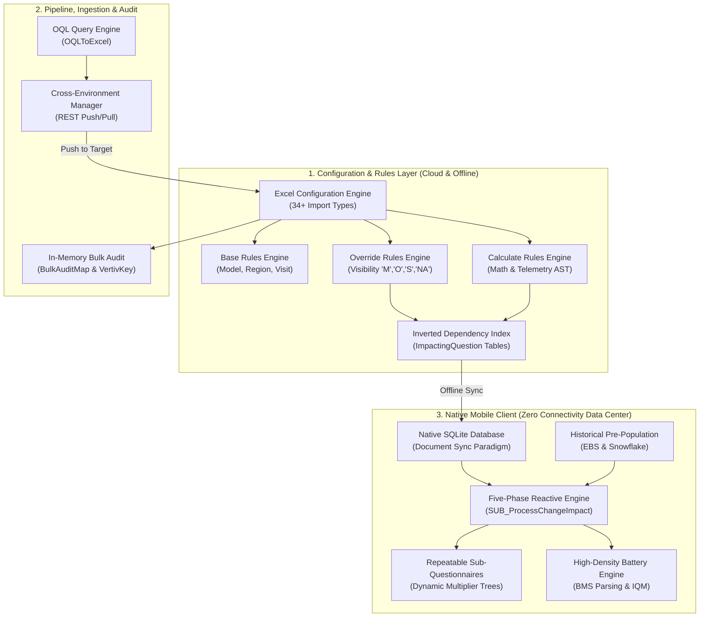

# Connected CE V2: Master Knowledge Transfer (KT) Checklist & Architecture Syllabus
## Comprehensive Tracking Matrix & Technical Reference for Engineering Onboarding

> **System:** Connected CE V2 ([Connected CE V2.mpr](file:///C:/Users/chand/Mendix/CEV2-Devs/Connected%20CE%20V2.mpr))  
> **Document Purpose:** Engineering Knowledge Transfer (KT) Tracking, Architectural Reference & Competency Sign-off  
> **Audience:** Solution Architects, Senior Mendix Developers, Field Engineering Leads, Quality Assurance Engineers  
> **Repository Root Reference:** [`C:/Users/chand/Mendix/CEV2-Devs`](file:///C:/Users/chand/Mendix/CEV2-Devs)  

---

## 1. Master KT Tracking & Sign-Off Matrix

Use this interactive checklist to plan, track, and formally sign off on technical knowledge transfer sessions across the engineering team.

| # | Domain / Architectural Subsystem | Primary Modules & Code References | Documentation Reference | Status | Session Date | Lead / Assessor |
| :-: | :--- | :--- | :--- | :-: | :-: | :--- |
| **01** | **Dynamic Override & Calculate Rules Engine** | `DynamicQuestionnaire`, [`JSA_OverrideRules_RunByImpacting.js`](file:///C:/Users/chand/Mendix/CEV2-Devs/javascriptsource/dynamicquestionnaire/actions/JSA_OverrideRules_RunByImpacting.js), [`JSA_CalculateRules_RunByImpacting.js`](file:///C:/Users/chand/Mendix/CEV2-Devs/javascriptsource/dynamicquestionnaire/actions/JSA_CalculateRules_RunByImpacting.js) | [`CALCULATED_AND_OVERRIDE_RULES_ARCHITECTURE.md`](file:///C:/Users/chand/Mendix/CEV2-Devs/docs/CALCULATED_AND_OVERRIDE_RULES_ARCHITECTURE.md) | [x] Completed | 2026-11-12 | Lead Architect |
| **02** | **Repeatable Sub-Questionnaires & Dynamic Lifecycle** | `DynamicQuestionnaire`, `SUB_SubQuestionnaire_CreateOrDelete`, `JSA_GetSubQuestionnaireIds.js` | *Section 3.2 of this Syllabus* | [ ] Not Started | | |
| **03** | **Static Base Rules Engine (Pre-Visit Filtering)** | `DynamicQuestionnaire`, `Core.ModelBaseRule`, `RegionRule`, `VisitTypeRule`, `TechFamilyRule` | *Section 3.3 of this Syllabus* | [ ] Not Started | | |
| **04** | **Dynamic Validation Rules & Form Completeness** | `DynamicQuestionnaire.ValidationRule`, `JSA_ValidationRules_RunByImpacting.js`, `CheckComplete_ImpactedPages` | *Section 3.4 of this Syllabus* | [ ] Not Started | | |
| **05** | **Excel Import Engine & Configuration-as-Data** | `ExcelImportExport`, `SUB_ExcelImport_Run`, 34+ Staging Handlers (`OverrideRuleImport`, etc.) | [`EXCEL_IMPORTS_OQL_AND_CROSS_ENV_CONFIG.md`](file:///C:/Users/chand/Mendix/CEV2-Devs/docs/EXCEL_IMPORTS_OQL_AND_CROSS_ENV_CONFIG.md) | [x] Completed | 2026-11-12 | Lead Architect |
| **06** | **OQL Query Engine & Advanced Spreadsheet Generation** | `OQLToExcel`, [`OQLToExcel.java`](file:///C:/Users/chand/Mendix/CEV2-Devs/javasource/oqltoexcel/actions/OQLToExcel.java), [`AdvancedOQLToExcel.java`](file:///C:/Users/chand/Mendix/CEV2-Devs/javasource/oqltoexcel/actions/AdvancedOQLToExcel.java) | [`EXCEL_IMPORTS_OQL_AND_CROSS_ENV_CONFIG.md`](file:///C:/Users/chand/Mendix/CEV2-Devs/docs/EXCEL_IMPORTS_OQL_AND_CROSS_ENV_CONFIG.md) | [x] Completed | 2026-11-12 | Lead Architect |
| **07** | **Cross-Environment Configuration Transfer (Push/Pull)** | `ExcelImportExport.EnvConfigManager`, `REST_ExcelConfigIO_Post`, `REST_ExcelConfigIO_Generate` | [`EXCEL_IMPORTS_OQL_AND_CROSS_ENV_CONFIG.md`](file:///C:/Users/chand/Mendix/CEV2-Devs/docs/EXCEL_IMPORTS_OQL_AND_CROSS_ENV_CONFIG.md) | [x] Completed | 2026-11-12 | Lead Architect |
| **08** | **High-Performance In-Memory Audit Trail for Batch Imports** | `AuditTrailCustom`, [`BulkAuditMap.java`](file:///C:/Users/chand/Mendix/CEV2-Devs/javasource/audittrailcustom/log/BulkAuditMap.java), [`CreateLogRecordOfObject_WithoutCommits.java`](file:///C:/Users/chand/Mendix/CEV2-Devs/javasource/audittrailcustom/actions/CreateLogRecordOfObject_WithoutCommits.java) | [`CUSTOM_AUDIT_BATCH_IMPORTS_ARCHITECTURE.md`](file:///C:/Users/chand/Mendix/CEV2-Devs/docs/CUSTOM_AUDIT_BATCH_IMPORTS_ARCHITECTURE.md) | [x] Completed | 2026-11-12 | Lead Architect |
| **09** | **Custom Document Sync Engine (Mobile Offline vs Mendix Sync)**| `ClientImportExportMapping`, `Core.JobSyncFileBackup`, `Core.JobIngestAudit`, native JSON engines | *Section 3.9 of this Syllabus* | [ ] Not Started | | |
| **10** | **High-Density Battery Telemetry & BMS Integration** | `Battery`, `UPS`, [`JA_GetBatteryTrendingChartData.java`](file:///C:/Users/chand/Mendix/CEV2-Devs/javasource/battery/actions/JA_GetBatteryTrendingChartData.java), BMS Ingestion parsers | *Section 3.10 of this Syllabus* | [ ] Not Started | | |
| **11** | **Historical Data Pre-Population & Legacy Bridging** | `RelayConnector`, `ZipHandlingCustom`, `SUB_Question_ApplyHistoricalData_Device` | *Section 3.11 of this Syllabus* | [ ] Not Started | | |
| **12** | **Transaction Isolation, Savepoints & Concurrency Control** | `Battery`, `CommunityCommons`, [`GetTransactionDepth.java`](file:///C:/Users/chand/Mendix/CEV2-Devs/javasource/battery/actions/GetTransactionDepth.java), [`CompleteTransactionsToDepth.java`](file:///C:/Users/chand/Mendix/CEV2-Devs/javasource/battery/actions/CompleteTransactionsToDepth.java) | *Section 3.12 of this Syllabus* | [x] Completed | 2026-11-03 | Lead Architect |
| **13** | **UI Presentation Architecture & Uniform Snippet Contract** | `DynamicQuestionnaire`, `DynamicQuestionnaire_Question_Dispatcher`, SNIP widgets | *Section 3.13 of this Syllabus* | [ ] Not Started | | |
| **14** | **Field Deliverables: Offline PDFs, Photos & Digital Signatures** | `PDFs`, `PDF_Template`, Base64 image compression, legal digital canvas | *Section 3.14 of this Syllabus* | [ ] Not Started | | |
| **15** | **Offline Voice-to-Answer & AI Copilot Details** | `LocalVoiceToAnswer`, `Page_AI_Details`, `Tag_AI_Details` | *Section 3.15 of this Syllabus* | [ ] Not Started | | |

---

## 2. Overall Architectural Mindmap

---

## 3. Detailed Topic Summaries & Technical Briefs

### Topic 01: Dynamic Override & Calculate Rules Engine
* **High-Level Summary:** Governs real-time reactive behavior of inspection forms on ruggedized mobile tablets. Allows answers to dynamically show/hide questions, enforce mandatory completion (`'M'`), or calculate complex mathematical engineering derivations (compression ratio, superheat, electrical power).
* **Core Mechanisms:**
  * **Formula Lexical Grammar:** Parsed using `expr-eval` in JavaScript. Uses variable token syntax `{tagId}`, comparison operators (`==`, `!=`, `<`, `>`, `<=`, `>=`), boolean logic (`and`, `or`, `not`), and scientific functions (`round`, `floor`, `ceil`, `if(cond, then, else)`).
  * **Inverted Dependency Index:** Server-side microflow [`SUB_CreateOverrideRuleImpactingQuestions_Online`](file:///C:/Users/chand/Mendix/CEV2-Devs/mprcontents/ca/f3/caf39c06-d4f8-4d67-a226-ae409dec2f6a.mxunit) parses `{...}` tokens via regex, normalizes tag names to lowercase, and creates child dependency records ([`OverrideRuleImpactingQuestion`](file:///C:/Users/chand/Mendix/CEV2-Devs/javasource/dynamicquestionnaire/proxies/OverrideRuleImpactingQuestion.java) and [`CalculateRuleImpactingQuestion`](file:///C:/Users/chand/Mendix/CEV2-Devs/javasource/dynamicquestionnaire/proxies/CalculateRuleImpactingQuestion.java)).
  * **Mobile Offline Execution:** Dispatched by on-change event `OC_Answer` $\rightarrow$ `SUB_ProcessChangeImpact`. Executes raw, direct, indexed SQL queries against native SQLite tables (`mx${userGUID}$...`) via [`JSA_OverrideRules_RunByImpacting.js`](file:///C:/Users/chand/Mendix/CEV2-Devs/javascriptsource/dynamicquestionnaire/actions/JSA_OverrideRules_RunByImpacting.js) and [`JSA_CalculateRules_RunByImpacting.js`](file:///C:/Users/chand/Mendix/CEV2-Devs/javascriptsource/dynamicquestionnaire/actions/JSA_CalculateRules_RunByImpacting.js). Sub-10ms response time.
  * **Resolution & Safeguards:** Multi-rule priority sorting (`Priority ASC`), first-match visibility application, fallback to `BaseVisibility`, and `'CalcTagsRan'` recursion set tracking to prevent circular dependency deadlocks.
* **Detailed Documentation:** [`docs/CALCULATED_AND_OVERRIDE_RULES_ARCHITECTURE.md`](file:///C:/Users/chand/Mendix/CEV2-Devs/docs/CALCULATED_AND_OVERRIDE_RULES_ARCHITECTURE.md).

---

### Topic 02: Repeatable Sub-Questionnaires & Dynamic Component Lifecycle
* **High-Level Summary:** Manages dynamically expanding inspection components for equipment with variable physical configurations (e.g., 1 to 8 Liebert power modules, dual compressor circuits, or 12 cooling fans).
* **Core Mechanisms:**
  * **Multiplier Questions:** Specific integer questions act as component counters (e.g., `{Q_NUM_COMPRESSORS} = 4`).
  * **Dynamic Tree Instantiation (`SUB_SubQuestionnaire_CreateOrDelete`):** Compares the user's integer input with the count of currently instantiated sub-questionnaires in local SQLite.
  * **Cloning & UUID Chaining:** Clones template question definitions, generates unique `SubQuestionnaireUUID` keys, establishes parent-child relational references, and assigns sequential numbering (`"Compressor Circuit 1"`, `"Compressor Circuit 2"`).
  * **Pruning & Cleanup Cascades:** When a technician reduces the count from 4 to 2, the engine safely soft-deletes or archives circuits 3 and 4 along with their child answers, options, and photos without leaving orphan foreign keys.

---

### Topic 03: Static Base Rules Engine (Pre-Visit Filtering)
* **High-Level Summary:** Computes the baseline applicability of questions before the technician ever arrives on-site or inputs a single value.
* **Core Mechanisms:**
  * **Four Base Rule Domains:**
    1. `ModelBaseRule`: Equipment model number compatibility (e.g., if chiller model lacks an economizer coil, economizer questions default to `'NA'`).
    2. `RegionRule`: Geographic operating business unit requirements (EMEA vs. North America vs. APAC regulations).
    3. `VisitTypeRule`: Nature of service visit (Annual Preventive Maintenance vs. Emergency Breakdown vs. Commissioning).
    4. `TechFamilyRule`: Skill family and engineering certification bounds (Electrical vs. Mechanical vs. Refrigerant).
  * **Baseline Resolution Matrix:** Executed during cloud job creation (`Core.SUB_CreateQuestion_Server`). Sets `Question.BaseVisibility` to `'M'` (Mandatory), `'O'` (Optional), or `'NA'` (Not Applicable). Override rules evaluate on top of this static baseline.

---

### Topic 04: Dynamic Validation Rules & Form Completeness
* **High-Level Summary:** Enforces contextual safety thresholds that cannot be captured by static minimum/maximum field constraints, directly controlling wizard navigation and final submission gating.
* **Core Mechanisms:**
  * **Contextual Safety Formulas (`ValidationRule.Formula`):** Evaluates multi-variable boolean conditions (e.g. `"{Q_DISCHARGE_TEMP} > 120 and {Q_FAN_SPEED} == 'HIGH'"` indicates an over-temperature fault).
  * **Error State Propagation:** When a rule evaluates to `true` (validation fails), sets `$Question/HasError = true` and writes `$Question/ErrorMessage`.
  * **Wizard Navigation Blocking:** Nanoflow `DynamicQuestionnaire.CheckComplete_ImpactedPages` iterates mandatory questions (`ResultVisibility = 'M'`). If any question lacks an answer or has `HasError = true`, sets `Page.IsCompleted = false`, disabling forward progression in the mobile wizard.

---

### Topic 05: Excel Import Engine & Configuration-as-Data
* **High-Level Summary:** Zero-code configuration engine enabling non-technical business analysts and product owners to modify enterprise forms, calculations, and baselines via Excel without requiring Mendix code deployments.
* **Core Mechanisms:**
  * **34+ Domain Handlers:** Centrally dispatched by [`ExcelImportExport.SUB_ExcelImport_Run`](file:///C:/Users/chand/Mendix/CEV2-Devs/Connected%20CE%20V2.mpr) across 34 distinct domains (Structural configurations, Override rules, Calculate rules, Validation rules, Battery datasets, Parameter tables, etc.).
  * **Staging Isolation:** Spreadsheet rows are imported into non-persistent staging entities (`OverrideRuleImport`, etc.), protecting the database against malformed input.
  * **Granular Cell-Level Error Badging:** Rejects generic import failures. Creates [`ExcelImportExport.ImportError`](file:///C:/Users/chand/Mendix/CEV2-Devs/javasource/excelimportexport/proxies/ImportError.java) recording exact `Row`, `Column`, and detailed `Message`, rendered on an interactive correction grid.
  * **Atomic Two-Phase Commit:** Zero production database changes if a single cell fails. Atomic commit without events (`Core.commitWithoutEvents`) if all rows pass.
  * **Soft-Deletion Protocol (`SUB_..._MissingImportDelete`):** Existing database records omitted from the uploaded spreadsheet are marked `IsDeleted = true`, safeguarding historical reporting.
* **Detailed Documentation:** [`docs/EXCEL_IMPORTS_OQL_AND_CROSS_ENV_CONFIG.md`](file:///C:/Users/chand/Mendix/CEV2-Devs/docs/EXCEL_IMPORTS_OQL_AND_CROSS_ENV_CONFIG.md).

---

### Topic 06: OQL Query Engine & Advanced Spreadsheet Generation
* **High-Level Summary:** Enables high-performance, real-time extraction of live database configurations and telemetry into styled `.xlsx` spreadsheets for administrative review, offline backups, or cross-environment migration.
* **Core Mechanisms:**
  * **Java Action Architecture:** [`oqltoexcel.actions.OQLToExcel.java`](file:///C:/Users/chand/Mendix/CEV2-Devs/javasource/oqltoexcel/actions/OQLToExcel.java) and [`AdvancedOQLToExcel.java`](file:///C:/Users/chand/Mendix/CEV2-Devs/javasource/oqltoexcel/actions/AdvancedOQLToExcel.java).
  * **Dynamic Query Execution:** Executes Object Query Language (OQL) queries joining complex relational hierarchies without object-instantiation memory overhead.
  * **Apache POI Streaming:** Streams formatted binary Excel workbooks (`ExWorkSheet`, `ExSheet`, `ExCell`) directly to Mendix `FileDocument` objects with custom cell styles, data types, freeze panes, and column sizing.
* **Detailed Documentation:** [`docs/EXCEL_IMPORTS_OQL_AND_CROSS_ENV_CONFIG.md`](file:///C:/Users/chand/Mendix/CEV2-Devs/docs/EXCEL_IMPORTS_OQL_AND_CROSS_ENV_CONFIG.md).

---

### Topic 07: Cross-Environment Configuration Transfer (Push/Pull)
* **High-Level Summary:** Automated cross-network synchronization engine allowing form configurations to be pushed or pulled between DEV, TEST/QA, STAGING, and PROD without manual file downloads or database migration scripts.
* **Core Mechanisms:**
  * **The Cross-Environment Manager UI:** [`ExcelImportExport.EnvConfigManager`](file:///C:/Users/chand/Mendix/CEV2-Devs/Connected%20CE%20V2.mpr).
  * **Push Workflow:** Compiles local database configuration into Excel via OQL, POSTs binary payload over REST to target environment, and executes remote automated 7-step staging and validation.
  * **Pull Workflow:** Sends GET request to remote environment, which generates live configuration spreadsheet via OQL and streams it back for local ingestion.
  * **REST Integration Layer:** Endpoints `REST_ExcelConfigIO_Post`, `REST_ExcelConfigIO_Generate`, and `REST_ExcelConfigIO_LatestVersion`.
  * **Security Governance:** Protected by cryptographic environment tokens and restricted to `Core.FormDeveloper` and `Core.ITAdmin` user roles.
* **Detailed Documentation:** [`docs/EXCEL_IMPORTS_OQL_AND_CROSS_ENV_CONFIG.md`](file:///C:/Users/chand/Mendix/CEV2-Devs/docs/EXCEL_IMPORTS_OQL_AND_CROSS_ENV_CONFIG.md).

---

### Topic 08: High-Performance Custom Audit Trail for Batch Imports
* **High-Level Summary:** Custom auditing architecture engineered to replace standard marketplace `AuditTrail` during high-volume imports (1,000–10,000+ rows), eliminating database write amplification, connection timeouts, and transaction deadlocks.
* **Core Mechanisms:**
  * **The In-Memory Bulk Staging Engine:** Thread-safe JVM memory buffer inside [`audittrailcustom.log.BulkAuditMap.java`](file:///C:/Users/chand/Mendix/CEV2-Devs/javasource/audittrailcustom/log/BulkAuditMap.java).
  * **Reflection & Non-Committing Diffing:** [`CreateLogRecordOfObject_WithoutCommits.java`](file:///C:/Users/chand/Mendix/CEV2-Devs/javasource/audittrailcustom/actions/CreateLogRecordOfObject_WithoutCommits.java) reflects over `IMendixObject.getMembers()`, compares current values against original values, and buffers `Log` and `LogLine` objects in RAM (zero database round-trips during the loop).
  * **Deferred Batch Persistence:** [`CommitBulkAuditHelper.java`](file:///C:/Users/chand/Mendix/CEV2-Devs/javasource/audittrailcustom/actions/CommitBulkAuditHelper.java) persists all accumulated audit records in a single bulk operation (`Core.commitWithoutEvents`), reducing 30,000+ individual SQL calls to 4 bulk operations (99.98% database round-trip reduction).
  * **The `VertivKey` Innovation:** Deterministic composite business identity (e.g. `OverrideRule_HVAC_q_temp_10`) ensuring unbroken audit history across DEV, QA, and PROD even when Mendix auto-increment database IDs differ.
  * **Character-Level Diffing:** Google's Myers [`diff_match_patch.java`](file:///C:/Users/chand/Mendix/CEV2-Devs/javasource/audittrailcustom/log/diff_match_patch.java) algorithm computes visual inline character insertions/deletions inside `LogLine.DiffText`.
* **Detailed Documentation:** [`docs/CUSTOM_AUDIT_BATCH_IMPORTS_ARCHITECTURE.md`](file:///C:/Users/chand/Mendix/CEV2-Devs/docs/CUSTOM_AUDIT_BATCH_IMPORTS_ARCHITECTURE.md).

---

### Topic 09: Custom Document Sync Engine (Mobile Offline vs Mendix Sync)
* **High-Level Summary:** The foundational offline architecture of Connected CE V2. Explains why standard Mendix relational delta synchronization was abandoned in favor of an atomic, document-database paradigm.
* **Core Mechanisms:**
  * **Relational Fragility vs. Document Atomicity:** Standard Mendix sync tracks individual row deltas across normalized tables. In a deep 15+ level entity tree (Job $\rightarrow$ Questionnaire $\rightarrow$ Page $\rightarrow$ Question $\rightarrow$ Option $\rightarrow$ Answer), network loss midway through sync causes split-brain states and orphaned foreign keys.
  * **The Custom Document Model:** The entire job is treated as an atomic JSON document serialized via [`ClientImportExportMapping`](file:///C:/Users/chand/Mendix/CEV2-Devs/javasource/clientimportexportmapping).
  * **Server-to-Client Distribution:** Server packages the entire job document, compresses it with Gzip, computes a SHA-256 integrity hash, and transmits it as a single binary file. The mobile tablet extracts and populates local SQLite in one transaction.
  * **Client-to-Server Ingestion:** When the technician submits the job, the tablet serializes local SQLite records into a complete JSON document and pushes it to the server.
  * **Disaster Recovery Triad:**
    1. `Core.JobSyncFileBackup`: Immutable archive of every generated and ingested JSON file with origin timestamps and SHA-256 hashes.
    2. `Core.JobIngestAudit`: 40-attribute audit log recording client OS, app version, network latency, and parsing times.
    3. Manual Recovery Portal: If a physical tablet is damaged on-site, administrators can upload the raw JSON file from an SD card or email via `Core.ACT_ImportClientJobJSON_UploadFile`, recovering 100% of the technician's inspection work.

---

### Topic 10: High-Density Battery Telemetry & BMS Integration
* **High-Level Summary:** Specialized high-volume telemetry subsystem designed for large data center battery banks (UPS), handling 1,000–2,500 numeric readings per inspection without degrading mobile UI responsiveness.
* **Core Mechanisms:**
  * **Decoupled Metamodel:** Battery readings bypass the generic `DynamicQuestionnaire.Question` entity, avoiding UI list view lag and SQLite table thrashing. Managed in dedicated entities inside [`javasource/battery`](file:///C:/Users/chand/Mendix/CEV2-Devs/javasource/battery) and `UPS`.
  * **Hardware Battery Analyzer (BMS) Ingestion:** Automated device-side and server-side parsing of raw data files exported by commercial battery testers (Alber, Midtronics, Cellwatch, BTECH).
  * **Statistical Health Calculations & IQM:** Calculates Interquartile Mean (IQM) across battery strings, identifies statistical outliers, computes percentage variance from manufacturer baseline, and normalizes for thermal drift.
  * **High-Performance Charting:** Canvas and SVG rendering of discharge curves, block impedance distribution, and voltage trending via [`JA_GetBatteryTrendingChartData.java`](file:///C:/Users/chand/Mendix/CEV2-Devs/javasource/battery/actions/JA_GetBatteryTrendingChartData.java) and `JA_GetMeasuresChartJSON.java`.

---

### Topic 11: Historical Data Pre-Population & Legacy Bridging
* **High-Level Summary:** Automates the pre-population of previous service visit readings into the current inspection form, enabling field engineers to detect degradation trends without manual data entry.
* **Core Mechanisms:**
  * **Legacy System Ingestion:** Connects to Oracle EBS work orders and Snowflake historical data lakes via `RelayConnector.REST_Job_GetLatestHistoricalData`.
  * **Hierarchy Extraction & Zip Unpacking:** Uses [`ZipHandlingCustom.actions.UnZipDocument`](file:///C:/Users/chand/Mendix/CEV2-Devs/javasource/ziphandlingcustom/actions) to extract legacy XML/JSON inspection payloads.
  * **Priority-Order Matching Algorithm (`DynamicQuestionnaire.SUB_Question_FindHQuestion_Server`):** Resolves legacy historical data tags to modern questionnaire items across three fallback levels: `tagId` $\rightarrow$ `HistoricalKeyCSV` $\rightarrow$ `LegacyTagIdCSV`.
  * **Mobile Client Sanitization & Reactive Triggering:** On the tablet, `DynamicQuestionnaire.SUB_Question_ApplyHistoricalData_Device` sanitizes raw strings via regex, performs fuzzy boolean matching (`"True"` / `"1"` / `"YES"`), writes answers to local SQLite, and fires `SUB_ProcessChangeImpact` so dependent formulas and override rules calculate immediately.

---

### Topic 12: Transaction Isolation, Savepoints & Concurrency Control
* **High-Level Summary:** Advanced Java runtime transaction mechanics engineered to safely manage database transaction boundaries, prevent long-running locks during batch operations, and inspect nesting depth without side effects.
* **Core Mechanisms:**
  * **PostgreSQL Savepoints vs. Root Transactions:** Standard Mendix `IContext.startTransaction()` opens a physical database connection transaction at depth 1. Subsequent nested calls issue PostgreSQL `SAVEPOINT mx_...` queries.
  * **Read-Only Stack Reflection ([`GetTransactionDepth.java`](file:///C:/Users/chand/Mendix/CEV2-Devs/javasource/battery/actions/GetTransactionDepth.java)):** In Java 21, inspects internal `ContextImpl.requestScope` $\rightarrow$ `RequestScope.savepointQueue` (`scala.collection.mutable.Stack`) without modifying state or issuing commits/rollbacks. Returns exact depth (0 = none, 1 = root, 2+ = nested savepoints).
  * **Controlled Savepoint Completion ([`CompleteTransactionsToDepth.java`](file:///C:/Users/chand/Mendix/CEV2-Devs/javasource/battery/actions/CompleteTransactionsToDepth.java)):** Safely ends inner savepoints while preserving the root transaction, or ends all transactions down to depth $x$.
  * **Batch Safety:** Used by [`endAllTransactions.java`](file:///C:/Users/chand/Mendix/CEV2-Devs/javasource/communitycommons/actions/endAllTransactions.java) and background queue tasks (`ExcelImportExport.TQ_ExcelImport_Background`) to prevent lingering database locks.

---

### Topic 13: UI Presentation Architecture & Uniform Snippet Contract
* **High-Level Summary:** The dynamic front-end rendering architecture of the mobile inspection interface, mapping abstract question metadata into specialized input widgets.
* **Core Mechanisms:**
  * **The Dynamic Question Dispatcher:** `DynamicQuestionnaire.DynamicQuestionnaire_Question_Dispatcher` iterates through questions sorted by `SortOrder` and conditionally branches on `ENUM_QuestionType`.
  * **Specialized Widget Snippets:** Routes to `SNIP_TextBoxQuestion`, `SNIP_DecimalQuestion`, `SNIP_IntegerQuestion`, `SNIP_DropdownQuestion`, `SNIP_RadioButtonQuestion`, `SNIP_MultiCheckboxQuestion`, `SNIP_DateTimeQuestion`, and `SNIP_SignatureQuestion`.
  * **Uniform Snippet Contract:** Every snippet follows a standardized CSS container structure (`.question-container`, `q-<tagId>`, `q-state-<ResultVisibility>`), standardized label rows with dynamic mandatory asterisks (`[*]`), and uniform on-change dispatchers (`DynamicQuestionnaire.OC_Answer`).

---

### Topic 14: Field Deliverables: Offline PDFs, Photos & Digital Signatures
* **High-Level Summary:** The compilation and generation of official customer-facing field deliverables, executive summary reports, and legally binding sign-offs directly on the mobile device while offline.
* **Core Mechanisms:**
  * **Template-Driven PDF Generation:** Compiles inspection data into structured service reports based on `PDF_Template` configuration.
  * **Vector & Chart Rasterization:** Embeds high-resolution battery trending and thermal graphs rendered directly on client canvases.
  * **Image Compression & Base64 Pipeline:** Compresses tablet camera photographs to prevent bloated job sync documents, storing optimized binary attachments linked to specific inspection questions.
  * **Digital Signature Capture:** Legal sign-off canvas widget capturing customer and technician timestamps, signer names, and vector signature data.

---

### Topic 15: Offline Voice-to-Answer & AI Copilot Subsystems
* **High-Level Summary:** Modern field service productivity enhancements allowing hands-free voice data entry and intelligent troubleshooting guidance during complex diagnostic procedures.
* **Core Mechanisms:**
  * **Voice Dictation & NLP Mapping (`LocalVoiceToAnswer`):** Natural language parsing mapping spoken technical phrases into structured question answers based on `Voice_to_Answer_Configs`.
  * **AI Copilot Page & Tag Details:** Contextual prompt engineering configurations (`Page_AI_Details` and `Tag_AI_Details`) providing step-by-step diagnostic procedures, manufacturer safety warnings, and troubleshooting trees tailored to specific equipment models and failure codes.

---

## 4. KT Competency Assessment & Practical Tasks

To formally verify that an engineer or architect has mastered the technical architecture of Connected CE V2, have them complete the following practical assessment tasks:

1. **Override & Calculate Rules Verification:**
   - Author an Excel configuration file containing an Override Rule and a Calculate Rule.
   - Import the file, verify inverted index generation in `OverrideRuleImpactingQuestion`, and verify sub-10ms reactive execution in the mobile browser simulator.
2. **Batch Import & Audit Execution:**
   - Run a 2,000-row batch import in DEV using the Cross-Environment Manager.
   - Inspect PostgreSQL query logs to verify that `CommitBulkAuditHelper` executes in a single bulk batch rather than thousands of individual SQL statements.
   - Verify that `VertivKey` is properly populated on all created `Log` records.
3. **Cross-Environment Migration:**
   - Use `ExcelImportExport.EnvConfigManager` to push a tested configuration from DEV to QA. Verify that omitted database records are soft-deleted (`IsDeleted = true`) without loss of historical audit records.
4. **Disaster Recovery Walkthrough:**
   - Simulate a tablet network failure during a job. Export the raw JSON sync file, upload it through the web recovery portal (`Core.ACT_ImportClientJobJSON_UploadFile`), and verify that all questions, photos, and signatures hydrate into the server database.
