# Connected CE V2: The Definitive Architecture Encyclopedia & Technical Reference Manual
## An Exhaustive Guide to Dynamic Questionnaire, Core Engine, Custom Offline Sync, Cross-Environment Migration, and High-Performance Telemetry

> **Document Type:** Master Enterprise Architecture Encyclopedia & Engineering Reference Manual  
> **Target Audience:** Mendix Enterprise Architects, Mobile Engineers, Backend Developers & Onboarding Engineers  
> **Repository Root Reference:** [Connected CE V2.mpr](file:///Root/Connected%20CE%20V2.mpr)  
> **Companion Integration Manual:** [CUSTOM_SYNC_AND_INTEGRATION_MANUAL.md](file:///Root/CUSTOM_SYNC_AND_INTEGRATION_MANUAL.md)  
> **Core Modules Analyzed:** `DynamicQuestionnaire`, `Core`, `ClientImportExportMapping`, `ExcelImportExport`, `AuditTrailCustom`, `Battery`, `MasterData`, `Translations`, `PDFs`, `Models`  

---

# Master Table of Contents

- [Book Preface: The Architectural Manifesto](#book-preface-the-architectural-manifesto)
- [VOLUME I: THE PHILOSOPHY, BUSINESS PROBLEM & FIELD ENGINEERING REALITY](#volume-i-the-philosophy-business-problem--field-engineering-reality)
  - [Chapter 1: The Commercial Field Engineering Landscape](#chapter-1-the-commercial-field-engineering-landscape)
    - [1.1 Physical Operating Environments](#11-physical-operating-environments)
    - [1.2 The Cost of Downtime & Mechanical Stakes](#12-the-cost-of-downtime--mechanical-stakes)
    - [1.3 The Disconnected Reality: Zero-Connectivity Constraints](#13-the-disconnected-reality-zero-connectivity-constraints)
  - [Chapter 2: The Day in the Life of Field Engineer Alex](#chapter-2-the-day-in-the-life-of-field-engineer-alex)
    - [2.1 Phase 1: Morning Dispatch & Offline Preparation (06:30 - 07:30)](#21-phase-1-morning-dispatch--offline-preparation-0630---0730)
    - [2.2 Phase 2: Site Arrival & Descent into the Sub-Basement (08:00 - 08:30)](#22-phase-2-site-arrival--descent-into-the-sub-basement-0800---0830)
    - [2.3 Phase 3: The Routine Inspection Begins (08:30 - 09:30)](#23-phase-3-the-routine-inspection-begins-0830---0930)
    - [2.4 Phase 4: Dynamic Discovery & The Hazard Branch (09:30 - 11:00)](#24-phase-4-dynamic-discovery--the-hazard-branch-0930---1100)
    - [2.5 Phase 5: High-Density Battery Telemetry Acquisition (11:00 - 13:30)](#25-phase-5-high-density-battery-telemetry-acquisition-1100---1330)
    - [2.6 Phase 6: Mathematical Verification & Real-Time Enthalpy (13:30 - 14:30)](#26-phase-6-mathematical-verification--real-time-enthalpy-1330---1430)
    - [2.7 Phase 7: Customer Sign-Off & Vector Signature Capture (14:30 - 15:30)](#27-phase-7-customer-sign-off--vector-signature-capture-1430---1530)
    - [2.8 Phase 8: Ascent & The Cellular Reconnection Sync (16:00)](#28-phase-8-ascent--the-cellular-reconnection-sync-1600)
  - [Chapter 3: Why Traditional Low-Code Architectures Fail in the Field](#chapter-3-why-traditional-low-code-architectures-fail-in-the-field)
    - [3.1 The Schema Explosion Anti-Pattern](#31-the-schema-explosion-anti-pattern)
    - [3.2 The Mobile SQLite B-Tree Bottleneck](#32-the-mobile-sqlite-b-tree-bottleneck)
    - [3.3 The Release Velocity Mismatch (App Store vs. Regulatory Speed)](#33-the-release-velocity-mismatch-app-store-vs-regulatory-speed)
    - [3.4 Relational Delta Sync Fragility on Unstable Networks](#34-relational-delta-sync-fragility-on-unstable-networks)
  - [Chapter 4: The Dynamic Questionnaire Paradigm](#chapter-4-the-dynamic-questionnaire-paradigm)
    - [4.1 Form as Data (The Metamodel Pattern)](#41-form-as-data-the-metamodel-pattern)
    - [4.2 The Cloud Compiler & Native Virtual Machine Analogy](#42-the-cloud-compiler--native-virtual-machine-analogy)
    - [4.3 EAV Pattern Tailored for High-Performance Offline Execution](#43-eav-pattern-tailored-for-high-performance-offline-execution)
- [VOLUME II: THE METAMODEL & ADMIN CONFIGURATION ENGINE](#volume-ii-the-metamodel--admin-configuration-engine)
  - [Chapter 5: The Domain Model Metamodel Deep Dive](#chapter-5-the-domain-model-metamodel-deep-dive)
    - [5.1 Comprehensive Entity Relationship Schema](#51-comprehensive-entity-relationship-schema)
    - [5.2 Attribute-by-Attribute Engineering Dictionary](#52-attribute-by-attribute-engineering-dictionary)
    - [5.3 Association Mechanics & Multiplicity Invariants](#53-association-mechanics--multiplicity-invariants)
  - [Chapter 6: The Base Rules Engine (Environmental Filtering)](#chapter-6-the-base-rules-engine-environmental-filtering)
    - [6.1 The Static Pre-Filter Concept](#61-the-static-pre-filter-concept)
    - [6.2 Geographical Filtering: `Core.RegionRule`](#62-geographical-filtering-coreregionrule)
    - [6.3 Technical Specialization: `Core.TechFamilyRule`](#63-technical-specialization-coretechfamilyrule)
    - [6.4 Visit Nature: `Core.VisitTypeRule`](#64-visit-nature-corevisittyperule)
    - [6.5 Equipment Specifics: `Core.ModelBaseRule`](#65-equipment-specifics-coremodelbaserule)
  - [Chapter 7: The Dynamic Override Rules Engine](#chapter-7-the-dynamic-override-rules-engine)
    - [7.1 The Reactive Visibility Paradigm](#71-the-reactive-visibility-paradigm)
    - [7.2 Formula Syntax, Token Parsing & Lexical Rules](#72-formula-syntax-token-parsing--lexical-rules)
    - [7.3 The Priority Matrix & Conflict Resolution Strategy](#73-the-priority-matrix--conflict-resolution-strategy)
    - [7.4 The Inverted Dependency Index (`OverrideRuleImpactingQuestion`)](#74-the-inverted-dependency-index-overrideruleimpactingquestion)
  - [Chapter 8: The Dynamic Calculate Rules Engine](#chapter-8-the-dynamic-calculate-rules-engine)
    - [8.1 Automatic Derived Telemetry in the Field](#81-automatic-derived-telemetry-in-the-field)
    - [8.2 Formula Grammar & Scientific Operations](#82-formula-grammar--scientific-operations)
    - [8.3 The Inverted Calculation Index (`CalculateRuleImpactingQuestion`)](#83-the-inverted-calculation-index-calculateruleimpactingquestion)
  - [Chapter 9: The Dynamic Validation Rules Engine](#chapter-9-the-dynamic-validation-rules-engine)
    - [9.1 Contextual Field Validation vs. Static Constraints](#91-contextual-field-validation-vs-static-constraints)
    - [9.2 Formulaic Validation Logic & Error State Propagation](#92-formulaic-validation-logic--error-state-propagation)
    - [9.3 Downstream Error Badges & Navigation Blocking](#93-downstream-error-badges--navigation-blocking)
  - [Chapter 10: Structural Versioning & Configuration Lifecycle](#chapter-10-structural-versioning--configuration-lifecycle)
    - [10.1 Draft, Active, and Archived States](#101-draft-active-and-archived-states)
    - [10.2 Soft-Deletion Protocols (`IsDeleted` Invariant)](#102-soft-deletion-protocols-isdeleted-invariant)
    - [10.3 Non-Destructive In-Flight Job Upgrades](#103-non-destructive-in-flight-job-upgrades)
- [VOLUME III: THE COMPILATION & INSTANTIATION PIPELINE (CLOUD SERVER)](#volume-iii-the-compilation--instantiation-pipeline-cloud-server)
  - [Chapter 11: The Job Creation & Questionnaire Factory](#chapter-11-the-job-creation--questionnaire-factory)
    - [11.1 Entry Point: `Core.SUB_Job_HandleNewQuestionnaire_Server`](#111-entry-point-coresub_job_handlenewquestionnaire_server)
    - [11.2 The Template Resolution Strategy](#112-the-template-resolution-strategy)
    - [11.3 Instantiation Coordinator: `Core.SUB_CreateQuestionnaire_Server`](#113-instantiation-coordinator-coresub_createquestionnaire_server)
  - [Chapter 12: Page Instantiation & PageMapping Pipeline](#chapter-12-page-instantiation--pagemapping-pipeline)
    - [12.1 Execution Flow: `Core.SUB_CreatePage_Server`](#121-execution-flow-coresub_createpage_server)
    - [12.2 Contractual Site Customization via `PageMapping`](#122-contractual-site-customization-via-pagemapping)
    - [12.3 Wizard Step Normalization & Sort Ordering](#123-wizard-step-normalization--sort-ordering)
  - [Chapter 13: Question Instantiation Pipeline](#chapter-13-question-instantiation-pipeline)
    - [13.1 Execution Flow: `Core.SUB_CreateQuestion_Server`](#131-execution-flow-coresub_createquestion_server)
    - [13.2 Metadata Replication & Attribute Typing](#132-metadata-replication--attribute-typing)
    - [13.3 Fallback Visibility Seeding](#133-fallback-visibility-seeding)
  - [Chapter 14: Option Generation Strategies](#chapter-14-option-generation-strategies)
    - [14.1 Microflow Architecture: `Core.SUB_CreateOptions_Server`](#141-microflow-architecture-coresub_createoptions_server)
    - [14.2 Strategy 1: `Tag_Specific` Direct Association Cloning](#142-strategy-1-tag_specific-direct-association-cloning)
    - [14.3 Strategy 2: `Standard_Option_Set` Global Reuse](#143-strategy-2-standard_option_set-global-reuse)
    - [14.4 Strategy 3: `Generate_from_Integer` Dynamic Steppers](#144-strategy-3-generate_from_integer-dynamic-steppers)
    - [14.5 Strategy 4: `Model_Options_CSV` Machine Bill-of-Materials](#145-strategy-4-model_options_csv-machine-bill-of-materials)
  - [Chapter 15: Historical Data Ingestion & Pre-Population](#chapter-15-historical-data-ingestion--pre-population)
    - [15.1 Architectural Flow: `Core.SUB_Question_ApplyHistoricalData_Server`](#151-architectural-flow-coresub_question_applyhistoricaldata_server)
    - [15.2 The `HQuestionnaire` and `HQuestion` Metamodel](#152-the-hquestionnaire-and-hquestion-metamodel)
    - [15.3 Historical Match Matching & Auto-Fill Policies](#153-historical-match-matching--auto-fill-policies)
  - [Chapter 16: Initial Base Visibility Computation](#chapter-16-initial-base-visibility-computation)
    - [16.1 Microflow Architecture: `Core.SUB_Question_CalcBaseVisibility`](#161-microflow-architecture-coresub_question_calcbasevisibility)
    - [16.2 Resolution Priority & Short-Circuit Rules](#162-resolution-priority--short-circuit-rules)
    - [16.3 Output Assignment: `BaseVisibility` & `ResultVisibility`](#163-output-assignment-basevisibility--resultvisibility)
- [VOLUME IV: THE DUAL-LAYER VISIBILITY ENGINE](#volume-iv-the-dual-layer-visibility-engine)
  - [Chapter 17: Visibility States & The Truth Table Matrix](#chapter-17-visibility-states--the-truth-table-matrix)
    - [17.1 The 5 Fundamental States (`M`, `O`, `S`, `NA`, `I`)](#171-the-5-fundamental-states-m-o-s-na-i)
    - [17.2 The Master Bitmask & State Combination Matrix](#172-the-master-bitmask--state-combination-matrix)
    - [17.3 DOM Rendering Policies per State](#173-dom-rendering-policies-per-state)
  - [Chapter 18: Client Resolution Nanoflow (`SUB_Question_CalcResultVisibility_Device`)](#chapter-18-client-resolution-nanoflow-sub_question_calcresultvisibility_device)
    - [18.1 Complete Nanoflow Logic Walkthrough](#181-complete-nanoflow-logic-walkthrough)
    - [18.2 Evaluating Block Containers & `IsBlockHidden`](#182-evaluating-block-containers--isblockhidden)
    - [18.3 Precedence Cascades & Edge-Case Protection](#183-precedence-cascades--edge-case-protection)
  - [Chapter 19: The Transition State Machine & The Reset Cascade](#chapter-19-the-transition-state-machine--the-reset-cascade)
    - [19.1 The Danger of Stale Data in Hidden Fields](#191-the-danger-of-stale-data-in-hidden-fields)
    - [19.2 Transition Interceptor: `SUB_QuestionVisibility_HandleOverridden`](#192-transition-interceptor-sub_questionvisibility_handleoverridden)
    - [19.3 Atomic Data Wipe: `DynamicQuestionnaire.ResetAnswer_Device`](#193-atomic-data-wipe-dynamicquestionnaireresetanswer_device)
    - [19.4 Downstream Cascading Impact Triggering](#194-downstream-cascading-impact-triggering)
  - [Chapter 20: Section & Page-Level Dynamic Visibility](#chapter-20-section--page-level-dynamic-visibility)
    - [20.1 Dynamic Page Exclusion (`All Questions NA`)](#201-dynamic-page-exclusion-all-questions-na)
    - [20.2 Wizard Step Gating & Page Completion Integrity](#202-wizard-step-gating--page-completion-integrity)
- [VOLUME V: THE CLIENT-SIDE REACTIVE ON-CHANGE & CALCULATION PIPELINE](#volume-v-the-client-side-reactive-on-change--calculation-pipeline)
  - [Chapter 21: Event Capture & Deduplication (`OC_Answer`)](#chapter-21-event-capture--deduplication-oc_answer)
  - [Chapter 22: The Master Coordinator: `SUB_ProcessChangeImpact`](#chapter-22-the-master-coordinator-sub_processchangeimpact)
  - [Chapter 23: Direct SQLite Indexing & High-Speed Query Execution](#chapter-23-direct-sqlite-indexing--high-speed-query-execution)
  - [Chapter 24: JavaScript Expression Parsers (`evaluateFormula.js` & `CalculateFormula.js`)](#chapter-24-javascript-expression-parsers-evaluateformulajs--calculateformulajs)
  - [Chapter 25: Recursion Prevention & Infinite Loop Safeguards](#chapter-25-recursion-prevention--infinite-loop-safeguards)
  - [Chapter 26: Page Completion Auditing & Wizard Navigation](#chapter-26-page-completion-auditing--wizard-navigation)
- [VOLUME VI: UI PRESENTATION ARCHITECTURE & SNIPPETS](#volume-vi-ui-presentation-architecture--snippets)
  - [Chapter 27: The Dynamic Widget Dispatcher Pattern](#chapter-27-the-dynamic-widget-dispatcher-pattern)
  - [Chapter 28: The Uniform Snippet Contract](#chapter-28-the-uniform-snippet-contract)
  - [Chapter 29: Dynamic CSS Classes & Styling Hooks](#chapter-29-dynamic-css-classes--styling-hooks)
  - [Chapter 30: Accessibility (ARIA) & Industrial Ergonomics](#chapter-30-accessibility-aria--industrial-ergonomics)
  - [Chapter 31: Exhaustive Snippet Catalog (All 15 Question Types)](#chapter-31-exhaustive-snippet-catalog-all-15-question-types)
- [VOLUME VII: THE CUSTOM JOB SYNC & DOCUMENT STORE ARCHITECTURE](#volume-vii-the-custom-job-sync--document-store-architecture)
  - [Chapter 32: Why Standard Mendix Offline Sync Was Abandoned for Jobs](#chapter-32-why-standard-mendix-offline-sync-was-abandoned-for-jobs)
  - [Chapter 33: The Document Database Paradigm on Native SQLite](#chapter-33-the-document-database-paradigm-on-native-sqlite)
  - [Chapter 34: Server-to-Client Pipeline: Job Packaging & Hashing](#chapter-34-server-to-client-pipeline-job-packaging--hashing)
  - [Chapter 35: Client-Side Extraction & Native Ingestion Engine](#chapter-35-client-side-extraction--native-ingestion-engine)
  - [Chapter 36: Client-to-Server Pipeline: Native JSON Serialization Engine](#chapter-36-client-to-server-pipeline-native-json-serialization-engine)
  - [Chapter 37: Server-Side Ingestion, Validation & Replacement Cascade](#chapter-37-server-side-ingestion-validation--replacement-cascade)
  - [Chapter 38: Disaster Recovery: Sync File Backups & Web Ingest Portal](#chapter-38-disaster-recovery-sync-file-backups--web-ingest-portal)
- [VOLUME VIII: CROSS-ENVIRONMENT CONFIGURATION & EXCEL ENGINE](#volume-viii-cross-environment-configuration--excel-engine)
  - [Chapter 39: Configuration As Data: The Zero-Code Delivery Model](#chapter-39-configuration-as-data-the-zero-code-delivery-model)
  - [Chapter 40: Cross-Environment Push/Pull Architecture (DEV → QA → PROD)](#chapter-40-cross-environment-pushpull-architecture-dev--qa--prod)
  - [Chapter 41: REST Integration Services (`REST_ExcelConfigIO_*`)](#chapter-41-rest-integration-services-rest_excelconfigio_)
  - [Chapter 42: Complete Catalog of 34+ Configuration Domains](#chapter-42-complete-catalog-of-34-configuration-domains)
  - [Chapter 43: Deep Walkthrough: Concrete Entity Example (`OverrideRule`)](#chapter-43-deep-walkthrough-concrete-entity-example-overriderule)
  - [Chapter 44: Two-Phase Validation & Granular Cell-Level Error Badging](#chapter-44-two-phase-validation--granular-cell-level-error-badging)
- [VOLUME IX: HIGH-PERFORMANCE AUDIT TRAIL CUSTOMIZATION](#volume-ix-high-performance-audit-trail-customization)
  - [Chapter 45: Bottlenecks of Marketplace Audit Trail on Bulk Data](#chapter-45-bottlenecks-of-marketplace-audit-trail-on-bulk-data)
  - [Chapter 46: The In-Memory Bulk Staging Engine (`BulkAuditHelper` & `BulkAuditMap`)](#chapter-46-the-in-memory-bulk-staging-engine-bulkaudithelper--bulkauditmap)
  - [Chapter 47: The `VertivKey` Innovation (Cross-Environment Business Identity)](#chapter-47-the-vertivkey-innovation-cross-environment-business-identity)
  - [Chapter 48: Character-Level Diffing via Google's `diff_match_patch`](#chapter-48-character-level-diffing-via-googles-diff_match_patch)
  - [Chapter 49: Java Reflection & Thread-Safe Execution Engine](#chapter-49-java-reflection--thread-safe-execution-engine)
- [VOLUME X: BATTERY MEASURES SYNCHRONIZATION (THE HIGH-VOLUME EXCEPTION)](#volume-x-battery-measures-synchronization-the-high-volume-exception)
  - [Chapter 50: The High-Volume Data Dilemma: Why Question Models Break](#chapter-50-the-high-volume-data-dilemma-why-question-models-break)
  - [Chapter 51: Physical Domain: Strings, Jars, Blocks, Cells & Impedance](#chapter-51-physical-domain-strings-jars-blocks-cells--impedance)
  - [Chapter 52: Device-Side Ingestion: BMS & Instrument File Parsing](#chapter-52-device-side-ingestion-bms--instrument-file-parsing)
  - [Chapter 53: Statistical String Baselines & IQM Health Algorithms](#chapter-53-statistical-string-baselines--iqm-health-algorithms)
  - [Chapter 54: Dedicated Serialization Trees in Client Export Mapping](#chapter-54-dedicated-serialization-trees-in-client-export-mapping)
  - [Chapter 55: Server-Side Ingestion: The Buffered Replacement Pattern](#chapter-55-server-side-ingestion-the-buffered-replacement-pattern)
- [VOLUME XI: ADVANCED SUBSYSTEMS & SPECIALIZED DOMAINS](#volume-xi-advanced-subsystems--specialized-domains)
  - [Chapter 56: Repeatable Sub-Questionnaires (1:N Sub-Forms)](#chapter-56-repeatable-sub-questionnaires-1n-sub-forms)
  - [Chapter 57: Multi-Language Localization Engine (`Translations`)](#chapter-57-multi-language-localization-engine-translations)
  - [Chapter 58: Offline Media, Camera Storage & Vector Signatures](#chapter-58-offline-media-camera-storage--vector-signatures)
- [VOLUME XII: DEVELOPER MANUAL, SCHEMAS & FIELD PLAYBOOK](#volume-xii-developer-manual-schemas--field-playbook)
  - [Chapter 59: Developer Recipe: Adding a New Question Type](#chapter-59-developer-recipe-adding-a-new-question-type)
  - [Chapter 60: Developer Recipe: Authoring Complex Dynamic Rules](#chapter-60-developer-recipe-authoring-complex-dynamic-rules)
  - [Chapter 61: Developer Recipe: Extending Custom Sync with Child Entities](#chapter-61-developer-recipe-extending-custom-sync-with-child-entities)
  - [Chapter 62: Developer Recipe: Adding a New Excel Configuration Type](#chapter-62-developer-recipe-adding-a-new-excel-configuration-type)
  - [Chapter 63: Diagnostic Playbook & Chrome Remote Debugging](#chapter-63-diagnostic-playbook--chrome-remote-debugging)
  - [Chapter 64: Architectural Commandments & Invariant Rules](#chapter-64-architectural-commandments--invariant-rules)
  - [Chapter 65: Comprehensive Master Glossary & Cross-Reference Index](#chapter-65-comprehensive-master-glossary--cross-reference-index)

---

# Book Preface: The Architectural Manifesto

When engineering enterprise mobile software for mission-critical industrial equipment, standard consumer application assumptions collapse. You cannot assume an active internet connection. You cannot assume low data density. You cannot assume static forms that remain unchanged for months.

The **Connected CE V2** platform represents an architectural triumph over these physical constraints. By decoupling form structure from the underlying code, compiling forms into self-contained document graphs, and executing rules in an offline reactive virtual machine, the system guarantees 100% offline operational autonomy for field technicians worldwide.

This book provides the complete technical truth of how this system is built, structured, executed, and maintained. Every software engineer joining this project is expected to understand the principles laid out in these chapters.

---

# VOLUME I: THE PHILOSOPHY, BUSINESS PROBLEM & FIELD ENGINEERING REALITY

## Chapter 1: The Commercial Field Engineering Landscape

### 1.1 Physical Operating Environments
Commercial equipment servicing takes place in some of the most unforgiving physical environments on Earth. Our field engineers do not operate in office suites with Wi-Fi connectivity. They operate in:
1. **Hospital Sub-basements:** Servicing critical absorption chillers and standby diesel generator sets located 3 stories underground behind 60-centimeter reinforced concrete retaining walls designed to withstand seismic shocks. Cellular radiation cannot penetrate these bunkers.
2. **Hyperscale Cloud Data Centers:** Facilities housing tens of thousands of compute racks. Battery rooms and electrical distribution substations are enclosed in Faraday cages. For corporate security and data privacy reasons, connection to customer guest Wi-Fi networks is strictly prohibited.
3. **Semiconductor Cleanrooms:** Technicians wear full-body positive-pressure cleanroom suits and double nitrile gloves. Touch screens must respond reliably to gloved fingertips, and UI controls must be large enough to prevent accidental mis-taps.
4. **Offshore Oil Rigs & Marine Vessels:** Equipment operating in high-salinity marine air where electrical switchgear is inspected under hazardous area regulations (ATEX/IECEx). Connectivity is limited to sporadic, low-bandwidth satellite uplinks.

### 1.2 The Cost of Downtime & Mechanical Stakes
In consumer software, an unhandled exception or an app crash results in mild user annoyance. In commercial field engineering, a software failure has immediate mechanical and financial consequences:
- **Hospital Chiller Failure:** Leads to temperature spikes in surgical theaters, forcing emergency patient evacuations, and spoils temperature-sensitive pharmaceuticals worth millions of dollars.
- **Data Center UPS Failure:** A failure during battery maintenance can drop power to banking transactions or emergency 911 dispatch lines.
- **Refrigerant Leaks:** Unreported hydrofluorocarbon (HFC) leaks violate international environmental laws (e.g. EPA Section 608, EU F-Gas Regulation), incurring regulatory fines of tens of thousands of dollars per day.

The software running on the technician's mobile tablet is an engineering tool. It must possess the same operational reliability as a calibrated torque wrench or a digital multimeter.

### 1.3 The Disconnected Reality: Zero-Connectivity Constraints
The foundational rule of this architecture is:
> **The application must function completely, without a single network call, for 100% of the technician's on-site shift (8 to 14 continuous hours).**

Every operation—rendering questions, calculating formulas, displaying diagrams, capturing photos, evaluating complex multi-variable visibility conditions, and logging validation errors—must execute locally against the device's native SQLite storage engine.

---

## Chapter 2: The Day in the Life of Field Engineer Alex

To understand the functional requirements that dictate our software design, we follow **Alex**, a Senior Commercial Equipment Field Engineer with 15 years of mechanical and electrical maintenance experience.

### 2.1 Phase 1: Morning Dispatch & Offline Preparation (06:30 - 07:30)
At 06:30 AM, Alex sits in the service van outside a hotel. The tablet connects to 4G cellular data. Alex opens **Connected CE V2**.
1. The app authenticates and triggers a custom synchronization job.
2. The central cloud server has prepared three service jobs assigned to Alex for the day:
   - **Job #9821:** Annual Preventive Maintenance on a 500-ton Centrifugal Chiller at St. Jude Regional Hospital.
   - **Job #9822:** UPS Battery Bank Health Assessment at a Tier-IV Telecom Data Center.
   - **Job #9823:** Emergency Breakdown Diagnosis on an Industrial Air Handler at a pharmaceutical packaging facility.
3. The tablet downloads three compressed document packages (`Core.JobSyncFile`). Each package contains the complete compiled questionnaire, historical measurements from previous service visits, equipment wiring schematics, and model-specific baseline tables.
4. The download finishes in under 20 seconds. Alex taps "Enter Offline Mode", shuts the van door, and drives to the hospital.

### 2.2 Phase 2: Site Arrival & Descent into the Sub-Basement (08:00 - 08:30)
Alex checks in at hospital security and takes the freight elevator down to Sub-Basement 3.
- The cellular signal bars on the tablet drop from 5G to 3G, then to "No Service".
- Alex enters the chiller room. Ambient temperature is 38°C; acoustic noise from dual centrifugal compressors exceeds 85 dB.
- Alex powers on the ruggedized Android tablet. There is zero cellular connection, zero Wi-Fi, and zero Bluetooth beaconing.
- Alex taps **Job #9821**. The application opens instantaneously. There is no loading spinner contacting a remote server. The local SQLite engine reads the pre-compiled job graph into memory in 45 milliseconds.

### 2.3 Phase 3: The Routine Inspection Begins (08:30 - 09:30)
Alex navigates to Page 1: **"Pre-Work Safety & PPE Verification"**.
- The page displays questions:
  - `{Q_LOCKOUT_TAGOUT}`: *"Is electrical Lockout/Tagout (LOTO) verified and padlocked?"* (Radio: Yes / No)
  - `{Q_PPE_ARC_FLASH}`: *"Are Arc Flash Category 4 PPE face shields inspected?"* (Radio: Yes / No)
- Because `{Q_LOCKOUT_TAGOUT}` has `FallbackVisibility = 'M'` (Mandatory), the question renders with a prominent red asterisk.
- The wizard navigation footer displays: `"Page 1 of 6 - Incomplete (2 Mandatory Questions Remaining)"`. The "Proceed to Next Page" button is disabled.
- Alex verifies the physical padlock, taps "Yes", verifies the PPE, taps "Yes". The page header turns green, displaying `"Page Completed"`. The forward navigation button unlocks.

### 2.4 Phase 4: Dynamic Discovery & The Hazard Branch (09:30 - 11:00)
Alex moves to Page 2: **"Mechanical Compressor & Lubrication Inspection"**.
- Alex unbolts the inspection port on Compressor 1. Everything looks normal: oil color is amber, sight glass level is at 50%. Alex inputs:
  - `{Q_OIL_LEVEL}`: `50` (%)
  - `{Q_OIL_COLOR}`: `'Normal Amber'`
  - `{Q_OIL_LEAK_OBSERVED}`: `'NO'`
- Next, Alex opens the housing on Compressor 2. A pool of synthetic polyolester (POE) oil has gathered in the sound attenuation tray. A high-pressure seal has ruptured.
- Alex taps `{Q_OIL_LEAK_OBSERVED}` and selects `'YES'`.
- **The Reactive Morphing Event:**
  - Instantly, without screen flicker or network delay, three new questions appear on the screen:
    - `{Q_LEAK_SEVERITY}`: Mandatory Dropdown (Minor Seepage / Active Drip / Pressurized Spray).
    - `{Q_EPA_REFRIG_CONTAINMENT}`: Mandatory Radio (Containment Deployed / Evacuation Required).
    - `{Q_LEAK_PHOTO_PROOF}`: Mandatory Image Capture (Minimum 1 photo required).
  - Simultaneously, the wizard injects an entirely new page into the step navigation: **"Page 2B: EPA Regulatory Hazardous Material Spill Protocol"**.
  - How did this happen offline? The local reactive engine executed an indexed SQLite query against `OverrideRuleImpactingQuestion`, detected that changing `{Q_OIL_LEAK_OBSERVED}` triggered Rule #402, parsed the boolean formula in JavaScript, and updated the `ResultVisibility` of dependent questions from `'NA'` to `'M'` in 8 milliseconds.

### 2.5 Phase 5: High-Density Battery Telemetry Acquisition (11:00 - 13:30)
Alex departs the hospital and arrives at Site 2: The Telecom Data Center. Job #9822 requires inspecting a 480V DC backup battery bank supporting the main server room.
- The battery bank consists of 4 parallel strings. Each string contains 40 heavy lead-acid jars (160 jars total). Each jar has 3 internal cells, resulting in **480 individual measurement points**.
- For each cell, Alex must capture:
  - Float Voltage (V) to three decimal places.
  - Internal Cell Impedance ($m\Omega$) to two decimal places.
  - Inter-tier Strap Connection Resistance ($\mu\Omega$).
  - Negative Post Operating Temperature (°C).
- If Alex had to type $480 \times 4 = 1,920$ numeric values into standard form text boxes, the inspection would take 8 hours, and human typographic error would be inevitable.
- **The Telemetry Ingestion Event:**
  - Alex connects a Fluke 500 Series Battery Analyzer via USB-OTG directly to the tablet.
  - Alex runs the automated test sequence across all 40 jars. The analyzer exports a structured `.csv` data log.
  - Inside the app's Battery Measurement interface, Alex taps **"Import Instrument Data"**.
  - Nanoflow `Battery.SUB_Battery_SyncBatteryMeasures` parses the file, matches the cell coordinates, instantiates 480 `Battery.BatteryMeasure` records, and computes the string statistical baselines (`Battery.BatteryStringBaseline`) in under 2 seconds.
  - The UI immediately renders a color-coded heatmap grid: 478 cells display green, but Cell #14 on String 2 displays bright red with an alert badge: *"Internal resistance 2.45 mΩ exceeds 3-sigma warning threshold (baseline 1.15 mΩ). Thermal runaway risk!"*

### 2.6 Phase 6: Mathematical Verification & Real-Time Enthalpy (13:30 - 14:30)
Returning to the mechanical inspection, Alex measures operating thermodynamic parameters:
- Alex inputs:
  - `{Q_SUCTION_PRESS}`: `4.2` bar
  - `{Q_SUCTION_TEMP}`: `8.5` °C
  - `{Q_DISCHARGE_PRESS}`: `16.8` bar
  - `{Q_DISCHARGE_TEMP}`: `74.0` °C
- The app instantly evaluates derived calculation rules:
  - `{CALC_PRESSURE_RATIO}`: $16.8 / 4.2 = 4.00$
  - `{CALC_SUPERHEAT}`: Evaluates saturated vapor temperature formulas and computes superheat as $6.2$ K.
  - A dynamic validation rule evaluates: If `{CALC_SUPERHEAT}` < $5.0$ K, throw warning *"Liquid refrigerant floodback risk to compressor cylinders!"* Because the value is $6.2$ K, the validation passes cleanly.

### 2.7 Phase 7: Customer Sign-Off & Vector Signature Capture (14:30 - 15:30)
With all pages completed, Alex meets with the hospital facilities director.
- The app renders an executive summary review screen compiling all observed anomalies, oil containment measures, and the high-impedance battery cell warning.
- The director reviews the summary and signs their name directly on the tablet screen inside the HTML5 canvas snippet (`SNIP_SignatureQuestion`).
- The vector coordinates and base64 PNG bitmap are stored offline inside entity `DynamicQuestionnaire.Signature`.
- Alex marks the job status as `'Customer Ready'`. The local database locks the inspection from further edits.

### 2.8 Phase 8: Ascent & The Cellular Reconnection Sync (16:00)
Alex takes the elevator back to the ground floor and walks out to the service van.
- The tablet detects cellular 5G connectivity.
- The custom synchronization background task awakens.
- Rather than initiating a heavy table-by-table database synchronization, the app calls `ClientImportExportMapping.ExportWithMapping`.
- The entire job—containing answers, photos, battery readings, signatures, and calculation logs—is serialized into a single atomic JSON document, compressed into a `.zip` archive, and uploaded to the cloud server via REST.
- The cloud server receives the document, executes pre-flight integrity assertions, runs the atomic replacement cascade, logs the audit trail, and notifies hospital dispatch that Job #9821 is officially complete.

---

## Chapter 3: Why Traditional Low-Code Architectures Fail in the Field

When inexperienced development teams build complex field inspection systems, they almost universally stumble into architectural traps that lead to catastrophic failures in production.

### 3.1 The Schema Explosion Anti-Pattern
The naive approach to building inspection forms in Mendix is to create persistent domain entities mirroring each form:

```
[ Domain Model: The Anti-Pattern ]
  Entity: ChillerAnnualMaintenanceForm
    ├── Q01_LockoutTagout (Boolean)
    ├── Q02_ArcFlashPPE (Boolean)
    ├── Q03_OilLevel (Decimal)
    ├── Q04_OilColor (Enumeration)
    ├── Q05_OilLeakObserved (Boolean)
    ├── Q06_LeakSeverity (Enumeration)
    ...
    └── Q380_FinalSignoff (Binary)
```

#### Why This Breaks Down:
1. **Column Limit Exhaustion:** Modern relational database engines (PostgreSQL, SQL Server, Oracle) enforce hard limits on row width and column counts (typically 1,000 to 1,600 columns). When supporting 400 different equipment models with thousands of unique questions, a static data model requires dozens of wide tables with hundreds of null columns.
2. **Schema Migration Gridlock:** Every time a safety manager adds a single question or alters a dropdown choice, a developer must modify the domain model, build an `.mda` package, execute database schema migrations (`ALTER TABLE ADD COLUMN`), and deploy the update to production cloud environments.
3. **App Store Release Bottleneck:** In mobile native architectures, altering hardcoded page layouts requires compiling a new binary through native build pipelines and submitting it to Apple App Store and Google Play reviews, introducing deployment delays of days or weeks for simple form edits.

### 3.2 The Mobile SQLite B-Tree Bottleneck
In offline-first Mendix applications, data is stored locally in an embedded **SQLite** database on the mobile device.
- When a page contains 200 standard text box widgets bound to an entity with 400 attributes, Mendix loads the entire database row into device memory.
- Standard Mendix conditional visibility evaluates expressions sequentially on the client UI thread. If 150 widgets each have visibility expressions referencing multiple attributes, scrolling the screen or entering text causes significant frame drops and input lag on mid-range tablets.

### 3.3 The Release Velocity Mismatch (App Store vs. Regulatory Speed)
Industrial safety regulations and equipment manufacturer Service Bulletins change on a weekly basis. 
- If a manufacturer discovers that a specific compressor bearing requires a clearance check starting this Friday, field engineers must receive that new checklist immediately.
- A release cycle requiring code modifications, testing, and mobile app deployment cannot meet this operational requirement. The system must support instant, zero-code form updates.

### 3.4 Relational Delta Sync Fragility on Unstable Networks
Standard Mendix offline synchronization uses declarative, table-by-table delta synchronization:
- If a job inspection contains 15 interrelated entity types (`Job`, `Questionnaire`, `Page`, `Question`, `Option`, `Media`, `Signature`, `BatteryMeasure`, etc.), standard synchronization executes dozens of separate HTTP requests to synchronize each table independently.
- If the cellular connection drops when 12 of the 15 tables have synchronized, the database is left in an inconsistent, partially committed state. Parent records may point to missing children, or foreign keys may fail, resulting in corrupted local data that requires a complete app reinstall and wiping of unsynced work.

---

## Chapter 4: The Dynamic Questionnaire Paradigm

To permanently overcome these limitations, the Connected CE platform was built on the **Dynamic Metamodel Architecture**.

### 4.1 Form as Data (The Metamodel Pattern)
In this architecture, forms, questions, dropdown options, visibility conditions, calculation formulas, and validation rules are **not code**. They are **Data Rows** stored in a set of configuration tables.

```
┌────────────────────────────────────────────────────────────────────────┐
│                        The Form-as-Data Concept                        │
└────────────────────────────────────────────────────────────────────────┘
  Instead of:
    <TextBox Attribute="OilTemperature" Visible="OilLeak == 'Yes'" />

  The database stores:
    QuestionConfig (tagId: 'Q_OIL_TEMP', Type: Decimal, Fallback: M)
    OverrideRule   (Target: 'Q_OIL_TEMP', Formula: "{Q_LEAK} == 'YES'", Vis: M)
```

Because forms are data:
- Non-technical business analysts can author, edit, and publish new inspection checklists using spreadsheet tools or administrative web portals.
- Form updates are synchronized to mobile devices as simple data updates—**zero code deployments, zero app store reviews, zero downtime**.

### 4.2 The Cloud Compiler & Native Virtual Machine Analogy
To understand this system, think of it as a programming language toolchain:

```
[ Form Authoring (Excel / Admin Portal) ]  <─── High-Level Source Code
                  │
                  ▼
[ Server Generation Engine (Microflows) ]  <─── The Compiler
  (Reads configs, filters rules, produces
   instantiated Job questionnaire graphs)
                  │
                  ▼
[ SQLite Document Store (Mobile Tablet) ]  <─── Compiled Bytecode
                  │
                  ▼
[ Reactive Execution Engine (Nanoflows) ]  <─── Virtual Machine / JIT
  (Renders generic snippets, evaluates
   JavaScript AST, manages state machine)
```

### 4.3 EAV Pattern Tailored for High-Performance Offline Execution
The Entity-Attribute-Value (EAV) modeling pattern is often criticized in backend web applications due to relational join overhead. However, when optimized for an offline native client, it provides distinct advantages:
1. **Lean Memory Footprint:** The device only stores the questions that apply to the assigned jobs, keeping the SQLite database compact and fast.
2. **Predictable Query Paths:** The mobile rendering engine executes uniform queries (`SELECT * FROM Question WHERE PageId = ? ORDER BY SortOrder ASC`), which SQLite evaluates in milliseconds via B-Tree indices.
3. **Inverted Indexing:** By pre-indexing rule dependencies into `OverrideRuleImpactingQuestion` at configuration save time, the mobile device never scans the entire rule set. It only queries the specific rules impacted by the modified question, maintaining sub-10ms response times.

---

# VOLUME II: THE METAMODEL & ADMIN CONFIGURATION ENGINE

## Chapter 5: The Domain Model Metamodel Deep Dive

The configuration layer resides primarily in the `DynamicQuestionnaire` module, with business extensions in the `Core` module.

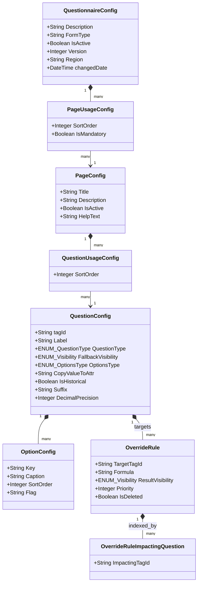

### 5.1 Comprehensive Entity Relationship Schema
The metamodel structure follows a strict parent-child tree:
- **`QuestionnaireConfig` (1) $\rightarrow$ (N) `PageUsageConfig` (N) $\leftarrow$ (1) `PageConfig`**  
  This many-to-many relationship via `PageUsageConfig` allows a single standardized page (e.g. *"Pre-Work Safety & PPE"*) to be reused across dozens of different questionnaire templates while maintaining custom sort ordering and mandatory rules per template.
- **`PageConfig` (1) $\rightarrow$ (N) `QuestionUsageConfig` (N) $\leftarrow$ (1) `QuestionConfig`**  
  Similarly, questions can be reused across multiple pages or templates through the `QuestionUsageConfig` join entity.
- **`QuestionConfig` (1) $\rightarrow$ (N) `OptionConfig`**  
  Defines the discrete options available for selection if the question is configured as a Dropdown, Radio Button, or Multi-Checkbox.
- **`QuestionConfig` (1) $\rightarrow$ (N) `OverrideRule` (1) $\rightarrow$ (N) `OverrideRuleImpactingQuestion`**  
  Defines the conditional visibility rules targeting this question, and the inverted index mapping tracking which answers impact those rules.

### 5.2 Attribute-by-Attribute Engineering Dictionary

#### 1. `DynamicQuestionnaire.QuestionnaireConfig`
| Attribute Name | Mendix Data Type | Validation Rules & Defaults | Purpose & Architectural Usage |
| :--- | :--- | :--- | :--- |
| `Description` | String (200) | Required | Human-readable template name (e.g. *"Commercial Chiller Annual Maintenance"*). Displayed in dispatch screens. |
| `FormType` | String (50) | Required, Indexed | Business classification code correlating with `Job.JobType` (e.g. `'CHILLER_PM'`, `'UPS_ASSESS'`). |
| `IsActive` | Boolean | Default: `false` | Master publication switch. Only active configurations are matched during job compilation. |
| `Version` | Integer | Default: `1`, Not Null | Monotonically increasing revision counter tracking structural migrations. |
| `Region` | String (50) | Optional | Geographical jurisdiction (e.g. `'EU'`, `'NA'`, `'APAC'`). Restricts template availability by operating unit. |

#### 2. `DynamicQuestionnaire.PageUsageConfig`
| Attribute Name | Mendix Data Type | Validation Rules & Defaults | Purpose & Architectural Usage |
| :--- | :--- | :--- | :--- |
| `SortOrder` | Integer | Required, Positive | Controls the sequential position of this page within the questionnaire wizard (e.g. `10`, `20`, `30`). |
| `IsMandatory` | Boolean | Default: `true` | If `true`, the wizard prevents final submission until all mandatory questions on this page are satisfied. |

#### 3. `DynamicQuestionnaire.PageConfig`
| Attribute Name | Mendix Data Type | Validation Rules & Defaults | Purpose & Architectural Usage |
| :--- | :--- | :--- | :--- |
| `Title` | String (100) | Required | The heading rendered in the mobile navigation bar and wizard step indicator. |
| `Description` | String (500) | Optional | Subtitle text displayed below the page heading to provide high-level technician guidance. |
| `HelpText` | String (Unlimited) | Optional | Markdown or rich-text reference documentation containing safety alerts, SOP links, or wiring diagrams. |
| `IsActive` | Boolean | Default: `true` | Soft-deletion flag. Inactive pages are excluded during compilation. |

#### 4. `DynamicQuestionnaire.QuestionUsageConfig`
| Attribute Name | Mendix Data Type | Validation Rules & Defaults | Purpose & Architectural Usage |
| :--- | :--- | :--- | :--- |
| `SortOrder` | Integer | Required, Positive | Dictates the vertical rendering position of the question on the page. |

#### 5. `DynamicQuestionnaire.QuestionConfig`
| Attribute Name | Mendix Data Type | Validation Rules & Defaults | Purpose & Architectural Usage |
| :--- | :--- | :--- | :--- |
| `tagId` | String (100) | Unique, Indexed, Regex: `^[A-Za-z0-9_-]+$` | The immutable variable name of the question (e.g. `Q_COMP_OIL_TEMP`). Used as formula tokens `{tagId}`. |
| `Label` | String (500) | Required | The user-facing prompt displayed above the input widget. |
| `QuestionType` | Enumeration | `DynamicQuestionnaire.ENUM_QuestionType` | Determines widget rendering and data storage type (`Text`, `Decimal`, `Dropdown`, `Radio`, etc.). |
| `FallbackVisibility`| Enumeration | `DynamicQuestionnaire.ENUM_Visibility` | Baseline visibility state before rules evaluate (`M`, `O`, `S`, `NA`, `I`). Default: `M`. |
| `OptionsType` | Enumeration | `DynamicQuestionnaire.ENUM_OptionsType` | Option population strategy (`Tag_Specific`, `Standard_Option_Set`, `Generate_from_Integer`, etc.). |
| `CopyValueToAttr` | String (100) | Optional | Target attribute on `Core.Job` or `JobMetaData` where the technician's answer is automatically copied. |
| `IsHistorical` | Boolean | Default: `false` | If `true`, the server queries previous service visits and pre-populates the last known answer. |
| `Suffix` | String (20) | Optional | Engineering unit label displayed adjacent to the input field (e.g. `'bar'`, `'°C'`, `'mΩ'`, `'RPM'`). |
| `DecimalPrecision` | Integer | Default: `2`, Range: 0-6 | Number of decimal places enforced and formatted for numeric questions. |

#### 6. `DynamicQuestionnaire.OptionConfig`
| Attribute Name | Mendix Data Type | Validation Rules & Defaults | Purpose & Architectural Usage |
| :--- | :--- | :--- | :--- |
| `Key` | String (50) | Required, Identifier | Machine-readable choice key stored in the database and evaluated in formulas (e.g. `'PASS'`, `'FAIL'`). |
| `Caption` | String (200) | Required | Human-readable label displayed in dropdown or radio card options. |
| `SortOrder` | Integer | Required | Ordering index of the option within the selection list. |
| `Flag` | String (50) | Optional | CSS styling flag (e.g. `'danger'`, `'warning'`, `'success'`) for conditional color badging. |

#### 7. `DynamicQuestionnaire.OverrideRule`
| Attribute Name | Mendix Data Type | Validation Rules & Defaults | Purpose & Architectural Usage |
| :--- | :--- | :--- | :--- |
| `TargetTagId` | String (100) | Required, Indexed | The `tagId` of the question whose visibility is modified by this rule. |
| `Formula` | String (1000) | Required | Boolean expression evaluated against answers (e.g. `"{Q_LEAK} == 'YES' and {Q_SEV} > 2"`). |
| `ResultVisibility` | Enumeration | `DynamicQuestionnaire.ENUM_Visibility` | The visibility applied to `TargetTagId` when `Formula` evaluates to `true` (`M`, `O`, `S`, `NA`). |
| `Priority` | Integer | Default: `10`, Positive | Evaluation order. Lower numbers evaluate first; the highest priority matching rule wins. |
| `IsDeleted` | Boolean | Default: `false` | Soft-deletion flag. Preserves audit history without executing obsolete rules. |

#### 8. `DynamicQuestionnaire.OverrideRuleImpactingQuestion`
| Attribute Name | Mendix Data Type | Validation Rules & Defaults | Purpose & Architectural Usage |
| :--- | :--- | :--- | :--- |
| `ImpactingTagId` | String (100) | Required, Indexed | A `tagId` found inside an `OverrideRule.Formula`. Used for fast indexed SQLite lookups on device. |

---

## Chapter 6: The Base Rules Engine (Environmental Filtering)

### 6.1 The Static Pre-Filter Concept
Base Rules establish the **Static Baseline Applicability** of questions. Unlike Override Rules (which evaluate dynamically as the user types), Base Rules depend on environmental and contextual metadata known *before* the inspection begins:
- Where is the equipment located? (Geographic region)
- What kind of visit is this? (Preventive maintenance vs. emergency breakdown)
- What trade skill does the technician hold? (HVAC vs. High Voltage Electrician)
- What specific equipment model variant is being serviced?

### 6.2 Geographical Filtering: `Core.RegionRule`
Certain questions apply only in specific regulatory jurisdictions.
- *Example:* Questions regarding refrigerant recovery certification under European Union F-Gas regulations must only appear for technicians operating within EU member states.
- The `Core.RegionRule` entity associates a `QuestionConfig` with specific region codes (`'UK'`, `'DE'`, `'US_CAL'`, `'APAC'`).
- If a question has Region Rules defined, and the current `Job.organization_region` does not match any configured rule, the question's `BaseVisibility` resolves to `'NA'` (Not Applicable), removing it from the form.

### 6.3 Technical Specialization: `Core.TechFamilyRule`
Field service teams encompass multiple technical disciplines:
- High-voltage electrical work requires arc flash safety certifications.
- Mechanical refrigeration work requires pressure vessel and refrigerant recovery certifications.
- The `Core.TechFamilyRule` entity restricts questions based on the assigned technician's trade discipline (`Job.TechFamily`). A purely mechanical maintenance question will not be presented to an electrical specialist performing a battery audit.

### 6.4 Visit Nature: `Core.VisitTypeRule`
The scope of work differs significantly depending on the visit type:
- **Commissioning / Installation Visit:** Requires verifying foundational leveling, electrical supply phase rotation, and initial refrigerant charging.
- **Preventive Maintenance (PM):** Focuses on wear-and-tear inspection, lubrication, and filter replacement.
- **Emergency Service Call:** Focuses on fault isolation, diagnostic error codes, and rapid restoration of service.
- The `Core.VisitTypeRule` matches against `Job.VisitType`. Questions specific to commissioning are excluded during routine preventive maintenance visits.

### 6.5 Equipment Specifics: `Core.ModelBaseRule`
Commercial product families contain multiple optional physical sub-assemblies (e.g. Economizer coils, Dual VFD drives, Glycol heat reclaimers).
- `Core.ModelBaseRule` links questions to specific equipment model numbers (`Job.Model`).
- If an equipment model lacks a heat reclaimer coil, all questions tagged with that sub-assembly resolve to `'NA'`.

---

## Chapter 7: The Dynamic Override Rules Engine

### 7.1 The Reactive Visibility Paradigm
While Base Rules establish the static form baseline, **Override Rules** make the form dynamic and responsive. They govern how questions appear, disappear, or become mandatory based on answers entered during the service visit.

### 7.2 Formula Syntax, Token Parsing & Lexical Rules
Override rule formulas are written using standard mathematical and boolean expressions:
- **Variable Tokens:** Enclosed in curly braces: `{TAG_NAME}`.
- **Comparison Operators:** `==` (equal), `!=` (not equal), `<` (less than), `>` (greater than), `<=` (less or equal), `>=` (greater or equal).
- **Logical Connectors:** `and`, `or`, `not`.
- **String Literals:** Enclosed in single quotes: `'YES'`, `'PASS'`, `'CRITICAL'`.
- **Parentheses:** Supported for nested logic: `({Q_TEMP} > 100 or {Q_PRESSURE} > 15) and {Q_ALERT} == 'YES'`.

### 7.3 The Priority Matrix & Conflict Resolution Strategy
A question may be targeted by multiple Override Rules:
- *Rule 1 (Priority 10):* If `{Q_LEAK} == 'YES'`, make `{Q_ACTION}` **Mandatory (`M`)**.
- *Rule 2 (Priority 20):* If `{Q_CONTAINED} == 'YES'`, make `{Q_ACTION}` **Optional (`O`)**.
- The engine sorts active rules by `Priority ASC`. The first rule whose formula evaluates to `true` takes precedence. If no override rule evaluates to `true`, the question retains its static `BaseVisibility`.

### 7.4 The Inverted Dependency Index (`OverrideRuleImpactingQuestion`)
When an administrator saves an `OverrideRule` in the admin portal:
1. Microflow `DynamicQuestionnaire.SUB_CreateOverrideRuleImpactingQuestions_Online` parses the formula string using regular expressions.
2. It extracts all variable tokens `{tagId}`.
3. It creates an `OverrideRuleImpactingQuestion` record for each token.
4. On the mobile tablet, this inverted index allows the client to evaluate only the rules impacted by a changed question, keeping response times under 10 milliseconds.

---

## Chapter 8: The Dynamic Calculate Rules Engine

### 8.1 Automatic Derived Telemetry in the Field
Field technicians must frequently record physical measurements and compute derived values:
- Suction Pressure and Discharge Pressure $\rightarrow$ **Pressure Compression Ratio**.
- Saturated Vapor Temperature and Suction Temperature $\rightarrow$ **Superheat**.
- Three-Phase Voltage and Current $\rightarrow$ **Total Power Consumption (kW)**.
Manual calculation risks errors. The Calculate Rules engine automates these computations in real time.

### 8.2 Formula Grammar & Scientific Operations
Calculate formulas support standard mathematical operations:
- Arithmetic: `+`, `-`, `*`, `/`, `^` (power), `%` (modulo).
- Mathematical functions: `round(val, decimals)`, `floor(val)`, `ceil(val)`, `abs(val)`, `min(a, b)`, `max(a, b)`.
- Conditional expressions: `if(condition, thenValue, elseValue)`.  
  *Example:* `if({Q_PRESS_RATIO} > 4.5, round({Q_FLOW} * 1.15, 2), round({Q_FLOW} * 1.05, 2))`

### 8.3 The Inverted Calculation Index (`CalculateRuleImpactingQuestion`)
Similar to override rules, calculate rules generate dependency records:
- Modifying `{VOLTS_L1}` or `{AMPS_L1}` immediately triggers recalculation of `{TOTAL_KW}` via direct indexed SQLite lookups.

---

## Chapter 9: The Dynamic Validation Rules Engine

### 9.1 Contextual Field Validation vs. Static Constraints
Standard Mendix input validation enforces static constraints (e.g. "Value must be a positive number"). However, equipment safety validation is highly contextual:
- A discharge pressure of 18 bar may be normal when ambient temperature is 40°C, but indicates an overpressure fault when ambient temperature is only 15°C.
- Dynamic Validation Rules evaluate multi-variable validation formulas against current answers.

### 9.2 Formulaic Validation Logic & Error State Propagation
The `DynamicQuestionnaire.ValidationRule` entity defines:
- **`TargetTagId`**: The question displaying the error.
- **`Formula`**: Boolean condition. If evaluates to `true`, validation **fails**.  
  *Example:* `"{Q_DISCHARGE_TEMP} > 120 and {Q_FAN_SPEED} == 'HIGH'"`
- **`ErrorMessage`**: User-facing message rendered below the widget.

### 9.3 Downstream Error Badges & Navigation Blocking
When a validation rule fails:
- Sets `$Question/HasError = true` and `$Question/ErrorMessage = '...'`.
- The UI renders a red alert badge below the input field.
- The page's completion status is invalidated (`Page.IsCompleted = false`), preventing forward wizard navigation until the technician corrects the invalid input.

---

## Chapter 10: Structural Versioning & Configuration Lifecycle

### 10.1 Draft, Active, and Archived States
Questionnaire configurations progress through three lifecycle stages:
- **Draft (`IsActive = false`):** Form authors can add questions, adjust sort orders, and test formula logic in development environments without affecting field technicians.
- **Active (`IsActive = true`):** The configuration is published. Cloud compilation microflows match against active configurations when creating new jobs.
- **Archived:** Replaced by newer versions. Existing jobs retain their compiled question instances, while new jobs inherit the latest published template.

### 10.2 Soft-Deletion Protocols (`IsDeleted` Invariant)
To protect historical reporting and compliance auditing:
- Deleting a question or rule in the administrative portal never executes a SQL `DELETE`.
- The system sets `IsDeleted = true`.
- All queries and export mappings filter on `[IsDeleted = false]`, preserving complete historical audit trails.

### 10.3 Non-Destructive In-Flight Job Upgrades
If a job is dispatched and downloaded to a mobile device, and a minor configuration update is subsequently published to the server:
- The system checks timestamps (`JobSyncFile/createdDate` vs. `QuestionnaireConfig/changedDate`).
- If an update is required, the server recompiles the job document while preserving the technician's already-entered answers, ensuring field work is never lost.

---

# VOLUME III: THE COMPILATION & INSTANTIATION PIPELINE (CLOUD SERVER)

When a service job is assigned and dispatched, the cloud server compiles the configuration metamodel into an operational questionnaire instance.

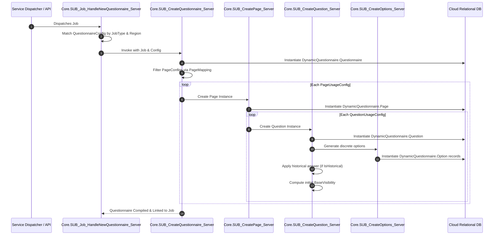

---

## Chapter 11: The Job Creation & Questionnaire Factory

### 11.1 Entry Point: `Core.SUB_Job_HandleNewQuestionnaire_Server`
- **Location:** `Core` module.
- **Input:** `$Job` (`Core.Job`).
- **Logic:**
  1. Inspects `Job.JobType`, `Job.organization_region`, and `Job.Model`.
  2. Queries `DynamicQuestionnaire.QuestionnaireConfig` where `IsActive = true` matching these parameters.
  3. Asserts that a valid template exists; if not found, logs a critical error to log node `@Core.CONST_LogNode`.
  4. Calls `Core.SUB_CreateQuestionnaire_Server`.

### 11.2 The Template Resolution Strategy
If multiple active configurations match the broad job type:
- The engine prioritizes the most specific template based on region, equipment model, and customer account mappings before falling back to global default templates.

### 11.3 Instantiation Coordinator: `Core.SUB_CreateQuestionnaire_Server`
1. Instantiates the root `DynamicQuestionnaire.Questionnaire` entity.
2. Generates an immutable UUID: `Questionnaire.QuestionnaireId = 'Q-' + toString(randomHash())`.
3. Establishes the association `DynamicQuestionnaire.Questionnaire_Job = $Job`.
4. Copies template metadata: `Description`, `FormType`, `Version`.
5. Iterates through associated `PageUsageConfig` records sorted by `SortOrder ASC`.

---

## Chapter 12: Page Instantiation & PageMapping Pipeline

### 12.1 Execution Flow: `Core.SUB_CreatePage_Server`
For each matching `PageUsageConfig`:
1. Instantiates `DynamicQuestionnaire.Page`.
2. Generates an identifier: `Page.PageId = 'P-' + toString($PageUsageConfig/SortOrder)`.
3. Copies presentation attributes:
   - `Title` $\leftarrow$ `PageConfig.Title`
   - `Description` $\leftarrow$ `PageConfig.Description`
   - `HelpText` $\leftarrow$ `PageConfig.HelpText`
   - `SortOrder` $\leftarrow$ `PageUsageConfig.SortOrder`
   - `IsMandatory` $\leftarrow$ `PageUsageConfig.IsMandatory`
   - `IsCompleted` $\leftarrow$ `false`
4. Establishes association `DynamicQuestionnaire.Page_Questionnaire = $Questionnaire`.

### 12.2 Contractual Site Customization via `PageMapping`
Certain commercial maintenance contracts exclude specific inspection sections (e.g. omitting cooling tower inspections at dry data centers):
- Calls `DynamicQuestionnaire.DS_PageUsageConfig_byMapping_Server`.
- Queries the `PageMapping` table matching the specific customer site.
- If a page is blacklisted for that site, it is excluded from instantiation, tailoring the checklist to the customer's contract.

### 12.3 Wizard Step Normalization & Sort Ordering
The microflow normalizes sort order indices, ensuring sequential increments (`10`, `20`, `30`, etc.) to prevent duplicate index collisions in mobile wizard navigation.

---

## Chapter 13: Question Instantiation Pipeline

### 13.1 Execution Flow: `Core.SUB_CreateQuestion_Server`
For each `QuestionUsageConfig` linked to the page:
1. Instantiates `DynamicQuestionnaire.Question`.
2. Establishes association `DynamicQuestionnaire.Question_Page = $Page`.
3. Establishes association `DynamicQuestionnaire.Question_Questionnaire = $Questionnaire`.

### 13.2 Metadata Replication & Attribute Typing
Copies definition attributes from `QuestionConfig`:
- `tagId` $\leftarrow$ `QuestionConfig.tagId`
- `Label` $\leftarrow$ `QuestionConfig.Label`
- `QuestionType` $\leftarrow$ `QuestionConfig.QuestionType`
- `FallbackVisibility` $\leftarrow$ `QuestionConfig.FallbackVisibility`
- `CopyValueToAttr` $\leftarrow$ `QuestionConfig.CopyValueToAttr`
- `Suffix` $\leftarrow$ `QuestionConfig.Suffix`
- `DecimalPrecision` $\leftarrow$ `QuestionConfig.DecimalPrecision`
- `HasError` $\leftarrow$ `false`

### 13.3 Fallback Visibility Seeding
Initializes visibility states:
- `ResultVisibility` $\leftarrow$ `QuestionConfig.FallbackVisibility`
- `VisibilityOverride` $\leftarrow$ `empty`

---

## Chapter 14: Option Generation Strategies

Handled by `Core.SUB_CreateOptions_Server` based on `QuestionConfig.OptionsType`:

```
┌────────────────────────────────────────────────────────────────────────┐
│                        Option Generation Strategies                    │
├─────────────────────────┬──────────────────────────────────────────────┤
│ Strategy                │ Generation Logic                             │
├─────────────────────────┼──────────────────────────────────────────────┤
│ 1. Tag_Specific         │ Clones OptionConfig entities linked directly │
│                         │ to this QuestionConfig.                      │
├─────────────────────────┼──────────────────────────────────────────────┤
│ 2. Standard_Option_Set  │ Clones shared reusable options (e.g., standard│
│                         │ "Pass / Fail / N/A" sets).                   │
├─────────────────────────┼──────────────────────────────────────────────┤
│ 3. Generate_from_Integer│ Dynamically creates N options (1 to N) based │
│                         │ on machine specifications.                   │
├─────────────────────────┼──────────────────────────────────────────────┤
│ 4. Model_Options_CSV    │ Parses comma-separated lists tied to the     │
│                         │ equipment's bill-of-materials.               │
└─────────────────────────┴──────────────────────────────────────────────┘
```

### 14.2 Strategy 1: `Tag_Specific` Direct Association Cloning
Clones `DynamicQuestionnaire.OptionConfig` records linked directly to the `QuestionConfig`, instantiating runtime `DynamicQuestionnaire.Option` entities associated with the new `Question`.

### 14.3 Strategy 2: `Standard_Option_Set` Global Reuse
Retrieves a global shared option set (e.g. Standard 3-State Inspection: `"Pass"`, `"Fail"`, `"Not Applicable"`). Clones the set into runtime `Option` entities.

### 14.4 Strategy 3: `Generate_from_Integer` Dynamic Steppers
For equipment with variable component counts (e.g. selecting burner heads or compressor circuits):
- Evaluates an integer parameter on the machine model (e.g. `Circuits = 4`).
- Generates $N$ runtime options dynamically (`"Circuit 1"`, `"Circuit 2"`, `"Circuit 3"`, `"Circuit 4"`).

### 14.5 Strategy 4: `Model_Options_CSV` Machine Bill-of-Materials
Parses a comma-separated string tied to the equipment's bill-of-materials in `MasterData`, generating discrete options for matching parts.

---

## Chapter 15: Historical Data Ingestion & Pre-Population

### 15.1 Architectural Flow: `Core.SUB_Question_ApplyHistoricalData_Server`
If `QuestionConfig.IsHistorical = true`:
1. Queries the previous completed `Core.Job` matching the same equipment serial number (`Job.SerialNumber`).
2. Retrieves the historical questionnaire associated with that job.

### 15.2 The `HQuestionnaire` and `HQuestion` Metamodel
Completed jobs store historical answers in dedicated archive entities (`DynamicQuestionnaire.HQuestionnaire`, `DynamicQuestionnaire.HQuestion`). This decouples historical audit records from active configuration changes.

### 15.3 Historical Match Matching & Auto-Fill Policies
- If a matching `HQuestion` with the same `tagId` exists in the archive:
  - Copies the historical answer into `$Question/HistoricalAnswerString`.
  - For baseline tracking questions (e.g. run-hours, historical baseline impedance), pre-populates `$Question/AnswerValueString`.
  - The UI renders a "Previous Visit Reading" reference badge alongside the input field.

---

## Chapter 16: Initial Base Visibility Computation

### 16.1 Microflow Architecture: `Core.SUB_Question_CalcBaseVisibility`
Evaluates static environmental rules against `Job` attributes:
1. If no base rules exist for the question, return `FallbackVisibility`.
2. Evaluate `RegionRule`, `TechFamilyRule`, `VisitTypeRule`, and `ModelBaseRule`:
   - If **any** matching rule evaluates to `NA`, return `NA`.
   - If **all** rules evaluate to `I`, return `I`.
   - If any rule evaluates to `S`, return `S`.
   - If any rule evaluates to `O`, return `O`.
   - If any rule evaluates to `M`, return `M`.

### 16.3 Output Assignment: `BaseVisibility` & `ResultVisibility`
The calculated base state is written to:
- `$Question/BaseVisibility`
- `$Question/ResultVisibility` (establishing the starting state before mobile runtime override rules evaluate).

---

# VOLUME IV: THE DUAL-LAYER VISIBILITY ENGINE

The visibility engine determines whether a question is hidden, optional, mandatory, or read-only.

## Chapter 17: Visibility States & The Truth Table Matrix

### 17.1 The 5 Fundamental States (`M`, `O`, `S`, `NA`, `I`)
Defined in `DynamicQuestionnaire.ENUM_Visibility`:

| Code | Enumeration Caption | Meaning in Engine | UI Render Behavior |
| :---: | :--- | :--- | :--- |
| **`M`** | Mandatory | Must be answered before page completion. | Rendered with red asterisk. Form completion blocked if blank. |
| **`O`** | Optional | Can be answered or left blank. | Rendered normally without required indicators. |
| **`S`** | Shown | Read-only informational presentation. | Rendered in disabled mode, or hidden unless helper toggle active. |
| **`NA`** | Not Applicable | Logically excluded by equipment type or rule. | **Completely hidden** from DOM. Answers wiped out. |
| **`I`** | Invisible | Configuration default before rules evaluate. | **Completely hidden** from DOM. |

### 17.2 The Master Bitmask & State Combination Matrix

$$\text{ResultVisibility} = \text{BaseVisibility} \oplus \text{VisibilityOverride}$$

| BaseVisibility | VisibilityOverride | IsBlockHidden | **Final ResultVisibility** | Action Taken by Engine |
| :---: | :---: | :---: | :---: | :--- |
| Any | Any | `true` | **`NA`** | Block container hidden $\rightarrow$ question forced hidden. |
| `NA` | Any | `false` | **`NA`** | Base rule excluded $\rightarrow$ cannot be overridden. |
| `I` | Any | `false` | **`I`** | Configuration invisible $\rightarrow$ remains hidden. |
| `M` | `empty` or `I` | `false` | **`M`** | No active override $\rightarrow$ retains Base Mandatory. |
| `M` | `NA` | `false` | **`NA`** | **Override takes precedence $\rightarrow$ question hidden & wiped.** |
| `M` | `O` | `false` | **`O`** | Override reduces requirement to Optional. |
| `M` | `S` | `false` | **`S`** | Override changes field to Read-Only Shown. |
| `O` | `M` | `false` | **`M`** | **Override escalates field to Mandatory.** |
| `O` | `NA` | `false` | **`NA`** | Override hides question & wipes answers. |
| `S` | `M` | `false` | **`M`** | Override converts read-only field into Mandatory input. |

---

## Chapter 18: Client Resolution Nanoflow (`SUB_Question_CalcResultVisibility_Device`)

Executed on the mobile device whenever an answer change impacts downstream rules:

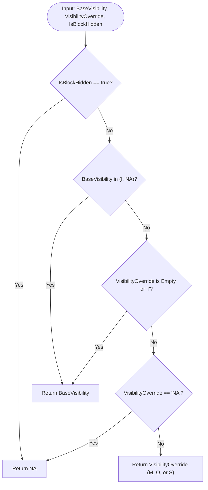

### 18.2 Evaluating Block Containers & `IsBlockHidden`
Certain questions reside inside parent collapsible groups or conditional sub-sections:
- If a parent section collapses or is hidden by a block rule, `IsBlockHidden` evaluates to `true`, forcing all child questions to `ResultVisibility = 'NA'` regardless of their individual override rules.

---

## Chapter 19: The Transition State Machine & The Reset Cascade

### 19.1 The Danger of Stale Data in Hidden Fields
What happens when Alex answers five mandatory questions under *"Oil Leak = YES"*, and then changes the answer to *"NO"*?
- If the system simply hid the questions, the stale leak answers would remain in SQLite storage.
- When the job is synchronized, the cloud server would process answers for questions that the technician cannot see, generating inaccurate inspection reports.

### 19.2 Transition Interceptor: `SUB_QuestionVisibility_HandleOverridden`
The engine intercepts every visibility state transition:
- If a question transitions from a **Visible State (`M`, `O`, `S`)** to a **Hidden State (`NA`, `I`)**:
- It invokes `DynamicQuestionnaire.ResetAnswer_Device`.

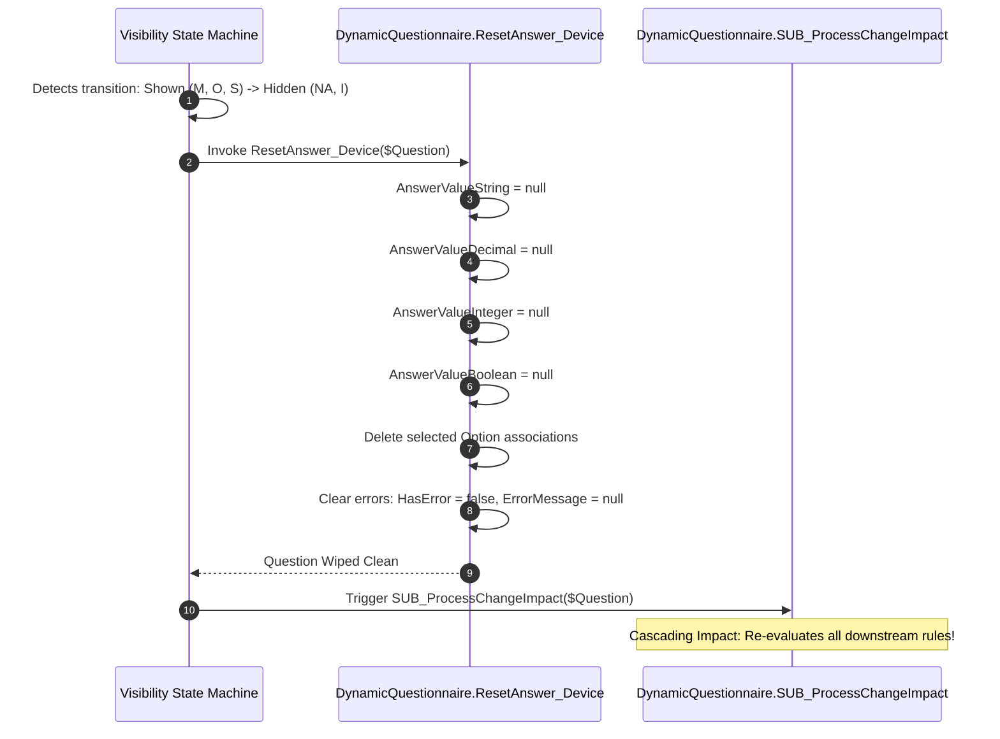

### 19.3 Atomic Data Wipe: `DynamicQuestionnaire.ResetAnswer_Device`
Wipes all answer attributes:
- `AnswerValueString = null`
- `AnswerValueDecimal = null`
- `AnswerValueInteger = null`
- `AnswerValueBoolean = null`
- `AnswerValueDateTime = null`
- Disassociates child `DynamicQuestionnaire.Option` selections.
- Resets error badges: `HasError = false`, `ErrorMessage = null`.

### 19.4 Downstream Cascading Impact Triggering
Because resetting the answer modified the question's state, it triggers `SUB_ProcessChangeImpact` for that question. Any rules dependent on the cleared question are re-evaluated, cascading updates down the dependency tree.

---

## Chapter 20: Section & Page-Level Dynamic Visibility

### 20.1 Dynamic Page Exclusion (`All Questions NA`)
If every question on a page evaluates to `ResultVisibility = 'NA'`:
- The page is excluded from the wizard step navigation.
- The mobile UI hides the step tab entirely, streamlining navigation for the technician.

### 20.2 Wizard Step Gating & Page Completion Integrity
- A page is marked `IsCompleted = true` if and only if:
  1. Every question with `ResultVisibility = 'M'` has a valid non-null answer.
  2. No question on the page has `HasError = true`.
- If any mandatory question is unsatisfied, the forward navigation button displays the remaining question count and prevents wizard progression.

---

*(Continued in Volume V through Volume XII below)*


# VOLUME V: THE CLIENT-SIDE REACTIVE ON-CHANGE & CALCULATION PIPELINE

The reactive engine executes entirely offline inside the mobile client using Mendix Nanoflows and native JavaScript actions.

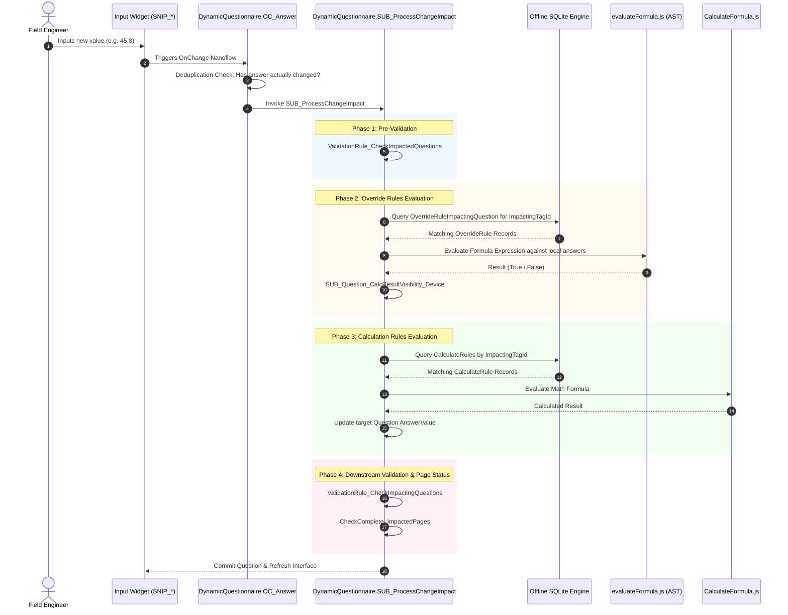

---

## Chapter 21: Event Capture & Deduplication (`OC_Answer`)

Attached to the `OnChange` event of every input widget:
1. **Deduplication Check:** Compares the current answer with the previous database value using `QuestionGetOriginalValueString` or `QuestionGetOriginalValueDecimal`.
2. If unchanged (e.g. user clicked into a field and blurred without making changes), execution halts immediately, preventing redundant rule evaluations.
3. If changed, dispatches to `DynamicQuestionnaire.SUB_ProcessChangeImpact`.

---

## Chapter 22: The Master Coordinator: `SUB_ProcessChangeImpact`

Coordinates reactive updates across five sequential phases:
- **Phase A — Pre-Validation:** Validates constraints on the modified question (`DynamicQuestionnaire.ValidationRule_CheckImpactedQuestions`).
- **Phase B — Sub-Questionnaire Lifecycle:** Instantiates or deletes repeatable sub-forms if the question controls component counts (`DynamicQuestionnaire.SUB_SubQuestionnaire_CreateOrDelete`).
- **Phase C — Override Rules Evaluation:** Evaluates conditional visibility rules for dependent questions (`DynamicQuestionnaire.JSA_OverrideRules_RunByImpacting`).
- **Phase D — Calculation Rules Evaluation:** Recomputes derived mathematical formulas (`DynamicQuestionnaire.JSA_CalculateRules_RunByImpacting`).
- **Phase E — Downstream Validation & Page Status:** Updates error badges and recalculates wizard page completion status (`DynamicQuestionnaire.ValidationRule_CheckImpactingQuestions` and `DynamicQuestionnaire.CheckComplete_ImpactedPages`).

---

## Chapter 23: Direct SQLite Indexing & High-Speed Query Execution

Standard Mendix nanoflow retrieve actions only support basic XPath/entity queries, which cannot perform complex joins or inverted index lookups efficiently.

To maintain sub-50ms response times, actions like [JSA_OverrideRules_RunByImpacting.js](file:///Root/javascriptsource/dynamicquestionnaire/actions/JSA_OverrideRules_RunByImpacting.js) run direct, indexed SQL queries against the local SQLite store:

```sql
SELECT 
    r.TargetTagId AS target,
    r.Formula AS formula,
    r.ResultVisibility AS vis,
    r.Priority AS priority
FROM DynamicQuestionnaire_OverrideRule r
INNER JOIN DynamicQuestionnaire_OverrideRuleImpactingQuestion i
    ON i.DynamicQuestionnaire_OverrideRule_ID = r.ID
WHERE i.ImpactingTagId = ?
ORDER BY r.Priority ASC;
```

---

## Chapter 24: JavaScript Expression Parsers (`evaluateFormula.js` & `CalculateFormula.js`)

Formulas are parsed using an embedded JavaScript parser based on `expr-eval` (an extensible mathematical expression evaluator):
- **Location:** [evaluateFormula.js](file:///Root/javascriptsource/dynamicquestionnaire/actions/evaluateFormula.js) and [CalculateFormula.js](file:///Root/javascriptsource/dynamicquestionnaire/actions/CalculateFormula.js)
- **Token Replacement:** Replaces tokens like `{tagId}` with actual typed values from the local SQLite answer table:
  - Text: Escaped strings (e.g. `'Normal'`).
  - Decimals/Integers: Unquoted numbers (e.g. `100.5`).
  - Booleans: `true` / `false`.
  - Empty/Null: Evaluates to `null`.
- **Functions Supported:** Standard logic (`and`, `or`, `not`), comparisons (`==`, `!=`, `<`, `>`, `<=`, `>=`), string operations (`contains`, `startsWith`), and math functions (`round`, `floor`, `ceil`, `if(cond, then, else)`).

---

## Chapter 25: Recursion Prevention & Infinite Loop Safeguards

If Question `{A}` calculates `{B}`, and `{B}` calculates `{A}`, an unconstrained reactive engine would loop indefinitely and freeze the mobile device.

### The Recursion Guard: `'CalcTagsRan'`
The engine passes a tracking list named `'CalcTagsRan'` into `CalculateFormula.js`. If a question tag appears more than once within a single evaluation cycle, the recursion guard halts calculation and logs a warning, preventing mobile client thread deadlocks.

---

## Chapter 26: Page Completion Auditing & Wizard Navigation

Invokes `DynamicQuestionnaire.CheckComplete_ImpactedPages`:
- Asserts that all questions with `ResultVisibility = 'M'` contain valid non-null answers and `HasError = false`.
- Updates `Page.IsCompleted`.
- Controls the enabled state of the wizard's "Next Step" and "Submit Inspection" buttons.

---

# VOLUME VI: UI PRESENTATION ARCHITECTURE & SNIPPETS

The user interface renders forms dynamically by nesting generic snippet widgets inside an outer iterator.

```
[ Page View: DynamicQuestionnaire_Page_Mobile ]
   │
   ▼
[ List View: Iterates Questions sorted by SortOrder ]
   │
   ▼
[ Dynamic Widget Dispatcher ]
   ├── If QuestionType == 'Text'       ──> SNIP_TextBoxQuestion
   ├── If QuestionType == 'Decimal'    ──> SNIP_DecimalQuestion
   ├── If QuestionType == 'Integer'    ──> SNIP_IntegerQuestion
   ├── If QuestionType == 'Dropdown'   ──> SNIP_DropdownQuestion
   ├── If QuestionType == 'Radio'      ──> SNIP_RadioButtonQuestion
   ├── If QuestionType == 'MultiCheck' ──> SNIP_MultiCheckboxQuestion
   ├── If QuestionType == 'DateTime'   ──> SNIP_DateTimeQuestion
   └── If QuestionType == 'Signature'  ──> SNIP_SignatureQuestion
```

---

## Chapter 27: The Dynamic Widget Dispatcher Pattern

Implemented in `DynamicQuestionnaire.DynamicQuestionnaire_Question_Dispatcher`:
- Contains a conditional visibility branch for each supported `ENUM_QuestionType`.
- Routes each question to its corresponding specialized snippet widget.

---

## Chapter 28: The Uniform Snippet Contract

Every snippet implementation adheres to a shared structural contract:

```
┌────────────────────────────────────────────────────────────────────────┐
│ .question-container                                                    │
│ [Dynamic Class]: 'q-' + tagId + ' q-state-' + ResultVisibility         │
│                                                                        │
│  ┌──────────────────────────────────────────────────────────────────┐  │
│  │ .question-label-row                                              │  │
│  │ Label Text                                     [*] (if 'M')      │  │
│  └──────────────────────────────────────────────────────────────────┘  │
│                                                                        │
│  ┌──────────────────────────────────────────────────────────────────┐  │
│  │ .question-input-wrapper (Visibility: M, O, or S)                 │  │
│  │  ┌────────────────────────────────────────────────────────────┐  │  │
│  │  │ Core Input Widget (TextBox, Dropdown, etc.)                │  │  │
│  │  │  - Attribute: $Question/AnswerValueString                  │  │  │
│  │  │  - OnChange: DynamicQuestionnaire.OC_Answer                │  │  │
│  │  │  - ReadOnly: if $Question/ResultVisibility = 'S'           │  │  │
│  │  └────────────────────────────────────────────────────────────┘  │  │
│  └──────────────────────────────────────────────────────────────────┘  │
│                                                                        │
│  ┌──────────────────────────────────────────────────────────────────┐  │
│  │ .question-error-container (Visibility: HasError == true)         │  │
│  │  [!] ErrorMessage text badge                                     │  │
│  └──────────────────────────────────────────────────────────────────┘  │
└────────────────────────────────────────────────────────────────────────┘
```

### Standard Snippet Parameters:
1. **`Question`** (`DynamicQuestionnaire.Question`): The specific question instance being rendered.
2. **`Questionnaire`** (`DynamicQuestionnaire.Questionnaire`): The parent questionnaire instance.
3. **`QuestionnaireHelper`** (`DynamicQuestionnaire.QuestionnaireHelper`): Transient UI helper entity holding flags like `ShowAllQuestions`.
4. **`CurrentPage`** (`DynamicQuestionnaire.Page`): The current wizard step context.

---

## Chapter 29: Dynamic CSS Classes & Styling Hooks

The top-level container applies dynamic classes to enable fine-grained CSS styling and automated testing:

```java
'q-' + regexReplace($Question/tagId, '[^a-zA-Z0-9_-]', '_')
+ ' q-type-' + toString($Question/QuestionType)
+ ' q-vis-' + toString($Question/ResultVisibility)
+ (if $Question/HasError then ' q-has-error' else '')
+ (if $Question/ResultVisibility = DynamicQuestionnaire.ENUM_Visibility.M then ' q-mandatory' else '')
```

---

## Chapter 30: Accessibility (ARIA) & Industrial Ergonomics

- Input wrappers include dynamic ARIA attributes:  
  `aria-required = if $Question/ResultVisibility = 'M' then 'true' else 'false'`
- Inputs feature high-contrast styling and enlarged touch targets (minimum 48×48px) designed for use with industrial gloves.

---

## Chapter 31: Exhaustive Snippet Catalog (All 15 Question Types)

| Snippet Name | Underlying Mendix Widget | Bound Attribute | Key Capabilities |
| :--- | :--- | :--- | :--- |
| `SNIP_TextBoxQuestion` | Text Box / Text Area | `AnswerValueString` | Regex masks, multi-line modes, character counters. |
| `SNIP_DecimalQuestion` | Numeric Text Box | `AnswerValueDecimal` | Localized decimal separators (`,`/`.`), precision formatting. |
| `SNIP_IntegerQuestion` | Integer Text Box | `AnswerValueInteger` | Whole-number validation, increment/decrement stepper buttons. |
| `SNIP_DropdownQuestion`| Dropdown / Reference Selector | `Question_Option` | Populated dynamically from child `Option` records. |
| `SNIP_RadioButtonQuestion`| Radio Buttons | `Question_Option` | Single-touch selection with visual radio card styling. |
| `SNIP_MultiCheckboxQuestion`| List View with Checkboxes | Association to `Option` | Multi-select choice arrays. |
| `SNIP_DateTimeQuestion`| Date Picker | `AnswerValueDateTime` | Date-only, Time-only, and combined DateTime pickers. |
| `SNIP_SignatureQuestion`| Signature Canvas | `DynamicQuestionnaire.Signature` | HTML5 vector canvas capturing signatures and PNG base64 strings. |
| `SNIP_BarcodeQuestion`| Native Camera Scanner | `AnswerValueString` | 1D/2D barcode and QR code scanner integration. |
| `SNIP_ImageQuestion` | Camera / File Picker | `DynamicQuestionnaire.Media` | Photo capture with thumbnail previews and offline caching. |

---

# VOLUME VII: THE CUSTOM JOB SYNC & DOCUMENT STORE ARCHITECTURE

## Chapter 32: Why Standard Mendix Offline Sync Was Abandoned for Jobs

Standard Mendix Native Mobile offline architecture relies on declarative entity synchronization:
- The modeler marks entities as *Synchronizable*.
- The Mendix client runtime introspects local SQLite tables and compares local commit flags with server timestamps.
- During a synchronization event (`mendix.lib.Sync`), the client packages changes and the server merges rows across tables using individual `INSERT` and `UPDATE` SQL statements.

```
┌────────────────────────────────────────────────────────────────────────┐
│             Why Standard Mendix Sync Fails for Enterprise Jobs         │
├───────────────────────────────────┬────────────────────────────────────┤
│ Problem in Field Reality          │ Result with Standard Mendix Sync   │
├───────────────────────────────────┼────────────────────────────────────┤
│ 1. Deep Entity Hierarchy          │ A single Job graph contains 15+    │
│    (Job -> Questionnaire -> Page  │ entity levels. Partial network     │
│    -> Question -> Option, etc.)   │ failures leave child rows orphaned.│
├───────────────────────────────────┼────────────────────────────────────┤
│ 2. Concurrent Field Operations    │ When 500 technicians sync at 8 AM, │
│    (High Cloud Server Contention) │ computing relational diffs across  │
│                                   │ normalized tables exhausts pools.  │
├───────────────────────────────────┼────────────────────────────────────┤
│ 3. Selective Job Portability      │ Field engineers must download or   │
│    (Targeted File Transfer)       │ export single jobs on demand       │
│                                   │ without syncing all other records. │
├───────────────────────────────────┼────────────────────────────────────┤
│ 4. Deterministic Backups          │ A single JSON file is trivial to   │
│    (Zero-Loss Disaster Recovery)  │ backup, email, inspect, or replay  │
│                                   │ if a physical tablet is damaged.   │
└───────────────────────────────────┴────────────────────────────────────┘
```

Because of these constraints, the engineering team designed an **Independent Document-Oriented Custom Synchronization Engine**.

---

## Chapter 33: The Document Database Paradigm on Native SQLite

Instead of synchronizing relational database tables row by row, the application treats an entire service visit as an **Atomic Document Package**:

```mermaid
flowchart LR
    subgraph Server_Cloud ["Mendix Cloud Runtime (PostgreSQL / SQL Server)"]
        RelJob[(Relational Job Tree)]
        ExportMap["Export Mapping: Core.JobClientJSON_Export_V2"]
        ZipEngine["Zip Document Engine (ZipHandlingCustom)"]
        SyncFileEntity["Core.JobSyncFile (Compressed Document)"]
    end

    subgraph Mobile_Device ["Offline Mobile Client (SQLite Store)"]
        UnzipEngine["JS Zip Extractor"]
        ClientImport["ClientImportExportMapping.ImportWithMapping"]
        LocalSQLite[(Local SQLite Tables)]
        ClientExport["ClientImportExportMapping.ExportWithMapping"]
    end

    RelJob -->|Compiled into JSON| ExportMap
    ExportMap -->|SHA-256 Hashed & Zipped| ZipEngine
    ZipEngine -->|Stored as FileDocument| SyncFileEntity
    SyncFileEntity -.->|HTTP File Download (Binary Stream)| UnzipEngine
    UnzipEngine -->|Parsed JSON Tree| ClientImport
    ClientImport -->|Instantiated Locally| LocalSQLite

    LocalSQLite -->|Serialized to JSON| ClientExport
    ClientExport -.->|Direct Document Upload| Server_Cloud
```

### The Three Invariants of the Document Sync Engine:
1. **Single Unit of Transfer:** A Job is packaged as a single, self-contained JSON file inside a compressed `.zip` container.
2. **Deterministic Hashing:** Before generating or downloading a package, the system computes a SHA-256 hash. If the payload hash matches the current state, data transfer is skipped entirely.
3. **Atomic Replacement on Ingest:** When the server receives an updated Job from a device, it does not execute messy field-by-field delta merges. It runs a validated replacement cascade, archiving the previous version and instantiating the new tree cleanly.

---

## Chapter 34: Server-to-Client Pipeline: Job Packaging & Hashing

The server generation pipeline is implemented in microflow [Core.SUB_JobSyncFile_Create](file:///Root/Connected%20CE%20V2.mpr).

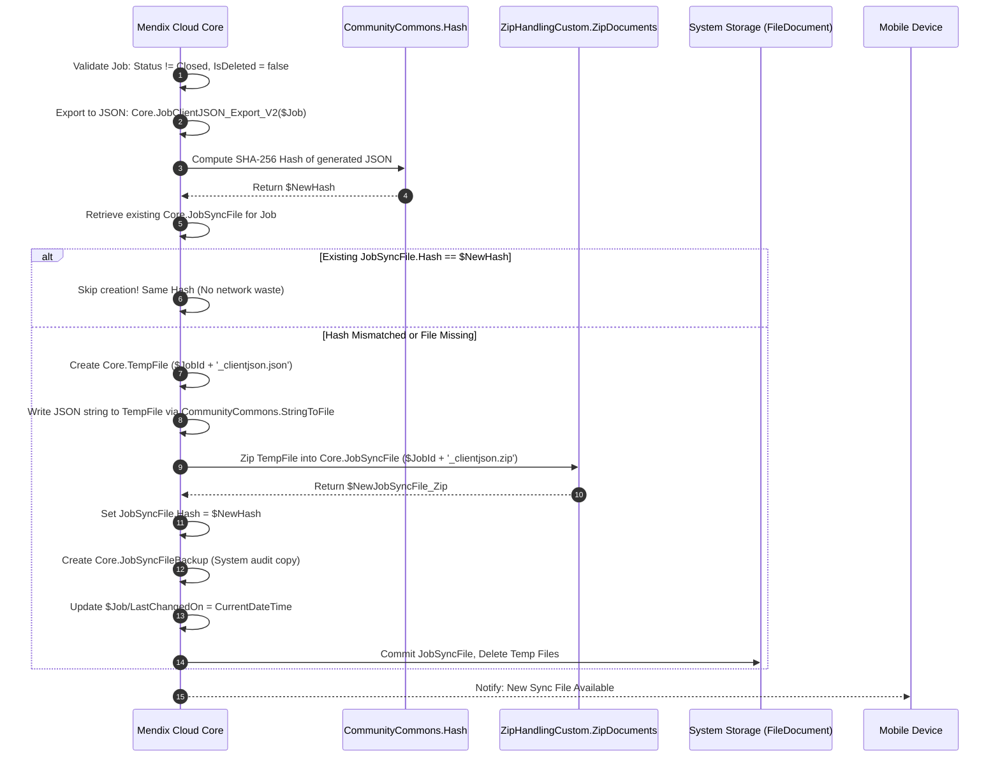

### Key Server Microflows:
- **`Core.SUB_JobSyncFile_Create`**: The master compilation microflow.
  - Takes `$Job` (`Core.Job`).
  - Calls `Core.DS_Job_GetRootHQuestionnaire_Server` and `Core.DS_Job_GetQuestionnaire_Server`.
  - Executes export mapping `Core.JobClientJSON_Export_V2($Job)`.
  - Computes `CommunityCommons.Hash(value = $NewJSON)`.
  - Compares with `$JobSyncFile_Current/Hash`. If matching, exits cleanly.
  - Compresses JSON into `$Job/JobId + '_clientjson.zip'` via `ZipHandlingCustom.ZipDocuments`.
  - Calls `Core.SUB_JobSyncFileBackup_Create` to maintain historical recovery snapshots.
- **`Core.SUB_Job_CheckNewSyncFileRequired`**:
  - Compares timestamps between `Job/changedDate`, child questionnaire changes, and the existing `JobSyncFile/createdDate`.

---

## Chapter 35: Client-Side Extraction & Native Ingestion Engine

When the mobile technician taps to synchronize or download an assigned job:
1. **Download Trigger:** Nanoflow [Core.ACT_Job_DownloadLatestSyncFile](file:///Root/Connected%20CE%20V2.mpr) queries the server for the latest `Core.JobSyncFile` associated with the technician's `JobId`.
2. **File Extraction:** Nanoflow [Core.SUB_JobSyncFile_TryExtract](file:///Root/Connected%20CE%20V2.mpr) invokes [Core.SUB_JobSyncFile_PerformExtraction](file:///Root/Connected%20CE%20V2.mpr):
   - Reads the `.zip` archive on the local mobile filesystem.
   - Unzips the inner payload file: `$JobId + '_clientjson.json'`.
3. **In-Memory Deserialization & Object Mapping:** Nanoflow calls JavaScript Action [ClientImportExportMapping.ImportWithMapping_returnObject](file:///Root/javascriptsource/clientimportexportmapping/actions/ImportWithMapping_returnObject.js):
   - Passes the JSON text and the client import mapping descriptor [Core.SUB_Job_GetClientJSONMapping_Import](file:///Root/Connected%20CE%20V2.mpr).
   - The engine (implemented in [ImportJsonHelper.js](file:///Root/javascriptsource/clientimportexportmapping/implementation/ImportJsonHelper.js)) traverses the JSON tree and instantiates Mendix offline entities directly into the local SQLite store.
4. **Deferred File Writing:** Any base64-encoded images, attachments, or signature canvases are extracted and scheduled via `pendingFiles`, ensuring files are saved to the device disk only *after* the parent database records are safely committed.

---

## Chapter 36: Client-to-Server Pipeline: Native JSON Serialization Engine

When the field engineer completes work or updates an inspection offline, the mobile client must serialize the active database state back into a JSON document.

### The Solution: `ClientImportExportMapping.ExportWithMapping`
- **Location:** [ExportWithMapping.js](file:///Root/javascriptsource/clientimportexportmapping/actions/ExportWithMapping.js)
- **Mapping Provider:** [Core.SUB_Job_GetClientJSONMapping_Export](file:///Root/Connected%20CE%20V2.mpr)

#### How `ExportWithMapping.js` Traverses the Entity Tree:

```javascript
// Excerpt from Root/javascriptsource/clientimportexportmapping/actions/ExportWithMapping.js
async function serializeMxObject(mxObject, eMap) {
    if (!mxObject) return null;
    
    // Sort attributes and associations alphabetically to ensure deterministic hashing
    const attributes = mxObject.getPrimitives().sort();
    const associations = eMap.Associations.sort((a, b) => a.JsonName.localeCompare(b.JsonName));
    let res = {};

    // 1. Serialize all primitive attributes (filtering by Include / Exclude rules)
    for (let i = 0; i < attributes.length; i++) {
        await serializeMxAttribute(mxObject, res, attributes[i], eMap);
    }

    // 2. Recursively traverse all configured associations
    for (let i = 0; i < associations.length; i++) {
        const assoc = associations[i];
        await serializeMxAssociation(mxObject, res, assoc);
    }
    return res;
}
```

---

## Chapter 37: Server-Side Ingestion, Validation & Replacement Cascade

When the JSON document is uploaded to the cloud server, it is processed by [Core.SUB_IngestClientJobJSON](file:///Root/Connected%20CE%20V2.mpr).

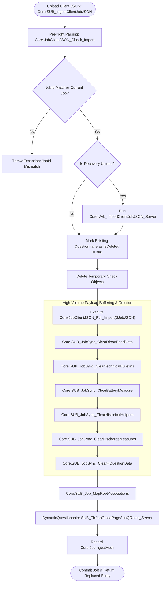

---

## Chapter 38: Disaster Recovery: Sync File Backups & Web Ingest Portal

- **`Core.JobSyncFileBackup`:** Every generated or ingested JSON is archived with its origin (`Server` vs `Device`), creation timestamp, and SHA-256 hash.
- **`Core.JobIngestAudit`:** Maintains a 40-attribute audit log recording client version, OS, battery level, question counts, and processing duration in milliseconds across every ingest phase.
- **Recovery Import Portal:** If a mobile device is damaged, but the engineer managed to export the local JSON file to an SD card or email, an administrator can open `Core.JobManagement` and invoke `Core.ACT_ImportClientJobJSON_UploadFile` (`fromRecovery = true`) to restore the job safely.

---

# VOLUME VIII: CROSS-ENVIRONMENT CONFIGURATION & EXCEL ENGINE

## Chapter 39: Configuration As Data: The Zero-Code Delivery Model

In large field service systems, the application code (Mendix MPR) represents the **Form Player**, while the actual business forms represent the **Sheet Music**.

```
┌────────────────────────────────────────────────────────────────────────┐
│                        Why Code Deployments Fail                       │
├────────────────────────────────────────────────────────────────────────┤
│ • Deploying an MPR requires IT change management, downtime, and        │
│   extensive regression testing.                                        │
│ • Business analysts and safety officers author form rules in Excel.    │
│ • Rules must be promoted seamlessly from DEV → TEST → STAGING → PROD.  │
│ • Rolling back a broken inspection rule must take 30 seconds, not      │
│   a 4-hour emergency hotfix release.                                   │
└────────────────────────────────────────────────────────────────────────┘
```

---

## Chapter 40: Cross-Environment Push/Pull Architecture (DEV → QA → PROD)

Instead of using database migration scripts, administrators use the **Cross-Environment Manager UI** ([ExcelImportExport.EnvConfigManager](file:///Root/Connected%20CE%20V2.mpr)).

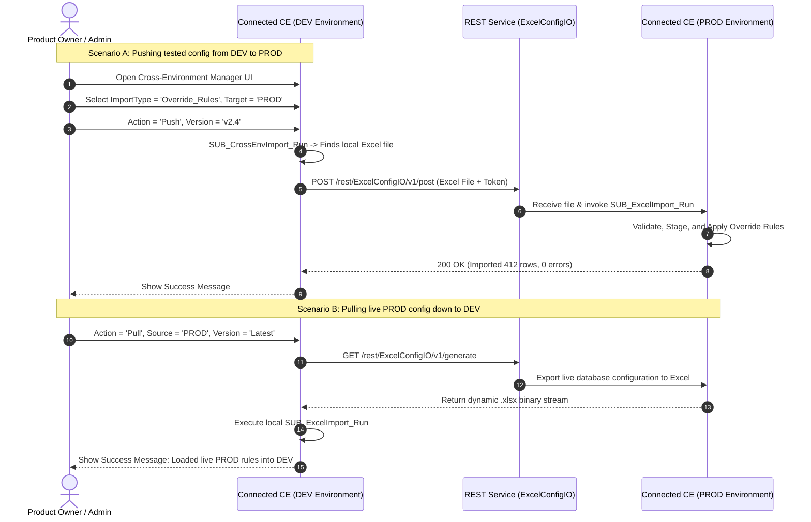

---

## Chapter 41: REST Integration Services (`REST_ExcelConfigIO_*`)

The module exposes and consumes three high-speed REST operations:
- **`REST_ExcelConfigIO_Post`**: Pushes a local `ExcelImport` file document across network boundaries to a remote Mendix node.
- **`REST_ExcelConfigIO_Generate`**: Instructs the target environment to query its local database, compile an Excel spreadsheet containing the latest live configuration, and stream it back.
- **`REST_ExcelConfigIO_Version`**: Pulls an immutable, historically versioned Excel snapshot from the target repository.

---

## Chapter 42: Complete Catalog of 34+ Configuration Domains

Dispatched by [ExcelImportExport.SUB_ExcelImport_Run](file:///Root/Connected%20CE%20V2.mpr), the engine supports 34 distinct business domains:

| # | Import Type Enumeration Key | Target Microflow | Business Domain & Data Managed |
| :--- | :--- | :--- | :--- |
| 1 | `Structural_QConfig` | `DynamicQuestionnaire.ACT_ImportStructuralQConfig` | Complete Questionnaire, Page, and Question hierarchy. |
| 2 | `Override_Rules` | `DynamicQuestionnaire.ACT_ImportOverrideRules` | Dynamic visibility formulas (`{tagId} == 'val'`). |
| 3 | `Calculate_Rules` | `DynamicQuestionnaire.ACT_ImportCalculateRules` | Mathematical calculations and formula engines. |
| 4 | `Validation_Rules` | `DynamicQuestionnaire.ACT_ImportValidationRules` | Custom field constraints and error messages. |
| 5 | `All_Base_Rules` | `DynamicQuestionnaire.ACT_ImportAllBaseRules_byStaging` | Consolidated Region, Model, VisitType, and TechFamily rules. |
| 6 | `Battery_Dataset` | `MasterData.ACT_ImportBatteryDataSet` | Manufacturer battery specifications and baseline tables. |
| 7 | `Model_Base_Rules` | `Models.ACT_ImportModelBaseRule` | Equipment model code compatibility mappings. |
| 8 | `Region_Rules` | `DynamicQuestionnaire.ACT_ImportRegionRules` | Geographic operating unit filtering. |
| 9 | `Visit_Type_Rules` | `DynamicQuestionnaire.ACT_ImportVisitTypeRules` | PM, Emergency, Commissioning filter rules. |
| 10 | `Tech_Family_Rules` | `DynamicQuestionnaire.ACT_ImportTechFamilyRules` | Electrical, HVAC, Mechanical skill restrictions. |
| 11 | `Sync_Config` | `RelayConnector.ACT_ImportSyncConfig` | External ERP/EBS integration sync settings. |
| 12 | `Parameter_Table` | `Models.ACT_ImportParameterTable` | Equipment operating parameter boundaries. |
| 13 | `Translations` | `Translations.ACT_ImportTranslations` | Multi-language question labels and UI captions. |
| 14 | `PDF_Template` | `PDFs.ACT_ImportPdfTemplates` | Inspection report layout templates. |
| 15 | `Documentation_Links` | `Core.ACT_ImportDocumentationLinks` | Links to external SOPs and equipment manuals. |
| 16 | `Companies` | `Company.ACT_ImportCompanies` | Service partner and subcontractor directories. |
| 17 | `Visit_Types` | `MasterData.ACT_ImportVisitTypes` | Master list of service visit classifications. |
| 18 | `Model_Rules` | `Models.ACT_ImportModelRules` | Model group definitions and hierarchy. |
| 19 | `LifecycleData` | `MasterData.ACT_ImportLifecycle` | Equipment lifecycle milestones and obsolescence. |
| 20 | `Local_Data` | `MasterData.ACT_ImportLocalData` | Localized client lookup tables. |
| 21 | `States_and_Countries`| `MasterData.ACT_ImportStatesAndCountries` | Global geographic address references. |
| 22 | `Power_Supplies` | `MasterData.ACT_ImportPowerSupplies` | Electrical grid power supply specifications. |
| 23 | `Pivot_Import_Configs`| `PivotDataImporter.ACT_ImportPivotImportConfig` | Config for multi-dimensional data importers. |
| 24 | `Selectable_Rated_Voltage`| `MasterData.ACT_ImportSelectableRatedVoltage`| Master nominal voltage rating options. |
| 25 | `Customers` | `Customer.ACT_ImportCustomers` | Commercial account master records. |
| 26 | `Quality_Feedback` | `MasterData.ACT_ImportQualityFeedback` | Field quality issue classification codes. |
| 27 | `Email_Templates` | `Email_Connector.ACT_ImportEmailTemplates` | Automated customer sign-off email notifications. |
| 28 | `NextPredict_Items` | `MasterData.ACT_ImportNextPredictItems` | AI/ML predictive maintenance component catalog. |
| 29 | `PartDemandConfig` | `MasterData.ACT_ImportPartDemandConfig` | Spare parts demand forecasting configuration. |
| 30 | `NextPredict_Validations`| `MasterData.ACT_ImportNextPredictValidation` | Validation rules for predictive telemetry. |
| 31 | `Voice_to_Answer_Configs`| `LocalVoiceToAnswer.ACT_ImportVoiceToAnswerConfig`| Voice dictation NLP token mapping rules. |
| 32 | `Page_AI_Details` | `DynamicQuestionnaire.ACT_ImportPageAIDetails` | AI copilot contextual page guidance prompts. |
| 33 | `Tag_AI_Details` | `DynamicQuestionnaire.ACT_ImportTagAIDetails` | AI copilot question-specific diagnostic guidance. |
| 34 | `Root_Cause` | `MasterData.ACT_ImportRootCause` | Root cause failure analysis hierarchy. |

---

## Chapter 43: Deep Walkthrough: Concrete Entity Example (`OverrideRule`)

Dissects the complete lifecycle of importing **`OverrideRule`** records via microflow [DynamicQuestionnaire.ACT_ImportOverrideRules](file:///Root/Connected%20CE%20V2.mpr):

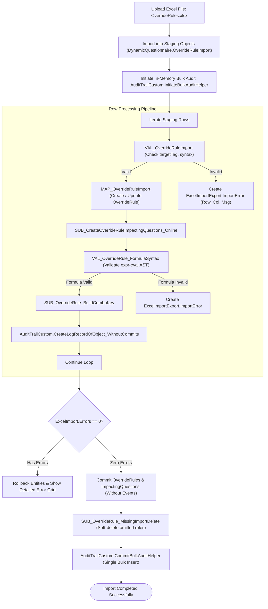

### 43.1 Detailed Steps:
1. **Staging Import:** Reads Excel rows into non-persistent staging entities (`OverrideRuleImport`) via `DynamicQuestionnaire.OverrideRuleImportMapping`.
2. **Row Validation (`VAL_OverrideRuleImport`):** Checks mandatory columns, target tags, and row indices.
3. **Entity Mapping (`MAP_OverrideRuleImport`):** Matches or creates `DynamicQuestionnaire.OverrideRule`. Sets `Formula`, `IsDeleted = false`, `LastImportedOn`.
4. **Inverted Index Recalculation:** Calls `DynamicQuestionnaire.SUB_CreateOverrideRuleImpactingQuestions_Online`, extracting `{tagId}` tokens.
5. **Formula Syntax AST Check:** Calls `DynamicQuestionnaire.VAL_OverrideRule_FormulaSyntax` to ensure valid compilation.
6. **In-Memory Audit Staging:** Generates `VertivKey` via `SUB_OverrideRule_BuildComboKey`, invokes `AuditTrailCustom.CreateLogRecordOfObject_WithoutCommits`.
7. **Two-Phase Commit:** If zero errors, bulk commits without events (`commit ... without events refresh`), soft-deletes omitted rules, and commits the bulk audit log. If errors exist, creates `ImportError` records and rolls back changes.

---

## Chapter 44: Two-Phase Validation & Granular Cell-Level Error Badging

- Entity `ExcelImportExport.ImportError`:
  - `Row` (Integer): Exact Excel spreadsheet row number (e.g. `Row 42`).
  - `Column` (String): Header column name (e.g. `'Formula'`).
  - `Message` (String): Specific failure reason (e.g. *"Tag {Q_TEMP_OUT} referenced in formula does not exist in QuestionConfig"*).
- The admin page displays an interactive Data Grid highlighting exact cells requiring correction, preventing broken configurations from entering the system.

---

*(Continued in Volume IX through Volume XII below)*


# VOLUME IX: HIGH-PERFORMANCE AUDIT TRAIL CUSTOMIZATION

## Chapter 45: Bottlenecks of Marketplace Audit Trail on Bulk Data

The standard Mendix Marketplace `AuditTrail` module logs changes by subscribing to entity `beforeCommit` events or calling `CreateLogRecordOfObject`.

### Why Standard Audit Trail Causes Performance Bottlenecks:
1. **Synchronous Commit Overhead:** For every changed attribute on an entity, standard AuditTrail executes individual database `INSERT` statements for `Log` and `LogLine`. When importing 5,000 rules, this results in over 30,000 database round-trips within a single transaction, frequently causing database connection timeouts.
2. **Auto-Increment ID Fragility:** Standard AuditTrail identifies objects by their internal Mendix auto-increment ID (`123456789`). When data is migrated across environments (DEV $\rightarrow$ TEST $\rightarrow$ PROD), internal database IDs change, breaking audit trail history across environments.

---

## Chapter 46: The In-Memory Bulk Staging Engine (`BulkAuditHelper` & `BulkAuditMap`)

To solve this, the engineering team developed **`AuditTrailCustom`**.

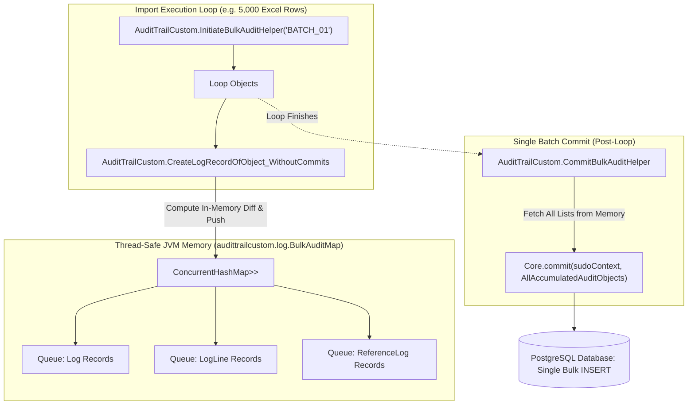

### Key Java Architecture Components:
- **[BulkAuditMap.java](file:///Root/javasource/audittrailcustom/log/BulkAuditMap.java):** Maintains thread-safe in-memory collections of pending audit records keyed by `MemoryListName`:
  ```java
  public static ConcurrentHashMap<String, Map<AuditListTypes, List<IMendixObject>>> bulkAuditMap;
  ```
- **[CreateLogRecordOfObject_WithoutCommits.java](file:///Root/javasource/audittrailcustom/actions/CreateLogRecordOfObject_WithoutCommits.java):** Uses Mendix Core Java API reflection (`IMendixObject.getMembers()`) to compare current values against original database values. It constructs `Log` and `LogLine` objects in memory and buffers them in `BulkAuditMap` without invoking database commits.
- **[CommitBulkAuditHelper.java](file:///Root/javasource/audittrailcustom/actions/CommitBulkAuditHelper.java):** Executes after the business loop completes. It pulls all accumulated `Log`, `LogLine`, and `ReferenceLog` instances and commits them to the database in a single batch, reducing audit write overhead by over 95%.

---

## Chapter 47: The `VertivKey` Innovation (Cross-Environment Business Identity)

To maintain consistent audit traceability across different environments, `AuditTrailCustom` introduces the **`VertivKey`**:
- In [CreateLogObject.java](file:///Root/javasource/audittrailcustom/log/CreateLogObject.java):
  ```java
  logObject.setValue(sudoContext, Log.MemberNames.VertivKey.toString(), vertivKey);
  ```
- **What is `VertivKey`?** It is an immutable composite business key representing the object across environments (for example: `OverrideRule_Q_CHILLER_PRESS_HIGH` or `QuestionConfig_TAG_OIL_TEMP`).
- Even when an entity has ID `1001` in DEV, ID `4502` in TEST, and ID `98231` in PROD, audit queries filtering by `VertivKey` return the complete modification history of that configuration across its entire enterprise lifecycle.

---

## Chapter 48: Character-Level Diffing via Google's `diff_match_patch`

For long text fields, mathematical expressions, and formula configurations, standard before-and-after logging is insufficient for debugging subtle syntax changes.

The module embeds Google's **`diff_match_patch`** algorithm:
- **Source:** [diff_match_patch.java](file:///Root/javasource/audittrailcustom/log/diff_match_patch.java)
- Computes character-level insertion and deletion diffs (e.g. detecting that a formula changed from `{TEMP} > 100` to `{TEMP} >= 100`).
- Stores human-readable visual diffs inside `LogLine.DiffText`, allowing administrators to see exact character modifications in the audit viewer.

---

## Chapter 49: Java Reflection & Thread-Safe Execution Engine

The Java engine uses reflection to introspect members:
- Compares date values using `SimpleDateFormat` ISO format.
- Compares BigDecimals with scale normalization to avoid spurious change events caused by trailing zeros.
- Tracks references by resolving associated object identifiers safely using sudo contexts.

---

# VOLUME X: BATTERY MEASURES SYNCHRONIZATION (THE HIGH-VOLUME EXCEPTION)

## Chapter 50: The High-Volume Data Dilemma: Why Question Models Break

During preventive maintenance of Uninterruptible Power Supply (UPS) systems and data center power rooms, technicians inspect massive battery banks.

```
┌────────────────────────────────────────────────────────────────────────┐
│                      The Scale of Battery Testing                      │
├────────────────────────────────────────────────────────────────────────┤
│ • 1 to 4 Parallel Battery Strings per UPS system                       │
│ • 30 to 60 Battery Jars/Blocks per String                              │
│ • 1 to 6 Internal Cells per Jar                                        │
│ • Measurements: Float Voltage, Internal Resistance (mΩ),               │
│   Inter-tier Connection Resistance (µΩ), Temperature (°C)             │
│ • Discharge Tests: Voltage time-series sampled every 30 seconds        │
│ ────────────────────────────────────────────────────────────────────── │
│ Total data points per inspection: 800 to 2,500 numeric values          │
└────────────────────────────────────────────────────────────────────────┘
```

If these 2,000 data points were modeled as standard questions in `DynamicQuestionnaire.Question`:
1. The question tree would balloon to 2,500 entities per job.
2. The UI renderer would choke iterating thousands of snippet widgets.
3. The reactive on-change engine would lag evaluating cross-question dependencies.

To keep the application responsive, battery data is decoupled into a dedicated high-performance module: **`Battery`**.

---

## Chapter 51: Physical Domain: Strings, Jars, Blocks, Cells & Impedance

```
┌────────────────────────────────────────────────────────────────────────┐
│                        Battery Physical Topology                       │
└────────────────────────────────────────────────────────────────────────┘
  [ Battery String 1 (e.g., 480V DC Bus) ]
    ├── Jar 1 (Block 1) ──> [ Cell 1: 2.25V, 1.2mΩ ] [ Cell 2: 2.24V, 1.2mΩ ]
    ├── Jar 2 (Block 2) ──> [ Cell 1: 2.26V, 1.3mΩ ] [ Cell 2: 2.25V, 1.2mΩ ]
    │   ...
    └── Jar 40 (Block 40) ─> [ Cell 1: 2.21V, 1.8mΩ (ALERT: High Impedance!) ]
```

Field technicians use handheld electronic battery analyzers (Fluke 500 Series, Megger BITE, Hioki, Alber Cellcorder). These instruments export structured data files via Bluetooth, USB, or CSV/BMS exports.

---

## Chapter 52: Device-Side Ingestion: BMS & Instrument File Parsing

Rather than typing 2,000 numbers manually into text boxes:
1. The technician uploads a BMS instrument data file or Excel report on their mobile tablet.
2. Nanoflow `Battery.SUB_Battery_ParseAndValidateBMS` parses the file into transient memory entities (`Battery.BatteryData`, `Battery.Module`, `Battery.CellInfo`).
3. Nanoflow [Battery.SUB_Battery_SyncBatteryMeasures](file:///Root/Connected%20CE%20V2.mpr) maps and synchronizes this telemetry into persistent mobile records:

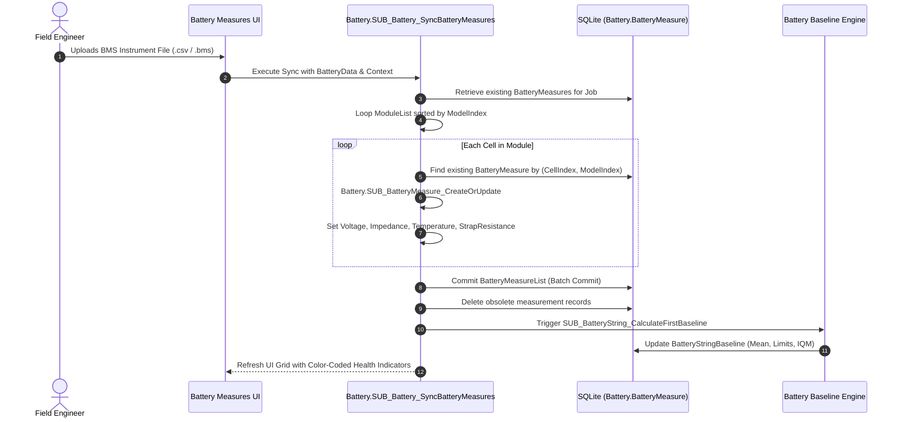

---

## Chapter 53: Statistical String Baselines & IQM Health Algorithms

Immediately upon synchronization, the device computes mathematical baselines via [Battery.SUB_BatteryString_CalculateFirstBaseline](file:///Root/Connected%20CE%20V2.mpr):
- **Mean String Voltage:**

  $$\mu_V = \frac{1}{N} \sum_{i=1}^{N} V_i$$

- **Mean Internal Resistance:**

  $$\mu_R = \frac{1}{N} \sum_{i=1}^{N} R_i$$

- **Impedance Variance Thresholds:**
  - Warning Threshold: $\mu_R \times 1.10$ (+10% deviation)
  - Critical Replacement Threshold: $\mu_R \times 1.20$ (+20% deviation)
- **IQM Index:** Calculates the Interquartile Mean to eliminate measurement outliers (e.g. bad probe contact) and stores the resulting baselines in entity `Battery.BatteryStringBaseline`.

---

## Chapter 54: Dedicated Serialization Trees in Client Export Mapping

Because battery telemetry is decoupled from `DynamicQuestionnaire.Question`, it is mapped under dedicated keys in [Core.SUB_Job_GetClientJSONMapping_Export](file:///Root/Connected%20CE%20V2.mpr):

```json
{
    "AssociationName": "Battery.BatteryMeasure_Job",
    "AssociationCardinality": "many",
    "JsonName": "BatteryMeasures",
    "EntityName": "Battery.BatteryMeasure",
    "Attributes": [
        "val_bat_measure_point_no_data_table",
        "val_bat_block_data_table",
        "val_bat_voltage",
        "val_bat_resistance",
        "val_bat_strap_resistance",
        "val_bat_temperature",
        "val_bat_is_valid",
        "val_bat_iqm_status"
    ]
},
{
    "AssociationName": "Battery.DischargeMeasures_Job",
    "AssociationCardinality": "many",
    "JsonName": "DischargeMeasures",
    "EntityName": "Battery.DischargeMeasures",
    "Associations": [
        {
            "AssociationName": "Battery.DischargeMeasures_VoltagePerTimestamp_DischargeMeasures",
            "AssociationCardinality": "many",
            "JsonName": "VoltagePerTimestamps",
            "EntityName": "Battery.DischargeMeasures_VoltagePerTimestamp"
        }
    ]
},
{
    "AssociationName": "Battery.BatteryStringBaseline_Job",
    "AssociationCardinality": "many",
    "JsonName": "BatteryStringBaseline",
    "EntityName": "Battery.BatteryStringBaseline"
}
```

---

## Chapter 55: Server-Side Ingestion: The Buffered Replacement Pattern

In [Core.SUB_IngestClientJobJSON](file:///Root/Connected%20CE%20V2.mpr), the server executes a **Buffered Replacement Pattern**:

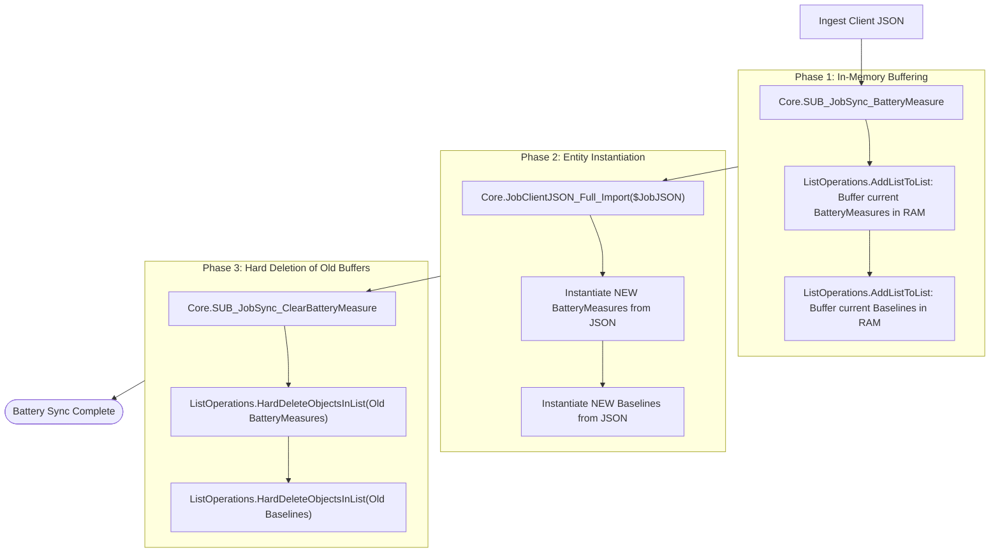

### Why This Pattern is Critical:
1. Prevents orphaned records if an import aborts halfway through.
2. Avoids expensive nested `UPDATE` matching loops across 2,000 rows.
3. Minimizes transaction log generation by using batched `HardDeleteObjectsInList`.

---

# VOLUME XI: ADVANCED SUBSYSTEMS & SPECIALIZED DOMAINS

## Chapter 56: Repeatable Sub-Questionnaires (1:N Sub-Forms)

For equipment with multiple identical components (e.g. inspecting 4 compressors on a refrigeration pack):
1. A parent question defines the component count (`tagId = 'NUM_COMPRESSORS'`).
2. When the technician inputs `4`, `DynamicQuestionnaire.SUB_SubQuestionnaire_CreateOrDelete` instantiates 4 child `Questionnaire` records linked via `Questionnaire_ParentQuestion`.
3. The UI renders an accordion or tab group where each panel instantiates an independent sub-form scope with its own answers, formulas, and validations.
4. On server upload, `DynamicQuestionnaire.SUB_FixJobCrossPageSubQRoots_Server` re-maps root foreign keys across parent and sub-questionnaires.

---

## Chapter 57: Multi-Language Localization Engine (`Translations`)

- Supports dynamic language switching without requiring database synchronization.
- During server compilation, `Core.SUB_TranslateQuestionLabel_Server` looks up localized prompts and copies them into the question instance.

---

## Chapter 58: Offline Media, Camera Storage & Vector Signatures

- Captured photos and signature drawings inherit from `System.FileDocument` or `System.Image`.
- During offline client JSON serialization ([ExportWithMapping.js](file:///Root/javascriptsource/clientimportexportmapping/actions/ExportWithMapping.js)), binary files are read from storage, encoded as base64, and embedded inside `"Contents"`.
- On server ingest, files are extracted and written to cloud object storage.

---

# VOLUME XII: DEVELOPER MANUAL, SCHEMAS & FIELD PLAYBOOK

## Chapter 59: Developer Recipe: Adding a New Question Type

1. **Update Domain Model Enumeration:** Open [Connected CE V2.mpr](file:///Root/Connected%20CE%20V2.mpr), locate `DynamicQuestionnaire.ENUM_QuestionType`, add new value (e.g. `AudioMemo`).
2. **Add Storage Attributes (If Needed):** Add attribute to `DynamicQuestionnaire.Question` (e.g. `AnswerValueAudioBlob`) and enable offline synchronization.
3. **Build Presentation Snippet:** Create `DynamicQuestionnaire.SNIP_AudioMemoQuestion` matching the 4 standard parameters (`Question`, `Questionnaire`, `QuestionnaireHelper`, `CurrentPage`). Bind the change event to `DynamicQuestionnaire.OC_Answer`.
4. **Register in Dispatcher:** Open `DynamicQuestionnaire.DynamicQuestionnaire_Question_Dispatcher`, add a conditional branch for `ENUM_QuestionType.AudioMemo`, and embed the snippet.
5. **Update Reset Logic:** Open `DynamicQuestionnaire.ResetAnswer_Device` and add logic to clear the new attribute when visibility transitions to `NA` or `I`.

---

## Chapter 60: Developer Recipe: Authoring Complex Dynamic Rules

1. **Tag Reference Syntax:** Always enclose variable tags in curly braces: `{TAG_NAME}`.
2. **Comparison Operators:** Use `==`, `!=`, `<`, `>`, `<=`, `>=`.  
   *Example:* `{Q_PRESSURE} > 15.5 and {Q_VALVE_STATUS} == 'OPEN'`
3. **String Literals:** Enclose text in single quotes: `'{TAG}' == 'YES'`.
4. **Calculations:** Use math operators (`+`, `-`, `*`, `/`, `^`, `%`) and functions:  
   `round({VOLTS} * {AMPS} * 1.732 / 1000, 2)`

---

## Chapter 61: Developer Recipe: Extending Custom Sync with Child Entities

1. **Domain Model:** Add the new association to `Core.Job` (e.g. `Core.Job_CustomData`).
2. **Client Export Descriptor:** Open [Core.SUB_Job_GetClientJSONMapping_Export](file:///Root/Connected%20CE%20V2.mpr) and append the child entity block under `Associations`.
3. **Server Export Mapping:** Update [Core.JobClientJSON_Export_V2](file:///Root/Connected%20CE%20V2.mpr) to include the new entity and attributes.
4. **Server Import Mapping:** Update [Core.JobClientJSON_Full_Import](file:///Root/Connected%20CE%20V2.mpr) to parse the JSON node.
5. **Ingest Cleanup:** If replacement buffering is required, add a cleanup routine in `Core.SUB_IngestClientJobJSON`.

---

## Chapter 62: Developer Recipe: Adding a New Excel Configuration Type

1. **Enumeration:** Add a new key to `ExcelImportExport.ENUM_ImportType`.
2. **Staging Entity:** Create `MyConfigImport` in your module.
3. **Import Mapping:** Build an Excel import mapping targeting `MyConfigImport`.
4. **Import Action:** Build `ACT_ImportMyConfig(ExcelImport)` following the pattern in `DynamicQuestionnaire.ACT_ImportOverrideRules`.
5. **Register in Dispatcher:** Open [ExcelImportExport.SUB_ExcelImport_Run](file:///Root/Connected%20CE%20V2.mpr) and route the new enumeration value.

---

## Chapter 63: Diagnostic Playbook & Chrome Remote Debugging

### Diagnostic Flowchart for Visibility Issues:

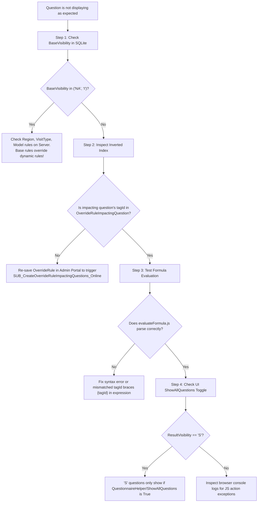

### Chrome DevTools Remote Inspection Console Script:
When debugging the mobile web view via Chrome remote debugging (`chrome://inspect`), execute this snippet in the developer console to inspect in-memory question state:

```javascript
// Query question state by Tag ID in mobile client memory
mx.data.get({
    xpath: "//DynamicQuestionnaire.Question[tagId='YOUR_TAG_ID']",
    callback: function(objs) {
        if (!objs.length) {
            console.error("Tag not found in local memory!");
            return;
        }
        var q = objs[0];
        console.table({
            TagId: q.get("tagId"),
            Type: q.get("QuestionType"),
            FallbackVis: q.get("FallbackVisibility"),
            BaseVis: q.get("BaseVisibility"),
            OverrideVis: q.get("VisibilityOverride"),
            ResultVis: q.get("ResultVisibility"),
            StringAnswer: q.get("AnswerValueString"),
            DecimalAnswer: q.get("AnswerValueDecimal"),
            HasError: q.get("HasError"),
            ErrorMessage: q.get("ErrorMessage")
        });
    }
});
```

---

## Chapter 64: Architectural Commandments & Invariant Rules

1. **Never Hardcode Tag IDs in Microflow Logic:** Always reference configuration tags dynamically. Hardcoding tag strings inside core microflows breaks metamodel extensibility.
2. **Always Re-index Override Rules on Configuration Changes:** If you programmatically import or seed `OverrideRule` entities, ensure you execute `SUB_CreateOverrideRuleImpactingQuestions_Online` for every rule. Missing index entries will cause mobile clients to skip rule evaluation.
3. **Preserve the `OC_Answer` Contract:** Never bind an input widget directly to an attribute without configuring the `OC_Answer` nanoflow on the `OnChange` event. Bypassing this handler causes visibility calculations and validation checks to fall out of sync.
4. **Guard Against Circular Dependencies in Calculate Rules:** Always pass the `'CalcTagsRan'` parameter when calling formula calculation actions. Circular dependencies will crash client threads if recursion guards are omitted.
5. **Always Test Form Changes Offline First:** A rule that functions correctly online in a cloud environment may behave differently offline if dependent data is excluded from sync configurations. Always test changes with network connectivity disabled.

---

## Chapter 65: Comprehensive Master Glossary & Cross-Reference Index

- **AST (Abstract Syntax Tree):** Parsed mathematical representation of formula expressions evaluated by `expr-eval`.
- **Base Visibility:** Environmental visibility calculated on the server from Region, Model, and Visit Type rules.
- **EAV (Entity-Attribute-Value):** Data modeling pattern where field definitions are stored as rows rather than database columns.
- **Inverted Dependency Index:** Optimization pattern mapping variable `{tagId}` references back to parent rules (`OverrideRuleImpactingQuestion`).
- **Result Visibility:** Final computed visibility (`M`, `O`, `S`, `NA`, `I`) applied to widgets in the mobile DOM.
- **Sub-Questionnaire:** Repeatable child questionnaire instantiated dynamically for multi-component inspections.
- **`VertivKey`:** Composite immutable business identifier enabling cross-environment audit trail tracking.
- **`JobSyncFile`:** Compressed, SHA-256 hashed atomic document container holding complete job state.
- **IQM (Interquartile Mean):** Robust statistical average trimming the top and bottom 25% of readings to eliminate sensor measurement anomalies.

---

*This master document is maintained as the primary engineering guide for Connected CE V2. For questions or enhancements, please consult the lead solution architect.*
