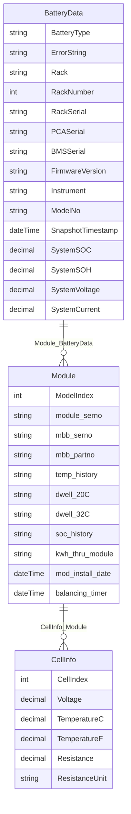

# Battery Measurements Ingestion System (`ACT_Upload_BatteryMeasures`)

A comprehensive, client-side Mendix solution for uploading, validating, and synchronizing battery string measurements (cell voltages, internal resistances, AC impedances, and temperatures) from multi-vendor BMS exports and testing instruments directly into Mendix domain models.

The system combines a modular, SRP-compliant **Mendix Nanoflow orchestrator** (`Battery.ACT_Upload_BatteryMeasures`) running directly in the browser/client, integrated with a high-performance **pure JavaScript parsing engine** (`FileUploadJSA.JSA_ImportBMSData`) that normalizes disparate vendor log formats into unified Mendix `Battery.BatteryMeasure` entities without server-side processing dependencies.

---

## Table of Contents

- [1. Executive System Architecture](#1-executive-system-architecture)
  - [End-to-End Ingestion Stack](#end-to-end-ingestion-stack)
  - [Key System Capabilities](#key-system-capabilities)
- [2. Primary Workflow Orchestrator: `ACT_Upload_BatteryMeasures`](#2-primary-workflow-orchestrator-act_upload_batterymeasures)
  - [UI Trigger & Snippet Context](#ui-trigger--snippet-context)
  - [Execution Pipeline Diagram](#execution-pipeline-diagram)
  - [Nanoflow Input Parameters](#nanoflow-input-parameters)
  - [Non-Persistent Context Entity (`BatteryUploadContext`)](#non-persistent-context-entity-batteryuploadcontext)
  - [Sub-Nanoflow Component Specifications](#sub-nanoflow-component-specifications)
    - [Phase 1: File Ingestion & Status Evaluation (`JSA_FileUploadToFile`, `SUB_ParseUploadCode`)](#phase-1-file-ingestion--status-evaluation)
    - [Phase 2: Metadata & Context Resolution (`SUB_Battery_ResolveUploadContext`)](#phase-2-metadata--context-resolution)
    - [Phase 3: Measuring Instrument Brand Resolution (`SUB_Battery_ResolveReadingInstrument`)](#phase-3-measuring-instrument-brand-resolution)
    - [Phase 4: Operating Mode & Module Flag Evaluation (`Sub_CheckOnlineOfOfflineVoltage`, `Sub_CalculateifOnlyModuledataImport`)](#phase-4-operating-mode--module-flag-evaluation)
    - [Phase 5: Expected Cell Count Computation (`SUB_Battery_CalculateExpectedCellCount`)](#phase-5-expected-cell-count-computation)
    - [Phase 6: BMS Parsing, Format Cross-Validation & Verification (`SUB_Battery_ParseAndValidateBMS`)](#phase-6-bms-parsing-format-cross-validation--verification)
    - [Phase 7: Entity Synchronization & Batch Persistence (`SUB_Battery_SyncBatteryMeasures`)](#phase-7-entity-synchronization--batch-persistence)
    - [Phase 8: Single-Cell Property Mapping (`SUB_BatteryMeasure_CreateOrUpdate`)](#phase-8-single-cell-property-mapping)
    - [Phase 9: Rollback & Failure Recovery Protocol (`SUB_Battery_CleanupFailedUpload`)](#phase-9-rollback--failure-recovery-protocol)
    - [Phase 10: Questionnaire Answer State Completion (`DynamicQuestionnaire.OC_Answer`)](#phase-10-questionnaire-answer-state-completion)
  - [Performance Engineering: Elimination of the "Retrieve-in-Loop" Anti-Pattern](#performance-engineering-elimination-of-the-retrieve-in-loop-anti-pattern)
- [3. UI Presentation, Table Ingestion & Visualization Architecture: `Battery.SNIP_ViewOrEdit_Measures`](#3-ui-presentation-table-ingestion--visualization-architecture-batterysnip_vieworedit_measures)
  - [Role within the Dynamic Questionnaire Engine](#role-within-the-dynamic-questionnaire-engine)
  - [Context Entity Bindings & DataView Scope](#context-entity-bindings--dataview-scope)
  - [Data Retrieval Pipeline & Java Backend Bridge (`DS_GetBatteryMeasuresAdvanced`, `JA_GetMeasuresChartJSON`)](#data-retrieval-pipeline--java-backend-bridge)
  - [Client-Side DOM Enhancement Engine (`Incentro JavaScriptSnippet`)](#client-side-dom-enhancement-engine-incentro-javascriptsnippet)
    - [Grouped DataGrid Table Headers (IDENTIFICATION, MEASUREMENTS, TRACKING)](#grouped-datagrid-table-headers)
    - [Sticky Frozen Columns Engine & Dynamic CSS Generation](#sticky-frozen-columns-engine--dynamic-css-generation)
    - [DOM Lifecycle Observers (`ResizeObserver`, `MutationObserver`, Cleanup)](#dom-lifecycle-observers)
  - [Client-Side Chart Generation & DOM Enhancements (`getMeasuresChartJSON.js`)](#client-side-chart-generation--dom-enhancements)
  - [In-Line Cell Editing, State Tracking & Atomic Commit Flow](#in-line-cell-editing-state-tracking--atomic-commit-flow)
- [4. Core BMS Parsing Engine Component: `FileUploadJSA.JSA_ImportBMSData`](#4-core-bms-parsing-engine-component-fileuploadjsajsa_importbmsdata)
  - [Role within the Nanoflow Architecture](#role-within-the-nanoflow-architecture)
  - [Action Entry Points & Source Code References](#action-entry-points--source-code-references)
  - [JavaScript Action Input Parameters](#javascript-action-input-parameters)
  - [The Base Rule: Strict Geometry Enforcement & Multi-Pack Regrouping](#the-base-rule-strict-geometry-enforcement--multi-pack-regrouping)
  - [Target Rack & String Resolution Architecture](#target-rack--string-resolution-architecture)
  - [Module Upload Mode (`isModuleUpload = true`)](#module-upload-mode-ismoduleupload--true)
  - [Decoupled Validation Contract (`shouldValidateCellCount = false`)](#decoupled-validation-contract-shouldvalidatecellcount--false)
  - [Supported Formats & Auto-Detection Matrix](#supported-formats--auto-detection-matrix)
  - [Battery Reading Measurement Return Matrix (Impedance, Online/Offline Voltage, Temperature, Metadata)](#battery-reading-measurement-return-matrix)
  - [Validation & Cell Distribution Architecture](#validation--cell-distribution-architecture)
  - [Domain Model Hierarchy (`BatteryData` → `Module` → `CellInfo`)](#domain-model-hierarchy)
  - [Numeric Precision & 3-Decimal Clamping](#numeric-precision--3-decimal-clamping)
  - [Fault-Tolerant Error Handling & `ErrorString`](#fault-tolerant-error-handling--errorstring)
- [5. Detailed Multi-Vendor Extraction Specifications](#5-detailed-multi-vendor-extraction-specifications)
  - [Type 1: Samsung SDI BATTMON (`SAMSUNG_BATTMON`)](#type-1-samsung-sdi-battmon-samsung_battmon)
  - [Type 2: Samsung SDI ELPMON (`SAMSUNG_ELPMON`) & Channel Filtering](#type-2-samsung-sdi-elpmon-samsung_elpmon--channel-filtering)
  - [Type 3: Samsung System Summary Log Guard (`SAMSUNG_SYSTEM_LOG`)](#type-3-samsung-system-summary-log-guard-samsung_system_log)
  - [Type 4: HPL / Vertiv VEC Lithium Snapshots (`HPL_VEC_SNAPSHOT`)](#type-4-hpl--vertiv-vec-lithium-snapshots-hpl_vec_snapshot)
  - [Type 5: Alber BDSU Backup Archives & Databases (`ALBER_BDSU`)](#type-5-alber-bdsu-backup-archives--databases-alber_bdsu)
  - [Type 6: Alber Cellcorder / CDF (`ALBER_CDF`)](#type-6-alber-cellcorder--cdf-alber_cdf)
  - [Type 7: Hioki BT3554 / BT3554-50 Battery HiTester (`HIOKI_BT3554`)](#type-7-hioki-bt3554--bt3554-50-battery-hitester-hioki_bt3554)
  - [Type 8: Hioki 3554 Legacy HiTester (`HIOKI_3554_LEGACY`)](#type-8-hioki-3554-legacy-hitester-hioki_3554_legacy)
  - [Type 9: ZincFive Nickel-Zinc BMS Logs (`ZINC`)](#type-9-zincfive-nickel-zinc-bms-logs-zinc)
  - [Type 10: Generic Tabular Fallback (`GENERIC_TABULAR`)](#type-10-generic-tabular-fallback-generic_tabular)
  - [System-Wide Specifications & Rules](#system-wide-specifications--rules)
- [6. Auxiliary Actions in `FileUploadJSA`](#6-auxiliary-actions-in-fileuploadjsa)
  - [Battery Discharge Import (`JSA_ImportBatteryDischargeData`)](#battery-discharge-import-jsa_importbatterydischargedata)
  - [File Upload & Offline Actions](#file-upload--offline-actions)
  - [Image Processing (`JSA_ResizeImage`)](#image-processing-jsa_resizeimage)
  - [Zip Archive Utilities](#zip-archive-utilities)
- [7. Directory Structure & Testing Architecture](#7-directory-structure--testing-architecture)
  - [Source Code Directory Tree](#source-code-directory-tree)
  - [Dependencies & Installation](#dependencies--installation)
  - [Standalone Testing Harness](#standalone-testing-harness)

---

## 1. Executive System Architecture

### End-to-End Ingestion Stack

Historically, field engineers recorded battery inspection data using vendor-specific diagnostic software or desktop Excel macros (`LithiumBMS.vba`, `battery_full_VBS.vba`, `Zinc.vba`). These legacy approaches caused device lock-in, required desktop Windows runtimes, and created inconsistent database records.

The **Battery Measurements Ingestion System** modernizes this pipeline into a fully client-side, browser-native architecture:

```
┌─────────────────────────────────────────────────────────────────────────────────────────────────┐
│                                 LAYERED INGESTION ARCHITECTURE                                  │
│                                                                                                 │
│   [ UI Layer ]                                                                                  │
│   • Battery.SNIP_UploadBatteryMeasures (Dynamic questionnaire file uploader snippet)            │
│   • Action Button: "Browse files" ──► Triggers ACT_Upload_BatteryMeasures                        │
│                                           │                                                     │
│                                           ▼                                                     │
│   [ Nanoflow Orchestration Layer ]                                                              │
│   • Battery.ACT_Upload_BatteryMeasures (Lean orchestrator coordinating sub-nanoflows)          │
│   ├── SUB_Battery_ResolveUploadContext (Consolidates FileUploadType, maps PowerShield to Hioki) │
│   ├── SUB_Battery_CalculateExpectedCellCount (Module-only vs. Lithium vs. Standard math)       │
│   ├── SUB_Battery_ParseAndValidateBMS (Executes parser & cross-validates file types)            │
│   └── SUB_Battery_SyncBatteryMeasures (High-performance in-memory batch DB synchronization)     │
│                                           │                                                     │
│                                           ▼                                                     │
│   [ Client-Side Engine Layer (FileUploadJSA) ]                                                 │
│   • FileUploadJSA.JSA_FileUploadToFile (HTML5 File picker, MIME & size filter)                  │
│   • FileUploadJSA.JSA_ImportBMSData (Multi-vendor pure JavaScript parsing engine)               │
│     ├── Format Dispatcher (extractBMSFileData.js: Auto-detects 10 vendor formats)               │
│     ├── SQLite & BLOB Decoder (Pure JS unpacking of Alber .bkup & .db archives)                 │
│     └── Normalization Engine (Transforms raw tables into BatteryData -> Module -> CellInfo)    │
│                                           │                                                     │
│                                           ▼                                                     │
│   [ Data Model Persistence Layer ]                                                              │
│   • Non-Persistent: Battery.BatteryUploadContext (Encapsulates FileUploadType and string context) │
│   • Non-Persistent: Battery.BatteryData / Module / CellInfo (Parsed intermediate tree)         │
│   • Persistent: Battery.BatteryMeasure (Committed to SQLite/database in atomic batch)           │
└─────────────────────────────────────────────────────────────────────────────────────────────────┘
```

### Key System Capabilities

* **Client-Side Execution (Zero Server Latency)**: Both the Nanoflows and JavaScript Actions execute entirely within the client runtime (browser or offline mobile container). Raw multi-megabyte log files, SQLite databases, and zip archives are parsed in memory without uploading uncompressed payloads to the Mendix server.
* **Strict Single Responsibility Principle (SRP)**: The monolithic legacy nanoflow (47 activities, nested database loops) is broken down into dedicated, testable sub-nanoflows with explicit input/output contracts.
* **Elimination of the "Retrieve-in-Loop" Performance Bottleneck**: Replaces sequential database retrieves inside nested loops with a single up-front retrieve and in-memory list filtering. This eliminates mobile SQLite UI freezes during large battery bank imports.
* **Unified Multi-Vendor BMS Normalization**: Seamlessly auto-detects and extracts cell float voltages, internal resistances, AC impedances, and temperatures from 10 distinct hardware formats (Samsung SDI, Vertiv VEC, HPL, Alber BDSU, Alber Cellcorder CDF, Hioki BT3554, ZincFive, and generic tabular logs).
* **Module Upload Mode (`isModuleUpload`)**: Gracefully handles module-level float voltage files (1 reading per jar), maps each reading to a module with `CellIndex = 1`, and automatically generates placeholder records for unmeasured internal cells.
* **Dual-Chemistry Support**: Enforces strict cell count multiplication ($\text{jars} \times \text{cellsPerJar}$) for multi-cell Lithium banks while respecting configured measurement points for Lead-Acid and Ni-Cd strings.
* **Direct File-Driven Ingestion**: Downstream upload logic (online vs. offline voltage assignment, module-only import rules, and resistance vs. impedance mapping) is driven directly by the selected `FileUploadType`, eliminating dependencies on redundant questionnaire inputs.
* **Pre-Upload Format Cross-Validation**: Validates that the actual content/format of the uploaded file matches the user's selected `FileUploadType` (e.g. verifying that a file uploaded under "Hioki file" is truly a Hioki format), preventing corrupted measures.
* **PowerShield to Hioki Standardization**: Transparently maps PowerShield continuous monitor exports into the Hioki BT3554 ingestion pipeline since both instruments export identical tabular structures.
* **Ohmic Resistance vs. Impedance Integrity**: Accurately preserves Alber DC internal resistance in Ohms ($\Omega$), fixing legacy bugs where Alber resistance was improperly multiplied by 1,000 as if it were AC impedance ($m\Omega$).
* **Safe Failure Rollback**: If an upload is aborted or validation fails, uploaded file attachments and partial database points are automatically purged to prevent orphaned or corrupt states.

---

## 2. Primary Workflow Orchestrator: `ACT_Upload_BatteryMeasures`

### UI Trigger & Snippet Context

The ingestion process is initiated when a field engineer clicks the **"Browse files"** button inside the dynamic questionnaire snippet:

* **Snippet**: `Battery.SNIP_UploadBatteryMeasures` (folder `Measures/Snippets`)
* **Widget**: Action Button (`actionButton4`, Caption: `'Browse files'`)
* **Trigger Action**: `call nanoflow Battery.ACT_Upload_BatteryMeasures(Question = $Question, Questionnaire = $Questionnaire, CurrentPage = $CurrentPage, Job = $Job)`
* **File Binding**: The enclosing DataView provides the target `DynamicQuestionnaire.Media` entity as `$Media`.

### Execution Pipeline Diagram

```
┌──────────────────────────────────────────────────────────────────────────────────────────────────────────────────┐
│                             ACT_Upload_BatteryMeasures EXECUTION PIPELINE                                        │
│                                                                                                                  │
│  User Clicks "Browse files" in Battery.SNIP_UploadBatteryMeasures                                                │
│                                      │                                                                           │
│                                      ▼                                                                           │
│  [ Phase 1: Client File Ingestion & Parsing Code ]                                                              │
│  • FileUploadJSA.JSA_FileUploadToFile (captures file, validates MIME & size limit)                              │
│  • FileUploadJSA.SUB_ParseUploadCode (decodes status: 200 OK, 413 Too Large, 415 Invalid MIME)                   │
│  • If cancelled/invalid ──► Delete partial points via Sub_deleteAllMeasurementPOints & exit                     │
│                                      │                                                                           │
│                                      ▼                                                                           │
│  [ Phase 2: Metadata & Context Resolution ] ──► Battery.SUB_Battery_ResolveUploadContext                         │
│  • Retrieves $RootQuestionnaire via Question_RootQuestionnaire association                                      │
│  • Queries dynamic questionnaire tags via DynamicQuestionnaire.DS_QuestionByTag:                                 │
│    - dc_source_bat_string_jars_blocs_per_string (jars count)                                                    │
│    - dc_source_bat_string_cells_per_bloc & SelectedOption caption (cells per jar)                                │
│    - dc_source_bat_string_measurement_points (configured point count)                                            │
│    - dc_source_bat_string_instanceno (equipment tag)                                                             │
│    - st_bat_rack_no (rack identifier)                                                                           │
│    - batterytype ('Lithium' check)                                                                               │
│    - dc_source_bat_manufacturer / dc_source_bat_manufacturer_other                                               │
│    - dc_source_bat_model / dc_source_bat_model_other                                                             │
│    - dc_source_bat_string_date_cd (inspection / date code)                                                      │
│    - st_select_file_type_for_import ($Question_FileType: BMS log, Hioki, Alber, PowerShield...)                 │
│  • Normalizes File Type: maps 'PowerShield file' ──► 'Hioki file' as $effectiveFileType                         │
│  • Derives ReadingInstrument: Alber ──► 'Alber', Hioki/PowerShield ──► 'Hioki', BMS ──► 'BMS', else 'Other'     │
│  • Resolves Operating Mode: Sub_CheckOnlineOfOfflineVoltage & Sub_CalculateifOnlyModuledataImport(fileUploadType)│
│  • Computes Expected Points: Battery.SUB_Battery_CalculateExpectedCellCount                                      │
│  • Instantiates Non-Persistent Entity: Battery.BatteryUploadContext (stores FileUploadType)                      │
│                                      │                                                                           │
│                                      ▼                                                                           │
│  [ Phase 3: BMS Data Parsing & Verification ] ──► Battery.SUB_Battery_ParseAndValidateBMS                        │
│  • Invokes FileUploadJSA.JSA_ImportBMSData (with shouldValidateCellCount = false)                                │
│  • ErrorString Guard: if populated, displays modal error dialog and flags failure                                │
│  • Format Cross-Check ('same FileTypes?'): verifies $Context/FileUploadType matches $BatteryData/BatteryType     │
│    - If mismatch ──► Displays modal warning ('Type of file Uploaded {1} and selected {2} do not match') & aborts│
│  • Imported Count Verification: calls Battery.Sub_GetTotalCount over Module list                                 │
│  • Strict Count Guard: if expectedCount != importedCount, shows informative mismatch notice                      │
│  • On Error/Mismatch ──► Calls Battery.SUB_Battery_CleanupFailedUpload & aborts                                  │
│                                      │                                                                           │
│                                      ▼                                                                           │
│  [ Phase 4: In-Memory Entity Synchronization ] ──► Battery.SUB_Battery_SyncBatteryMeasures                       │
│  • Bulk Retrieves existing measures once: Battery.DS_GetBatteryMeasures -> $AllBatteryMeasureListOld             │
│  • Iterates Module -> CellInfo:                                                                                  │
│    - In-Memory Match: find $AllBatteryMeasureListOld WHERE CellIndex & ModelIndex                               │
│    - Battery.SUB_BatteryMeasure_CreateOrUpdate (maps impedance/resistance, float/offline voltage, temps)        │
│  • Module-Only Padding Loop:                                                                                     │
│    - If isOnlyModuleDataImport = true: creates/updates empty placeholder records for remaining cells             │
│  • Bulk Database Persistence:                                                                                    │
│    - commit $BatteryMeasureList refresh                                                                          │
│    - subtract $BatteryMeasureList from $AllBatteryMeasureListOld -> $MeasuresToDelete                            │
│    - delete $MeasuresToDelete refresh                                                                            │
│                                      │                                                                           │
│                                      ▼                                                                           │
│  [ Phase 5: Questionnaire State Finalization ]                                                                   │
│  • DynamicQuestionnaire.OC_Answer (marks upload question answered and triggers conditional page rules)           │
│  • Exits cleanly                                                                                                 │
└──────────────────────────────────────────────────────────────────────────────────────────────────────────────────┘
```

### Nanoflow Input Parameters

| Parameter | Type / Entity | Required | Description |
| :--- | :--- | :---: | :--- |
| `$Media` | `DynamicQuestionnaire.Media` | Yes | Uploaded file document entity in Mendix, bound from the enclosing dataview context. |
| `$Question` | `DynamicQuestionnaire.Question` | Yes | Active question definition in the dynamic questionnaire engine containing MIME and size limits. |
| `$Questionnaire` | `DynamicQuestionnaire.Questionnaire` | Yes | Current questionnaire instance holding string-level responses. |
| `$CurrentPage` | `DynamicQuestionnaire.Page` | Yes | Active page in the questionnaire wizard. |
| `$Job` | `Core.Job` | Yes | Job / Work Order to which the battery measurement records belong. |

---

### Non-Persistent Context Entity (`BatteryUploadContext`)

To adhere to clean architecture and prevent deep parameter clutter across sub-flows, all resolved questionnaire metadata, file upload selections, and string configuration are consolidated into the non-persistent entity `Battery.BatteryUploadContext`:

| Attribute | Type | Description |
| :--- | :--- | :--- |
| `FileUploadType` | `String(200)` | Primary driver of the ingestion pipeline (from `st_select_file_type_for_import`). Normalized string (`BMS log file`, `Hioki file`, `Alber CDF file`, `Alber Backup file`, `PowerShield file`, `Monitoring System file`). |
| `JarsPerString` | `Integer` | Physical jar/block count in the string (from `dc_source_bat_string_jars_blocs_per_string`). Defaults to 1. |
| `CellsPerJar` | `Integer` | Configured cells per jar (parsed from `dc_source_bat_string_cells_per_bloc/SelectedOption/Caption`). Defaults to 1. |
| `ConfiguredPoints` | `Integer` | Total measurement points manually entered (from `dc_source_bat_string_measurement_points`). |
| `ExpectedCount` | `Integer` | Computed expected cell count to validate the imported file against. |
| `EquipmentTag` | `String` | String / asset identifier (from `dc_source_bat_string_instanceno`). |
| `Rack` | `String` | Target rack identifier (from `st_bat_rack_no`). |
| `IsLithium` | `Boolean` | Flag indicating whether the battery system chemistry is Lithium (`batterytype = 'Lithium'`). |
| `ReadingInstrument` | `String` | Derived measurement equipment brand (`Alber`, `Hioki`, `BMS`, `Other`). Derived directly from `FileUploadType` (or secondary questionnaire fallback). |
| `IsOnline` | `Boolean` | True if measurements represent online float voltages; false if offline open-circuit voltages. |
| `IsOnlyModuleDataImport` | `Boolean` | True if the file contains single module readings rather than multi-cell readings. |
| `Manufacturer` | `String` | Manufacturer name resolved from selection or free-text other field. |
| `Model` | `String` | Battery model resolved from selection or free-text other field. |
| `DateCode` | `DateTime` | Battery manufacturing date code (from `dc_source_bat_string_date_cd`). |
| `RootQuestionnaireId` | `String` | Root questionnaire GUID for hierarchical association matching. |
| `QuestionnaireId` | `String` | Active questionnaire GUID for entity indexing. |

---

### Sub-Nanoflow Component Specifications

#### Phase 1: File Ingestion & Status Evaluation
* **Entry**: `FileUploadJSA.JSA_FileUploadToFile` & `FileUploadJSA.SUB_ParseUploadCode`
* **Single Responsibility**: Triggers the client-side file selection dialog, enforces MIME type filters and byte size limits, and parses the resulting status code.
* **Operational Flow**:
  1. Opens the native file picker configured with accepted MIME types (`$Question/FileMimeTypes`) and max size (`$Question/FileSizeLimit`).
  2. Evaluates `$UploadCode` via `SUB_ParseUploadCode`.
  3. If cancelled or invalid (`$Continue = false`), purges any existing measurement points via `Battery.Sub_deleteAllMeasurementPOints` and aborts.

#### Phase 2: Metadata & Context Resolution (`SUB_Battery_ResolveUploadContext`)
* **Entry**: `Battery.SUB_Battery_ResolveUploadContext`
* **Single Responsibility**: Gathers all dynamic questionnaire tag responses, normalizes file types, evaluates operating modes, and instantiates the `BatteryUploadContext` entity.
* **Operational Flow**:
  1. Traverses `$Question/Question_RootQuestionnaire` to reach root questionnaire configuration (`batterytype`).
  2. Queries question tags via `DynamicQuestionnaire.DS_QuestionByTag`:
     * Jars count (`dc_source_bat_string_jars_blocs_per_string`)
     * Cells per block (`dc_source_bat_string_cells_per_bloc`)
     * Manual points (`dc_source_bat_string_measurement_points`)
     * Equipment tag (`dc_source_bat_string_instanceno`) and Rack number (`st_bat_rack_no`)
     * Manufacturer, Model, and DateCode
     * Selected File Type (`st_select_file_type_for_import` $\rightarrow$ `$Question_FileType`)
  3. **PowerShield to Hioki Normalization**:
     Evaluates `$rawFileType = $Question_FileType/ValueString`. If `$rawFileType = 'PowerShield file'`, maps to `$effectiveFileType = 'Hioki file'`. Otherwise, retains `$rawFileType`.
  4. **Direct Instrument Brand Derivation**:
     Derives `$effectiveReadingInstrument`:
     ```mendix
     if $effectiveFileType = 'Alber CDF file' or $effectiveFileType = 'Alber Backup file' then
         'Alber'
     else if $effectiveFileType = 'Hioki file' then
         'Hioki'
     else if $effectiveFileType = 'BMS log file' then
         'BMS'
     else if $ReadingsInstrument != empty then
         $ReadingsInstrument
     else
         'Other'
     ```
  5. **Direct File-Driven Operating Mode Evaluation**:
     * Passes `$effectiveFileType` as parameter `fileUploadType` to `Battery.Sub_CheckOnlineOfOfflineVoltage` to resolve `$isOnline`.
     * Passes `$effectiveFileType` as parameter `fileUploadType` to `Battery.Sub_CalculateifOnlyModuledataImport` to resolve `$isOnlyModuledataImport`.
  6. Invokes `SUB_Battery_CalculateExpectedCellCount` to compute `ExpectedCount`.
  7. Instantiates and returns `Battery.BatteryUploadContext` with `FileUploadType = $effectiveFileType` and `ReadingInstrument = $effectiveReadingInstrument`.

#### Phase 3: Measuring Instrument Brand Resolution (`SUB_Battery_ResolveReadingInstrument`)
* **Entry**: `Battery.SUB_Battery_ResolveReadingInstrument`
* **Single Responsibility**: Optional / secondary questionnaire fallback determining equipment brand (`Alber`, `Hioki`, `Fluke`, `Other`) if questionnaire prompts were answered. The primary ingestion workflow is now file-type driven via `$Context/FileUploadType`.

#### Phase 4: Operating Mode & Module Flag Evaluation
* **Entry**: `Battery.Sub_CheckOnlineOfOfflineVoltage` & `Battery.Sub_CalculateifOnlyModuledataImport`
* **Parameters**: `$Questionnaire`, `$isLithium: Boolean`, `$fileUploadType: String`.
* **Single Responsibility**: Resolves whether voltage readings represent online float voltages vs. offline open-circuit voltages, and checks whether the upload represents block-level module readings.
* **Operational Rules**:
  * **Lithium Battery Systems (`$isLithium = true`)**:
    * `Sub_CheckOnlineOfOfflineVoltage`: `$fileUploadType != 'Hioki file'` returns `true` (Online float voltage for live BMS logs; offline for portable Hioki/PowerShield testers).
    * `Sub_CalculateifOnlyModuledataImport`: `$fileUploadType = 'Hioki file'` returns `true` (Portable testers measure single module-level float voltages across lithium packs).
  * **Lead-Acid / Non-Lithium Systems (`$isLithium = false`)**:
    * Inferred from the job questionnaire response `st_bat_voltage_measures_taken_online_offline` (`'Online'`, `'Offline'`, or `'Online&Offline'`).

#### Phase 5: Expected Cell Count Computation (`SUB_Battery_CalculateExpectedCellCount`)
* **Entry**: `Battery.SUB_Battery_CalculateExpectedCellCount`
* **Single Responsibility**: Pure business rule calculation determining the exact number of expected cell readings.
* **Calculation Rules**:
  $$\text{ExpectedCount} = \begin{cases} \text{JarsPerString} & \text{if } \text{IsOnlyModuleDataImport} = \text{true} \\ \text{JarsPerString} \times \text{CellsPerJar} & \text{else if } \text{IsLithium} = \text{true} \\ \text{ConfiguredPoints} & \text{otherwise (Lead-Acid / Ni-Cd / Standard)} \end{cases}$$

#### Phase 6: BMS Parsing, Format Cross-Validation & Verification (`SUB_Battery_ParseAndValidateBMS`)
* **Entry**: `Battery.SUB_Battery_ParseAndValidateBMS`
* **Single Responsibility**: Executes client-side JavaScript parsing via [`FileUploadJSA.JSA_ImportBMSData`](#3-core-bms-parsing-engine-component-fileuploadjsajsa_importbmsdata), validates actual uploaded format against the user's selected file type, and verifies cell counts before any database updates occur.
* **Operational Rules**:
  1. **Selection Guard**: Verifies `$Context/FileUploadType != empty`. If empty, warns user to select a file type and aborts.
  2. **JavaScript Parsing Execution**: Invokes `FileUploadJSA.JSA_ImportBMSData` with `shouldValidateCellCount = false`.
  3. **Error Guard**: If `BatteryData/ErrorString` is populated, presents a blocking error dialog displaying `ErrorString` and returns `empty`.
  4. **Pre-Upload Format Cross-Validation (`same FileTypes?`)**:
     Compares `$Context/FileUploadType` against `$BatteryData/BatteryType` (enum) to prevent technicians from accidentally uploading an incompatible vendor file:
     ```mendix
     if $Context/FileUploadType = 'BMS log file' then
       ($BatteryData/BatteryType = Battery.Enum_BatteryType.SAMSUNG_BATTMON
        or $BatteryData/BatteryType = Battery.Enum_BatteryType.SAMSUNG_ELPMON
        or $BatteryData/BatteryType = Battery.Enum_BatteryType.HPL_VEC_SNAPSHOT
        or $BatteryData/BatteryType = Battery.Enum_BatteryType.SAMSUNG_SYSTEM_LOG
        or $BatteryData/BatteryType = Battery.Enum_BatteryType.ZINC)

     else if $Context/FileUploadType = 'Hioki file' or $Context/FileUploadType = 'PowerShield file' then
       ($BatteryData/BatteryType = Battery.Enum_BatteryType.HIOKI_BT3554
        or $BatteryData/BatteryType = Battery.Enum_BatteryType.HIOKI_3554_LEGACY)

     else if $Context/FileUploadType = 'Alber CDF file' then
       ($BatteryData/BatteryType = Battery.Enum_BatteryType.ALBER_CDF)

     else if $Context/FileUploadType = 'Alber Backup file' then
       ($BatteryData/BatteryType = Battery.Enum_BatteryType.ALBER_BDSU)

     else if $Context/FileUploadType = 'Monitoring System file' then
       ($BatteryData/BatteryType = Battery.Enum_BatteryType.ALBER_BDSU
        or $BatteryData/BatteryType = Battery.Enum_BatteryType.HIOKI_BT3554
        or $BatteryData/BatteryType = Battery.Enum_BatteryType.HIOKI_3554_LEGACY)

     else
       false
     ```
     * **Mismatch Action**: If false, displays a modal warning:
       `"Type of file Uploaded {getCaption($BatteryData/BatteryType)} and selected {$Context/FileUploadType} do not match. Upload failed."`
       and returns `empty`.
     * **Enum Cleanup**: Note that `POWERSHIELD` was removed from `Battery.Enum_BatteryType` as PowerShield files naturally route through the `HIOKI_BT3554` parser.
  5. **Imported Cell Count Aggregation**: Retrieves the imported module list and calls `Battery.Sub_GetTotalCount`, which sums all parsed `Battery.CellInfo` records.
  6. **Count Mismatch Verification**:
     * Verifies `Context/ExpectedCount == countCellsImported`.
     * If unequal, displays an informative dialog:
       `"Expected Count of Cell imported is {ExpectedCount} Actual Cells imported {countCellsImported} do not match."`
       and returns `empty`.
  7. Returns validated `Battery.BatteryData`.

#### Phase 7: Entity Synchronization & Batch Persistence (`SUB_Battery_SyncBatteryMeasures`)
* **Entry**: `Battery.SUB_Battery_SyncBatteryMeasures`
* **Single Responsibility**: Maps parsed BMS modules and cells to persistent `Battery.BatteryMeasure` records, pads missing module cells when applicable, and executes batch database operations.
* **Operational Flow**:
  1. Bulk retrieves existing measures for the job and questionnaire once into `$AllBatteryMeasureListOld` via `Battery.DS_GetBatteryMeasures`.
  2. Within the module and cell loops, matching measures are found in-memory using list search:
     `find $AllBatteryMeasureListOld where $currentObject/val_bat_measure_point_no_data_table = $CellIndex and $currentObject/val_bat_block_data_table = $IteratorModel/ModelIndex`
  3. Calls `SUB_BatteryMeasure_CreateOrUpdate` to populate readings.
  4. **Module-Only Padding Mechanism**: When `IsOnlyModuleDataImport = true`, pads the remaining unmeasured cells for each jar up to `CellsPerJar` with empty placeholder `Battery.BatteryMeasure` records.
  5. **Batch Persistence**: Commits `$BatteryMeasureList` in a single batch (`commit $BatteryMeasureList refresh`).
  6. **Obsolete Record Purge**: Isolates old records via set subtraction (`subtract $BatteryMeasureList from $AllBatteryMeasureListOld`) and batch deletes them (`delete $BatteryMeasureListToBeDeleted refresh`).

#### Phase 8: Single-Cell Property Mapping (`SUB_BatteryMeasure_CreateOrUpdate`)
* **Entry**: `Battery.SUB_BatteryMeasure_CreateOrUpdate`
* **Single Responsibility**: Centralizes single-cell property assignment and prevents code duplication between the standard cell loop and the module padding loop.
* **Mapping Rules**:
  * **Impedance vs. Resistance Separation (Alber 1000x Bug Fix)**:
    * **Alber Systems** (`$Context/FileUploadType = 'Alber CDF file' or $Context/FileUploadType = 'Alber Backup file' or $Context/ReadingInstrument = 'Alber'`):
      Internal DC Ohmic resistance is stored directly in `val_bat_measure_point_resistance = CellInfo/Resistance` (in raw $\Omega$ or $\mu\Omega$). `val_bat_measure_point_impedance` is set to `empty`.  
      *(Note: Fixes a legacy bug where Alber resistance was inadvertently multiplied by 1,000).*
    * **Non-Alber Systems** (Hioki, PowerShield, Fluke, Samsung, etc.):
      AC impedance is stored in `val_bat_measure_point_impedance = CellInfo/Resistance * 1000` (in $\text{m}\Omega$). `val_bat_measure_point_resistance` is set to `empty`.
  * **Online vs. Offline Voltage Assignment**:
    * If `IsOnline = true`: `val_bat_measure_point_float_voltage = CellInfo/Voltage`, offline voltage set to `empty`.
    * If `IsOnline = false`: `val_bat_measure_point_offline_open_circuit_voltage = CellInfo/Voltage`, float voltage set to `empty`.
  * **Temperatures**: Populates `val_bat_measure_point_tempc` and `val_bat_measure_point_tempf`.
  * **Null Measure Handling**: Blank or unmeasured numeric readings in `CellInfo` are stored as `empty` rather than `0`, preventing false zero values from skewing string averages, baselines, and chart bounds.
  * **Metadata**: Populates `val_bat_measure_point_manufacturer_data_table`, `val_bat_measure_point_model_data_table`, `val_bat_measure_point_date_code_table`, and sets access status to `Battery.ENUM_Access_LinkedOut.Y`.

#### Phase 9: Rollback & Failure Recovery Protocol (`SUB_Battery_CleanupFailedUpload`)
* **Entry**: `Battery.SUB_Battery_CleanupFailedUpload`
* **Single Responsibility**: Ensures transactional rollback when file upload or verification fails.
* **Actions**:
  1. Calls `DynamicQuestionnaire.SUB_Media_Delete` to remove the uploaded file attachment and clear client storage.
  2. Calls `Battery.Sub_deleteAllMeasurementPOints` to purge any partially imported or invalid measurement records for the current questionnaire and job.

#### Phase 10: Questionnaire Answer State Completion (`DynamicQuestionnaire.OC_Answer`)
* **Entry**: `DynamicQuestionnaire.OC_Answer`
* **Single Responsibility**: Marks the upload question as answered in the active questionnaire session, triggering any conditional page rules and updating the wizard progress state.

---

### Performance Engineering: Elimination of the "Retrieve-in-Loop" Anti-Pattern

In client-side Mendix architectures (Nanoflows running in Web browsers or offline mobile apps backed by SQLite/IndexedDB), executing database retrieves inside loops represents a severe performance anti-pattern.

| Dimension | Legacy Monolithic Implementation | Refactored SRP Architecture |
| :--- | :--- | :--- |
| **Database Queries (40 Jars × 12 Cells)** | **~480 sequential SQLite queries** inside nested loops | **1 bulk retrieve** up-front (`DS_GetBatteryMeasures`) |
| **Query Mechanism** | Disk I/O retrieve per cell (`retrieve ... first`) | In-memory O(1) list filter (`find $List where ...`) |
| **Commit Strategy** | Multiple inline commits during iteration | Single batch commit on the entire list (`commit $List refresh`) |
| **Mobile UI Impact** | Noticeable UI thread lockup (several seconds) | Instantaneous in-memory processing (< 50ms) |
| **Code Duplication** | Entity creation duplicated across 2 loops | Fully centralized in `SUB_BatteryMeasure_CreateOrUpdate` |

---

## 3. UI Presentation, Table Ingestion & Visualization Architecture: `Battery.SNIP_ViewOrEdit_Measures`

### Role within the Dynamic Questionnaire Engine

Following Phase 7 of the ingestion pipeline (`SUB_Battery_SyncBatteryMeasures`), where imported records are synchronized into persistent `Battery.BatteryMeasure` database entities, field technicians inspect, edit, and validate string measurements inside the dynamic questionnaire UI.

The central presentation and interaction component is the Mendix snippet **`Battery.SNIP_ViewOrEdit_Measures`** (located at `Measures/Snippets/SNIP_ViewOrEdit_Measures`). This snippet orchestrates:
1. **Interactive Tabular Review**: Displaying module/block numbers, cell indices, float voltages, internal resistances, AC impedances, strap resistances, and temperatures in a responsive grid.
2. **Dynamic UI Styling & Column Freezing**: Injected client-side JavaScript (`javaScriptSnippet2`) providing multi-level grouped headers and sticky frozen columns.
3. **Threshold & Baseline Monitoring**: Real-time evaluation against IEEE 450 / 1188 criteria, displaying monitor and critical limits.
4. **Client & Server Visualization Engines**: Bridging browser-based Plotly / AnyChart rendering with server-side Java actions (`JA_GetMeasuresChartJSON`) for PDF reporting.

```
┌──────────────────────────────────────────────────────────────────────────────────────────────────┐
│                         SNIP_ViewOrEdit_Measures UI ARCHITECTURE                                 │
│                                                                                                  │
│   Questionnaire Wizard Page                                                                      │
│   └── Battery.SNIP_ViewOrEdit_Measures                                                           │
│       ├── [DataView: Measures_MonitorCrtical] ──► ACT_GetMonitorCritcal_BatteryMeasures           │
│       │   • Displays Float Voltage & OCV Critical Bounds (Monitor Min/Max, Critical Min/Max)    │
│       │                                                                                          │
│       ├── [JavaScriptSnippet: javaScriptSnippet2] ──► Pure DOM UI Enhancements                   │
│       │   • Grouped Header Injection: IDENTIFICATION | MEASUREMENTS | TRACKING & THRESHOLDS      │
│       │   • Sticky Frozen Columns: position: sticky, left offsets, right-edge drop shadow       │
│       │   • Observers: ResizeObserver + MutationObserver (auto-recalculates on grid paging)     │
│       │                                                                                          │
│       ├── [DataView: dataView1] ──► ACT_BatteryMeasures_MeasurementNeeded                        │
│       │   └── [DataView: MeasuresTable_Visibility] ──► ACT_GetVisibility_BatteryMeasures         │
│       │       └── [DataGrid: MeasuresTable] ──► DS_GetBatteryMeasuresAdvanced                     │
│       │           • Database Retrieve: Battery.BatteryMeasure (Job + QuestionnaireId)            │
│       │           • Nanoflow: ACT_Calculate_BatteryMeasures_MandatoryCells                       │
│       │           • Columns: Block#, Cell#, Mfr, Model, Float V, OCV, Res, Imp, Temp, Strap     │
│       │           • Row Actions: ACT_SetActiveMeasures_Row, OCH_CommitBatteryMeasures            │
│       │                                                                                          │
│       └── [Visualization Sub-System]                                                             │
│           ├── Client-Side: getMeasuresChartJSON.js (Plotly traces, custom tooltips, slider)      │
│           └── Server-Side: JA_GetMeasuresChartJSON (MeasuresChartGenerator.java for PDF reports)  │
└──────────────────────────────────────────────────────────────────────────────────────────────────┘
```

### Context Entity Bindings & DataView Scope

`Battery.SNIP_ViewOrEdit_Measures` operates on a hierarchical tree of DataViews and Nanoflow data sources:

| Scope / Widget | Entity / Source | Nanoflow / Action | Responsibility |
| :--- | :--- | :--- | :--- |
| **Snippet Arguments** | `$$Questionnaire`, `$$QuestionnaireHelper`, `$$CurrentPage`, `$$job`, `$$TableQuestion` | Caller Nanoflow | Injects active job, questionnaire instance, and current question context. |
| **`Measures_MonitorCrtical`** | `Battery.BatteryMeasures_MonitorCrtical` | `ACT_GetMonitorCritcal_BatteryMeasures` | Computes system-wide warning/critical bounds (float voltage limits, offline open-circuit voltage limits) from baseline. |
| **`dataView1`** | `Battery.BatteryMeasure_MeasurementNeeded` | `ACT_BatteryMeasures_MeasurementNeeded` | Determines which columns (Float Voltage, Offline OCV, Resistance, Impedance, Specific Gravity) are required based on battery chemistry and job type. |
| **`MeasuresTable_Visibility`** | `Battery.BatteryMeasure_VisibilityHelper` | `ACT_GetVisibility_BatteryMeasures` | Dynamically drives column visibility (Mandatory `M`, Optional `O`, Show All `S`, Not Applicable `NA`). |
| **`MeasuresTable` (DataGrid)** | `Battery.BatteryMeasure` | `DS_GetBatteryMeasuresAdvanced` | Primary DataGrid listing individual cell measurement records. |
| **`javaScriptSnippet2`** | DOM Script (Incentro Widget) | Inline JavaScript | Injects multi-level grouped headers and sticky frozen columns into the DataGrid DOM. |

### Data Retrieval Pipeline & Java Backend Bridge

#### 1. Client-Side Bulk Ingestion (`DS_GetBatteryMeasuresAdvanced`)
The DataGrid datasource executes `Battery.DS_GetBatteryMeasuresAdvanced`:
* Performs a **single bulk retrieve** of `Battery.BatteryMeasure` objects from client SQLite/IndexedDB constrained by:
  ```xquery
  [Battery.BatteryMeasure_Job = $job and QuestionnaireId = $Questionnaire/QuestionnaireId]
  ```
* Calls `Battery.ACT_Calculate_BatteryMeasures_MandatoryCells` to evaluate completeness, flag missing mandatory cells, and calculate accessible cell totals.
* Returns the complete in-memory list `$BatteryMeasureList` directly to the grid, avoiding per-cell database calls.

#### 2. Server-Side Java Action Bridge (`JA_GetMeasuresChartJSON` & `MeasuresChartGenerator.java`)
When generating formal PDF inspection reports (`PDFs.BatteryMeasurement`) or server-side analysis records:
* Mendix executes the Java action [`JA_GetMeasuresChartJSON`](file:///C:/Users/chand/Mendix/CEV2-Devs/javasource/battery/actions/JA_GetMeasuresChartJSON.java).
* This action acts as the **server-side port of the client-side JavaScript engine**, invoking [`MeasuresChartGenerator.generate()`](file:///C:/Users/chand/Mendix/CEV2-Devs/javasource/battery/charts/measures/MeasuresChartGenerator.java):
  1. **Record Extraction** (`RecordExtractor.java`): Reads `BatteryMeasure` objects, resolves the metric context (`Float Voltage`, `Specific Gravity`, `Internal Resistance`, `AC Impedance`), and excludes unmeasured/inaccessible cells (`val_bat_measure_point_access = LinkedOut`).
  2. **Threshold Computation**: Applies `MonitorFactor` (e.g. 1.30 for $+30\%$ impedance) and `CriticalFactor` (e.g. 1.50 for $+50\%$ impedance) to calculate baseline reference steps.
  3. **Trace & Layout Serialization**: Formats Plotly-compatible JSON payloads and assigns them directly to the non-persistent entity `Battery.ChartNPE`:
     - `ChartNPE.ChartDataJSON`: JSON array containing bar traces, baseline reference shapes, and threshold step curves.
     - `ChartNPE.ChartLayoutJson`: JSON layout defining axes, margins, and legend settings.
     - `ChartNPE.isChartVisible`: Set to `true` to display the chart widget.

### Client-Side DOM Enhancement Engine (`Incentro JavaScriptSnippet`)

Standard Mendix DataGrid widgets cannot natively group column headers across multiple columns or freeze multiple identification columns during horizontal scrolling. To provide an enterprise Excel-grade UX, `SNIP_ViewOrEdit_Measures` includes an embedded **Incentro JavaScriptSnippet** (`mx-name-javaScriptSnippet2`).

```
┌────────────────────────────────────────────────────────────────────────────────────────────────────────┐
│                                INJECTED GROUPED DATAGRID HEADERS                                       │
│                                                                                                        │
│  ┌────────────────────────────────────┬──────────────────────────────────────┬──────────────────────┐  │
│  │    IDENTIFICATION (Frozen)         │             MEASUREMENTS             │ TRACKING & THRESHOLDS│  │
│  ├──────┬──────┬────────┬──────┬──────┼───────┬───────┬──────┬───────┬───────┼──────┬──────┬────────┤  │
│  │Block#│Cell# │  Mfr   │Model │DateCd│Float V│ Offline│Res(Ω)│Imp(mΩ)│Strap(Ω│BaseLine│% Dev │ Status │  │
│  │(Col0)│(Col1)│ (Col2) │(Col3)│(Col4)│(Col6) │ (Col7)│(Col8)│(Col9) │(Col10)│(Col18) │(Col19)│(Col20) │  │
│  └──────┴──────┴────────┴──────┴──────┴───────┴───────┴──────┴───────┴───────┴──────┴──────┴────────┘  │
│     │      │                                                                                           │
│     ▼      ▼                                                                                           │
│  [ position: sticky; left: Xpx; z-index: 2/4; box-shadow: 2px 0 4px rgba(0,0,0,0.12) on last col ]     │
└────────────────────────────────────────────────────────────────────────────────────────────────────────┘
```

#### 1. Grouped DataGrid Table Headers
The script targets `.measures_datagrid` and dynamically injects a parent header row (`.dg-group-cell`) spanning across related column ranges:
* **Group 1: `IDENTIFICATION` (Columns 0 to 5, `frozen: true`)**:
  Covers Block Number (`val_bat_block_data_table`), Cell/Measure Point Number (`val_bat_measure_point_no_data_table`), Manufacturer, Model, Date Code, and Serial Number.
* **Group 2: `MEASUREMENTS` (Columns 6 to 17)**:
  Covers Float Voltage, Offline Open-Circuit Voltage, Resistance ($\Omega$), Impedance ($m\Omega$), Connection/Strap Resistance, Temperatures (°C/°F), and Specific Gravity.
* **Group 3: `TRACKING & THRESHOLDS` (Columns 18 to 21)**:
  Covers Baseline Reference, Percentage Variance, Deviation Flag, and LinkedOut Access Status.

The header row uses CSS Grid spanning (`gridColumn: (first + 1) / (last + 2)`) to dynamically expand or contract when individual columns are hidden or reordered by the technician.

#### 2. Sticky Frozen Columns Engine & Dynamic CSS Generation
To prevent technicians from losing row context when scrolling horizontally through 20+ measurement attributes:
1. `readColumns(headRow)` calculates the exact pixel offset `left` for each visible identification column.
2. The script constructs and appends a single `<style data-dg-frozen=".measures_datagrid">` stylesheet to `document.head`:
   ```css
   /* Header Frozen Cells (Z-Index: 4) */
   .measures_datagrid .widget-datagrid-grid.table .widget-datagrid-grid-head .tr > .th:nth-child(1 of .th) {
       position: sticky; left: 0px; background-color: #fff; z-index: 4;
   }
   /* Body Frozen Cells (Z-Index: 2) */
   .measures_datagrid .widget-datagrid-grid.table .widget-datagrid-grid-body .tr > .td:nth-child(1) {
       position: sticky; left: 0px; background-color: #fff; z-index: 2;
   }
   /* Rightmost Frozen Column Drop Shadow */
   .measures_datagrid .widget-datagrid-grid.table .widget-datagrid-grid-head .tr > .th:nth-child(6 of .th),
   .measures_datagrid .widget-datagrid-grid.table .widget-datagrid-grid-body .tr > .td:nth-child(6) {
       box-shadow: 2px 0 4px rgba(0, 0, 0, 0.12);
   }
   ```
3. This architecture guarantees 60fps hardware-accelerated scrolling without JavaScript scroll lag.

#### 3. DOM Lifecycle Observers (`ResizeObserver`, `MutationObserver`, Cleanup)
Because Mendix Single Page Applications (SPAs) dynamically destroy, recreate, and re-render DOM nodes upon tab changes, pagination, or sorting:
* **`ResizeObserver`**: Tracks element width changes on each `.th` column header. When column widths change (e.g. window resize or flexbox autoFill), it triggers `schedule()` to update sticky pixel offsets.
* **`MutationObserver`**: Observes `document.body` for child additions or subtree changes. When the DataGrid re-renders, pages, or toggles visibility, the observer immediately re-injects the grouped header and reapplies CSS rules.
* **`requestAnimationFrame` Scheduling**: Debounces all layout checks to at most once per animation frame, preventing layout thrashing and UI jitter.
* **`giveUpTimer` & Self-Destruction**: A 10,000ms safety timer checks if the grid is still connected (`grid.isConnected`). When the user navigates away or closes the page, `destroy()` disconnects observers, cancels animation frames, removes the injected `<style>` tag, and clears `window.__dgGroupHeader`.

### Client-Side Chart Generation & DOM Enhancements (`getMeasuresChartJSON.js`)

While the Java action handles server-side PDF exports, interactive in-browser charts are generated directly by [`javascriptsource/battery/actions/getMeasuresChartJSON.js`](file:///C:/Users/chand/Mendix/CEV2-Devs/javascriptsource/battery/actions/getMeasuresChartJSON.js):
1. **Global Cache for Cross-Action Trending**:
   ```javascript
   if (typeof globalThis !== "undefined" && Array.isArray(batterymeasures) && batterymeasures.length > 0) {
       globalThis.__lastBatteryMeasures = batterymeasures;
   }
   ```
   Caches the current measure set so that subsequent trending nanoflows (`JSA_GetBatteryTrendingChartData`) can overlay historical visit curves without re-querying the database.
2. **Metric & IEEE Threshold Evaluation**:
   * **Voltage / Specific Gravity**: Builds static upper and lower threshold boundaries.
   * **Impedance / Resistance**: Multiplies baseline values by `monitorFactor` (default $1.30$) and `criticalFactor` (default $1.50$) to produce IEEE 450/1188 compliance bands.
3. **In-Browser UI Enhancements**:
   * **`initCustomTooltip()`**: Replaces default Plotly tooltips with custom Figma-styled hover cards showing Cell #, Measured Value, Baseline, % Variance, and Pass/Warning/Critical badges.
   * **`initRangeSelector()`**: When a battery string contains more than `maxVisibleRecords` (default 50 cells, e.g. a 240-cell UPS string), the script automatically mounts a dual-thumb slider widget beneath the chart container for smooth horizontal panning and zooming.

### In-Line Cell Editing, State Tracking & Atomic Commit Flow

Technicians can correct readings or manually record unmeasured cells directly within the DataGrid:
1. **Active Row Selection**: Clicking into an editable cell triggers `Battery.ACT_SetActiveMeasures_Row`, highlighting the active row and setting tracking attributes.
2. **On-Change Commit**:
   * When an engineer changes a voltage or resistance reading, `Battery.OCH_CommitBatteryMeasures` is dispatched.
   * Computes the new variance against baseline:
     $$\text{Variance \%} = \frac{\text{Measured} - \text{Baseline}}{\text{Baseline}} \times 100$$
   * Dynamically updates the status badge (Normal, Warning, Critical).
   * Commits the updated `Battery.BatteryMeasure` entity directly to client storage.
3. **Deselection & Clear**: When clicking outside the row, `Battery.OCH_ClearActiveMeasure_Row` or `Battery.OCH_ClearModelValue` resets active visual cues.

---

## 4. Core BMS Parsing Engine Component: `FileUploadJSA.JSA_ImportBMSData`

### Role within the Nanoflow Architecture

Within Phase 6 of the `ACT_Upload_BatteryMeasures` workflow (`SUB_Battery_ParseAndValidateBMS`), the raw file payload is delegated to `FileUploadJSA.JSA_ImportBMSData`.

`JSA_ImportBMSData` serves as the **isolated multi-format decoding engine**. It auto-detects the vendor file signature, parses binary BLOBs or tabular spreadsheets, normalizes cell indexing, and returns a non-persistent `BatteryData → Module → CellInfo` object hierarchy to the Nanoflow without performing database commits.

* **Entry Action**: [`actions/JSA_ImportBMSData.js`](file:///C:/Users/chand/Mendix/CEV2-Devs/javascriptsource/fileuploadjsa/actions/JSA_ImportBMSData.js)
* **Core Processor**: [`implementation/processBMSImport.js`](file:///C:/Users/chand/Mendix/CEV2-Devs/javascriptsource/fileuploadjsa/implementation/processBMSImport.js)
* **Format Dispatcher**: [`implementation/extractBMSFileData.js`](file:///C:/Users/chand/Mendix/CEV2-Devs/javascriptsource/fileuploadjsa/implementation/extractBMSFileData.js)

### JavaScript Action Input Parameters

| Parameter | Type | Required | Description |
| :--- | :--- | :---: | :--- |
| `inputFile` | `System.FileDocument` | Yes | Uploaded raw measurement file (`.xlsx`, `.csv`, `.txt`, `.cdf`, `.bkup`, `.db`). |
| `jarsPerBattery` | `Integer / Decimal` | Yes | Number of physical jars/modules in the battery string (e.g. 16, 24, 17, 40, 2). Used to determine cell grouping and module counts. |
| `measurementPoints` | `Integer / Decimal` | Yes | Total measurement points configured in Mendix. **Must be divisible by `jarsPerBattery`**; if not, import halts with a validation error. Number of cells per jar is strictly drawn from formula: $\text{cellsPerJar} = \text{measurementPoints} / \text{jarsPerBattery}$. Expected cells is always an integer. |
| `equipmentTag` | `String` | Optional | Equipment tag or serial number (used for Alber BDSU string resolution). |
| `rack` | `String / Integer` | Optional | Target rack or string identifier (e.g. `"1"`, `"2"`, `"RACK#2"`, `"[RACK_#2]"`). Controls multi-rack column extraction for Samsung ELPMON, verification for Samsung BATTMON, HPL rack routing, and acts as fallback `targetStringId` for Alber BDSU. If omitted, auto-detected from filename or defaults to 1. |
| `shouldValidateCellCount` | `Boolean` | Optional | Defaults to `false`. When `false`, cell count mismatches do not throw exceptions or populate `ErrorString`, allowing a separate Nanoflow to inspect validation results. |
| `isModuleUpload` | `Boolean` | Optional | Defaults to `false`. When `true`, indicates each reading in the file is a module float voltage (1 cell per module with `CellIndex = 1`). Expected cells = jars count (`expectedTotalCells = jarsPerBattery`). If the file contains more than one cell per jar, or if reading count $\ne$ number of jars, throws an error. |

---

### The Base Rule: Strict Geometry Enforcement & Multi-Pack Regrouping

#### 1. Foundational Principle: User Configuration Governs String Geometry
In the Mendix domain model, the physical architecture of a battery string is strictly defined by two configuration parameters passed to `JSA_ImportBMSData`:
1. `jarsPerBattery` ($J$): Number of physical modules / jars in the string (e.g. 7, 16, 17, 22, 40).
2. `measurementPoints` ($M$): Total electrical measurement points configured for the string.

The derived number of cells per module is strictly:
$$\text{calculatedCellsPerJar} = \frac{\text{measurementPoints}}{\text{jarsPerBattery}}$$

> [!IMPORTANT]
> **The Base Rule**: The passed parameters `jarsPerBattery` and `measurementPoints` strictly define how many `Battery.Module` entities ($J$) and how many `Battery.CellInfo` child entities per module ($\text{calculatedCellsPerJar}$) are constructed in Mendix. This rule overrides any internal grouping, pack layout, or chunking present in the raw vendor file across all chemistries (Lithium, Lead-Acid, Ni-Cd).

#### 2. The Multi-Pack Lithium Regrouping Problem (The 22x7 vs. 7x22 Bug)
In advanced lithium-ion battery cabinets (such as Samsung lithium rack systems, e.g. file `120200_PACK(B12-R02)_20260525.csv`), vendor logging software exports cell measurements organized by physical half-pack or sub-module columns:
* The CSV file exports 154 total cell readings, divided into **22 half-pack columns with 7 cells each**.
* In Mendix, the technician configures the battery system as **7 jars / modules with 22 cells per jar** ($7 \times 22 = 154$ total cells).
* **The Legacy Failure**:
  - The raw pack parser extracted 22 module objects containing 7 cells each.
  - An `else if (!isLithium)` guard in `processBMSImport.js` bypassed regrouping for Lithium files, incorrectly assuming Lithium files always match raw hardware packs.
  - The downstream Mendix validation nanoflow `SUB_Battery_ParseAndValidateBMS` iterates through nested loops:
    ```mendix
    while $ModuleIndex <= $Context/JarsPerString (1 .. 7) do:
        while $CellIndex <= $Context/cellPerJarCalculated (1 .. 22) do:
            find $CellList where ModelIndex = $ModuleIndex and CellIndex = $CellIndex
            if empty then
                show error "MEASUREMENT POINT MISSING FOR MODULE " + $ModuleIndex + " Cell " + $CellIndex
    ```
  - For Module 1, the nanoflow successfully verified cells 1 through 7, but when looking for Cell 8 through 22, it failed because Module 1 only contained 7 cells! This aborted the entire upload with:
    `"MEASUREMENT POINT MISSING FOR MODULE 1 Cell 8"`.

#### 3. Regrouping Implementation Architecture

To ensure strict compliance with the Base Rule across all files:

```
┌──────────────────────────────────────────────────────────────────────────────────────────────────┐
│                         MULTI-PACK GEOMETRY REGROUPING PIPELINE                                  │
│                                                                                                  │
│  [ Raw Extracted Modules: e.g. 22 Half-Packs x 7 Cells = 154 Cells ]                             │
│                                           │                                                      │
│                                           ▼                                                      │
│  [ Geometry Check: targetModules.length !== jarCount (22 !== 7) ]                                │
│                                           │                                                      │
│                                           ▼                                                      │
│  [ Step 1: Flatten Raw Cells Stream ]                                                            │
│  • Traverses all raw modules in order, extracting continuous sequence of raw cells (1 .. 154)    │
│                                           │                                                      │
│                                           ▼                                                      │
│  [ Step 2: Parameter-Driven Chunking into targetModules ]                                        │
│  • Loops m = 1 .. jarCount (1 .. 7 Modules):                                                     │
│    - Instantiates Module m: ModelIndex = m, module_serno = `${rackSerial}_M${m}`                 │
│    - Copies pack-level temperatures from raw pack chunk                                          │
│    - Loops c = 0 .. (cellCount - 1) (0 .. 21 Cells):                                            │
│      • globalIdx = (m - 1) * cellCount + c + 1  (1 .. 154)                                       │
│      • ModelIndex = m                           (1 .. 7)                                        │
│      • CellIndex  = c + 1                       (1 .. 22)                                       │
│      • cellNo     = String(globalIdx)           ("1" .. "154")                                  │
│      • cellInJar  = c + 1                       (1 .. 22)                                       │
│                                           │                                                      │
│                                           ▼                                                      │
│  [ Result: 7 Modules x 22 Cells each = 154 Cells with exact ModelIndex & CellIndex ]            │
│  • Nanoflow SUB_Battery_ParseAndValidateBMS executes without missing point errors!               │
└──────────────────────────────────────────────────────────────────────────────────────────────────┘
```

#### 4. Code Implementation Specifications
1. **`processBMSImport.js`**:
   - Compares existing module count and cells-per-module against requested geometry:
     ```javascript
     const targetModules = result.modules || [];
     if (jarCount > 0 && cellCount > 0 && rawCells.length > 0) {
         if (targetModules.length !== jarCount || (targetModules[0] && targetModules[0].cells && targetModules[0].cells.length !== cellCount)) {
             // Regroup rawCells into jarCount modules of cellCount cells each
             const regrouped = [];
             for (let m = 1; m <= jarCount; m++) {
                 const modCells = [];
                 for (let c = 0; c < cellCount; c++) {
                     const globalIdx = (m - 1) * cellCount + c;
                     if (globalIdx < rawCells.length) {
                         const cell = { ...rawCells[globalIdx] };
                         cell.ModelIndex = m;
                         cell.CellIndex = c + 1;
                         cell.cellNo = String(globalIdx + 1);
                         cell.cellInJar = c + 1;
                         modCells.push(cell);
                     }
                 }
                 regrouped.push({
                     ModelIndex: m,
                     module_serno: `${metadata.rackSerial || "RACK"}_M${m}`,
                     cells: modCells,
                     temperatures: sourceMod?.temperatures || []
                 });
             }
             result.modules = regrouped;
         }
     }
     ```
2. **`extractBMSFileData.js`**:
   - Forwards `jarsPerBattery` and `cellsPerJar` parameters into `extractLithiumPackBms()` and `extractHplLithium()`, enabling early geometry awareness during format dispatching.
3. **`bmsUtils.js`**:
   - Module naming uniformly respects `${metadata.rackSerial}_M${m}` (e.g. `120200_PACK(B12-R02)_M1`), maintaining asset traceability across Mendix forms.
4. **Bidirectional Adaptability**:
   - If the user configures $7 \times 22$ (7 jars, 22 cells/jar), it outputs 7 modules with 22 cells each.
   - If the user configures $22 \times 7$ (22 jars, 7 cells/jar), it outputs 22 modules with 7 cells each.
   - Both configurations pass Nanoflow validation seamlessly.

---

### Target Rack & String Resolution Architecture

The `rack` parameter provides fine-grained control when uploading files from multi-rack battery banks or multi-string installations.

```
┌──────────────────────────────────────────────────────────────────────────────────────────────────┐
│                             TARGET RACK & STRING RESOLUTION PIPELINE                             │
│                                                                                                  │
│   Incoming Parameter: `rack` (e.g., "1", "2", "RACK#2", "[RACK_#2]", or undefined)               │
│                                           │                                                      │
│                                           ▼                                                      │
│                           [ 1. Input Normalization ]                                             │
│       Extracts positive integer digits: e.g. "RACK#02" -> 2, "[RACK_#1]" -> 1                    │
│                                           │                                                      │
│                                           ▼                                                      │
│                           [ 2. 3-Tier Resolution Hierarchy ]                                     │
│       Tier 1: Explicit caller input (e.g., rack = 2)                                             │
│       Tier 2: Filename pattern match (`/RACK[#_]?0*(\d+)/i`, e.g. "RACK002_Log_CELL.csv" -> 2)   │
│       Tier 3: Spreadsheet header column (`[RACK#2]` or `RACK#002`)                               │
│       Tier 4: System default -> Rack 1                                                           │
│                                           │                                                      │
│                                           ▼                                                      │
│                           [ 3. Format-Specific Routing ]                                         │
│                                                                                                  │
│   ├── Samsung SDI ELPMON (SAMSUNG_ELPMON):                                                       │
│   │   • Extracts columns matching target rack prefix (`R#2/M#..._Cell...[V]`)                    │
│   │   • Completely ignores columns belonging to other racks in the multi-rack sheet              │
│   │                                                                                              │
│   ├── Samsung SDI BATTMON (SAMSUNG_BATTMON):                                                     │
│   │   • Single-rack per file: checks if designated file rack matches target rack                 │
│   │   • If mismatch: halts with "Rejected: BATTMON file is RACK#... but rack ... was requested" │
│   │   • Prevents accidental upload of Rack 1 measurements into Rack 2 asset in database          │
│   │                                                                                              │
│   ├── HPL / Vertiv VEC Snapshots (HPL_VEC_SNAPSHOT):                                             │
│   │   • Passed directly into snapshot parser to validate target rack serial and configuration    │
│   │                                                                                              │
│   └── Alber BDSU Backup Archives (ALBER_BDSU):                                                   │
│       • Dual-Purpose Mapping: if no `equipmentTag` is provided (or parsing raw `bdsu_dat.db`),  │
│       • `rack` doubles as `targetStringId` (e.g. rack: "2" -> extracts StringID: 2)              │
│                                           │                                                      │
│                                           ▼                                                      │
│                           [ 4. Mendix Entity Persistence ]                                       │
│       • `BatteryData.Rack`: Stores normalized string ("2")                                       │
│       • `BatteryData.RackNumber`: Stores numeric integer (2)                                     │
│       • `BatteryData.RackSerial`: Formatted string ("RACK#2" or hardware serial)                 │
│       • `summary.rack`: Output in diagnostic summary object                                      │
└──────────────────────────────────────────────────────────────────────────────────────────────────┘
```

#### Detailed Operational Rules for Rack Resolution:
1. **Input Sanitization**:
   - The parameter accepts strings or numbers in diverse field-entered formats (e.g. `"2"`, `"RACK#02"`, `"[RACK_#2]"`).
   - The normalization routine strips non-digits and parses the numerical integer value (`parseInt(raw.replace(/\D/g, ""), 10)`).
2. **Multi-Rack Isolation (Samsung ELPMON)**:
   - When a data center monitoring suite exports all racks into a single large CSV, specifying `rack: 2` directs the extractor to isolate only columns formatted as `R#2/M#...`. All other rack columns are discarded, preventing measurement cross-contamination.
3. **Integrity Guard (Samsung BATTMON)**:
   - BATTMON exports are single-rack files where the rack is stamped into the filename (`RACK001_Log_CELL_0.csv`) and header (`[RACK#001]`).
   - If an engineer attempts to import a Rack 1 file while the asset form requests Rack 2, the parser halts with an actionable error:  
     `"Rejected: BATTMON file is RACK#001 but rack 2 was requested"`.
4. **Dual-Purpose StringID Mapping (Alber BDSU)**:
   - In multi-string Alber BDSU installations, strings are indexed by integer `StringID` (1, 2, 3...).
   - If `equipmentTag` is omitted, passing `rack: "2"` directs the BDSU extractor to select `StringID: 2` from `StringHistory` and `ResistanceHistoryFile`.

---

### Module Upload Mode (`isModuleUpload = true`)

#### Business Context
In field maintenance and UPS commissioning, battery strings with multi-cell modules (e.g. 8 cells per module across 16 or 17 modules) are frequently tested at the module terminal level using portable battery testers (such as the Hioki BT3554) where technicians record a single overall float voltage reading per module (`Module1`, `Module2`, ... `Module17`). In this mode, the uploaded file contains exactly one reading per module ($N$ rows = $N$ modules), and each measurement represents the module's overall float voltage.

#### Functional Objective
> **As a** Battery Test Engineer,  
> **I want to** pass `isModuleUpload = true` when uploading a module-level measurements file,  
> **So that** each row is recognized as a full module reading, modules are sequentially numbered from $1 \dots n$ with `CellIndex = 1`, reading count is enforced to equal the number of jars, and files with detailed cell readings are rejected with an actionable prompt.

#### Technical Specifications & Operational Architecture

```
┌──────────────────────────────────────────────────────────────────────────────────────────────────┐
│                             MODULE UPLOAD PROCESSING ARCHITECTURE                                │
│                                                                                                  │
│   Incoming Options: `isModuleUpload = true`, `jarsPerBattery = N`, `cellsPerJar = M`             │
│                                           │                                                      │
│                                           ▼                                                      │
│                       [ 1. Standard Raw Extraction ]                                             │
│       Parses file normally to discover raw reading records and detected format                   │
│                                           │                                                      │
│                                           ▼                                                      │
│                       [ 2. Single Cell Per Jar Enforcement ]                                     │
│       Is there more than 1 cell per jar in the uploaded file?                                    │
│         ├── Multi-cell formats (Samsung BATTMON/ELPMON, HPL/VEC Snapshots, ZincFive)             │
│         ├── Geometry indicates cellCount > 1                                                     │
│         ├── Multi-cell table columns (Voltage 1 & Voltage 2, Cell 1 & Cell 2)                    │
│         ├── Repeated module identifiers in rows (e.g., "Module 1" on multiple rows)              │
│         └── Cell readings exceed jarCount (e.g., totalCells >= jarCount * 2)                     │
│                                           │                                                      │
│         ├── YES ──► REJECT: Throws exact error:                                                  │
│         │           "Float voltages are not measured at each measure point.                      │
│         │            Kindly upload a file which only has one reading for each jar[Module]"       │
│         └── NO                                                                                   │
│              │                                                                                   │
│              ▼                                                                                   │
│       [ 3. Reading Count Equality Check: reading count == jarsPerBattery ]                       │
│         ├── totalCellCount !== jarsPerBattery ──► REJECT: Throws count mismatch error            │
│         └── totalCellCount === jarsPerBattery ──► OK: Proceed to Module Mapping                  │
│                                           │                                                      │
│                                           ▼                                                      │
│                       [ 4. Module & Cell Sequence Construction ]                                 │
│       • Expected Cells: expectedTotalCells = jarsPerBattery                                      │
│       • Modules: Numbered sequentially from 1 to n (ModelIndex = 1 ... n)                        │
│       • Cells: Exactly 1 cell per module (CellIndex = 1, cellInJar = 1)                          │
│       • Global Cell Index: globalCellIndex = moduleIndex (1 ... n)                               │
│       • FloatVoltage: Row voltage mapped to module's cell 1 FloatVoltage                         │
│       • Resistance: Row resistance mapped to module's cell 1 Resistance                          │
│       • BatteryData: BatteryData.IsModuleUpload = true                                           │
└──────────────────────────────────────────────────────────────────────────────────────────────────┘
```

#### Operational Rules for Module Upload Mode:
1. **Single Cell Per Jar Guard (`hasMoreThanOneCellPerJar`)**:
   - In module upload mode, the uploaded file can have **only one cell per jar**.
   - If an uploaded file contains detailed cell readings across modules (e.g. Samsung BATTMON/ELPMON with 8 cell columns, HPL snapshots, ZincFive, multi-cell table columns, or repeated module identifiers in rows), the processor flags a validation error:  
     `"Float voltages are not measured at each measure point. Kindly upload a file which only has one reading for each jar[Module]"`.
2. **Expected Jars Resolution & Reading Count Equality**:
   - The engine resolves the expected number of jars/modules:
     - Directly from `jarsPerBattery` if $> 0$ (e.g. `jars = 40`).
     - Derived from $\text{measurementPoints} / \text{cellsPerJar}$ if available (e.g. $240 / 6 = 40$).
     - Inferred if $\text{measurementPoints} \pmod{\text{totalCellCount}} == 0$ (e.g. $240 / 40 = 6 \implies 40\text{ jars}$).
   - Total extracted readings must equal expected jars ($\text{totalCellCount} == \text{expectedJars}$).
   - If a mismatch occurs:
     - When `shouldValidateCellCount = true`, the engine halts and throws the validation error.
     - When `shouldValidateCellCount = false`, the engine logs `console.warn(...)`, sets `isCellCountValid: false`, and returns the parsed domain model.
3. **Module Upload vs. Detailed Upload for the Same File**:
   - **When `isModuleUpload = true`** (`jars = 40`, `cellsPerJar = 6`, `measurementPoints = 240`):
     - Expects **40 module readings** ($\text{expectedTotalCells} = 40$).
     - A 40-reading file (`A1.xlsx`) **passes** with $\text{isCellCountValid} = \text{true}$.
   - **When `isModuleUpload = false`** (`jars = 40`, `cellsPerJar = 6`, `measurementPoints = 240`):
     - Expects **240 cell readings** ($\text{expectedTotalCells} = 240$).
     - The same 40-reading file is flagged as a mismatch ($40 \ne 240$).
     - If `shouldValidateCellCount = true`, throws `"Validation Error: File 'A1.xlsx' contains 40 cell readings, but configuration specifies 240 measurement points."`
     - If `shouldValidateCellCount = false`, logs the warning, sets `isCellCountValid: false`, and returns the result.
4. **Module & Cell Sequence Construction**:
   - Modules are instantiated sequentially from $1 \dots n$ (`ModelIndex = 1 ... n`).
   - Each module contains exactly 1 cell record with `CellIndex = 1` and `cellInJar = 1`.
   - `globalCellIndex` and `cellNo` match `moduleIndex` ($1 \dots n$).
   - Measured float voltage and resistance are mapped directly to `CellInfo.Voltage`, `CellInfo.FloatVoltage`, and `CellInfo.Resistance`.
   - `expectedTotalCells` in diagnostic summary and Mendix entity is set to `expectedJars`.
   - `BatteryData.IsModuleUpload` is assigned `true`.

---

### Cell Count Validation Control (`shouldValidateCellCount = false`)

#### Business Context
In enterprise Mendix applications, business logic and user feedback flows are frequently managed within visual Nanoflows. Blocking or throwing an exception in a JavaScript Action prevents the Nanoflow from displaying custom confirmation dialogs, partial-import options, or technician warnings.

#### Functional Objective
> **As a** Mendix Application Developer,  
> **I want to** set `shouldValidateCellCount = false` (default),  
> **So that** cell count discrepancies do not throw runtime exceptions, allowing my Nanoflow to inspect validation results and control user messaging.

#### Technical Specifications & Operational Rules:
1. **Decoupled Validation Execution**:
   - The processor calculates expected total cells based on battery type ($\text{jars} \times \text{cells}$ for Lithium, $\text{jarsPerBattery}$ for module uploads, or $\text{measurementPoints}$ for Non-Lithium).
   - If extracted cells do not match expected cells, the action flags `isCellCountValid: false` and builds a descriptive `cellCountValidationError` message.
   - When `shouldValidateCellCount` is `false` (default):
     - The action **does not throw an exception**.
     - The action **does not populate `ErrorString`** on `BatteryData`.
     - The domain model hierarchy (`BatteryData -> Module -> CellInfo`) is constructed and returned in full.
2. **Attribute Reflection on Mendix Entities**:
   - The validation status is safely mirrored to `BatteryData` attributes if they exist on the domain entity:
     - `BatteryData.IsCellCountValid`: Boolean (`true` / `false`).
     - `BatteryData.CellCountValidationError`: String containing mismatch explanation.
     - `BatteryData.TotalCellCount`: Decimal / Integer count of extracted readings.
     - `BatteryData.ExpectedTotalCells`: Decimal / Integer count of expected measurement points.
3. **Strict Validation Override (`shouldValidateCellCount = true`)**:
   - When explicitly passed as `true`, any cell count discrepancy halts the import and either throws or populates `BatteryData.ErrorString`.

---

### Supported Formats & Auto-Detection

The parser inspects file headers, binary magic numbers, and layout signatures to determine the battery format:

| Format Identifier | Vendor / Type | Extensions | Detection Signature |
| :--- | :--- | :--- | :--- |
| **`SAMSUNG_BATTMON`** | Samsung SDI BATTMON | `.csv`, `.xlsx` | Row 0 contains `[R#...` and `[V]` column headers (e.g. `Cell#01[V]` and `Temp#01`). |
| **`SAMSUNG_ELPMON`** | Samsung SDI ELPMON | `.csv`, `.xlsx` | Row 0 contains multi-rack pattern: `R#\d+/M#\d+_Cell\d+\[V\]` or `[T]`. |
| **`SAMSUNG_SYSTEM_LOG`** | Samsung System Log | `.csv` | Filename has `SYSTEM_Log` or row 0 has `[SYSTEM]` without cell voltage columns (trapped by guard). |
| **`HPL_VEC_SNAPSHOT`** | HPL / Vertiv VEC | `.txt` | Contains text: `"Snapshot for "`, `"HPL FW Version"`, `"CELL DATA for "`. |
| **`ALBER_BDSU`** | Alber BDSU Backup / DB | `.bkup`, `.db`, `.zip` | Zip containing `bdsu_cfg` / `bdsu_dat`, or starts with SQLite header `SQLite format 3`. |
| **`ALBER_CDF`** | Alber Cellcorder / CDF | `.cdf`, `.txt` | Filename ends with `.cdf`, or text starts with `#SI` / contains `\n#CD`. |
| **`HIOKI_BT3554`** | Hioki BT3554 / BT3554-50 & PowerShield | `.csv`, `.xlsx` | Key-value `#Type =`, `#Model No. =`, `#Memory =` rows followed by `No.` table header. *(Note: PowerShield monitoring files use this format; `POWERSHIELD` enum routes to `HIOKI_BT3554`).* |
| **`HIOKI_3554_LEGACY`** | Hioki 3554 HiTester | `.csv` | Header contains `3554`, `HiTESTER`, or `UNIT C/F` with `No.` column. |
| **`ZINC`** | ZincFive (Nickel-Zinc) | `.xlsx`, `.csv` | Columns contain `Battery Voltage 1`, `Battery Temperature 1`, and `System SOC` / `System SOH`. |
| **`GENERIC_TABULAR`** | Generic Tabular Table | `.csv`, `.xlsx` | Fallback table containing column headers for `voltage`, `cell`, `temp`, or `resistance`. |

---

### Battery Reading Measurement Return Matrix

This matrix specifies what electrical, thermal, and configuration values are extracted from each file upload type and how they map into the `Battery.BatteryMeasure` domain model:

| File Upload Type | Format Identifier | Impedance ($m\Omega$) | Resistance ($\Omega / \mu\Omega$) | Online Voltage (Float) | Offline Voltage (Open Circuit) | Temperature (°C & °F) | Other Metadata Extracted |
| :--- | :--- | :---: | :---: | :---: | :---: | :---: | :---: |
| **Hioki file** | `HIOKI_BT3554` | **Yes** *(from file)* | *Empty* | Depends on mode* | Depends on mode* | **Yes** | Model, Serial, Date/Time, Memory, Comment |
| **Hioki file (Legacy)** | `HIOKI_3554_LEGACY` | **Yes** *(from file)* | *Empty* | Depends on mode* | Depends on mode* | **Yes** | Model, Serial, Date |
| **PowerShield file** | `HIOKI_BT3554` *(mapped)* | **Yes** *(via Hioki)* | *Empty* | Depends on mode* | Depends on mode* | **Yes** | Shares Hioki structure & memory tags |
| **Alber CDF file** | `ALBER_CDF` | *Empty* | **Yes** *(from `#CD`)* | Depends on mode* | Depends on mode* | **Yes** *(if in file)* | Serial (`#SI`), Model (`#MN`), Firmware, Date |
| **Alber Backup file** | `ALBER_BDSU` | *Empty* | **Yes** *(from SQLite)*| Depends on mode* | Depends on mode* | **Yes** *(from SQLite)*| String ID, Tag, System Voltage, Timestamp |
| **BMS log file** | `SAMSUNG_BATTMON` | *Empty* | *Empty* | **Yes** *(Always)* | *Empty* | **Yes** *(Multi-sensor)*| Module & Rack index, Timestamp |
| **BMS log file** | `SAMSUNG_ELPMON` | *Empty* | *Empty* | **Yes** *(Always)* | *Empty* | **Yes** *(Multi-sensor)*| Rack number, Module index, Timestamp |
| **BMS log file** | `HPL_VEC_SNAPSHOT` | *Empty* | *Empty* | **Yes** *(Always)* | *Empty* | **Yes** *(Multi-sensor)*| Rack, Module/MBB layout, Timestamp |
| **BMS log file** | `ZINC` | *Empty* | *Empty* | **Yes** *(Always)* | *Empty* | **Yes** | System SOC/SOH, Current, Voltage, State |
| **Generic Tabular file** | `GENERIC_TABULAR` | **Yes** *(if mapped)* | *Empty* | Depends on mode* | Depends on mode* | **Yes** *(if mapped)* | Custom header columns |
| **Specific Gravity file**| *Questionnaire Table* | *Empty* | *Empty* | *Empty* | *Empty* | *Optional* | Hydrometer Specific Gravity ($SG$) per cell |
| **Serial Number file**  | *Questionnaire Table* | *Empty* | *Empty* | *Empty* | *Empty* | *Empty* | Cell / Module Serial Barcodes (`val_bat_serial_no`) |
| **Temperature file**    | *Questionnaire Table* | *Empty* | *Empty* | *Empty* | *Empty* | **Yes** *(Only)* | Standalone thermal survey probe readings |

#### Detailed Metric Mapping Specifications:

1. **Impedance vs. Resistance Separation**:
   * **Hioki BT3554, Legacy & PowerShield**: Portable AC meters inject a 1 kHz test signal and calculate internal AC impedance. Stored in `val_bat_measure_point_impedance` scaled to milli-Ohms ($m\Omega$, multiplied by 1,000). `val_bat_measure_point_resistance` is left `empty`.
   * **Alber Files (CDF & BDSU Backup)**: Alber systems measure DC Ohmic resistance by applying an internal load. Stored directly in `val_bat_measure_point_resistance` (in raw $\Omega$ or $\mu\Omega$) without the 1,000x multiplier. `val_bat_measure_point_impedance` is left `empty`.
   * **Lithium & Nickel-Zinc BMS Logs**: Live operational BMS hardware monitors real-time voltage and temperature, not high-frequency AC impedance. Both impedance and resistance are left `empty`.

2. **Online (Float) Voltage vs. Offline Open-Circuit Voltage Routing**:
   * **Lithium Battery Type (`IsLithium = true`)**:
     * **BMS log file**: Always assigned to **Online Float Voltage** (`val_bat_measure_point_float_voltage`, with `IsOnline = true`).
     * **Hioki file / PowerShield file**: Portable testers measure resting or disconnected modules; always assigned to **Offline Voltage** (`val_bat_measure_point_offline_open_circuit_voltage`, with `IsOnline = false`), and flag `IsOnlyModuleDataImport = true`.
   * **Lead-Acid / Non-Lithium Systems (`IsLithium = false`)**:
     * Inferred from the job questionnaire response `st_bat_voltage_measures_taken_online_offline`:
       * If `'Online'` $\rightarrow$ assigned to `val_bat_measure_point_float_voltage`.
       * If `'Offline'` $\rightarrow$ assigned to `val_bat_measure_point_offline_open_circuit_voltage`.
       * If `'Online&Offline'` $\rightarrow$ evaluated from secondary choice (`st_select_file_type_for_import_online_ofline`).

3. **Thermal Reading Dual-Unit Normalization**:
   * The parser calculates both Celsius (`TemperatureC`) and Fahrenheit (`TemperatureF`) regardless of the vendor's source unit.
   * Both values are stored simultaneously in `val_bat_measure_point_tempc` and `val_bat_measure_point_tempf`, guaranteeing consistent reports across regional preferences.

4. **Specialized Non-BMS File Handling**:
   * **Specific Gravity File**: Used exclusively for flooded lead-acid maintenance. Populates specific gravity readings ($SG$) and sets the internal inspection state without altering electrical impedance or float voltages.
   * **Serial Number File**: Imports barcode scanner logs or tabular asset lists to populate `val_bat_serial_no` for each cell.
   * **Temperature File**: Standalone thermal probe survey; updates cell temperatures without touching existing electrical voltage or resistance data.

---

### Validation & Cell Distribution Architecture

#### 1. Dynamic Cells Per Jar Derivation & Uniform Grouping
* `cellsPerJar` is **not passed as an independent parameter**; it is drawn directly from the formula:
  $$\text{cellsPerJar} = \frac{\text{measurementPoints}}{\text{jarsPerBattery}}$$
* **Divisibility Rule & Immediate Exit**:
  `measurementPoints` **MUST** be evenly divisible by `jarsPerBattery` ($\text{measurementPoints} \pmod{\text{jarsPerBattery}} == 0$). If not evenly divisible, the processor immediately halts and exits with:
  `"Validation Error: Measurement points (<M>) must be divisible by jars per battery (<J>). Configuration specifies an uneven cell distribution (<M/J> cells per jar)."`
* **Integer Guarantee**:
  `expectedTotalCells` and `cellsPerJar` are **strictly guaranteed to always be integers** (`Math.round`).
* **Uniform Cell Distribution Across Jars**:
  Every jar is populated with the exact same number of cells ($\text{cellsPerJar}$).
  * *Example*: `jarsPerBattery = 2`, `measurementPoints = 4`:
    * Cells per jar: $4 / 2 = 2$.
    * **Module 1**: Contains exactly 2 cells (Cell 1, Cell 2; `globalCellIndex` 1, 2).
    * **Module 2**: Contains exactly 2 cells (Cell 1, Cell 2; `globalCellIndex` 3, 4).
    * Eliminates uneven distribution (e.g., placing 3 cells in Jar 1 and 1 cell in Jar 2).

#### 2. Mendix Nanoflow Calculation for `measurementPoints`
In the caller Nanoflow, `measurementPoints` is computed and passed to `JSA_ImportBMSData`:
```text
if $isOnlyModuledataImport then
    $Question_Jars_blocks_per_string/ValueInteger
else if $isLithium then
    $Question_Jars_blocks_per_string/ValueInteger * parseInteger($SelectedOptionCells/Caption)
else
    $measurement_points/ValueInteger
```

#### 3. Lithium vs. Non-Lithium Validation Rules
The import engine uses `isLithiumFormat(detectedFormat)` to determine which validation path to enforce:

* **Lithium Imports (`SAMSUNG_BATTMON`, `SAMSUNG_ELPMON`, `HPL_VEC_SNAPSHOT`)**:
  * Validates extracted cells against `measurementPoints` ($\text{jarsPerBattery} \times \text{cellsPerJar}$):
    $$\text{expectedTotalCells} = \text{measurementPoints}$$
  * If $\text{totalCellCount} \ne \text{expectedTotalCells}$:
    * When `shouldValidateCellCount = true`, halts with `"Validation Error: File '<file>' contains <count> cell readings, but configuration specifies <expected> (<jars> jars x <cells> cells per jar)."`.
    * When `shouldValidateCellCount = false`, logs warning, sets `isCellCountValid: false`, and returns data.

* **Non-Lithium Imports (`HIOKI_BT3554`, `HIOKI_3554_LEGACY`, `ALBER_BDSU`, `ALBER_CDF`, `ZINC`, `GENERIC_TABULAR`)**:
  * Validates extracted cells directly against `measurementPoints`:
    $$\text{totalCellCount} == \text{measurementPoints}$$
  * If $\text{totalCellCount} \ne \text{measurementPoints}$:
    * When `shouldValidateCellCount = true`, halts with `"Validation Error: File '<file>' contains <count> cell readings, but configuration specifies <points> measurement points."`.
    * When `shouldValidateCellCount = false`, logs warning, sets `isCellCountValid: false`, and returns data.

---

### Domain Model Hierarchy



* **`Battery.BatteryData`**: Root object containing rack identity (`Rack`, `RackNumber`, `RackSerial`), hardware identifiers (`PCASerial`, `BMSSerial`), firmware version, snapshot timestamp, system metrics (`SystemSOC`, `SystemSOH`, `SystemVoltage`, `SystemCurrent`), detected `BatteryType`, and `ErrorString`.
* **`Battery.Module`**: Grouped module entities referencing `BatteryData` via `Module_BatteryData`.
* **`Battery.CellInfo`**: Individual cell readings (`Voltage`, `TemperatureC`, `TemperatureF`, `Resistance`, `ResistanceUnit`) referencing `Module` via `CellInfo_Module`.

---

### Numeric Precision & Decimal Handling

* Every floating-point number (Voltage, Temperature, Resistance, SOC, SOH, System Voltage, System Current) is clamped to a **maximum of 3 decimal places** via [`roundToPrecision(val, 3)`](file:///C:/Users/chand/Mendix/CEV2-Devs/javascriptsource/fileuploadjsa/implementation/parsers/bmsUtils.js).
* Numeric attributes in Mendix are populated using `big.js` (`new Big(val)`) via `safeSetNumeric()` to avoid precision loss.

---

### Error Handling Pattern

The action avoids breaking the UI with red error dialogs:
1. When a validation error or parsing mismatch occurs, the action checks if `BatteryData.ErrorString` exists.
2. If available, it instantiates `Battery.BatteryData`, sets `ErrorString` to the message, sets `BatteryType`, and returns the object gracefully.
3. The calling Nanoflow can inspect `$BatteryData/ErrorString` and present a standard user alert.

---

## 5. Detailed Multi-Vendor Extraction Specifications

This section details the operational rationale, parsing rules, and implementation specifications for each supported battery management system (BMS) and instrument file type.

```
┌───────────────────────────────────────────────────────────────────────────────────────────────────┐
│                                     FILE UPLOAD & PARSER ROUTER                                    │
│                                                                                                   │
│  [ Uploaded File: .csv / .xlsx / .txt / .cdf / .bkup / .db ]                                     │
│                              │                                                                    │
│                              ▼                                                                    │
│             Is it a Zip / BDSU .bkup / SQLite DB?                                                 │
│               ├── YES ──► ALBER_BDSU Parser (In-Memory Unpack, Tag/Rack Match & BLOB Decoders)     │
│               └── NO                                                                              │
│                    │                                                                              │
│             Is it an HPL / Vertiv VEC Text Snapshot?                                              │
│               ├── YES ──► HPL_VEC_SNAPSHOT Parser (Multi-section Text, Rack & MBB Mapping)        │
│               └── NO                                                                              │
│                    │                                                                              │
│             Is it an Alber Cellcorder CDF file?                                                   │
│               ├── YES ──► ALBER_CDF Parser (#CD Sections & 256-Cell Truncation)                   │
│               └── NO                                                                              │
│                    │                                                                              │
│             Workbook / CSV Row Inspection:                                                        │
│               ├── Samsung Summary Guard? ──► REJECT: Prompt for Cell Log                          │
│               ├── [R#...[V] or Temp#01? ──► SAMSUNG_BATTMON Parser (Rack Verification Guard)     │
│               ├── R#.../M#..._Cell[V]?  ──► SAMSUNG_ELPMON Parser (Target Rack Column Isolation)  │
│               ├── #Type = ... & No.?    ──► HIOKI_BT3554 Metadata Parser                          │
│               ├── 3554 / HiTESTER / C/F?──► HIOKI_3554_LEGACY Parser                              │
│               ├── Battery Voltage 1..N? ──► ZINC Parser (Latest Row Extraction)                   │
│               └── Column matching?      ──► GENERIC_TABULAR Fallback Parser                       │
└───────────────────────────────────────────────────────────────────────────────────────────────────┘
```

---

### Type 1: Samsung SDI BATTMON (`SAMSUNG_BATTMON`)

#### Business Context
Samsung SDI lithium-ion battery cabinets used in uninterruptible power supply (UPS) applications log operational performance data using the BATTMON monitoring tool. Field service engineers export these logs to analyze cell balance, float voltages, and thermal characteristics across battery racks.

#### Functional Objective
> **As a** Battery Field Technician,  
> **I want to** upload a Samsung SDI BATTMON `.csv` or `.xlsx` export,  
> **So that** individual cell voltages and paired temperatures are automatically extracted from the latest snapshot and structured into modules without manual data entry.

#### Technical Specifications & Parsing Rules
1. **File Signature Identification**:
   - The system shall identify the file as `SAMSUNG_BATTMON` if the first row contains columns formatted as `[RACK#...]` or `M#..._Cell#...[V]` alongside temperature headers like `Temp#01`.
2. **Newest Timestamp Selection**:
   - The parser shall scan upwards from the end of the file to locate the newest recorded row having a valid date stamp formatted as `YYYY-MM-DD`. Intermediate historical or interrupted rows shall be ignored.
3. **Target Rack Resolution & Integrity Guard**:
   - The target rack is resolved through the 4-tier hierarchy: explicit `rack` parameter $\rightarrow$ file name pattern $\rightarrow$ header tag $\rightarrow$ default `1`.
   - BATTMON files are single-rack files where the designated rack is stamped into the filename (e.g. `RACK001_Log_CELL_0.csv`) and header (`[RACK#001]`).
   - If an explicit `rack` parameter is provided (e.g., `rack: "2"`) and conflicts with the file's designated rack number (`RACK001`), the parser halts import with:  
     `"Rejected: BATTMON file is RACK#001 but rack 2 was requested"`.
   - This prevents accidental cross-rack data contamination when managing multiple battery racks.
4. **Cell Voltage Extraction**:
   - The parser shall extract individual cell voltages from columns matching `/M#0*(\d+)/` and `/Cell#0([1-8])\[V\]/`.
   - Extracted voltages shall be rounded to a maximum of 3 decimal places.
5. **Temperature-to-Cell Association Rule**:
   - Samsung BATTMON modules contain 8 physical cells and 4 temperature sensors.
   - The parser shall apply the paired temperature sensor business rule ($1 \text{ sensor per } 2 \text{ cells}$):
     - **Cell 1 & Cell 2** $\rightarrow$ `Temp#01`
     - **Cell 3 & Cell 4** $\rightarrow$ `Temp#02`
     - **Cell 5 & Cell 6** $\rightarrow$ `Temp#03`
     - **Cell 7 & Cell 8** $\rightarrow$ `Temp#04`
   - Raw temperature readings in Celsius shall be converted to Fahrenheit using:  
     $$T_F = \text{round}\left(\frac{T_C \times 9}{5} + 32, 3\right)$$
   - Both Celsius and Fahrenheit values shall be populated on `CellInfo`.
6. **Module and String Geometry**:
   - Cells shall be grouped into modules of 8 cells each (`CellsPerJar = 8`).
   - Standard 128-cell systems shall yield 16 modules (`128S1P`); standard 136-cell systems shall yield 17 modules (`136S1P`).
7. **Strict Lithium Cell Count Validation**:
   - Total extracted cells must match `jarsPerBattery * cellsPerJar`.
   - If the file contains 128 cells but the user configured 17 jars $\times$ 8 cells (136), import shall fail with an actionable mismatch error.

---

### Type 2: Samsung SDI ELPMON (`SAMSUNG_ELPMON`)

#### Business Context
Samsung SDI ELPMON represents the multi-rack monitoring utility deployed across enterprise data center battery suites. Unlike BATTMON files which usually cover a single rack per file, ELPMON files often aggregate multiple racks within a single wide spreadsheet.

#### Functional Objective
> **As a** Critical Facility Engineer,  
> **I want to** upload a multi-rack Samsung ELPMON export file,  
> **So that** the system extracts cell voltages and temperatures for the target rack and maps them into the battery hierarchy.

#### Technical Specifications & Parsing Rules
1. **File Signature Identification**:
   - The system shall classify the file as `SAMSUNG_ELPMON` if the header row contains multi-rack tokens matching:  
     `/^R#\d+\/M#\d+_Cell0*\d+\[([VT])\]/i`.
2. **Multi-Rack Filtering & Target Rack Extraction**:
   - ELPMON files frequently contain columns for multiple racks within the same sheet (e.g., `R#1/...`, `R#2/...`, `R#3/...`).
   - The parser evaluates `wantRack` from the passed `rack` parameter, filename, or defaults to Rack 1.
   - The parser isolates columns where the rack prefix `R#<rack>` matches `wantRack`.
   - Data columns belonging to all other racks in the file are ignored, ensuring clean isolation of the target battery rack.
3. **Voltage & Temperature Column Separation**:
   - Columns ending in `[V]` shall be parsed as Cell Voltage.
   - Columns ending in `[T]` shall be parsed as Temperature readings in Celsius.
4. **Sensor-to-Cell Mapping**:
   - Temperatures shall be assigned to cells using the identical Samsung paired rule (sensor index = $\lfloor(\text{cellInJar} - 1) / 2\rfloor$).
5. **Latest Record Extraction**:
   - The parser shall extract the most recent data row based on the final chronological `YYYY-MM-DD` entry.
6. **Geometry & Validation**:
   - The system shall construct modules with `CellsPerJar = 8` (or detected column length).
   - Validation must satisfy the Lithium rule: $\text{totalCells} == \text{jarsPerBattery} \times \text{cellsPerJar}$.
7. **Smart Empty Channel Filtering (Cell09..Cell12 Truncation)**:
   - In Samsung ELPMON spreadsheets (e.g. `20200702_132519_ELP_MON_SYSTEM_CELL_Log_#R1-#R10_0.csv`), the logging utility pre-allocates headers for up to 12 cells per module (`Cell01` through `Cell12`).
   - For standard 8-cell modules (8S), columns `Cell09[V]`, `Cell10[V]`, `Cell11[V]`, and `Cell12[V]` contain hyphens (`-`) or empty cells across all modules.
   - The parser evaluates the maximum cell index with valid float voltage or temperature readings across the rack (`maxCellWithData`) and honors `cellsPerJar` if supplied.
   - Empty trailing channels are completely excluded: they are **not** instantiated as phantom cell records and are **not** included in measurement point tallies (e.g., correctly extracting 128 cells for a 16-module rack rather than 192).

---

### Type 3: Samsung System Summary Log Guard (`SAMSUNG_SYSTEM_LOG`)

#### Business Context
Technicians downloading data from Samsung BMS consoles often inadvertently download the **System Summary Log** (e.g., `_SYSTEM_Log_0.csv`) instead of the **Cell Log** (e.g., `_Log_CELL_*.csv`). The System Summary contains overall string voltages, currents, and alarm codes, but lacks cell-level float voltages.

#### Functional Objective
> **As a** Battery Field Technician,  
> **I want to** receive immediate, clear feedback if I accidentally upload a Samsung System Summary file,  
> **So that** I know exactly which file to upload instead of encountering an unhandled crash.

#### Technical Specifications & Parsing Rules
1. **Guard Trigger Detection**:
   - A file shall be intercepted as `SAMSUNG_SYSTEM_LOG` if:
     - The file name matches `/SYSTEM_Log/i`, OR
     - Row 0 contains `[SYSTEM]` but contains no cell voltage headers (`Cell01[V]` or `Cell#01[V]`).
2. **Actionable Rejection Message**:
   - The import must halt immediately and populate `BatteryData.ErrorString` with:  
     `"Validation Error: '<FileName>' is a Samsung BMS System Summary log and does not contain individual cell readings. Please upload the corresponding Cell Log file (e.g. '*_SYSTEM_CELL_Log_*.csv' or '*_Log_CELL_*.csv')."`
3. **No Phantom Entity Creation**:
   - No `Module` or `CellInfo` records shall be created.
   - The client application shall remain responsive without throwing runtime JavaScript exceptions.

---

### Type 4: HPL / Vertiv VEC Lithium Snapshots (`HPL_VEC_SNAPSHOT`)

#### Business Context
Vertiv Energy Storage Systems (VEC) and High Power Lithium (HPL) cabinets (such as Vertiv Li5 and Li7 lineups) produce comprehensive diagnostic plain text snapshots. These files capture complete battery management electronics (BMS), measurement and balancing boards (MBB), module health accumulators, and series-parallel cell matrices.

#### Functional Objective
> **As a** Vertiv Field Service Engineer,  
> **I want to** upload an HPL or VEC text snapshot file,  
> **So that** module health metrics (dwell time, historical temperatures, MBB serials) and cell-level voltage and thermal data are extracted into the system.

#### Technical Specifications & Parsing Rules

```
┌────────────────────────────────────────────────────────────────────────────────────────┐
│                        HPL / VEC SNAPSHOT PARSER ARCHITECTURE                          │
│                                                                                        │
│  [ Text Snapshot: Snapshot for RACK SERIAL [XYZ], HPL FW Version, CELL DATA ... ]      │
│                                           │                                            │
│                                           ▼                                            │
│   1. Extract Header Metadata:                                                          │
│      - Rack Serial, BMS Serial, PCA Serial, Firmware Version                           │
│      - Module Accumulators: dwell_20C, dwell_32C, temp_history, soc_history, kwh       │
│                                           │                                            │
│                                           ▼                                            │
│   2. Resolve String Geometry (EEPROM cell_series_ct & actual_mod_ct):                  │
│                                                                                        │
│        ├── Layout 22S3P (Vertiv Li7 / HPL 22S) ──────────────────────────────────┐     │
│        │   - 6 Modules x 22 Cells = 132 Cells Total                              │     │
│        │   - 2 MBBs/module x 3 Temps/MBB = 36 Temps Total                        │     │
│        │   - MBB Triplet: [PCB Temp, Busbar Temp, Cell Temp]                     │     │
│        │   - Cell Temp -> assigned to 11 cells under that MBB                    │     │
│        │   - PCB Temp & Busbar Temp -> assigned directly to Cell attributes      │     │
│        │                                                                         │     │
│        ├── Layout 9S3P (HPL 9S) ─────────────────────────────────────────────────┤     │
│        │   - 16 or 18 Modules x 9 Cells = 144 or 162 Cells Total                 │     │
│        │   - 4 Temps/module: Last is Module Sensor, First 3 cycle (1-4-7, etc.)  │     │
│        │                                                                         │     │
│        └── Layout 8S1P (Vertiv VEC Li5 / 8S) ────────────────────────────────────┘     │
│            - 8 Cells/module, 5 Temps/module                                            │
│            - 5th is Module Sensor; Sensors 1-4 cycle across cells (1-5, 2-6, etc.)     │
└────────────────────────────────────────────────────────────────────────────────────────┘
```

#### 4.1 Header Metadata & Module Health Accumulators
1. **Identification**:
   - The file is detected as `HPL_VEC_SNAPSHOT` if it contains plain text tokens:  
     `"Snapshot for "`, `"HPL FW Version"`, `"CELL DATA for "`, or `"Manufacturing Data:"`.
2. **Cabinet Identifiers & Rack Routing**:
   - `RackSerial`: Parsed from `Snapshot for RACK SERIAL [...]` or `rack_serial` (or formatted as `RACK#<rack>` if `rack` is provided).
   - `BMSSerial`: Parsed from `BMS SERIAL [...]` or `bms_serial`.
   - `PCASerial`: Parsed from `pca_serial`.
   - `FirmwareVersion`: Parsed from `HPL FW Version <ver>` or assembled from `bms_major.bms_minor.bms_patch`.
   - `SnapshotTimestamp`: Parsed from the Unix epoch timestamp in field 2 of the `CELL DATA` row.
3. **Module Operational Health Attributes**:
   - For every module $m$, the parser shall extract operational tracking accumulators from the header block and store them in the `Module` entity:
     - `module_serno`: Module serial number (e.g. `module[m].module_serno` or `mod_serno[m]`).
     - `mbb_serno`: MBB board serial number (`module[m].mbb_serno`).
     - `mbb_partno`: MBB hardware part number (`module[m].mbb_partno`).
     - `dwell_20C`: Cumulative time operating at or above 20°C (`dwell_20C`).
     - `dwell_32C`: Cumulative time operating at or above 32°C (`dwell_32C`).
     - `temp_history`: Lifetime thermal distribution histogram (`temp_history`).
     - `soc_history`: Lifetime State of Charge histogram (`soc_history`).
     - `kwh_thru_module`: Lifetime cumulative energy throughput (`kwh_thru_module`).

#### 4.2 Layout 22S3P (Vertiv Li7 / HPL 22S)
1. **Architecture**:
   - 6 modules in series, 22 cells per module $\rightarrow$ **132 total series cells**.
2. **MBB Triplet Sensor Assignment**:
   - Each module contains 2 MBBs (Measurement & Balancing Boards), each overseeing 11 cells.
   - Each MBB provides 3 temperature readings: `[0]` PCB temperature, `[1]` Busbar temperature, and `[2]` Cell temperature ($6 \times 2 \times 3 = 36$ total temperature readings).
3. **Data Mapping Rules**:
   - The **Cell Temperature** (reading index 2 of the triplet) shall be assigned as `temperature` on all 11 cells monitored by that MBB.
   - The **PCB Temperature** (reading index 0) shall be stored on each cell as `pcbTemp`.
   - The **Busbar Temperature** (reading index 1) shall be stored on each cell as `busBarTemp`.
   - Temperature unit defaults to Fahrenheit (`F`) and shall be converted to Celsius (`TemperatureC`).

#### 4.3 Layout 9S3P (HPL 9S)
1. **Architecture**:
   - 16 or 18 modules, 9 cells per module $\rightarrow$ **144 or 162 total cells**.
2. **Thermal Cycling Rule (`cycle-skip-last`)**:
   - Each module provides 4 temperature readings.
   - The **4th temperature** represents the overall module enclosure temperature and is preserved at the module level.
   - The **first 3 temperatures** cycle across the 9 individual cells:
     - Sensor 1 $\rightarrow$ Cells 1, 4, 7
     - Sensor 2 $\rightarrow$ Cells 2, 5, 8
     - Sensor 3 $\rightarrow$ Cells 3, 6, 9

#### 4.4 Layout 8S1P (Vertiv VEC Li5 / 8S)
1. **Architecture**:
   - 8 cells per module.
2. **Thermal Cycling Rule (`cycle-skip-last`)**:
   - Each module provides 5 temperature readings.
   - The **5th temperature** is the module enclosure sensor.
   - Sensors 1 through 4 cycle across the 8 cells:
     - Sensor 1 $\rightarrow$ Cells 1 & 5
     - Sensor 2 $\rightarrow$ Cells 2 & 6
     - Sensor 3 $\rightarrow$ Cells 3 & 7
     - Sensor 4 $\rightarrow$ Cells 4 & 8

---

### Type 5: Alber BDSU Backup Archives & Databases (`ALBER_BDSU`)

#### Business Context
Alber BDSU (Battery Data Storage Unit) monitors stationary lead-acid battery installations (UPS, utility switchgear, telecommunications). System backups are exported as `.bkup` archives (Zip files containing two internal SQLite databases: `bdsu_cfg` for hardware configurations and `bdsu_dat` for time-series measurement logs).

#### Functional Objective
> **As a** Power Systems Engineer,  
> **I want to** upload an Alber BDSU `.bkup` archive or SQLite database directly in the browser,  
> **So that** the system extracts the latest internal cell resistances, voltages, and temperatures for the specified battery string without needing desktop SQLite tools.

#### Technical Specifications & Parsing Rules

```
┌────────────────────────────────────────────────────────────────────────────────────────┐
│                        ALBER BDSU PURE JS DECODER WORKFLOW                             │
│                                                                                        │
│  [ Uploaded File: .bkup archive or .db database ]                                      │
│                               │                                                        │
│                               ▼                                                        │
│   1. In-Memory Zip Extraction: Unpacks bdsu_cfg & bdsu_dat (Zero Native Binaries)      │
│                               │                                                        │
│                               ▼                                                        │
│   2. Pure JS SQLite B-Tree Parser: Decodes SQLite 3 leaf pages into rows               │
│                               │                                                        │
│                               ▼                                                        │
│   3. Configuration & Tag/Rack Matching (BAMConfiguration):                             │
│      - Matches equipmentTagNumber / serialNo to determine target StringID              │
│      - Fallback: Uses `rack` parameter directly as `targetStringId` (e.g. rack: 2)     │
│                               │                                                        │
│                               ▼                                                        │
│   4. Time-Series Selection (StringHistory & ResistanceHistoryFile):                    │
│      - Filters by StringID, selects newest record by RecordTime descending             │
│                               │                                                        │
│                               ▼                                                        │
│   5. Proprietary Binary BLOB Decoding (decodeBdsuBlob):                                │
│      - applyExceptionLength (replaces escape pairs: 0101->00, 0102->01, 0103->27)      │
│      - Reads LeadStart byte offset; decodes 4-hex nibbles modulo 256                   │
│      - Applies Divisors:                                                               │
│        • Cell Voltage:   raw / 1000 -> Volts                                           │
│        • Temperature:    raw / 10   -> °F (converted to °C)                            │
│        • Resistance:     raw / 1    -> µΩ                                              │
└────────────────────────────────────────────────────────────────────────────────────────┘
```

#### 5.1 In-Memory Archive & SQLite Database Handling
1. **Archive Decompression**:
   - The parser shall unpack `.bkup` files directly in browser memory using `@zip.js/zip.js`.
   - The archive must contain `bdsu_cfg` (configuration) and `bdsu_dat` (measurements).
2. **Configuration Database Guard**:
   - If a technician uploads `bdsu_cfg.db` directly, the system shall reject it with:  
     `"Validation Error: File '...' is a BDSU configuration database (bdsu_cfg) and does not contain measurement readings. Please upload the full .bkup backup archive ... or upload 'bdsu_dat.db'."`
3. **Pure JS SQLite Engine**:
   - Reading SQLite leaf pages shall execute through a custom JS B-tree parser without calling native compiled binaries (C/C++), enabling full execution in client Nanoflows.

#### 5.2 Equipment Identification & Dual-Purpose StringID Matching
1. **Equipment Tag Matching**:
   - The parser inspects `BAMConfiguration` in `bdsu_cfg` and matches `EquipmentTagNumber` or `SerialNumber` against the passed `equipmentTag` parameter.
2. **Dual-Purpose `rack` Mapping**:
   - If `equipmentTag` is not provided (or when analyzing a standalone `bdsu_dat.db` file without configuration tables), the `rack` parameter is automatically evaluated as the `targetStringId` (e.g., passing `rack: "2"` selects `StringID: 2`).
3. **Default String**:
   - If neither `equipmentTag` nor `rack` is provided, the parser selects the first available `StringID` in the file.
4. **Unmatched Tag Actionable Error**:
   - If an `equipmentTag` is specified but does not match any entry in the file, the parser halts and lists all available battery tags:  
     `"Validation Error: Battery with tag/serial '...' was not found in Alber BDSU backup configuration. Available battery tags in file: [Tag1 (StringID: 1), Tag2 (StringID: 2)]."`

#### 5.3 Historical Record Selection
1. **Latest Log Entry**:
   - From `StringHistory` and `ResistanceHistoryFile` in `bdsu_dat`, the parser shall filter rows where `StringID == selectedStringId`.
   - The row with the highest `RecordTime` (Unix epoch seconds) shall be selected as the active measurement set.
2. **System Voltage**:
   - Overall string voltage shall be extracted from `OverallVoltage` divided by 10 (`overallVolt / 10`).

#### 5.4 Binary BLOB Decoding & Divisors
1. **Escape Sequence Replacement**:
   - Before decoding, the binary BLOB hex stream shall be passed through `applyExceptionLength()` to unescape control bytes:
     - `0101` $\rightarrow$ `00`
     - `0102` $\rightarrow$ `01`
     - `0103` $\rightarrow$ `27`
2. **Modulo 256 Algorithmic Port**:
   - Measurements shall be decoded using `decodeValueFromDB()` (port of legacy `battery_full_VBS.vba`):
     - First 2 hex digits determine `leadStartDec`.
     - Each 4-hex-digit element is split into 2-digit pairs, offset by `leadStartDec`, evaluated modulo 256, and reassembled.
3. **Engineering Divisors**:
   - **Cell Voltage**: BLOB value divided by `1000` $\rightarrow$ Volts (e.g. `2250` $\rightarrow$ `2.250 V`).
   - **Cell Temperature**: BLOB value divided by `10` $\rightarrow$ Fahrenheit (°F), converted to Celsius.
   - **Internal Resistance**: BLOB value divided by `1` $\rightarrow$ Micro-ohms ($\mu\Omega$). Mapped directly to `BatteryMeasure.val_bat_measure_point_resistance` (DC Ohmic resistance; NOT multiplied by 1,000).
4. **Non-Lithium Validation**:
   - Validates that total decoded cells equal `measurementPoints`.

---

### Type 6: Alber Cellcorder / CDF (`ALBER_CDF`)

#### Business Context
Alber Cellcorder handheld testers (CRT-400, CLC-200) generate standard Comma Delimited Format (`.CDF`) text files during periodic battery maintenance inspections.

#### Functional Objective
> **As a** Field Technician,  
> **I want to** upload an Alber Cellcorder `.CDF` inspection file,  
> **So that** cell float voltages, internal resistances, and strap temperatures are imported while automatically discarding pre-allocated empty padding rows.

#### Technical Specifications & Parsing Rules
1. **Header Identification**:
   - Detects `ALBER_CDF` format if the extension is `.cdf` or lines begin with `#SI` / contain `#CD`.
2. **System Metadata Extraction**:
   - `#SI`: Serial number / site identifier.
   - `#MN`: Instrument model number (e.g., `CRT-400`).
   - `#FV`: Firmware version.
   - `#RD`: Record date/time (14-digit UTC format `YYYYMMDDHHMMSS`).
   - `#NC`: Configured cell count.
3. **Measurement Record Parsing (`#CD`)**:
   - **Column 1**: Cell Index (`CellNo`).
   - **Column 2**: Voltage in millivolts divided by 1000 $\rightarrow$ Volts (e.g. `13450` $\rightarrow$ `13.450 V`).
   - **Column 3**: Internal Cell Resistance in micro-ohms ($\mu\Omega$). Mapped directly to `BatteryMeasure.val_bat_measure_point_resistance` (DC Ohmic resistance; NOT multiplied by 1,000).
   - **Column 8**: Temperature reading in tenths of °F divided by 10 (omitted if `+0320`, which represents an uninstalled sensor).
4. **Firmware 256-Cell Padding Truncation Rule**:
   - Alber Cellcorder firmware pre-allocates exactly 256 cell rows in memory. In smaller battery strings (e.g. 60 cells), rows 61 to 256 contain padding entries with `00000` resistance (e.g. `#CD 61 00000 00000 ...`).
   - The parser shall halt reading cells upon encountering the first unmeasured row where resistance is `00000` or voltage is 0, completely ignoring all subsequent padded rows.
5. **Non-Lithium Validation**:
   - Total valid cells must equal configured `measurementPoints`.

---

### Type 7: Hioki BT3554 / BT3554-50 Battery HiTester & PowerShield (`HIOKI_BT3554`)

#### Business Context
The Hioki BT3554 and BT3554-50 are handheld lead-acid battery testers widely used for UPS and telecommunications maintenance. Files exported via Hioki GENNECT Cross or PC transfer software contain key-value `#` metadata headers followed by tabulated cell measurements. Continuous monitoring systems such as **PowerShield** also export in this identical structure.

#### Functional Objective
> **As a** Battery Maintenance Technician,  
> **I want to** upload a Hioki BT3554 or PowerShield `.csv` or `.xlsx` export file,  
> **So that** cell voltages, internal AC impedances ($m\Omega$), and probe temperatures are automatically extracted with their configured memory bank names.

#### Technical Specifications & Parsing Rules
1. **Metadata Header Extraction**:
   - The parser shall extract configuration metadata from leading `#Key = Value` rows:
     - `#Type` $\rightarrow$ Battery chemistry / type
     - `#Date` $\rightarrow$ Inspection date
     - `#Model No.` $\rightarrow$ Hioki tester model (e.g. `BT3554-50`)
     - `#Serial No.` $\rightarrow$ Device serial number
     - `#Memory` $\rightarrow$ Memory bank name (e.g. `UPS_STRING_1`)
2. **Table Header Mapping**:
   - The parser shall identify the data table start row matching `No.`.
   - Columns shall be dynamically mapped: `No.` (cell index), `Voltage[V]`, `Resistance[mOhm]`, `Temperature[C/F]`, and `Comment`.
3. **Unit and Resistance Parsing**:
   - If the resistance unit column specifies `mOhm` or `uOhm`, it shall be stored in `ResistanceUnit`.
   - Resistance numeric values shall be stored with up to 3 decimal places.
4. **Thermal Unit Handling**:
   - If the temperature column header contains `[F]`, readings shall be parsed as Fahrenheit and converted to Celsius. Otherwise, readings shall be parsed as Celsius and converted to Fahrenheit.
5. **Memory Bank Propagation**:
   - If the file contains multiple memory blocks interleaved with `#Memory = ...`, the current memory tag shall be associated with subsequent cell records.
6. **Non-Lithium Validation**:
   - Enforces equality against `measurementPoints`.

---

### Type 8: Hioki 3554 Legacy HiTester (`HIOKI_3554_LEGACY`)

#### Business Context
Legacy Hioki 3554 instruments generate tabular CSV files that lack the modern `#` key-value syntax, instead using raw top-level labels such as `3554 BATTERY HiTESTER` and `UNIT C/F`.

#### Functional Objective
> **As a** Field Technician,  
> **I want to** upload a legacy Hioki 3554 CSV file,  
> **So that** historical measurement logs can be imported without reformatting.

#### Technical Specifications & Parsing Rules
1. **Format Identification**:
   - Detected if top rows contain `3554`, `HiTESTER`, or `UNIT C/F` preceding a table header starting with `No.`.
2. **Column Disambiguation**:
   - The parser shall explicitly filter out judgment and comparator threshold columns (e.g. `Voltage Judgement`, `Resistance Warning Limit`) to ensure only actual measured values are stored.
3. **Data Extraction**:
   - Cell Index (`No`), Voltage (V), Resistance, and Temperature are extracted and grouped into modules based on `cellsPerJar`.
4. **Validation**:
   - Validates against configured `measurementPoints`.

---

### Type 9: ZincFive Nickel-Zinc BMS Logs (`ZINC`)

#### Business Context
ZincFive manufactures Nickel-Zinc (NiZn) battery cabinets for mission-critical UPS applications. Their web console exports multi-megabyte time-series logs containing over 100 columns representing cabinet-level metrics and individual cell readings over time.

#### Functional Objective
> **As a** UPS Field Engineer,  
> **I want to** upload a ZincFive time-series Excel or CSV log,  
> **So that** system-level metrics (SOC, SOH, System Voltage, Current) and cell readings from the most recent timestamp are extracted.

#### Technical Specifications & Parsing Rules
1. **Format Identification**:
   - Detected if row 0 contains `Battery Voltage 1` and `Battery Temperature 1`, alongside `System SOC`, `System SOH`, or `R3000 Timestamp`.
2. **Latest Row Extraction (VBA xlUp Equivalent)**:
   - ZincFive logs can contain thousands of chronological rows.
   - The parser shall scan backwards from the bottom of the sheet to identify the **last populated row** (representing the latest operational status), matching legacy `Zinc.vba` (`ParseZincFile`).
3. **Cabinet-Level Metric Extraction**:
   - `SystemSOC`: Extracted from `System SOC` column (%).
   - `SystemSOH`: Extracted from `System SOH` column (%).
   - `SystemVoltage`: Extracted from `System Voltage` column (V).
   - `SystemCurrent`: Extracted from `System Current` column (A).
   - `FirmwareVersion`: Extracted from `Firmware Version` column.
   - `SnapshotTimestamp`: Parsed from `R3000 Timestamp` or `Timestamp`.
4. **Dynamic Multi-Cell Mapping**:
   - The parser shall dynamically discover all columns matching `Battery Voltage <N>` and `Battery Temperature <N>`.
   - Cell indices shall be sorted in ascending numerical order ($1, 2, \dots, N$).
   - Raw temperatures in Celsius shall be converted to Fahrenheit.
5. **Validation**:
   - Validates against `measurementPoints` or total detected cells.

---

### Type 10: Generic Tabular Fallback (`GENERIC_TABULAR`)

#### Business Context
When maintenance teams use custom data loggers, third-party spreadsheets, or generic multimeter exports, the system provides a resilient fallback parser.

#### Functional Objective
> **As a** Field Technician,  
> **I want to** upload a standard tabular CSV or Excel sheet with column headers like Voltage, Temp, and Cell,  
> **So that** custom battery measurements are recognized and processed.

#### Technical Specifications & Parsing Rules
1. **Header Discovery**:
   - Scans the first 20 rows for a row containing column headers matching `/volt/i`, `/cell/i`, or `/reading/i`.
2. **Column Mapping**:
   - Dynamically maps `Cell Index`, `Voltage`, `Temperature`, `Resistance`, and `Comment`.
3. **Fallback Rejection**:
   - If no readable headers containing voltage or cell readings are found, import shall fail with:  
     `"Validation Error: File '...' is not recognized as a valid BMS measurements file. Could not find header columns for cell voltage or readings."`
4. **Validation**:
   - Validates against configured `measurementPoints`.

---

### System-Wide Specifications & Rules

These rules govern all formats across the entire `FileUploadJSA` suite:

| Category | Requirement | Technical Specification |
| :--- | :--- | :--- |
| **Rack & String Routing** | Target Rack & String Isolation | The `rack` parameter normalizes numeric digits (e.g. `"RACK#02"` $\rightarrow$ `2`) and routes target data for Samsung ELPMON (multi-rack column isolation), Samsung BATTMON (conflict guard verification), HPL/VEC, and Alber BDSU (`targetStringId` fallback). Populates `BatteryData.Rack` and `BatteryData.RackNumber`. |
| **Module Upload** | Single Reading Per Module Mode | When `isModuleUpload = true`, the engine validates that the uploaded file has exactly 1 reading per module ($\text{reading count} == \text{jarsPerBattery}$), sequentially numbers modules $1 \dots n$ (`ModelIndex = 1 ... n`), and sets `CellIndex = 1`. If an uploaded file contains more than one cell per jar, it immediately throws `"Float voltages are not measured at each measure point. Kindly upload a file which only has one reading for each jar[Module]"`. |
| **Validation** | Decoupled Nanoflow Validation | `shouldValidateCellCount = false` (default) allows cell count discrepancies to pass through without throwing exceptions or populating `ErrorString`, returning `isCellCountValid`, `cellCountValidationError`, and counts in `summary` and on `BatteryData` attributes for flexible visual Nanoflow validation. |
| **Validation** | Divisibility & Uniform Distribution | `measurementPoints` **MUST** be evenly divisible by `jarsPerBattery` ($\text{measurementPoints} \pmod{\text{jarsPerBattery}} == 0$). If not divisible, engine halts and exits immediately with a validation error. Every jar receives the exact same number of cells ($\text{measurementPoints} / \text{jarsPerBattery}$). `expectedTotalCells` is strictly guaranteed to be an integer. |
| **Validation** | Lithium Rule | If format is `SAMSUNG_BATTMON`, `SAMSUNG_ELPMON`, or `HPL_VEC_SNAPSHOT` (and `isModuleUpload` is false), total cells must match `measurementPoints` (which equals $\text{jarsPerBattery} \times \text{cellsPerJar}$). |
| **Validation** | Non-Lithium Rule | If format is Non-Lithium (and `isModuleUpload` is false), total cells must equal `measurementPoints`. |
| **Channel Filtering** | ELPMON Channel Filtering | Automatically detects and discards trailing unused channels (`Cell09..Cell12` with `-` or empty values), preventing the creation of phantom cell records and aligning cell counts with physical module geometry (e.g. 128 cells instead of 192). |
| **Precision** | 3-Decimal Clamping | Every floating-point number (`Voltage`, `TemperatureC`, `TemperatureF`, `Resistance`, `SystemSOC`, `SystemSOH`, `SystemVoltage`, `SystemCurrent`, `pcbTemp`, `busBarTemp`) **MUST** be rounded to $\le 3$ decimal places via `roundToPrecision(val, 3)`. |
| **Error Handling** | Fault-Tolerant Return | When validation errors occur, if `BatteryData.ErrorString` exists in the Mendix domain model, the action **MUST NOT** throw a red-box exception. It must return a populated `BatteryData` entity with `ErrorString` set. |
| **Integrity** | Big.js Persistence | Numeric attributes in Mendix entities must be assigned using `Big` (`new Big(numVal)`) to prevent precision degradation across Mendix client-runtime boundaries. |
| **File I/O** | 0-Byte Detection | Uploaded files with 0 bytes must immediately halt with: `"Validation Error: The selected file '...' is empty (0 bytes)."` |

---

## 6. Auxiliary Actions in `FileUploadJSA`

### Battery Discharge Import (`JSA_ImportBatteryDischargeData`)

* **Action**: [`actions/JSA_ImportBatteryDischargeData.js`](file:///C:/Users/chand/Mendix/CEV2-Devs/javascriptsource/fileuploadjsa/actions/JSA_ImportBatteryDischargeData.js)
* **Processor**: [`implementation/processDischargeImport.js`](file:///C:/Users/chand/Mendix/CEV2-Devs/javascriptsource/fileuploadjsa/implementation/processDischargeImport.js)
* **Parser**: [`implementation/parsers/parseDischarge.js`](file:///C:/Users/chand/Mendix/CEV2-Devs/javascriptsource/fileuploadjsa/implementation/parsers/parseDischarge.js)

Parses battery discharge test CSV exports (e.g., 24, 40, 68, or 240 cell configurations). Extracts discharge time intervals, total string voltage, discharge current, and individual cell float voltages over time.

### File Upload & Offline Utilities
* **`JSA_FileUploadToFile.js`**: Handles file uploads with validation of MIME types and extensions against configured allowed lists.
* **`JSA_FileUploadToBase64.js`**: Reads uploaded files and returns Base64 encoded strings.
* **`JSA_DownloadFileOffline.js`** / **`JSA_DownloadBase64File.js`**: Client-side file download triggers compatible with offline-first PWAs and desktop browsers.
* **`JSA_CopyFileOffline.js`**: Clones FileDocument content in offline environments.

### Image Processing (`JSA_ResizeImage`)
* **Action**: [`actions/JSA_ResizeImage.js`](file:///C:/Users/chand/Mendix/CEV2-Devs/javascriptsource/fileuploadjsa/actions/JSA_ResizeImage.js)
* Converts iOS HEIC/HEIF files to JPEG using `heic-to`.
* Scales down large camera photos to configured maximum dimensions.
* Compresses JPEG images to reduce storage size and upload bandwidth.

### Zip Archive Utilities
* **`JSA_CreateZipFile.js`**: Creates in-memory zip archives from multiple files using `@zip.js/zip.js`.
* **`JSA_UnZipFile.js`**: Extracts files from zip archives directly in the browser.

---

## 7. Directory Structure & Testing Architecture

### Source Code Directory Tree

```text
fileuploadjsa/
├── actions/                                # Mendix Nanoflow Actions (JSA_*.js)
│   ├── JSA_ImportBMSData.js               # Unified BMS Import action
│   ├── JSA_ImportBatteryDischargeData.js  # Discharge curve import action
│   ├── JSA_ResizeImage.js                 # HEIC conversion & image compression
│   ├── JSA_FileUploadToFile.js            # Secure file upload action
│   ├── JSA_FileUploadToBase64.js          # Base64 file upload action
│   ├── JSA_CreateZipFile.js               # In-browser Zip creation
│   └── JSA_UnZipFile.js                   # In-browser Zip extraction
├── implementation/                         # Pure JavaScript logic
│   ├── parsers/                           # Dedicated format parsers
│   │   ├── bmsUtils.js                    # Unit conversions, math, grouping
│   │   ├── parseAlberBdsu.js              # Alber BDSU SQLite & BLOB parser
│   │   ├── parseAlberCdf.js               # Alber CDF parser
│   │   ├── parseDischarge.js              # Battery discharge curve parser
│   │   ├── parseGenericTabular.js         # Generic table fallback parser
│   │   ├── parseHiokiBT3554.js            # Hioki BT3554 metadata parser
│   │   ├── parseHiokiLegacy.js            # Hioki 3554 legacy parser
│   │   ├── parseLithiumBms.js             # Samsung & HPL/VEC lithium parsers
│   │   └── parseZincFive.js               # ZincFive Nickel-Zinc parser
│   ├── extractBMSFileData.js              # Format detection and router
│   ├── processBMSImport.js                # Core BMS import orchestrator
│   ├── processDischargeImport.js          # Core discharge import orchestrator
│   ├── getMxFileBlob.js                   # Mendix FileDocument blob reader
│   └── resizeImage.js                     # Image transformation routines
├── test_bms_harness.html                  # Standalone browser test harness
├── package.json                           # Dependencies
└── README.md                              # Module documentation
```

### Dependencies & Installation

Dependencies are installed within `javascriptsource/fileuploadjsa`:

```bash
cd javascriptsource/fileuploadjsa
npm install
```

#### Core Libraries
* **`@zip.js/zip.js`**: Cross-platform zip reader/writer used for Alber BDSU backup archives and zip utilities.
* **`xlsx`** (SheetJS): Fast spreadsheet and CSV parsing.
* **`heic-to`**: Browser-based conversion of Apple HEIC/HEIF images to JPEG.
* **`big.js`**: Arbitrary-precision decimal arithmetic matching Mendix `Decimal` types.

### Standalone Testing Harness

You can test and verify raw battery files without running the Mendix runtime:

1. Open [`test_bms_harness.html`](file:///~~~/CEV2-Devs/javascriptsource/fileuploadjsa/test_bms_harness.html) in any modern web browser (Edge, Chrome, Firefox).
2. Drag and drop any supported BMS file (`.csv`, `.xlsx`, `.txt`, `.cdf`, `.bkup`, `.db`).
3. Set `jarsPerBattery` and `cellsPerJar` (for Lithium) or `measurementPoints` (for Non-Lithium), and optional `rack`.
4. View detected format, validation results, JSON domain output, and rendered cell tables instantly.
